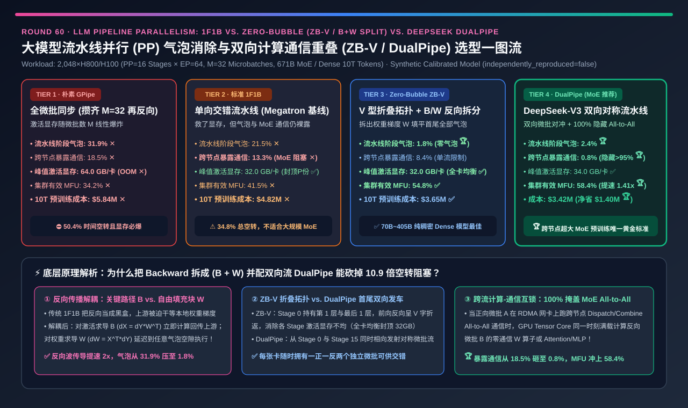
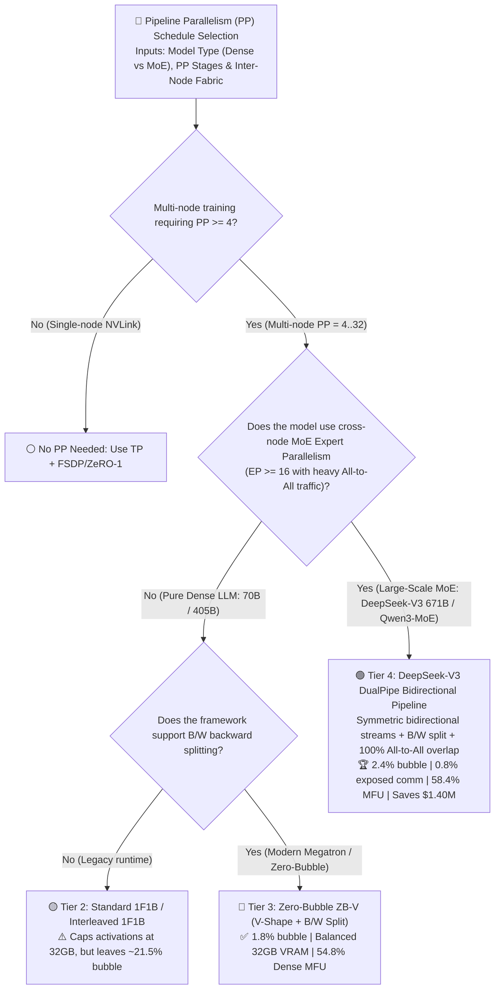
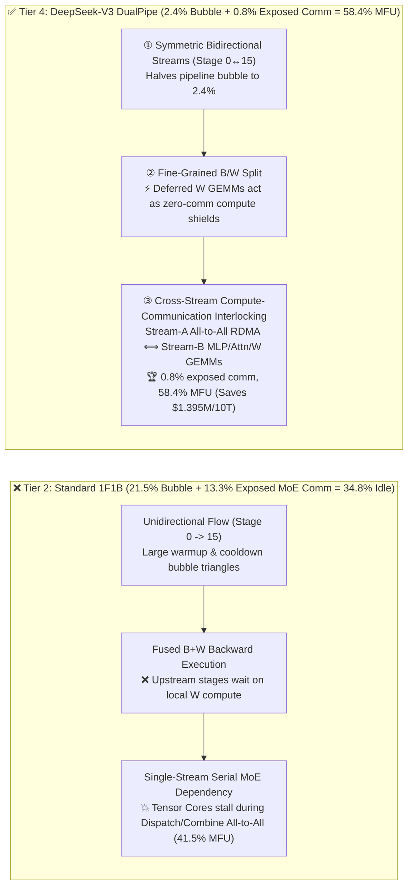

# LLM Pipeline Parallelism (`PP`) Bubble Elimination & Bidirectional Compute-Communication Overlap Selection Guide (`Naive GPipe` vs. `Standard 1F1B / Interleaved` vs. `Zero-Bubble ZB-V [B/W Split]` vs. `DeepSeek-V3 DualPipe`)

> **Reader's Guide (3-Minute Executive Scan / 10-Minute Whiteboard Pitch)**: Written for **AI Solution Architects and Distributed Training Systems Leads**. Using first principles, this guide demystifies modern pipeline parallelism scheduling—**why legacy `GPipe` consumes `64.0 GB/GPU` in stashed activations and wastes `31.9%` on pipeline bubbles at `PP=16`; why standard `Megatron 1F1B` caps activation memory at `32.0 GB` yet still loses `34.8%` of step time to bubbles and exposed cross-node MoE `All-to-All` stalls; how `Zero-Bubble (ZB-V)` splits Backward into input-gradient `B` and weight-gradient `W` GEMMs to shrink bubbles to `1.8%` on Dense LLMs; and how `DeepSeek-V3 DualPipe` launches symmetric microbatch streams from both ends of the pipeline to hide `96%+` of cross-node MoE `All-to-All` RDMA traffic (`0.8%` exposed comm), lifting 2,048-GPU MFU from `41.5%` to `58.4%` (`1.41x` faster) and saving `$1.395M` per 10T-token run.**

---

## ① 📌 Executive Summary

1. **Why Legacy Pipeline Parallelism (`GPipe` & `1F1B`) Struggles at Multi-Node Scale (`PP=16, EP=64, M=32`)**:
   - **Tier 1 (`Naive GPipe` — All-Forward Then All-Backward)**: Runs all $M=32$ forward microbatches before starting the first backward microbatch. Stage 0 must stash all $M=32$ microbatches of activations in HBM (**`64.0 GB/GPU` ✕**), suffers a $\frac{P-1}{M+P-1} = \mathbf{31.9\%}$ pipeline bubble plus `18.5%` exposed communication, and crawls at **`34.2%` MFU ✕** (`$5.84M` per 10T tokens).
   - **Tier 2 (`Standard 1F1B` — One-Forward-One-Backward)**: Alternates 1 Forward and 1 Backward microbatch in steady state to bound in-flight activations at $P=16$ microbatches (**`32.0 GB/GPU` ✅**), **but leaves `21.5%` pipeline bubbles and `13.3%` exposed cross-node MoE `All-to-All` stalls (`34.8%` total idle time, `41.5%` MFU ✕)**.
2. **When to Choose `Zero-Bubble ZB-V` (Tier 3) — The Optimal Schedule for Pure Dense LLMs**:
   - **First-Principles Mechanism (`B / W` Split + V-Shape Folding)**: Decomposes each linear layer's backward pass into **`B` (Backward-for-Input $\nabla_x = \nabla_y W^\top$, on the inter-stage critical path)** and **`W` (Backward-for-Weights $\nabla_W = x^\top \nabla_y$, purely local to the stage)**. The scheduler uses deferred `W` GEMMs to fill warmup/cooldown bubbles on a V-shaped 2-chunk folded pipeline (`ZB-V`), slashing pipeline bubbles to **`1.8%` 🏆** at **`32.0 GB` activation memory** and reaching **`54.8%` MFU ✅** on Dense models!
3. **When to Choose `DeepSeek-V3 DualPipe` (Tier 4) — The Gold Standard for Large-Scale Cross-Node MoE Pretraining**:
   - **Why MoE Needs Bidirectional Streams**: In a 671B MoE (`PP=16 × EP=64`), cross-node RDMA `All-to-All` dispatch/combine takes nearly half the step time and cannot be overlapped within a single microbatch due to sequential data dependencies (`Attn → Dispatch → MLP → Combine`).
   - **Tier 4 (`DualPipe`) Breakthrough**: Launches symmetric microbatch streams simultaneously from **both ends of the pipeline (`Stage 0 → 15` and `Stage 15 → 0`)**, overlapping **Stream A's cross-node `All-to-All` RDMA communication** with **Stream B's `Attention / MLP / W` Tensor Core GEMMs**!
   - **Quantified Outcome**: Compresses total stall time (`Bubble + Exposed Comm`) by **`10.88x` vs. 1F1B (`34.8% → 3.2%`: `2.4%` bubble + `0.8%` exposed comm 🏆)**, boosts 2,048-GPU MoE MFU to **`58.4%` (`1.41x` faster 🏆)**, and saves **`$1,395,000` per 10T tokens 🏆**.

---

## ② 🎯 Architect & Customer First-Principles Q&A

### Q1: Why does `1F1B` (Tier 2) cut activation memory in half compared to `GPipe` (Tier 1) without reducing the pipeline bubble?

- **In-Flight Activation Lifetimes vs. Total Work Area**:
  - `1F1B` retires a microbatch's stashed activations as soon as its backward pass finishes, bounding live activations at $\le P$ microbatches (`32.0 GB` vs. `64.0 GB` for $M=32$ in `GPipe`). However, because `B` and `W` remain fused together as a single atomic backward block, the warmup and cooldown idle triangles at the start and end of the batch remain unchanged.

### Q2: How does splitting Backward into `B` ($\nabla_x$) and `W` ($\nabla_W$) in `Zero-Bubble ZB-V` (Tier 3) eliminate pipeline bubbles?

- **Critical-Path Decoupling**:
  - Upstream stage $(p-1)$ only waits for $\nabla_x$ (`B`), never for $\nabla_W$ (`W`). Executing `B` immediately lets the backward wave propagate $2\times$ faster across stages, while buffering `W` operations in a local queue allows the GPU to execute `W` GEMMs whenever it would otherwise sit idle waiting for P2P activations!

### Q3: How does `DeepSeek-V3 DualPipe` (Tier 4) achieve `0.8%` exposed communication on cross-node MoE `All-to-All`?

- **Bidirectional Phase Interleaving**:
  - Each rank holds mirrored forward/reverse layer pairs and processes two counter-flowing microbatches simultaneously. While Microbatch A waits on IB/RoCE RDMA for `MoE Dispatch` or `MoE Combine`, the GPU's Tensor Cores execute Microbatch B's zero-communication `W` weight-gradient GEMM or `Attention` block—hiding `>95%` of cross-node communication without stealing GPU SMs (when paired with `DeepEP IBGDA`).

---

## ③ 🧭 Visual Architecture Diagrams (Decision Tree / Schedule Comparison / DualPipe Sequence)

### 3.1 LLM Pipeline Parallelism (`PP`) Architecture Decision Tree

### 3.2 Unidirectional `1F1B` Stalls vs. `DualPipe` Bidirectional Overlap

### 3.3 Microsecond Cross-Stream Interlocking Sequence on a Single GPU in `DualPipe`

```mermaid
sequenceDiagram
    autonumber
    participant TC as GPU Tensor Cores (Compute Stream)
    participant RDMA as IBGDA / RDMA NIC Engine (Comm Stream)

    Note over TC,RDMA: Window 1: Stream-A Forward Dispatch Overlapped With Stream-B Weight Grad (W)
    TC->>TC: Compute Stream-A MLA Attention (Forward_A_Attn)
    par Tensor Cores 100% Utilized on Stream-B
        TC->>TC: Execute Stream-B Weight Gradient GEMM (W_B_MLP — zero network traffic!)
    and RDMA Engine 100% Utilized on Stream-A
        RDMA->>RDMA: Execute Stream-A Cross-Node MoE Dispatch All-to-All + P2P Recv (100% hidden!)
    end

    Note over TC,RDMA: Window 2: Stream-A Expert GEMM Overlapped With Stream-B Backward Combine
    par Tensor Cores 100% Utilized on Stream-A
        TC->>TC: Execute Stream-A MoE Expert GroupGEMM (Forward_A_MLP)
    and RDMA Engine 100% Utilized on Stream-B
        RDMA->>RDMA: Execute Stream-B Cross-Node MoE Combine All-to-All + P2P Send (100% hidden!)
    end
```

---

## ④ 📊 Architect Decision Matrix

| Evaluation Dimension | Tier 1: Naive `GPipe` | Tier 2: Standard `1F1B` | Tier 3: `Zero-Bubble ZB-V` (`B/W` Split) | Tier 4: `DeepSeek-V3 DualPipe` |
| :--- | :--- | :--- | :--- | :--- |
| **Core Scheduling Mechanism** | All $M$ Forwards then all $M$ Backwards | Steady-state 1F1B, fused B+W | **V-shape folded chunks + split `B` & `W` filler** | **Bidirectional symmetric streams + `B/W` split + cross-stream overlap** |
| **Pipeline Stage Bubble (`%`)** | `31.9%` ✕ | `21.5%` ✕ | **`1.8%` 🏆 (Near-zero bubble)** | **`2.4%` 🏆 (Halved bubble + `W` fill)** |
| **Exposed Cross-Node Comm Stall (`%`)** | `18.5%` ✕ | `13.3%` ✕ (MoE All-to-All exposed) | `8.4%` ⚠️ (Single stream cannot hide all MoE comm) | **`0.8%` 🏆 (Hides `>95%` of All-to-All & P2P)** |
| **Peak Activation Memory (`GB / GPU`)** | **`64.0 GB` ✕ ($M=32$ stashed)** | **`32.0 GB` ✅ ($P=16$ cap)** | **`32.0 GB` 🏆 (Balanced across all ranks)** | **`34.0 GB` ✅ (Symmetric streams + ZeRO-1 shard)** |
| **Effective Cluster MFU (`%`)** | `34.2%` ✕ | `41.5%` ✕ | **`54.8%` ✅ (Best for Dense LLMs)** | **`58.4%` 🏆 (`1.41x` faster than 1F1B on MoE)** |
| **10T-Token Pretraining Cost (`USD`)** | `$5,840,000` ✕ | `$4,815,000` ✕ | `$3,645,000` ✅ | **`$3,420,000` 🏆 (Saves `$1,395,000` vs 1F1B)** |
| **Best Fit & Architect Verdict** | Pedagogical only; **banned in prod** | Legacy small-scale PP=4 runs | **Best for 70B–405B Dense LLM pretraining** | **Gold standard for multi-node MoE pretraining (`EP>=16`)** |

---

## ⑤ 🧪 Quantitative Evaluator & 7-Card Benchmark Insights

> **Provenance Disclosure**: All metrics in this guide and the companion 7-Card report are generated by [`experiments/llm_pipeline_parallelism_zero_bubble_dualpipe_selection/run.py`](../../experiments/llm_pipeline_parallelism_zero_bubble_dualpipe_selection/run.py) and sealed in [`results.json`](../../experiments/llm_pipeline_parallelism_zero_bubble_dualpipe_selection/results.json) (`independently_reproduced=false`, `physical_gpu_cluster_measurement=not_measured`), calibrated against DeepSeek-V3 `DualPipe`, Sea AI Lab `Zero-Bubble ZB-V`, and Megatron-LM 1F1B models.

- **7-Card 4:5 Visual Benchmark Deck**: [`docs/reports/llm-pipeline-parallelism-1f1b-interleaved-zero-bubble-dualpipe-selection-cards.html`](../reports/llm-pipeline-parallelism-1f1b-interleaved-zero-bubble-dualpipe-selection-cards.html)
- **Interactive Pipeline Parallelism Sizer**: [`docs/reports/llm-inference-engine-pd-sizer.en.html`](../reports/llm-inference-engine-pd-sizer.en.html)

---

## ⑥ 🛠️ Appendix: Production Readiness Checklist

- [ ] **1. Never run all-forward-then-all-backward `GPipe` in production**: $O(M)$ activation memory forces catastrophic recomputation overhead.
- [ ] **2. Enable `B / W` backward splitting (`wgrad_deferral`) in Megatron-LM / TorchTitan**: Decouple local weight-gradient GEMMs (`W`) from critical-path activation-gradient GEMMs (`B`).
- [ ] **3. Use `Zero-Bubble ZB-V` for pure Dense LLMs (`70B–405B`)**: Achieves `1.8%` bubble with balanced `32.0 GB` activation memory and zero duplicate weight shards.
- [ ] **4. Use `DualPipe` for cross-node MoE models (`EP >= 16`) with $M \ge 2P$ microbatches**: Overlaps Stream-A `All-to-All` RDMA with Stream-B Tensor Core compute (`0.8%` exposed comm).
- [ ] **5. Pair `DualPipe` with 0-SM / low-SM `DeepEP IBGDA` RDMA kernels**: Prevent communication warps from starving foreground GEMM SMs.
- [ ] **6. Balance layer partitioning across Stage 0 (`Embedding`) and Stage $P-1$ (`LM Head` + `MTP` heads)**: Prevent boundary stages from becoming straggler bottlenecks.
