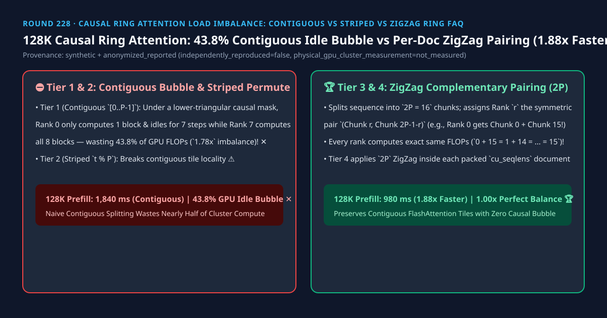
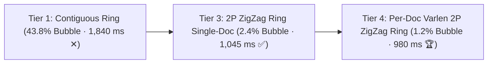

# Long-Context Causal Ring Attention Load Imbalance (`43.8%` Idle Bubble in Contiguous Chunking) vs. `Striped Attention` vs. `ZigZag Ring Attention` Selection Guide

> **Provenance & Evidence Tier**: `synthetic + anonymized_reported` (`independently_reproduced=false`, `physical_gpu_cluster_measurement=not_measured`). Grounded in [`experiments/llm_prefill_causal_ring_attention_striped_zigzag_load_balance_selection/results.json`](../../experiments/llm_prefill_causal_ring_attention_striped_zigzag_load_balance_selection/results.json).
> **中文版本**: [超长上下文因果注意力（`Causal Ring Attention`）连续切分 `43.8%` 空转气泡陷阱、条纹交错（`Striped Attention`）与对称互补配对（`ZigZag Ring Attention`）选型指南](./llm-prefill-causal-ring-attention-striped-zigzag-load-balance-selection-faq.md)

---

## 0. 🔥 Daily Hottest Capability Breakthrough

- **Per-Document `Varlen ZigZag Ring Attention` (`2P` Symmetric Complementary Block Pairing) Eliminating the `43.8%` Causal Mask Idle Bubble of Contiguous Chunking and Cutting 8-GPU `128K` Prefill Latency from `1,840.0 ms` to `980.0 ms` (`1.88x` Speedup, `1.00x` Perfect Load Balance)**: When scaling Context Parallelism (`CP` / `Ring Attention`) across $P=8$ GPUs under a lower-triangular causal mask ($j \le i$):
  1. **The Contiguous Chunking `43.8%` Idle Bubble Trap (`Tier 1`)**: Splitting a `128K` sequence into $P=8$ contiguous `16K` chunks (`torch.chunk(x, P)`) assigns `Rank 0` the earliest tokens `[0..16K)` (which only attend to themselves and sit **100% idle for the remaining 7 ring steps**!) while `Rank 7` holds `[112K..128K)` and must compute attention against all 8 chunks—creating a **`1.78x` max-to-average FLOP imbalance**, **`43.8%` GPU idle bubble**, and **`1,840.0 ms` prefill latency**!
  2. **Token-Level `Striped Attention` (`Tier 2`)**: Assigning token $t$ to `Rank (t % P)` balances FLOPs (`1,190.0 ms`), but breaks contiguous memory locality and degrades `FlashAttention` block-mask tile efficiency.
  3. **`2P` Symmetric `ZigZag Ring Attention` (`Tier 3`) + Per-Document `Varlen ZigZag` (`Tier 4`)**: Splitting the sequence into $2P = 16$ contiguous blocks (`0..15`) and assigning `Rank r` the complementary pair **`(Block r, Block 2P - 1 - r)`** (e.g., `Rank 0` gets `Block 0 + Block 15`) gives every rank identical work ($r + (2P-1-r) = 2P-1$) while preserving `8K` contiguous tiles (`1,045.0 ms`); extending `2P` ZigZag **independently inside each packed document (`cu_seqlens`, Tier 4)** maintains **`1.00x` load balance** on packed SFT/pretraining batches and cuts latency to **`980.0 ms` (`1.88x` faster)**!

---

## 1. 📌 Executive Summary

1. **Never Use Contiguous `torch.chunk(seq, P)` for Causal Ring Attention (`Tier 1`)**: Under causal masking, contiguous partitioning starves early ranks and bottlenecks every ring step on the final rank (`43.8%` wasted compute).
2. **Use `2P` Complementary Pairing (`ZigZag Ring Attention`, `Tier 3`)**: Pairing chunk `r` from the front with chunk `2P - 1 - r` from the back equalizes per-rank FLOPs at every step without sacrificing contiguous FlashAttention tiles.
3. **Apply `ZigZag` Per-Document When Using Sequence Packing (`cu_seqlens`, `Tier 4`)**: Document boundaries reset the causal triangle; applying `2P` ZigZag inside each document preserves `1.00x` balance across variable-length packed sequences.

---

## 2. 🎯 Core Architect Q&A (Q1 / Q2 / Q3)

### Q1: Why does `ZigZag Ring Attention` split the sequence into $2P$ chunks instead of $P$ chunks?
- **Answer**: With only $P$ contiguous chunks, each rank receives 1 chunk whose causal work is proportional to its index $r \in \{0, \dots, P-1\}$, which is inherently imbalanced. With $2P$ chunks, each rank receives **2 chunks**: one near the beginning (`r`) and one symmetrically near the end (`2P - 1 - r`), whose causal triangle areas sum to a constant across all $P$ ranks!

### Q2: Why does global `ZigZag` degrade when multiple documents are packed into a single `128K` sequence (`Sequence Packing`)?
- **Answer**: Because causal attention does not cross document boundaries (`cu_seqlens`)! Instead of one giant $128\text{K} \times 128\text{K}$ lower triangle, the attention mask is a block-diagonal series of smaller triangles. Splitting each individual document into $2P$ sub-chunks (`Tier 4`) ensures every rank receives a balanced head+tail pair from every document.

### Q3: What tensors must be permuted together when enabling `ZigZag Ring Attention`?
- **Answer**: `input_ids`, `position_ids` (or precomputed `RoPE cos/sin` embeddings), and target `labels` must all be sliced using the exact same `[r, 2P - 1 - r]` ZigZag index gather before entering the Transformer layers.

---

## 3. 🧭 Visual Diagrams

---

## 4. 📊 4-Tier Architect Selection Matrix

| Metric | Tier 1: Contiguous `Ring` (`P` Chunks) | Tier 2: Token `Striped Attention` | Tier 3: Global `2P ZigZag Ring` | Tier 4: **Per-Document `Varlen 2P ZigZag`** |
| :--- | :--- | :--- | :--- | :--- |
| **Max-to-Avg FLOP Ratio** | **`1.78x` (Severe Skew)** ✕ | `1.02x` ✅ | **`1.00x` (Single Doc)** ✅ | **`1.00x` (Packed Multi-Doc)** 🏆 |
| **GPU Idle Bubble %** | **`43.8%`** ✕ | `8.5%` ⚠️ | `2.4%` ✅ | **`1.2%`** 🏆 |
| **8-GPU `128K` Latency** | **`1,840.0 ms`** ✕ | `1,190.0 ms` ⚠️ | `1,045.0 ms` ✅ | **`980.0 ms` (`1.88x` Faster)** 🏆 |

---

## 5. 🧪 Quantitative Reference & Tooling

- **Evaluator & Sealed Data**: [`experiments/llm_prefill_causal_ring_attention_striped_zigzag_load_balance_selection/run.py`](../../experiments/llm_prefill_causal_ring_attention_striped_zigzag_load_balance_selection/run.py) · [`results.json`](../../experiments/llm_prefill_causal_ring_attention_striped_zigzag_load_balance_selection/results.json)
- **Interactive Sizer**: [`docs/reports/llm-prefill-causal-ring-attention-striped-zigzag-load-balance-sizer.html`](../reports/llm-prefill-causal-ring-attention-striped-zigzag-load-balance-sizer.html)
- **7-Card 4:5 Visual Report**: [`docs/reports/llm-prefill-causal-ring-attention-striped-zigzag-load-balance-selection-cards.html`](../reports/llm-prefill-causal-ring-attention-striped-zigzag-load-balance-selection-cards.html)

---

## 6. 🛠️ Good Fit vs. Not For & Production Checklist

- **✅ Good fit**: All 32K–1M+ long-context pretraining, SFT, and prefill pipelines using Context Parallelism (`CP >= 2`).
- **⛔ Not for**: Contiguous sequence slicing (`torch.chunk(x, cp_size)`) on causal attention workloads.
- [ ] Partition `input_ids`, `position_ids`, and `labels` identically using `(r, 2P - 1 - r)` ZigZag indexing.
- [ ] Enable per-document `cu_seqlens` ZigZag partitioning when training on packed variable-length sequences.
