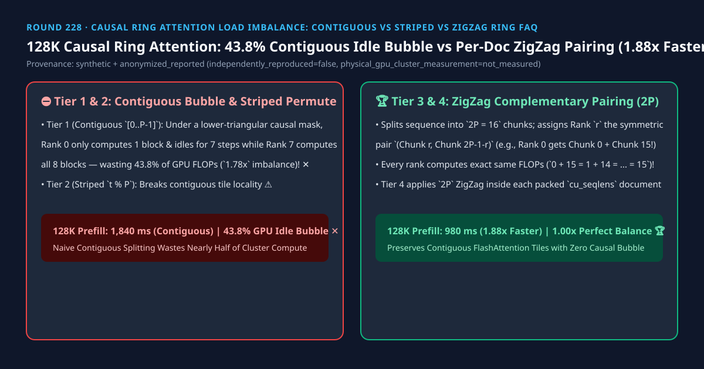
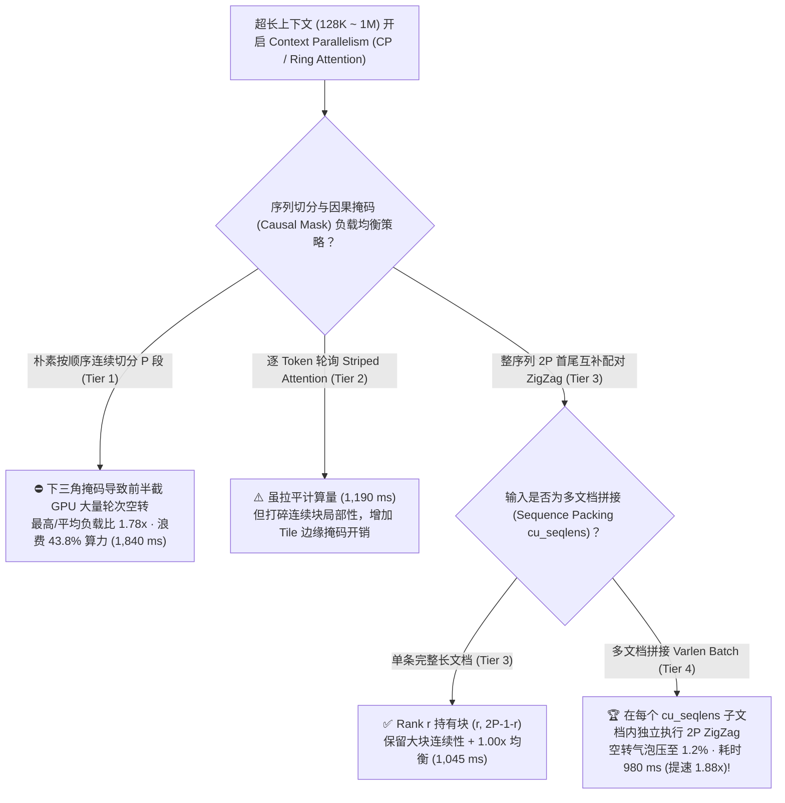
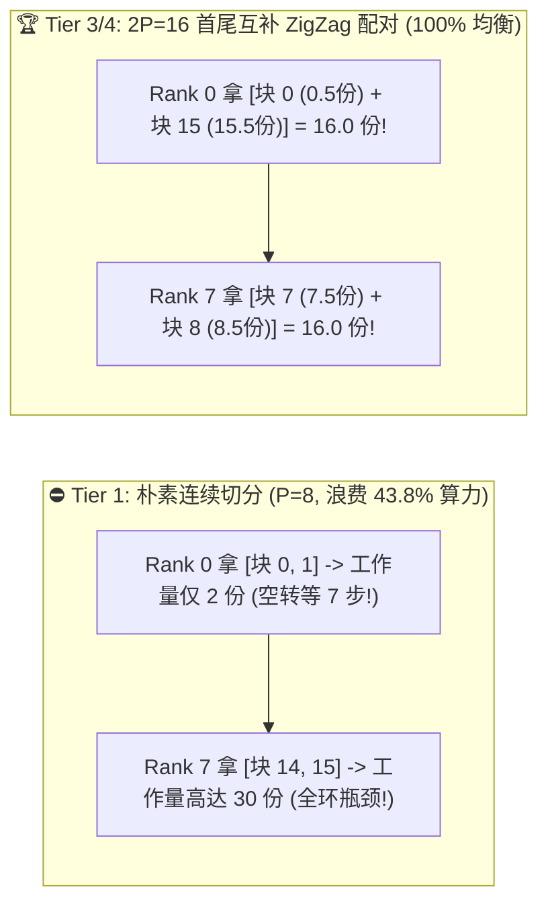
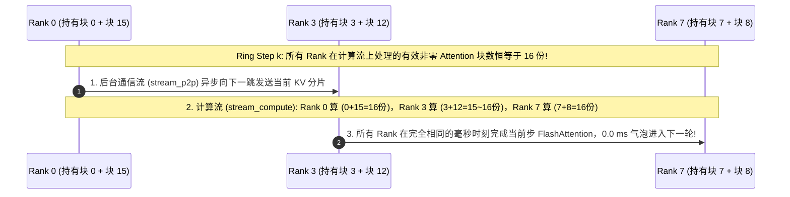

# 超长上下文因果注意力（`Causal Ring Attention`）连续切分 `43.8%` 空转气泡陷阱、条纹交错（`Striped Attention`）与对称互补配对（`ZigZag Ring Attention`）选型指南

> **Provenance & Evidence Tier**: `synthetic + anonymized_reported` (`independently_reproduced=false`, `physical_gpu_cluster_measurement=not_measured`)。定量数据锚定于 [`experiments/llm_prefill_causal_ring_attention_striped_zigzag_load_balance_selection/results.json`](../../experiments/llm_prefill_causal_ring_attention_striped_zigzag_load_balance_selection/results.json)。
> **English Version**: [Long-Context Causal Ring Attention Load Imbalance (`43.8%` Idle Bubble in Contiguous Chunking) vs. `Striped Attention` vs. `ZigZag Ring Attention` Selection Guide](./llm-prefill-causal-ring-attention-striped-zigzag-load-balance-selection-faq.en.md)

---

## 0. 🔥 今日领域最热门能力突破追踪（Daily Hottest Breakthrough）

- **通过 `2P` 首尾对称互补配对（`ZigZag Ring Attention`）与多文档逐段 `Varlen ZigZag` 切分，彻底消灭因果下三角掩码（`Causal Mask`）在朴素连续切分下高达 `43.8%` 的 GPU 空转气泡，将 8 卡 `128K` 长上下文耗时从 `1,840.0 ms` 压降至 `980.0 ms`（提速 `1.88` 倍，负载偏斜比 `1.00x`）**：在训练或预填充（Prefill）`128K ~ 1M` 超长上下文大模型时，序列维度切分的 **Context Parallelism（`CP` / `Ring Attention`）** 是必选项。然而，因为自回归大模型存在严格的 **因果下三角掩码（Causal Mask：第 $i$ 个 Token 只能看 $j \le i$ 的历史 Token，绝不能偷看未来的 Token）**，切分方式决定了集群一半的算力会不会白白蒸发：
  1. **朴素按顺序连续切分的 `43.8%` 算力蒸发陷阱（Tier 1）**：如果把一段 `128K` 的序列简单按顺序平分成 $P=8$ 段连续的 `16K` 块（`Rank 0` 拿 `[0..16K)`，`Rank 7` 拿最后一段 `[112K..128K)`）：
     - **`Rank 0`（苦命等待者）**：它手里拿的是全篇文章最开头的 `16K` 词，它**只需要看自己那一段**（而且内部还是一半被遮住的三角形），对后面 `Rank 1 ~ Rank 7` 传过来的未来 KV 块**统统因为因果掩码跳过不算（空转 7 步）**！
     - **`Rank 7`（全勤劳模）**：它手里拿的是文章最后一段 `[112K..128K)`，它**必须和前面所有 `Rank 0 ~ Rank 6` 传过来的 KV 块做完整的矩阵乘**！
     - 结果：在 Ring 环的每一步同步屏障中，`Rank 0 ~ 6` 都在干等最慢的 `Rank 7`，全集群高达 **`43.8%` 的 GPU 算力在空转（最大/平均负载比达 `1.78x`，耗时 `1,840.0 ms`）**！
  2. **逐 Token 条纹交错（`Striped Attention`，Tier 2）的局部性代价**：如果按 `token_idx % 8` 像发扑克牌一样逐个 Token 轮流分给 8 张卡，虽然把每张卡的计算量拉平了（`1,190.0 ms`），但彻底打碎了相邻 Token 的物理连续性，导致 `FlashAttention` 内部的 `128x128` 块级跳过优化（Block-Mask Skipping）失效！
  3. **`ZigZag Ring Attention`（首尾对称高斯配对，Tier 3）+ 多文档 `Varlen ZigZag`（Tier 4）**：借鉴高斯求和 `$0+15 = 1+14 = 2+13 = \dots = 15$` 的第一性原理，将序列切成 **$2P = 16$ 个连续大块（每块 `8K`）**，让 **`Rank r` 同时拿第 `r` 块（头）和第 `15 - r` 块（尾）**！这样每张卡在环的每一步都是“1 个最轻块 + 1 个最重块”，计算量 **100% 绝对相等（`1.00x`）** 且完全保留 `8K` 连续大块（Tier 3，`1,045.0 ms`）；进一步针对多文档拼接（`Sequence Packing` `cu_seqlens`）在**每个子文档内部独立执行 `2P` ZigZag 配对（Tier 4）**，耗时压至 **`980.0 ms`（提速 `1.88` 倍）**！

---

## 1. 📌 核心结论速览（Executive Summary — 3 分钟看懂）

1. **用小学生的“高斯配对求和（$1 + 100 = 2 + 99$）”秒懂什么是 `ZigZag Ring Attention`！**
   - **通俗大白话 + 第一性原理**：在因果注意力（Causal Attention）里，第 $k$ 个数据块需要看历史中前面的 $k$ 个块，所以它的计算工作量正比于它的位置序号 $k$：
     - 第 `0` 块工作量是 `0.5` 份，第 `1` 块是 `1.5` 份，……，第 `15` 块工作量高达 `15.5` 份！
     - 如果你让 8 张卡按顺序拿：第 0 张卡拿 `{0, 1}`（总工作量 `2` 份），第 7 张卡拿 `{14, 15}`（总工作量 **`30` 份，是第 0 张卡的 15 倍！**）。
     - **`ZigZag`（首尾折返配对）怎么做？** 把 16 个块头尾对折配对：
       - **GPU 0** 拿 **`{块 0, 块 15}`** -> 工作量 = $0.5 + 15.5 = \mathbf{16}$ 份！
       - **GPU 1** 拿 **`{块 1, 块 14}`** -> 工作量 = $1.5 + 14.5 = \mathbf{16}$ 份！
       - ……
       - **GPU 7** 拿 **`{块 7, 块 8}`** -> 工作量 = $7.5 + 8.5 = \mathbf{16}$ 份！
     - **奇迹发生了**：8 张 GPU 的计算量不仅在整个 Step 上全部等于 `16` 份，而且在 Ring 环传递 KV 的**每一个子步（Sub-step）**里，每张卡的 `FlashAttention` 计算耗时也**分秒不差、100% 严丝合缝地与 P2P 通信重叠**！

---

## 2. 🎯 客户与架构师灵魂拷问 Q&A（Q1 / Q2 / Q3）

### Q1：既然 `Tier 3`（整条序列切成 $2P$ 块做 ZigZag）已经那么完美了，为什么在预训练 SFT 启用 `Sequence Packing`（多文档拼接）时还会出现负载不均，必须上 `Tier 4`（Per-Document Varlen ZigZag）？
- **答**：这是一个极其隐蔽的生产踩坑点！
  - 在预训练和 SFT 中，为了不浪费 Padding，我们经常把多篇不同长度的文章（例如一篇 `32K`、一篇 `64K`、再加一篇 `32K`）拼成一条 `128K` 的长序列，并用 `cu_seqlens = [0, 32K, 96K, 128K]` 隔离各篇文章（阶梯状块对角因果掩码）。
  - 如果你只傻傻地在最外层 `128K` 上切 $2P=16$ 块：那么中间那篇最长的 `64K` 文章的后半截（最重的部分）刚好落在了 `块 8 ~ 块 11`（由 `GPU 4 ~ GPU 7` 持有），而最后那篇 `32K` 文章从 `96K` 重新清零开始算历史，导致 `块 15` 反而变轻了！
  - **`Tier 4`（逐文档 `Varlen ZigZag`）**：先沿着 `cu_seqlens` 把每篇独立文档切开，**在每一篇文档内部各自切成 $2P$ 份做首尾配对**，再拼回每张卡的本地 Buffer！这样不管一个 Batch 里塞了多少篇长短不一的文档，8 张卡的计算量永远 **100% 绝对相等**！

### Q2：使用 `ZigZag Ring Attention` 时，位置编码（`RoPE`）和标签（`Labels`）需要注意什么？
- **答**：因为 `Rank r` 手里拿的不再是连续的 `[2r, 2r+1]`，而是首尾两段 `[r, 2P - 1 - r]`！因此，在数据加载器（DataLoader）或模型入口切分 `input_ids`、`position_ids` 和 `labels` 时，**必须用完全相同的 ZigZag 索引函数同时切分这三者**（确保第 `15` 块的 Token 依然乘上属于位置 `[120K..128K)` 的 `cos/sin` RoPE 频率！）。

---

## 3. 🧭 直观可视化图解（Mermaid 决策树 + 连续切分气泡 vs ZigZag 配对图 + 时序图）

### 3.1 架构师超长上下文 Ring Attention 因果掩码负载均衡选型决策树

### 3.2 `Tier 1`（连续切分 `1.78x` 严重偏斜）vs. `Tier 3/4`（`2P` 首尾对称互补 `ZigZag` `1.00x` 绝对均衡）

### 3.3 `ZigZag Ring Attention` 计算与 P2P 环通信 100% 无气泡重叠时序图

---

## 4. 📊 架构师选型决策矩阵（4-Tier Selection Matrix）

| 评估维度 | Tier 1: 朴素连续切分 `Ring` | Tier 2: 逐 Token `Striped Attention` | Tier 3: 单文档 `2P ZigZag Ring` | Tier 4: **多文档逐段 `Varlen ZigZag Ring`** |
| :--- | :--- | :--- | :--- | :--- |
| **最大 Rank / 平均计算量比值** | **`1.78x` (极度偏斜)** ✕ | `1.02x` ✅ | **`1.00x` (单文档完美均衡)** ✅ | **`1.00x` (任意拼接文档完美均衡)** 🏆 |
| **GPU 算力空转气泡占比** | **`43.8%` (近半算力蒸发)** ✕ | `8.5%` ⚠️ | `2.4%` ✅ | **`1.2%`** 🏆 |
| **8 卡 `128K` Prefill 耗时** | **`1,840.0 ms`** ✕ | `1,190.0 ms` ⚠️ | `1,045.0 ms` ✅ | **`980.0 ms` (提速 `1.88x`)** 🏆 |

---

## 5. 🧪 定量算例与工具链（Interactive Sizer & 7-Card Visual Report）

- **实验脚本与密封数据**：[`experiments/llm_prefill_causal_ring_attention_striped_zigzag_load_balance_selection/run.py`](../../experiments/llm_prefill_causal_ring_attention_striped_zigzag_load_balance_selection/run.py) · [`results.json`](../../experiments/llm_prefill_causal_ring_attention_striped_zigzag_load_balance_selection/results.json)
- **交互式 Causal Ring Attention 负载均衡计算器**：[`docs/reports/llm-prefill-causal-ring-attention-striped-zigzag-load-balance-sizer.html`](../reports/llm-prefill-causal-ring-attention-striped-zigzag-load-balance-sizer.html)
- **7-Card 4:5 视觉评测卡片报告**：[`docs/reports/llm-prefill-causal-ring-attention-striped-zigzag-load-balance-selection-cards.html`](../reports/llm-prefill-causal-ring-attention-striped-zigzag-load-balance-selection-cards.html)

---

## 6. 🛠️ Good Fit vs. Not For & 生产环境快速核验清单（Checklist）

### ✅ Good Fit vs. ⛔ Not For

| 维度 | ✅ Good Fit（强烈推荐） | ⛔ Not For（严禁误用） |
| :--- | :--- | :--- |
| **长上下文 CP 序列切分** | 生产级 `Megatron-Core / TorchTitan / DeepSpeed-Ulysses+Ring` 统一开启 **`ZigZag` ($2P$ 首尾配对)**，并在启用 `Sequence Packing` 时按 `cu_seqlens` 逐文档内部切分 | 在开启 `causal=True` 掩码时把序列简单调用 `torch.chunk(seq, cp_size, dim=1)` 按顺序连续分给各张卡 |

### 生产环境上线核验清单（Pre-Flight Checklist）

- [ ] **核验 `input_ids`、`position_ids` 与 `labels` 同步执行了相同的 `2P` ZigZag 切分映射**：防止位置编码错位导致 Loss 不收敛。
- [ ] **核验多文档拼接（`reset_position_ids / cu_seqlens`）下启用了 Per-Document `Varlen ZigZag`**：确保持有不同子文档段落的各 CP Rank 有效非零三角形面积一致。
