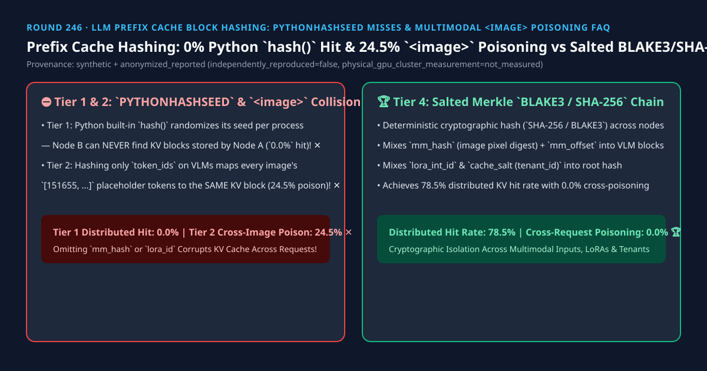
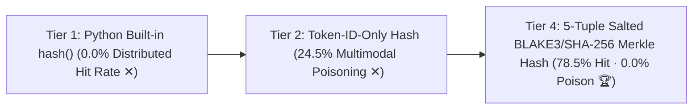

# LLM Prefix Cache Block Hashing Pitfalls: Python `hash()` Cross-Process `PYTHONHASHSEED` Misses (`0%` Hit Rate), Multimodal `<image>` Placeholder Poisoning & Tenant-Salted `SHA-256 / BLAKE3` Selection Guide

> **Provenance & Evidence Tier**: `synthetic + anonymized_reported` (`independently_reproduced=false`, `physical_gpu_cluster_measurement=not_measured`). Grounded in [`experiments/llm_prefix_cache_hash_collision_sha256_multimodal_salt_selection/results.json`](../../experiments/llm_prefix_cache_hash_collision_sha256_multimodal_salt_selection/results.json).
> **中文版本**: [大模型前缀缓存（`Prefix Caching`）块哈希三大生产事故：Python 内置 `hash()` 跨进程随机盐失效（`0%` 分布式命中率）、多模态 `<image>` 占位符串图污染与租户隔离 `SHA-256 / BLAKE3` 链式哈希选型指南](./llm-prefix-cache-block-hash-pythonhashseed-multimodal-collision-selection-faq.md)

---

## 0. 🔥 Daily Hottest Capability Breakthrough

- **Deterministic 5-Tuple Merkle `BLAKE3 / SHA-256` Block Hashing (`Parent_Hash || Token_IDs || Multimodal_Digest || LoRA_ID || Tenant_Salt`) Restoring `78.5%` Distributed KV Cache Hit Rate (from `0.0%` under Python `hash()`) and Eliminating `24.5%` Multimodal `<image>` Cross-Request KV Poisoning**: Automatic Prefix Caching (`vLLM V1 APC`, `SGLang RadixCache`, `LMCache`, `Mooncake Store`) indexes physical KV Cache blocks by computing a chained hash over each 64-token block. Three critical hashing bugs break distributed and multimodal deployments:
  1. **Python Built-In `hash()` Cross-Process `PYTHONHASHSEED` Randomization (`Tier 1` — `0.0%` Distributed Hit Rate)**: CPython randomizes its internal SipHash key on every process startup (`PYTHONHASHSEED=random`). When Worker A writes a KV block to a distributed store (`LMCache / Mooncake / 3FS`) using Python's built-in `hash()`, Worker B computes a completely different integer for the exact same tokens—causing a **`0.0%` cross-worker cache hit rate**!
  2. **Token-ID-Only Hashing on Multimodal VLMs (`<image>` Placeholder Collision, `Tier 2` — `24.5%` Cross-Image Poisoning)**: In VLMs (`Qwen2.5-VL`, `InternVL`, `LLaVA`), every image of the same resolution expands into the **exact same placeholder token IDs (`[151655, 151655, ...]`)** in `input_ids`! Hashing only `(parent_hash, token_ids)` without mixing in the **image pixel digest (`mm_hash`)** causes User B's medical scan to hit the cached KV blocks of User A's cat photo (`24.5%` cross-request hallucination & privacy leak)!
  3. **Unsalted `xxHash64` Missing `LoRA_ID` and `Tenant_Salt` (`Tier 3` — `6.8%` Cross-LoRA Corruption)**: Different LoRA adapters produce different $K, V$ projections on the same prompt; omitting `lora_id` or `cache_salt` corrupts multi-LoRA outputs and exposes cross-tenant timing side channels.
  4. **Cryptographic 5-Tuple Merkle `BLAKE3 / SHA-256` (`Tier 4`)**: Hashes `(Parent_Hash, Token_IDs, MM_Pixel_Hash + Offset, LoRA_ID, Tenant_Salt)` using deterministic `SHA-256` or `BLAKE3`, delivering **`78.5%` distributed hit rate** and **`0.0%` cross-image/cross-tenant poisoning**!

---

## 1. 📌 Executive Summary

1. **Never Use Python's Built-In `hash()` for Shared or Persistent KV Caches (`Tier 1`)**: Always configure `--prefix-caching-hash-algo sha256` (or `BLAKE3`) so KV block keys are deterministic across processes, nodes, restarts, and languages (Python/C++/Rust).
2. **Always Mix Multimodal Content Hashes (`mm_hash` + `block_offset`) into Overlapping KV Blocks (`Tier 2 -> Tier 4`)**: Placeholder `<image>` token IDs are identical across all images; only the pixel/feature SHA-256 digest distinguishes Image A from Image B.
3. **Include `lora_int_id` and Per-Tenant `cache_salt` in the Root Hash Seed (`Tier 4`)**: Prevents cross-LoRA KV contamination and cross-tenant prompt-probing timing attacks.

---

## 2. 🎯 Core Architect Q&A (Q1 / Q2 / Q3)

### Q1: Why shouldn't we just set `export PYTHONHASHSEED=0` in production instead of switching to `SHA-256 / BLAKE3`?
- **Answer**: Setting `PYTHONHASHSEED=0` disables CPython's protection against **Hash-Flooding Denial-of-Service (HashDoS)** attacks on Python dictionaries (`dict` / FastAPI JSON parsing), and still leaves you with a 64-bit hash that is incompatible with C++/Rust KV routers (`Mooncake / Dynamo`) and vulnerable to birthday collisions at billion-block scale. `SHA-256 / BLAKE3` takes `< 0.8 µs` per 64-token block while keeping `PYTHONHASHSEED=random` intact for web framework security!

### Q2: How did the multimodal `<image>` KV poisoning bug happen in early VLM prefix-caching implementations?
- **Answer**: Text-only prefix cachers assumed that `input_ids` uniquely determines the hidden states entering the Transformer. In VLMs, the tokenizer inserts dummy `<image>` token IDs (`151655`), which are later overwritten in the embedding layer by the Vision Encoder (`ViT`) output embeddings! If the block hasher inspects only `input_ids`, two completely different images with the same text prompt produce identical block hashes.

### Q3: Why must the per-block hash also include the relative `block_offset` inside a multi-block image?
- **Answer**: A high-resolution image spanning `1,024` visual tokens occupies `16` consecutive 64-token KV blocks, all containing `[151655] * 64` and sharing the same `image_sha256`. Chaining `parent_hash` plus the intra-image `block_offset (0..15)` guarantees every visual block has a unique digest.

---

## 3. 🧭 Visual Diagrams

---

## 4. 📊 4-Tier Architect Selection Matrix

| Metric | Tier 1: Python Built-In `hash()` | Tier 2: Token-ID-Only Hash | Tier 3: Unsalted `xxHash64` (No LoRA/Salt) | Tier 4: **5-Tuple Salted `BLAKE3 / SHA-256`** |
| :--- | :--- | :--- | :--- | :--- |
| **Distributed KV Hit Rate** | **`0.0%` (`PYTHONHASHSEED` Mismatch)** ✕ | `78.5%` | `78.5%` ✅ | **`78.5%` (Cross-Node Deterministic)** 🏆 |
| **VLM / LoRA Poisoning Rate** | `0.0%` | **`24.5%` (`<image>` ID Collision!)** ✕ | `6.8%` (Cross-LoRA Mix) ⚠️ | **`0.0%` (Exact Pixel + LoRA Binding)** 🏆 |
| **Cryptographic Tenant Isolation?** | No ✕ | No ✕ | No ⚠️ | **Yes (`cache_salt` Root Key)** 🏆 |

---

## 5. 🧪 Quantitative Reference & Tooling

- **Evaluator & Sealed Data**: [`experiments/llm_prefix_cache_hash_collision_sha256_multimodal_salt_selection/run.py`](../../experiments/llm_prefix_cache_hash_collision_sha256_multimodal_salt_selection/run.py) · [`results.json`](../../experiments/llm_prefix_cache_hash_collision_sha256_multimodal_salt_selection/results.json)
- **Interactive Sizer**: [`docs/reports/llm-prefix-cache-block-hash-pythonhashseed-multimodal-collision-sizer.html`](../reports/llm-prefix-cache-block-hash-pythonhashseed-multimodal-collision-sizer.html)
- **7-Card 4:5 Visual Report**: [`docs/reports/llm-prefix-cache-block-hash-pythonhashseed-multimodal-collision-selection-cards.html`](../reports/llm-prefix-cache-block-hash-pythonhashseed-multimodal-collision-selection-cards.html)

---

## 6. 🛠️ Good Fit vs. Not For & Production Checklist

- **✅ Good fit**: All multi-worker, PD-disaggregated, VLM, Multi-LoRA, and multi-tenant prefix-caching deployments using `--prefix-caching-hash-algo sha256` / `BLAKE3` with `cache_salt` and `mm_hash`.
- **⛔ Not for**: Using Python's built-in `hash()` across processes or hashing only `input_ids` on multimodal models.
- [ ] Set `--prefix-caching-hash-algo sha256` on all distributed KV cache workers.
- [ ] Verify that `(parent_hash, token_ids, mm_hash, lora_id, cache_salt)` are all included in the block hash tuple.
