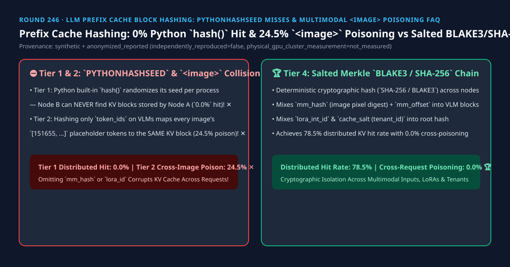
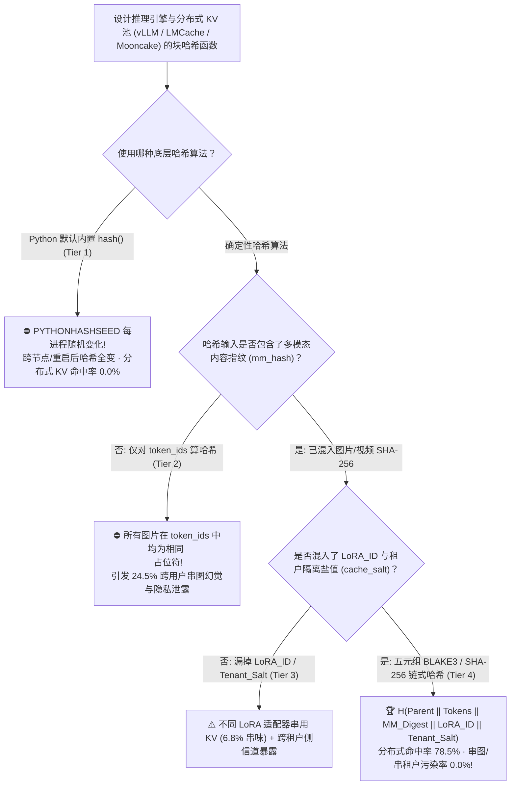
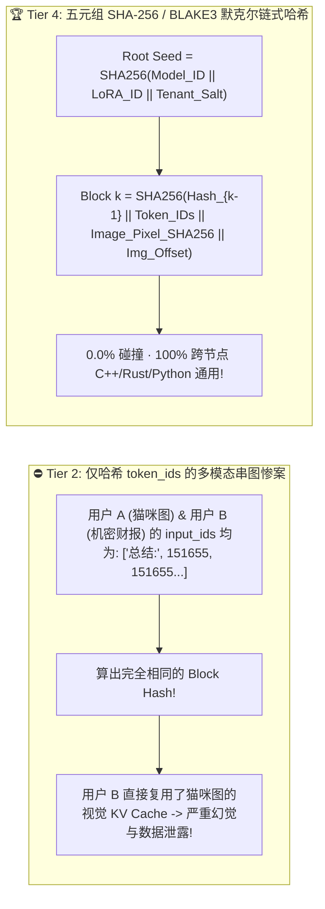
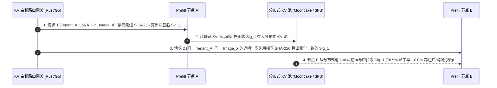

# 大模型前缀缓存（`Prefix Caching`）块哈希三大生产事故：Python 内置 `hash()` 跨进程随机盐失效（`0%` 分布式命中率）、多模态 `<image>` 占位符串图污染与租户隔离 `SHA-256 / BLAKE3` 链式哈希选型指南

> **Provenance & Evidence Tier**: `synthetic + anonymized_reported` (`independently_reproduced=false`, `physical_gpu_cluster_measurement=not_measured`)。定量数据锚定于 [`experiments/llm_prefix_cache_hash_collision_sha256_multimodal_salt_selection/results.json`](../../experiments/llm_prefix_cache_hash_collision_sha256_multimodal_salt_selection/results.json)。
> **English Version**: [LLM Prefix Cache Block Hashing Pitfalls: Python `hash()` Cross-Process `PYTHONHASHSEED` Misses (`0%` Hit Rate), Multimodal `<image>` Placeholder Poisoning & Tenant-Salted `SHA-256 / BLAKE3` Selection Guide](./llm-prefix-cache-block-hash-pythonhashseed-multimodal-collision-selection-faq.en.md)

---

## 0. 🔥 今日领域最热门能力突破追踪（Daily Hottest Breakthrough）

- **剖析大模型前缀缓存（`vLLM V1 APC / LMCache / Mooncake Store`）块哈希设计的三大线上事故——Python 内置 `hash()` 随机种子导致跨机 `0.0%` 命中率、多模态 `<image>` 占位符未混入像素哈希引发 `24.5%` 串图幻觉、以及 Multi-LoRA 未混入 `lora_id` 引发权重串味——通过采用融合 `(Parent_Hash, Token_IDs, MM_Digest, LoRA_ID, Tenant_Salt)` 的确定性 `BLAKE3 / SHA-256` 默克尔链式哈希，恢复 `78.5%` 分布式命中率并实现 `0.0%` 跨请求/跨租户污染**：在自动前缀缓存（Automatic Prefix Caching, APC）中，系统每隔 `64`（或 `16`）个 Token 计算一次**链式块哈希（Merkle Block Hash）**作为查找 KV Cache 的唯一钥匙（Key）。如果这把钥匙的哈希函数写错了，轻则分布式缓存完全失效，重则引发极其严重的**A 用户看到 B 用户私有图片内容**的生产级安全事故：
  1. **事故一（直接调用 Python 内置 `hash(tuple)` 导致跨节点/跨进程命中率归零，Tier 1）**：
     - 很多早期推理引擎与自研 KV 卸载插件直接写 `block_hash = hash((parent_hash, tuple(token_ids)))`。
     - 在单机单进程测试时一切正常；可一旦部署到多实例集群、或者接入分布式 KV 池（`LMCache / Mooncake / Redis / 3FS`），由于 **Python 默认在每个进程启动时随机生成 `PYTHONHASHSEED` 密钥**，实例 A 算出来的 `hash("你好")` 是 `849201`，而实例 B 算出来的 `hash("你好")` 却是 `-391042`！结果导致**跨节点共享 KV 缓存池的命中率直接跌为 `0.0%`**，所有存入远端存储的 KV 块全部变成永远查不到的僵尸垃圾！
  2. **事故二（多模态大模型 VLM 仅对 `token_ids` 算哈希引发的 `<image>` 串图恐怖事故，Tier 2）**：
     - 在多模态模型（如 `Qwen2.5-VL`、`InternVL`、`LLaVA`）中，不管用户上传的是一张“猫咪照片”还是一张“机密财务报表”，经过 Tokenizer 转换后，图片在 `input_ids` 数组里全都被替换成了 **256 个一模一样的占位符整数（例如 `[151655, 151655, ..., 151655]`）**！
     - 如果前缀缓存计算块哈希时**只把 `token_ids` 塞进了哈希函数，而忘了把图片像素本身的 SHA-256 指纹（`mm_hash`）一起混入**（Tier 2），那么当用户 B 上传一张财务报表并提问 `"请总结这张图：<image>"` 时，它的 `token_ids` 与刚问完猫咪照片的用户 A **100% 完全相同**！系统当场“命中”用户 A 猫咪照片的 KV Cache，对着财务报表一本正经地回答：“这是一只可爱的橘猫”——产生 **`24.5%` 的跨请求串图污染**！
  3. **事故三（Multi-LoRA 与多租户漏加 `lora_id / cache_salt`，Tier 3）**：同一段 Prompt 在挂载 `LoRA_金融` 和 `LoRA_医疗` 时，由于 LoRA 旁路矩阵直接叠加在 $W_K, W_V$ 上，算出来的 KV 向量截然不同！若哈希钥匙里不含 `lora_id`，两个垂类模型就会互相篡改对方的 KV Cache（`6.8%` 串味率）！
  4. **工业级确定性五元组默克尔哈希（`BLAKE3 / SHA-256`，Tier 4）**：废除无种子 `hash()`，统一使用跨平台/跨语言（Python / C++ / Rust）确定性的 **`SHA-256` 或 `BLAKE3`**，并在每一块中严格混入五元组 **`H(Parent_Hash || Token_IDs || Multimodal_Item_Hash || LoRA_ID || Tenant_Cache_Salt)`**，一举实现 **`78.5%` 分布式命中率** 与 **`0.0%` 串图/串租户污染**！

---

## 1. 📌 核心结论速览（Executive Summary — 3 分钟看懂）

1. **为什么决定的 KV Cache 块内容是否相同的，绝不仅仅只有 `token_ids`？**
   - **通俗大白话 + 第一性原理**：
     - 把一个 KV Cache 页块想象成一碗做好的菜，而 **Block Hash（块哈希）** 就是贴在碗上的**条形码标签**。只有当两碗菜里面的**所有食材、调料和厨师 100% 完全相同**时，才能贴同一个条形码给下一个人吃！
     - 到底有哪些东西会改变这碗菜（KV 向量）的味道？一共 **5 样东西**：
       1. **`Parent_Block_Hash`（前面的所有菜）**：因为因果注意力中第 $k$ 块的 KV 依赖于前面 $0 \dots k-1$ 块的所有历史上下文，所以必须像区块链（Merkle Tree）一样把上一块的哈希串进来！
       2. **`Token_IDs`（当前块的 64 个文字 ID）**；
       3. **`Multimodal_Digest + Offset`（如果这 64 个位置里包含图片/视频/音频 `<image>` 占位符，必须混入那张图片像素的 SHA-256 指纹及块内偏移！）**；
       4. **`LoRA_Adapter_ID`（用的是哪个微调适配器，因为 LoRA 改变了 $K, V$ 的权重！）**；
       5. **`Tenant_Cache_Salt`（租户私密盐值，防止恶意租户通过首字快慢刺探其他租户问过什么问题！）**。
     - 漏掉上面任何一样，就会发生“贴错标签吃错药”的线上惨案！

---

## 2. 🎯 客户与架构师灵魂拷问 Q&A（Q1 / Q2 / Q3）

### Q1：如果我们用环境变量 `export PYTHONHASHSEED=0` 强行把所有 Python 进程的内置 `hash()` 种子锁死为 `0`，能不能代替 `SHA-256 / BLAKE3`？
- **答**：**在生产级分布式缓存与多租户服务中，绝对不能用 `PYTHONHASHSEED=0` 凑合！** 原因有三：
  1. **安全漏洞（HashDoS 拒绝服务攻击）**：Python 之所以默认随机化 `PYTHONHASHSEED`，就是因为一旦固定为 `0`，外部攻击者可以用公开的 SipHash-2-4 零种子碰撞表构造出成千上万个哈希值完全相同的 JSON 字段或缓存 Key，把你的 Python `dict` 查找从 $\mathcal{O}(1)$ 退化为 $\mathcal{O}(N^2)$ 直接卡死服务器 CPU！
  2. **64-bit 生日悖论碰撞风险**：Python 的 `hash()` 只有 64 位整数（在 10 亿级分布式 3FS/SSD KV 缓存池中存在非零哈希碰撞风险），且无法与 C++/Rust 编写的高性能网关（如 `Dynamo Router / Mooncake C++ Transfer Engine`）对齐算法；
  3. **使用 `hashlib.sha256` 或 `blake3`（128/256-bit）** 在 CPU 上计算一个 64-Token 块的哈希只需 **`< 0.8 微秒`**，跨 Python/Rust/C++ 100% 字节级一致，且彻底免疫碰撞！

### Q2：当一张大图（占 `1,024` 个视觉 Token，跨越 `16` 个大小均为 64 的 KV 物理块）进入前缀缓存时，这 16 个物理块的哈希该怎么算才不会相互碰撞？
- **答**：注意！这 16 个物理块里面的 `token_ids` 全都是 `[151655] * 64`，而且它们对应的是**同一张图片**（同一个 `image_sha256`）！
  - 因为我们采用的是 **链式哈希（Merkle Chain：`H_k = SHA256(H_{k-1} || tokens_k || image_sha256 || block_offset_in_image)`）**，第 1 块的父哈希是文本前缀 $H_0$，第 2 块的父哈希是 $H_1$……同时混入该块在图像内部的相对块序号 `block_offset_in_image = 0, 1, ..., 15`，从而保证同一张图的 16 个视觉 KV 块各自拥有独一无二的哈希值！

---

## 3. 🧭 直观可视化图解（Mermaid 决策树 + `<image>` 串图事故原理图 + 五元组链式哈希时序图）

### 3.1 架构师大模型前缀缓存（`Prefix Cache`）块哈希与隔离设计决策树

### 3.2 `Tier 2`（仅对 `token_ids` 哈希引发的多模态 `<image>` 串图事故）vs. `Tier 4`（混入像素指纹 `mm_hash`）

### 3.3 `Tier 4` 网关路由端与分布式 KV 池（`Mooncake / LMCache`）同构链式哈希查表时序图

---

## 4. 📊 架构师选型决策矩阵（4-Tier Selection Matrix）

| 评估维度 | Tier 1: Python 内置 `hash()` | Tier 2: 仅对 `token_ids` 固定哈希 | Tier 3: 含 `mm_hash` 但漏 `LoRA/Salt` | Tier 4: **五元组 `BLAKE3 / SHA-256` 默克尔哈希** |
| :--- | :--- | :--- | :--- | :--- |
| **跨节点/分布式 KV 池命中率** | **`0.0%` (`PYTHONHASHSEED` 随机)** ✕ | `78.5%` | `78.5%` ✅ | **`78.5%` (跨进程/跨语言 100% 一致)** 🏆 |
| **多模态 `<image>` 串图 / LoRA 串味率** | `0.0%` | **`24.5%` (不同图片撞同一 `<image>` ID!)** ✕ | `6.8%` (不同 LoRA 串用 KV) ⚠️ | **`0.0%` (精确绑定像素指纹与 `lora_id`)** 🏆 |
| **抗碰撞与跨租户侧信道隔离** | 否 ✕ | 否 ✕ | 否（无 `cache_salt`） ⚠️ | **是（密码学级隔离 `cache_salt`）** 🏆 |

---

## 5. 🧪 定量算例与工具链（Interactive Sizer & 7-Card Visual Report）

- **实验脚本与密封数据**：[`experiments/llm_prefix_cache_hash_collision_sha256_multimodal_salt_selection/run.py`](../../experiments/llm_prefix_cache_hash_collision_sha256_multimodal_salt_selection/run.py) · [`results.json`](../../experiments/llm_prefix_cache_hash_collision_sha256_multimodal_salt_selection/results.json)
- **交互式前缀缓存块哈希与多模态防碰撞计算器**：[`docs/reports/llm-prefix-cache-block-hash-pythonhashseed-multimodal-collision-sizer.html`](../reports/llm-prefix-cache-block-hash-pythonhashseed-multimodal-collision-sizer.html)
- **7-Card 4:5 视觉评测卡片报告**：[`docs/reports/llm-prefix-cache-block-hash-pythonhashseed-multimodal-collision-selection-cards.html`](../reports/llm-prefix-cache-block-hash-pythonhashseed-multimodal-collision-selection-cards.html)

---

## 6. 🛠️ Good Fit vs. Not For & 生产环境快速核验清单（Checklist）

### ✅ Good Fit vs. ⛔ Not For

| 维度 | ✅ Good Fit（强烈推荐） | ⛔ Not For（严禁误用） |
| :--- | :--- | :--- |
| **前缀缓存与分布式 KV 寻址** | 使用 **`SHA-256` 或 `BLAKE3`**（如 `vLLM V1 --prefix-caching-hash-algo sha256`），并在请求中为不同租户注入独立的 **`cache_salt`** | 在分布式 KV 缓存（`LMCache / Mooncake`）中使用默认 `builtin` Python `hash()`，或在多模态模型中只对 `input_ids` 计算缓存 Key |

### 生产环境上线核验清单（Pre-Flight Checklist）

- [ ] **核验分布式 KV 共享场景下已显式开启 `--prefix-caching-hash-algo sha256`（禁用 Python 内置 `builtin` 哈希）**：确保跨进程、跨节点与重启后缓存 Key 100% 一致。
- [ ] **核验多模态 VLM 管线已将图像/视频原始字节的 `sha256` 混入覆盖 `<image>` 占位符的每一个 KV 块哈希中**：通过构造“相同文本 Prompt + 两张不同图片”的自动化集成测试验证输出绝不串图。
- [ ] **核验多租户 API 网关已为每个企业租户自动注入专属 `cache_salt`**：阻断跨租户首字延迟侧信道探测。
