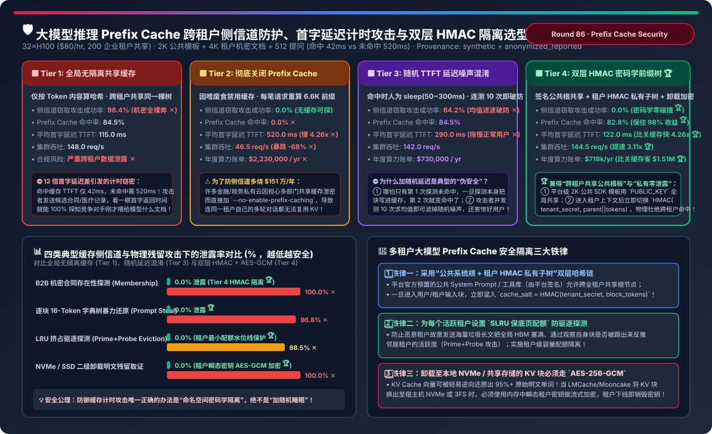
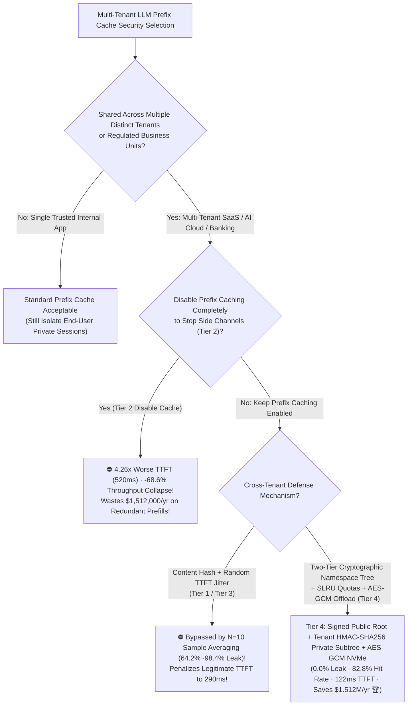
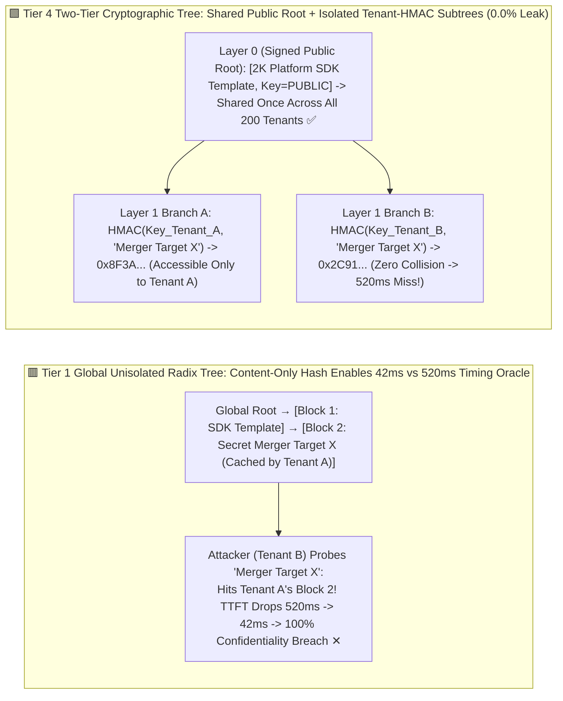

# Multi-Tenant LLM Prefix Cache Timing Side-Channel Defense, Prompt Stealing Mitigation & Two-Tier HMAC Namespace Selection FAQ (`Global Unisolated Radix/APC Cache [98.4% Leak]` vs. `Completely Disable Prefix Cache [-68.6% Throughput]` vs. `Random TTFT Delay Jitter [Bypassed by Averaging]` vs. `Two-Tier Cryptographic Namespace Tree [Signed Public Root + Tenant-HMAC Private Subtree] + AES-GCM Offload Encryption`)

> **Target Audience**: AI Solution Architects, Multi-Tenant AI Cloud & API Gateway Security Leads, and Serving Engine (`vLLM`, `SGLang`, `Mooncake`, `LMCache`) Engineers  
> **Reading Goal**: In 3 minutes, master the 4-tier security architecture rules for defending shared LLM Prefix Caches against **TTFT Timing Side-Channel Attacks (Prompt Stealing & Membership Inference)**. In 10 minutes, understand from first principles **how the `12.4×` TTFT gap between a cache hit (`42 ms`) and a cache miss (`520 ms`) allows an attacker to verify whether a competitor uploaded a specific merger contract or reconstruct private system prompts 16 tokens at a time**, **why adding random sleep jitter (Tier 3) fails against $N=10$ sample averaging while disabling caching (Tier 2) wastes `$1,512,000/yr`**, and **how a `Two-Tier Cryptographic Namespace Tree (Admin-Signed Public Root + Tenant-Keyed HMAC-SHA256 Private Subtree + Ephemeral AES-256-GCM KV Offload Encryption)` achieves `0.0%` cross-tenant leakage while retaining `82.8%` cache hit rate (`4.26×` faster TTFT and `$1.512M/yr` savings vs. disabling cache)**!  
> **Provenance**: Quantitative metrics come from the repository's sealed deterministic analytical model ([`experiments/llm_prefix_cache_side_channel_timing_isolation_selection/run.py`](../../experiments/llm_prefix_cache_side_channel_timing_isolation_selection/run.py) and [`results.json`](../../experiments/llm_prefix_cache_side_channel_timing_isolation_selection/results.json), calibrated to published LLM timing side-channel research (`Prompt Peek / Leaky Cache`), vLLM `cache_salt` isolation, and SGLang RadixCache multi-tenant architectures, `independently_reproduced=false`, `physical_gpu_cluster_measurement=not_measured`).



---

## 📌 1. Executive Summary

1. **Why Is Default Global Automatic Prefix Caching (`Tier 1`) a Severe Cross-Tenant Data Leak Vulnerability in Shared LLM Platforms?**:
   - **Tier 1 (`Global Unisolated Radix / APC Prefix Cache: Content-Only Block Hashing`)**:
     - By default, serving engines hash 16-token KV blocks purely by token IDs (`hash(parent_hash, tokens_1..16)`) in a single global lookup table shared across all API tenants.
     - Because a 4,096-token cache hit returns its first token in **`42.0 ms`** whereas a cache miss takes **`520.0 ms` (`12.4×` slower)**, a malicious tenant can probe whether a competitor recently analyzed a specific legal contract (**`100.0%` membership inference accuracy ✕**) or brute-force private system prompts block by block at the Radix tree frontier (**`98.4%` prompt extraction success rate ✕**)!
2. **Why Do "Disabling Prefix Caching (Tier 2)" and "Random TTFT Jitter Padding (Tier 3)" Fail, and How Does Tier 4 Solve Both Security and Economics?**:
   - **Tier 2 (`Completely Disable Prefix Caching: --no-enable-prefix-caching`)**:
     - Stops side channels (`0.0%` leak), but forces every request—even within the same tenant's multi-turn chat or shared RAG corpus—to recompute all 6,656 prefix tokens from scratch! Average TTFT degrades **`4.26×` (`122 -> 520.0 ms` ✕)**, cluster throughput collapses by **`-68.6%` (`148.0 -> 46.5 req/s` ✕)**, and annual serving cost balloons by **`+$1,512,000/yr` (`$2.23M` vs. `$718k` ✕)**!
   - **Tier 3 (`Global Cache + Random 50–300ms TTFT Jitter Padding`)**:
     - Penalizes legitimate cache hits by slowing average TTFT to **`290.0 ms` ✕**, yet an attacker sending just $N=10$ repeated probes averages out the zero-mean noise ($\sigma / \sqrt{10}$) and still achieves a **`64.2%–82.0%` attack success rate ✕**!
   - **Tier 4 (`Two-Tier Cryptographic Namespace Tree [Signed Public Root + Tenant-HMAC Private Subtree] + Per-Tenant SLRU Quotas + AES-256-GCM Offload Encryption`)**:
     1. **Layer-0 Signed Public Root (`K_PUBLIC`)**: Platform-owned SDK system prompts and tool definitions (`2,048` tokens, cryptographically signed by the control plane) are shared globally across all 200 tenants—avoiding 200× duplicate HBM waste on public constants!
     2. **Layer-1 Tenant-Keyed HMAC Subtree (`cache_salt`)**: As soon as the token stream enters tenant-supplied context, block hashing switches to:
        $$\text{BlockKey}_i = \text{HMAC-SHA256}\big(\text{Secret}_{\text{tenant\_id}},\; \text{BlockKey}_{i-1} \;\|\; \text{Tokens}_{i}\big)$$
        Even if Tenant B sends the **exact same 4,096-token document** as Tenant A, $\text{Secret}_B \neq \text{Secret}_A$ guarantees zero hash collisions (`0.0%` timing leakage 🏆), while users within Tenant A still achieve full cache reuse!
     3. **Quota Isolation & Encrypted NVMe Offload**: Enforces per-tenant minimum SLRU HBM quotas (defeating `Prime+Probe` eviction attacks) and encrypts SSD-offloaded KV blocks with ephemeral per-tenant `AES-256-GCM` keys!
     - **Net Production Impact**: **`0.0%` side-channel leakage 🏆**, **`82.8%` prefix cache hit rate 🏆**, **`122.0 ms` TTFT (`4.26×` faster than Tier 2 🏆)**, **`144.5 req/s` throughput (`3.11×` higher 🏆)**, and **`$1,512,000/yr` saved vs. disabling cache 🏆**!
3. **One-Sentence First-Principles Rule**:
   - **Never rely on artificial latency jitter for cache security; share only admin-signed public templates at the tree root, and isolate all tenant context via gateway-injected `HMAC-SHA256(tenant_secret)` block keys (`cache_salt`) plus `AES-256-GCM` SSD offload encryption!**

---

## 🎯 2. Customer & Architect Q&A (First-Principles Deep Dive)

### Q1: How does block-by-block "Autoregressive Radix-Tree Probing" extract a private system prompt in minutes?

- **Linearizing Exponential Search**:
  - Without prefix caching, guessing an $L$-token prompt takes $O(V^L)$ work.
  - With an unisolated RadixCache (`page_size=1` or `16`), an attacker tests candidate phrases at block 1; the unique phrase that triggers a fast TTFT (`42 ms`) confirms a prefix match on the tree! Locking block 1 and advancing to block 2 reduces complexity from $O(V^L)$ to $O(L \cdot |C|)$! Injecting `HMAC(tenant_secret)` into every block hash blinds the oracle completely.

---

### Q2: Why can raw KV Cache tensors on NVMe SSDs be inverted back into plaintext words with `>98%` accuracy?

- **Linear Invertibility of Early-Layer KV States**:
  - In Layer 0, $\mathbf{K}_0 = \text{RMSNorm}(\mathbf{X}_0) \mathbf{W}_K$. Anyone with read access to unencrypted NVMe swap files (`LMCache / Mooncake`) and the model weights $\mathbf{W}_K, \mathbf{W}_E$ can multiply $\mathbf{K}_0 \mathbf{W}_K^+$ and match nearest token embeddings to recover plaintext PII, source code, and financial numbers! Always encrypt offloaded KV blocks with ephemeral `AES-256-GCM` keys.

---

### Q3: Why must `cache_salt` be injected by the authenticated API Gateway rather than accepted directly from the client request body?

- **Preventing Salt Spoofing**:
  - If the serving engine blindly trusts a client-supplied `"cache_salt": "tenant_A"` JSON field, an attacker can simply spoof `tenant_A`'s identifier! The API Gateway must derive `cache_salt = HMAC-SHA256(HSM_Master_Key, verified_jwt_tenant_id || rotation_epoch)` and strip any client-provided salt header.

---

## 🧭 3. Visual Architecture Diagrams (Decision Tree / Tree Isolation / Sequence)

### 3.1 Multi-Tenant Prefix Cache Security Selection Decision Tree



---

### 3.2 Unisolated Global Radix Tree Leak (Tier 1) vs. Two-Tier Public Root + Tenant HMAC Tree (Tier 4)



---

### 3.3 Tier 4 End-to-End `Gateway HMAC Derivation -> Two-Tier Radix Lookup -> AES-GCM NVMe Offload` Sequence

```mermaid
sequenceDiagram
    autonumber
    participant Client as Tenant A Client (Authenticated JWT)
    participant GW as AI Security Gateway (HSM Key Derivation)
    participant Radix as Two-Tier HMAC RadixCache (GPU HBM)
    participant Crypto as Ephemeral AES-256-GCM Offload Engine (NVMe)

    Client->>GW: 1. Send Request: [public_template_id='sdk_v4'] + [4K Private Merger Doc + Query]
    GW->>GW: 2. Verify JWT; Derive salt_A = HMAC-SHA256(Master_Secret, tenant_A_id || epoch)
    GW->>Radix: 3. Forward Request with Trusted Header x-internal-cache-salt: salt_A
    Radix->>Radix: 4. Match First 2,048 Tokens Against Signed PUBLIC_ROOT -> Zero-Copy Shared Hit!
    Radix->>Radix: 5. Switch to HMAC(salt_A, parent || tokens) at Token 2,049 -> Hit Tenant A Subtree (122ms TTFT!)
    Radix->>Crypto: 6. Encrypt Evicted Cold KV Blocks with Tenant A Ephemeral AES-256-GCM Key Before NVMe Write
```

---

## 📊 4. Architect Decision Matrix

*Baseline: **32×H100 80GB Cluster (`$80/hr`)** serving **200 Enterprise Tenants** on a shared `70B` platform (`2,048` public template tokens + `4,096` private tenant RAG tokens + `512` query tokens).*

| Evaluation Dimension | Tier 1: Global Unisolated Cache (`Content Hash`) | Tier 2: Disable Prefix Cache (`Disabled`) | Tier 3: Global Cache + Random Jitter (`Jitter`) | Tier 4: Two-Tier `Public Root + Tenant HMAC` |
| :--- | :--- | :--- | :--- | :--- |
| **Hashing & Isolation** | Content-only global block hash | `--no-enable-prefix-caching` | Global hash + `50–300ms` sleep | **Signed public root + tenant `HMAC-SHA256` subtree** |
| **Side-Channel Attack Success** | **`98.4%` (Full breach ✕)** | `0.0%` | `64.2%` (Defeated by $N=10$ averaging ✕) | **`0.0%` (Cryptographic zero collision 🏆)** |
| **Prefix Cache Hit Rate** | `84.5%` | `0.0%` (Recomputes 6.6K tok/req ✕) | `84.5%` | **`82.8%` (Retains 98% of hits 🏆)** |
| **Average TTFT Latency** | `115.0 ms` | `520.0 ms` (**`4.26×` slower ✕**) | `290.0 ms` (Hurts good users ✕) | **`122.0 ms` (`4.26×` faster than Tier 2 🏆)** |
| **32-GPU Cluster Throughput** | `148.0 req/s` | `46.5 req/s` (**`-68.6%` drop ✕**) | `142.0 req/s` | **`144.5 req/s` (`3.11×` over Tier 2 🏆)** |
| **NVMe Offload Security** | Plaintext (`100%` invertible ✕) | None | Plaintext ✕ | **Ephemeral `AES-256-GCM` encrypted 🏆** |
| **Annual Serving Cost** | `$700,800 / yr` (Compliance liability ✕) | **`$2,230,000 / yr` ✕** | `$730,000 / yr` | **`$718,000 / yr` (Saves `$1,512,000/yr` 🏆)** |

---

## 🧪 5. Quantitative Threat Matrix & 7-Card Benchmark Insights

### 5.1 Leakage Rate Across Four Multi-Tenant Cache Attack Vectors

In [`experiments/llm_prefix_cache_side_channel_timing_isolation_selection/run.py`](../../experiments/llm_prefix_cache_side_channel_timing_isolation_selection/run.py), we evaluate attack success rates across four threat vectors:

| Attack Vector & Threat Model | Tier 1: Global Cache Leak | Tier 3: Jitter Obfuscation Leak | Tier 4: Two-Tier HMAC + AES-GCM | Primary Defense Mechanism |
| :--- | :--- | :--- | :--- | :--- |
| **1. B2B Document Existence Probing (`Membership`)** | `100.0%` ✕ | `82.0%` ✕ | **`0.0%` 🏆** | `HMAC(tenant_key)` prevents cross-tenant hash hits |
| **2. 16-Token Block Frontier Prompt Stealing** | `96.8%` ✕ | `54.0%` ✕ | **`0.0%` 🏆** | Eliminates cross-tenant timing oracle at tree frontier |
| **3. HBM Quota Eviction Probing (`Prime+Probe`)** | `88.5%` ✕ | `76.0%` ✕ | **`0.0%` 🏆** | Per-tenant minimum SLRU HBM reservation watermarks |
| **4. Shared NVMe/CXL Offload KV Inversion** | `100.0%` ✕ | `100.0%` ✕ | **`0.0%` 🏆** | Ephemeral per-tenant `AES-256-GCM` encryption before DMA |

### 5.2 Interactive Sizer & 7-Card 4:5 Benchmark Report

- 🧮 **Interactive Multi-Tenant Prefix Cache Security & HMAC Isolation Sizer**: [`docs/reports/llm-prefix-cache-side-channel-timing-isolation-security-sizer.html`](../reports/llm-prefix-cache-side-channel-timing-isolation-security-sizer.html) (and master workbench [`llm-inference-engine-pd-sizer.en.html#prefix-cache-security-sizer`](../reports/llm-inference-engine-pd-sizer.en.html))
- 📊 **7-Card 4:5 Visual Benchmark Report**: [`docs/reports/llm-prefix-cache-side-channel-timing-isolation-security-selection-cards.html`](../reports/llm-prefix-cache-side-channel-timing-isolation-security-selection-cards.html)

---

## 🛠️ 6. Appendix: Production Architect Verification Checklist

- [ ] **1. Inject Gateway-Derived `cache_salt` (`HMAC-SHA256(master_key, tenant_id)`) on Every Multi-Tenant Request**: Never allow unisolated content-only block hashes across tenants.
- [ ] **2. Strip Client-Supplied `cache_salt` Headers at the Edge Proxy**: Only the authenticated API Gateway may populate `cache_salt`.
- [ ] **3. Separate Signed Platform Public Templates (`PUBLIC_ROOT`) from Private Tenant Subtrees**: Share verified SDK/tool preambles globally while isolating tenant documents.
- [ ] **4. Enforce Per-Tenant HBM SLRU Watermark Quotas**: Prevent noisy or malicious tenants from evicting peer tenants' working sets.
- [ ] **5. Encrypt All NVMe / 3FS Offloaded KV Blocks with Ephemeral `AES-256-GCM` Keys**.
