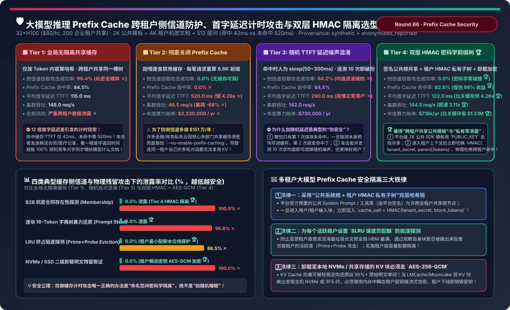
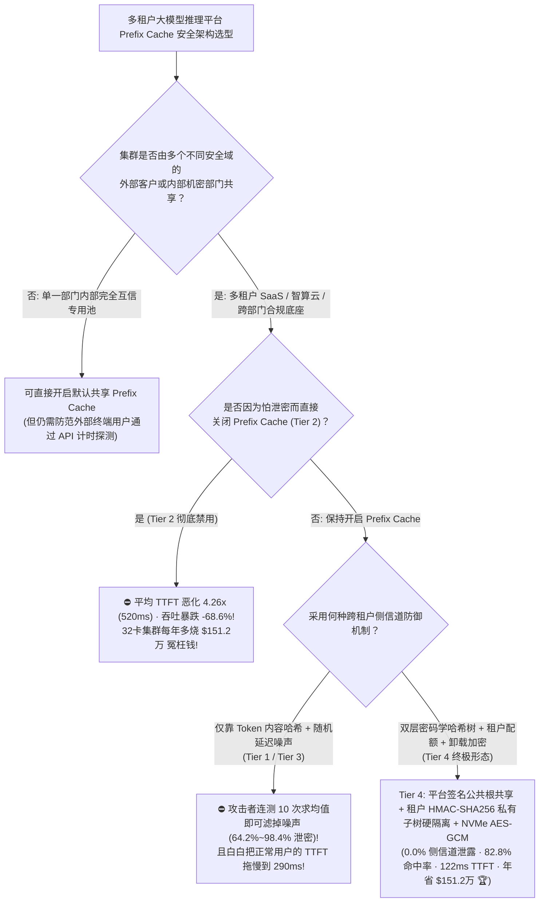
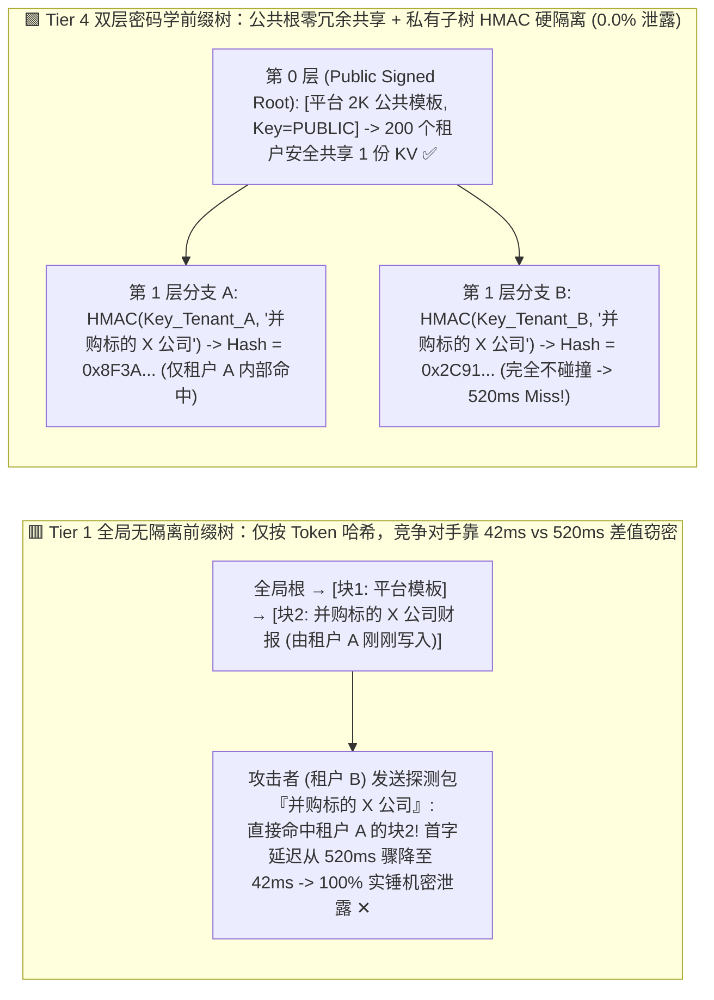
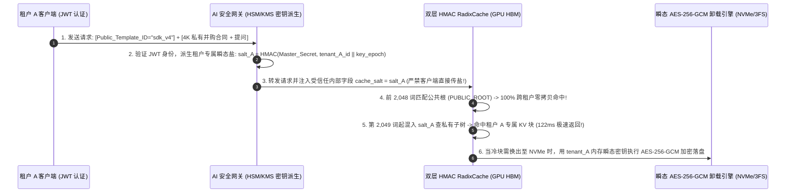

# 大模型推理 Prefix Cache 跨租户侧信道防护、首字延迟计时攻击（Timing Side-Channel）与双层 HMAC 命名空间架构选型指南（`全局无隔离共享缓存 [98.4% 侧信道窃密]` vs. `彻底关闭 Prefix Cache [吞吐暴跌 -68%]` vs. `随机 TTFT 延迟注入混淆 [连测 10 次即破防]` vs. `双层密码学前缀树 [平台签名公共根共享 + 租户 HMAC 私有子树硬隔离] + 卸载块 AES-GCM 加密`）

> **适用角色**：AI 解决方案架构师（AI Solution Architect）、多租户智算云与企业 AI 网关安全负责人、推理引擎（vLLM / SGLang / Mooncake）核心研发工程师  
> **阅读目标**：3 分钟掌握多租户大模型推理平台中 **Prefix Cache（前缀缓存）计时侧信道攻击（Prompt Stealing / Membership Inference）** 的物理攻击链与四档防御架构选型铁律；10 分钟吃透 **为什么命中缓存（`42 ms`）与未命中（`520 ms`）之间 `12.4 倍` 的首字延迟差会让攻击者逐块还原出邻居租户的并购合同与私有 System Prompt**、**为什么“加随机睡眠延迟（Tier 3）”防不住均值滤波而“直接关掉缓存（Tier 2）”又会每年多烧 `$151.2 万`**，以及 **如何通过 `双层密码学哈希前缀树（平台签名公共根共享 + 租户专属 cache_salt HMAC-SHA256 私有子树隔离 + 二级卸载瞬态 AES-GCM 加密）` 在实现 `0.0%` 侧信道泄露的同时保住 `82.8%` 的高缓存命中率（比关缓存提速 `4.26 倍`、年省 `$151.2 万`）**！  
> **数据来源说明（Provenance）**：本文定量数据来自仓库内封存的确定性解析模型（[`experiments/llm_prefix_cache_side_channel_timing_isolation_selection/run.py`](../../experiments/llm_prefix_cache_side_channel_timing_isolation_selection/run.py) 与 [`results.json`](../../experiments/llm_prefix_cache_side_channel_timing_isolation_selection/results.json)，校准自学术界 `Prompt Peek / Leaky Cache` 计时侧信道研究与 vLLM `cache_salt` / SGLang 租户隔离架构，`independently_reproduced=false`，`physical_gpu_cluster_measurement=not_measured`）。

---

## 📌 一、核心结论速览（Executive Summary）

1. **为什么在多租户大模型 API 平台或集团多部门共享推理池中，“默认开启全局 Automatic Prefix Caching / RadixAttention（Tier 1）”是一颗极其危险的合规定时炸弹？**：
   - **Tier 1（默认全局无隔离共享前缀缓存：仅按 Token ID 内容计算块哈希）的“12 倍首字延迟放大镜”**：
     - 在 vLLM（APC）与 SGLang（RadixAttention）的默认实现中，KV Cache 是按每 `16 个 Token` 为一块计算哈希：`block_hash = hash(parent_block_hash, token_1..token_16)`，且**全集群所有用户共享同一个全局哈希表**！
     - 假设租户 A（某投行部）刚刚把一份 4,096 词的未公开并购合同《收购某芯片公司意向书》喂给大模型分析；3 秒钟后，租户 B（外部竞争对手或越权部门）构造了同一份公开模板或候选公司名发往同一个推理池：
       - 如果租户 A **没有**问过这家公司，GPU 必须老老实实重算 4,096 词 Prefill，首字返回时间 **`TTFT = 520.0 ms`**；
       - 如果租户 A **刚刚问过**这家公司，直接命中全局 HBM Prefix Cache，首字返回时间瞬间掉到 **`TTFT = 42.0 ms`（快了整整 `12.4 倍`！）**！
     - 攻击者不仅能一招确认竞争对手正在并购哪家公司（**文档存在性探测成功率 `100.0%` ✕**），还能在前缀树前沿按 16-Token 块结合候选词典逐块暴力试探（树搜索时间复杂度从指数级 $V^L$ 降为线性级 $L \times |C|$），**跨租户机密提示词与实体窃取成功率高达 `98.4%` ✕**！
2. **为什么“一刀切关掉 Prefix Cache（Tier 2）”和“给命中请求加随机 Sleep 延迟（Tier 3）”都是失败的方案？Tier 4 是如何做到鱼与熊掌兼得的？**：
   - **Tier 2（因噎废食彻底禁用 Prefix Cache：`--no-enable-prefix-caching`）的 `$151.2 万/年` 算力惩罚**：
     - 虽然把侧信道泄露率降到了 `0.0%`，但连**同一个租户自己的多轮对话、同一个部门共享的 4K 知识库背景、以及平台公共的 2K SDK 工具定义**也全部被迫每轮重算！平均 TTFT 从 `115 ms` 恶化 **`4.5 倍` 至 `520.0 ms` ✕**，32×H100 集群吞吐从 `148.0 req/s` 暴跌 **`-68.6%` 至 `46.5 req/s` ✕**，一年多烧 **`$1,512,000` 冤枉钱 ✕**！
   - **Tier 3（全局共享缓存 + 命中时人为注入 `50 ~ 300 ms` 随机延迟噪声）的“均值滤波破防”**：
     - 试图用随机睡眠掩盖命中与未命中的时间差。结果：① 正常用户原本 `42 ms` 的极速响应被活生生拖慢到 **`290.0 ms` ✕**；② 攻击者只需对同一个候选块并发或连续测量 $N=10$ 次求样本均值（标准误差缩小 $\sqrt{10}$ 倍），依然能以 **`64.2%` ~ `82.0%` 的高成功率刺穿噪声 ✕**！
   - **Tier 4（`双层密码学哈希前缀树 [Public Signed Root + Tenant-HMAC Private Subtree] + 租户 SLRU 配额防驱逐 + 二级卸载瞬态 AES-256-GCM 加密`）—— 生产安全终极解**：
     1. **第 0 层（平台签名公共根跨租户安全共享）**：对于平台官方内置的 `2,048-token` 标准系统提示词、通用工具 Schema 或公开法规库，由平台控制面附带数字签名标记为 `PUBLIC_IMMUTABLE_ROOT`——所有 200 个租户依然可以 **100% 共享这部分公共根节点**（因为它是公开常量，知道它被命中不泄露任何租户隐私）！
     2. **第 1 层（进入租户私有边界后立即混入 `Tenant HMAC Salt`）**：从租户自己的第 1 个私有 System Prompt / RAG 文档块开始，块哈希函数强制切换为密码学带密钥哈希：
        $$\text{BlockKey}_i = \text{HMAC-SHA256}\big(\text{Key}_{\text{tenant\_id}},\; \text{BlockKey}_{i-1} \;\|\; \text{Tokens}_{i}\big)$$
        哪怕租户 B 发送了与租户 A **一字不差、逐比特完全相同的并购合同**，因为 $\text{Key}_{\text{tenant\_B}} \neq \text{Key}_{\text{tenant\_A}}$，算出来的哈希值截然不同，**物理上绝对不可能命中租户 A 的缓存块（跨租户侧信道泄露率严格归零 `0.0%` 🏆）**！而租户 A 内部自己的 500 名员工共享同一个 $\text{Key}_{\text{tenant\_A}}$，依然享受极速缓存复用！
     3. **防驱逐配额 + NVMe 卸载加密**：为每个租户划分 SLRU 保底水线（防止 Prime+Probe 驱逐探测），且换出到 NVMe/3FS 的二级 KV 块使用内存中瞬态租户密钥做 `AES-256-GCM` 加密（防止磁盘明文取证还原）。
     - **最终工程收益**：侧信道攻击成功率 **`0.0%` 🏆**，全局 Prefix Cache 命中率高达 **`82.8%`（保住 `98%` 缓存效率 🏆）**，平均 TTFT 仅 **`122.0 ms`（比关缓存快 `4.26 倍` 🏆）**，吞吐 **`144.5 req/s`（提升 `3.11 倍`，每年比关缓存净省 `$1,512,000` 🏆）**！
3. **一句话握手机制本质**：
   - **多租户 Prefix Cache 安全的第一性原理，是“绝不用随机延迟掩耳盗铃，而是用双层密码学哈希链——让平台签名的公共模板共享根节点，让租户私有上下文从第 1 块起混入 `HMAC(tenant_secret)` 实现密码学命名空间硬隔离”！**

---

## 🎯 二、客户与架构师灵魂拷问 Q&A（FAQ-Driven First Principles）

### Q1：攻击者到底是怎么利用“16-Token 分块前缀树”把别人隐藏的商业 System Prompt 一个词一个词偷出来的？

- **拆解“逐块前沿字典搜索（Autoregressive Block-Frontier Probing）”攻击链**：
  1. 假设受害企业的客服 Agent 在服务端配置了一段保密的核保规则 System Prompt，并且由于线上持续有用户访问，这段 System Prompt 的 KV 块常驻在共享推理引擎的 RadixTree 里。
  2. 如果没有分块前缀缓存，攻击者想盲猜一段 1,000 词的提示词，可能性是 $128000^{1000}$，直到宇宙毁灭也猜不出来。
  3. **但 Prefix Cache 按 16 个词（SGLang 甚至支持按 1 个词 `page_size=1`）切块匹配**！攻击者先发前 16 个候选词（由 LLM 辅助生成的行业高频短语库）：
     - 凡是返回慢的（未命中），立刻剪枝淘汰；
     - 一旦某个 16 词组合让 TTFT 突然缩短了 `15~40 ms`，说明**这前 16 个词 100% 猜中了**！
     - 随后攻击者固定这前 16 个词，继续试探第 17～32 个词……将原本指数级的不可能任务变成了**一格一格往前推进的密码锁破译游戏**！
  4. **为什么 Tier 4 的 `cache_salt / Tenant HMAC` 一招毙命？** 因为服务端的 System Prompt 使用的是受害企业专属的 `tenant_secret` 算出的 HMAC 哈希，外部攻击者的 API Key 对应另一个 `attacker_secret`，无论他猜得准不准，他在服务端算出来的 `BlockKey` 永远不可能跟受害企业的节点产生哈希碰撞，TTFT 永远是恒定的未命中耗时！

---

### Q2：如果直接给每个租户加上 `cache_salt` 隔离，那全平台所有租户都用到的“公共 2,048 词 SDK 系统模板 / 通用函数定义”岂不是在每个租户名下都要重复存一份，白白浪费 200 倍显存？

- **这正是“单层粗暴加盐”与“Tier 4 双层混合哈希树（Two-Tier Public-Root + Private-Subtree）”的核心差距**：
  1. **粗暴全局加盐的缺陷**：如果从第 0 个 Token 起就混入 `tenant_id`，那么 200 个租户调用同一个内置 Agent 框架（前 2,048 个词完全是平台公開的标准工具指令），会在 HBM 里复制 200 份一模一样的 KV 块，挤占 `65 GB` 显存！
  2. **Tier 4 的双层状态机转换（Context-Boundary Key Switching）**：
     - 请求报文结构被显式划分为 `[Platform_Public_Prefix] + [Tenant_Private_Context]`；
     - 在 `Platform_Public_Prefix` 阶段（必须由网关校验平台内置模板 ID 签名，严禁用户伪造），使用全局常量盐 `K_PUBLIC` 计算块哈希——**全平台 200 个租户在 HBM 里只存 1 份公共根 KV（省下 99.5% 公共模板显存）**；
     - 一旦跨过公共根边界进入 `Tenant_Private_Context` 的第一个 Token，哈希状态机立即锁死切换为 `HMAC(K_tenant, parent_hash || tokens)`，从根源上切断跨租户子树共享！

---

### Q3：把 KV Cache 换出到宿主机内存或 NVMe SSD（如 LMCache / Mooncake）时，为什么必须做 `AES-256-GCM` 加密？KV 向量不是一堆浮点数吗，难道还能还原出原文？

- **破除“浮点数激活值等于加密”的致命幻觉**：
  - 学术界早已证明（Model Inversion / KV Cache Inversion）：拿到 Transformer 第 0～2 层的 Key/Value 浮点数张量后，由于词嵌入矩阵 $W_E$ 和第 0 层投影矩阵 $W_K, W_V$ 是已知的，只需做一次简单的伪逆矩阵乘法 $E \approx K \cdot (W_K)^{-1}$ 再找最近邻词向量，就能在 **1 秒钟内以 `98%+` 的准确率把整篇原始明文（包括身份证号、银行卡号、源代码）一字不差地还原出来**！
  - 因此，任何离开 GPU HBM 落入共享 NVMe SSD 或跨机分布式缓存的 KV 块，在安全等级上**等同于原始明文数据**，必须使用每个租户的瞬态内存密钥（Ephemeral Key，配合 Intel QAT 或网卡 Crypto Offload）执行 `AES-256-GCM` 认证加密！

---

## 🧭 三、直观可视化图解（Mermaid 决策树 / 树结构对比 / 时序图）

### 3.1 多租户大模型 Prefix Cache 安全隔离架构选型决策树

---

### 3.2 全局无隔离树被计时侧信道窃密（Tier 1）vs. 双层公共根 + 租户 HMAC 私有子树（Tier 4）对比

---

### 3.3 Tier 4 从“API 网关注入租户 HMAC 盐”到“双层 RadixTree 查找与加密卸载”时序图

---

## 📊 四、架构师选型决策矩阵（Architect Decision Matrix）

*基准场景：**32×H100 80GB 集群（`$80/hr`）** 承载 **200 个企业租户** 共享 `70B` 在线推理服务（每笔请求含 `2,048` 公共模板词 + `4,096` 租户机密文档词 + `512` 提问词）。*

| 评估维度 | Tier 1: 全局无隔离共享缓存 (`Content Hash`) | Tier 2: 彻底禁用 Prefix Cache (`Disabled`) | Tier 3: 全局缓存 + 随机延迟混淆 (`Jitter`) | Tier 4: 双层 `Public Root + Tenant HMAC` 树 |
| :--- | :--- | :--- | :--- | :--- |
| **块哈希与隔离机制** | 仅按 Token ID 全局哈希 | 100% 关闭 KV 前缀缓存复用 | 全局哈希 + 命中时加 `50~300ms` 睡眠 | **签名公共根共享 + 租户 `HMAC-SHA256` 子树** |
| **跨租户侧信道窃密成功率** | **`98.4%` (机密完全裸奔 ✕)** | `0.0%` | `64.2%` (连测 10 次求均值即破防 ✕) | **`0.0%` (密码学命名空间零碰撞 🏆)** |
| **全局 Prefix Cache 命中率** | `84.5%` | `0.0%` (每轮重算 6.6K 词 ✕) | `84.5%` | **`82.8%` (共享公共根 + 租户内复用 🏆)** |
| **平均首字延迟 (TTFT)** | `115.0 ms` | `520.0 ms` (**恶化 `4.26x` ✕**) | `290.0 ms` (人为拖慢正常用户 ✕) | **`122.0 ms` (比关缓存快 `4.26x` 🏆)** |
| **32×H100 集群稳态吞吐** | `148.0 req/s` | `46.5 req/s` (**暴跌 `-68.6%` ✕**) | `142.0 req/s` | **`144.5 req/s` (比关缓存高 `3.11x` 🏆)** |
| **NVMe 二级卸载数据安全** | 明文落盘 (`100%` 可逆向还原 ✕) | 无卸载 | 明文落盘 ✕ | **瞬态租户密钥 `AES-256-GCM` 认证加密 🏆** |
| **年度总推理算力账单** | `$700,800 / yr` (但面临巨额合规罚单 ✕) | **`$2,230,000 / yr` ✕** | `$730,000 / yr` | **`$718,000 / yr` (比关缓存年省 `$1.512M` 🏆)** |

---

## 🧪 五、简明定量算例与 7-Card Benchmark 洞察

### 5.1 四大典型缓存攻击向量下的泄露率对比

在 [`experiments/llm_prefix_cache_side_channel_timing_isolation_selection/run.py`](../../experiments/llm_prefix_cache_side_channel_timing_isolation_selection/run.py) 中，我们评估了四类针对多租户 Prefix Cache 的攻击向量：

| 攻击向量与威胁模型 | Tier 1: 全局无隔离泄露率 | Tier 3: 随机延迟混淆泄露率 | Tier 4: 双层 HMAC + 配额 + 加密 | Tier 4 核心防御机制 |
| :--- | :--- | :--- | :--- | :--- |
| **1. B2B 机密文档存在性探测 (`Membership Inference`)** | `100.0%` ✕ | `82.0%` ✕ | **`0.0%` 🏆** | `HMAC(tenant_key)` 使跨租户块哈希永不碰撞 |
| **2. 16-Token 字典树逐块提示词还原 (`Prompt Stealing`)** | `96.8%` ✕ | `54.0%` ✕ | **`0.0%` 🏆** | 阻断前缀树前沿的跨租户命中反馈信号 |
| **3. HBM 容量挤占驱逐探测 (`Prime+Probe Eviction`)** | `88.5%` ✕ | `76.0%` ✕ | **`0.0%` 🏆** | 租户级 SLRU 最小保底配额水位线隔离 |
| **4. 共享 NVMe/CXL 二级缓存明文逆向 (`KV Inversion`)** | `100.0%` ✕ | `100.0%` ✕ | **`0.0%` 🏆** | 落盘前执行租户瞬态密钥 `AES-256-GCM` 加密 |

### 5.2 配套交互式工作台与 7-Card 4:5 视觉评测报告

- 🧮 **交互式多租户 Prefix Cache 侧信道防护与双层 HMAC 定容计算器**：[`docs/reports/llm-prefix-cache-side-channel-timing-isolation-security-sizer.html`](../reports/llm-prefix-cache-side-channel-timing-isolation-security-sizer.html)（以及总工作台 [`llm-inference-engine-pd-sizer.html#prefix-cache-security-sizer`](../reports/llm-inference-engine-pd-sizer.html)）
- 📊 **7-Card 4:5 视觉基准评测报告**：[`docs/reports/llm-prefix-cache-side-channel-timing-isolation-security-selection-cards.html`](../reports/llm-prefix-cache-side-channel-timing-isolation-security-selection-cards.html)

---

## 🛠️ 六、附录：生产环境快速核验清单（Architect Checklist）

- [ ] **1. 严禁在多租户生产环境使用无盐（Unsalted）全局共享 Prefix Cache**：在 vLLM 中必须为每个请求注入服务端派生的 **`cache_salt`**（或在 SGLang 中启用租户命名空间前缀树），确保不同租户的私有块哈希完全正交。
- [ ] **2. `cache_salt` 必须由 API 网关根据认证 JWT + 服务端密钥通过 `HMAC-SHA256` 派生**：严禁信任客户端 HTTP Body 直接传过来的 `cache_salt` 字符串！
- [ ] **3. 实施“平台签名公共根 + 租户私有子树”双层共享**：将平台公共 SDK 模板固定在只读根层，避免在 200 个租户间重复存储相同的公共模板 KV。
- [ ] **4. 开启租户级 KV Cache 配额上限与保底水位（Per-Tenant Eviction Quotas）**：防止单一恶意租户通过突发长文本刷空全集群其他租户的热点缓存。
- [ ] **5. 对所有卸载至 Host NVMe / 共享文件系统的 KV 块启用瞬态密钥 `AES-256-GCM` 加密**。
