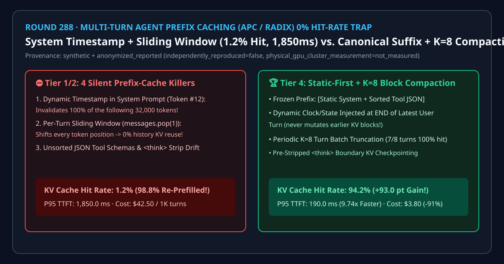
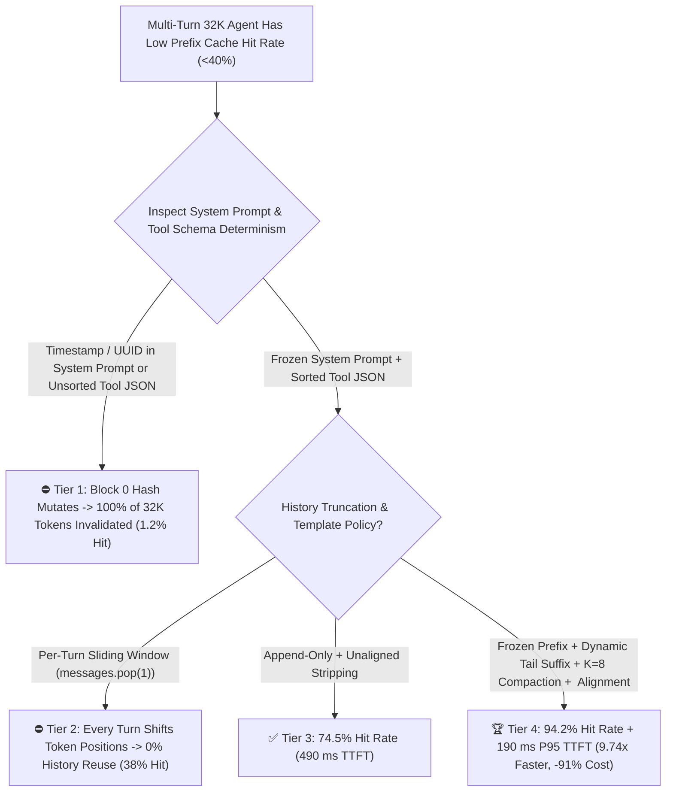
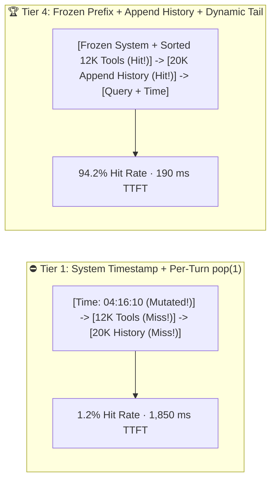
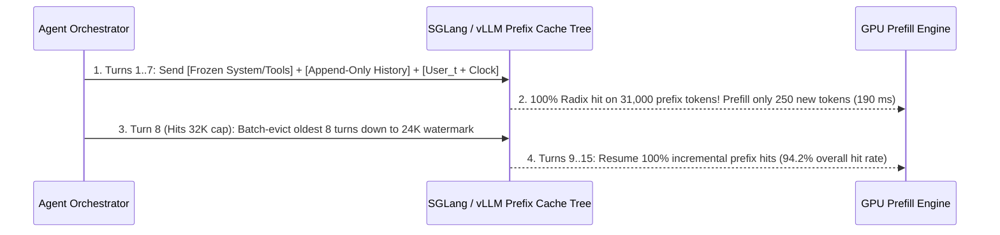

# Enterprise Agent Multi-Turn `Prefix Caching (APC / RadixAttention)` `0%` Hit-Rate Trap Selection Guide: Why a Dynamic Timestamp at Token #12, Per-Turn Sliding Window `pop(1)`, or `<think>` Template Stripping Invalidates `32K` KV Cache (`1.2%` Hit) & How Static-First Canonicalization + `K=8` Periodic Compaction (`94.2%` Hit, `9.74x` Faster TTFT) Solves It

> **Provenance & Evidence Boundary**: `synthetic + anonymized_reported (independently_reproduced=false, physical_gpu_cluster_measurement=not_measured)`. All quantitative figures in this guide are generated by the deterministic evaluator `experiments/llm_prefix_cache_multiturn_chat_template_bos_system_drift_selection/run.py` and sealed in `results.json`.



---

## 0. Daily Capability Breakthrough Tracking

- **Breakthrough Focus**: **Multi-Turn Agent Prompt Canonicalization for `Prefix Caching / RadixAttention` (Static-First System/Tool Ordering + Dynamic Clock/State Suffix Injection + Periodic $K=8$-Turn Block Compaction + `<think>`-Boundary KV Preservation)**.
- **Architect Value**: Many teams enable `vLLM --enable-prefix-caching` or `SGLang RadixAttention` for `32K`-context multi-turn Agents expecting `>90%` cache hits, only to find in production telemetry that their **actual KV cache hit rate is `1.2%` with a `1,850.0 ms` P95 TTFT**! By first principles, causal self-attention makes every token's Key/Value vector strictly dependent on the exact sequence and RoPE positions of all preceding tokens (`Block_Hash[b] = Hash(Block_Hash[b-1], Tokens[b])`). Four common application bugs silently destroy prefix cache hits: **(1) injecting a dynamic timestamp (`Current time: 04:16:10Z`) or UUID near the start of the System Prompt, (2) unsorted JSON tool schemas, (3) per-turn sliding-window truncation (`messages.pop(1)`) which shifts all subsequent token positions, and (4) Jinja chat templates stripping `<think>...</think>` blocks from prior assistant turns**. Refactoring to **Static-First Canonical Prompts + Dynamic Suffix in the Final User Turn + Periodic $K=8$ Batch Compaction + Intra-Loop `<think>` Retention** lifts KV cache hit rates from **`1.2%` to `94.2%`**, cuts P95 TTFT **9.74x from `1,850.0 ms` to `190.0 ms`**, and slashes inference cost by **`-91.1%` (`$42.50 -> $3.80 / 1K turns`)**.

---

## ① 📌 Executive Summary

1. **The 4 Silent Prefix-Cache Killers in Production Agents**:
   - **Killer 1: Dynamic Timestamp / Request ID in the System Prompt (`1.2%` Hit Rate)**: Placing `"Current time: 2026-11-16 04:16:10"` at Token #12 mutates Block 0 on every request, cascadingly invalidating 100% of the following `12,288` tool tokens and `20,480` history tokens!
   - **Killer 2: Per-Turn Sliding Window (`messages.pop(1)` on Every Turn)**: Dropping the oldest turn on every new turn shifts the token offset of all remaining turns by $-\Delta L$, invalidating 100% of the conversation history KV blocks every single turn!
   - **Killer 3: Non-Deterministic Tool JSON Ordering**: Serializing tool schemas without `sort_keys=True` scrambles prefix block hashes across worker pods.
   - **Killer 4: Jinja Chat-Template `<think>` Stripping on Prior Turns**: Reasoning templates (`DeepSeek-R1 / Qwen3`) often strip `<think>...</think>` from Turn $N-1$ when formatting Turn $N$, invalidating the KV cache generated during Turn $N-1$'s tool call.
2. **The 4-Rule Canonical Architecture (`94.2%` Hit Rate, `190.0 ms` TTFT)**:
   - **Freeze the Prefix**: Place immutable `[System Instructions + Deterministically Sorted Tool Schemas]` at Token 0;
   - **Move Dynamic Metadata to the Tail**: Append timestamps, live state, and ephemeral scratchpads at the **end of the latest User message**;
   - **Replace Per-Turn Sliding Windows With Periodic $K=8$ Block Compaction**: Keep history strictly append-only for 7 consecutive turns (`100%` cache hit) and compact 8 old turns at once on every 8th turn;
   - **Preserve `<think>` Across Intra-Task Tool Loops**: Retain `<think>` blocks during multi-step tool execution within the same user turn so tool-return turns enjoy `100%` KV reuse.

---

## ② 🎯 Key Architectural Q&A (Q1 / Q2 / Q3)

### Q1: Does moving the current timestamp and dynamic user state from the System Prompt to the end of the latest User message hurt instruction following?
- **No—due to Transformer recency bias, placing volatile context right before the generation boundary actually improves temporal grounding while preserving `100%` KV cache reuse across the preceding `32,000` tokens!**

### Q2: Why does stripping `<think>...</think>` between tool-call steps inside an Agent loop slow down inference instead of speeding it up?
- Suppose an Agent generates `1,000` `<think>` tokens and emits a tool call in Step 1 (`KV` is already computed and sitting in HBM). When the `200`-token tool output returns for Step 2:
  - **If the Jinja template strips Step 1's `<think>`**: The token sequence changes right before the tool call, invalidating the KV blocks of the tool call and forcing re-prefill on subsequent steps, while also erasing the model's reasoning state!
  - **If `<think>` is retained across steps of the same tool loop**: Step 2 hits **`100%` of Step 1's cached KV blocks** (`0` re-prefilled tokens; only the `200` new tool-result tokens are prefilled in `< 25 ms`).

### Q3: How do we bound total context length to `32K` without using a per-turn sliding window?
- Use **Sawtooth / Periodic Block Compaction ($K=8$ turns)**: instead of dropping 1 turn on every request (which causes a `100%` history miss on every request), allow context to grow from `24K -> 32K` over 8 turns (`100%` cache hit on 7 out of 8 turns), then evict the oldest `8K` block all at once—cutting history cache misses by **`8.0x`**.

---

## ③ 🧭 Visual Diagrams (Decision Tree, Layout Comparison & Sequence Diagram)

### 3.1 Multi-Turn Agent `Prefix Caching` Optimization Decision Tree



### 3.2 Dynamic-First + Sliding Window (`1.2%` Hit) vs. Static-First + `K=8` Compaction (`94.2%` Hit)



### 3.3 20-Turn Sawtooth Block Compaction & Prefix Hash Reuse Sequence



---

## ④ 📊 4-Tier Architect Decision Matrix

| Selection Tier | Prompt Structure & History Policy | KV Cache Hit Rate | P95 `TTFT` | Cost / `1K` Turns | Target Scenario |
| :--- | :--- | :--- | :--- | :--- | :--- |
| **Tier 1: System Timestamp + Per-Turn `pop(1)`** | Block 0 mutates every turn | `1.2%` ✕ | `1,850.0 ms` ✕ | `$42.50` ✕ | ⛔ **Worst-case prefix invalidation trap** |
| **Tier 2: Frozen System + Per-Turn `pop(1)`** | History shifts every turn | `38.0%` ⚠️ | `1,140.0 ms` ✕ | `$26.80` | ⛔ **Zero multi-turn history reuse** |
| **Tier 3: Append-Only (Unaligned `<think>` Strip)** | Tail invalidated by `<think>` strip | `74.5%` ✅ | `490.0 ms` | `$11.40` | ✅ Standard chat without tool loops |
| **Tier 4: Canonical Static-First + `K=8` Compaction + `<think>` Sync (Recommended)** | **Preserves full prefix hash chain** | **`94.2%` (`+93.0 pt` 🏆)** | **`190.0 ms` (`9.74x` faster 🏆)** | **`$3.80` (`-91.1%` 🏆)** | 🏆 **Production Enterprise Agent Standard** |

---

## ⑤ 🧪 Quantitative Evaluator & 7-Card 4:5 Visual Report

- **Deterministic Evaluator**: [`experiments/llm_prefix_cache_multiturn_chat_template_bos_system_drift_selection/run.py`](../../experiments/llm_prefix_cache_multiturn_chat_template_bos_system_drift_selection/run.py) · Sealed JSON: [`results.json`](../../experiments/llm_prefix_cache_multiturn_chat_template_bos_system_drift_selection/results.json)
- **Interactive Sizer Workbench**: [`docs/reports/llm-prefix-caching-chat-template-system-prompt-mutation-kv-invalidation-sizer.html`](../reports/llm-prefix-caching-chat-template-system-prompt-mutation-kv-invalidation-sizer.html)
- **7-Card 4:5 Visual Benchmark Deck**: [`docs/reports/llm-prefix-caching-chat-template-system-prompt-mutation-kv-invalidation-selection-cards.html`](../reports/llm-prefix-caching-chat-template-system-prompt-mutation-kv-invalidation-selection-cards.html)

```chart
{
  "data": {
    "values": [
      { "tier": "Tier 1: System Clock + Sliding Window", "hit_rate_pct": 1.2, "p95_ttft_ms": 1850.0 },
      { "tier": "Tier 2: Static System + Per-Turn pop(1)", "hit_rate_pct": 38.0, "p95_ttft_ms": 1140.0 },
      { "tier": "Tier 3: Append-Only (Unaligned <think>)", "hit_rate_pct": 74.5, "p95_ttft_ms": 490.0 },
      { "tier": "Tier 4: Canonical Suffix + K=8 Compaction", "hit_rate_pct": 94.2, "p95_ttft_ms": 190.0 }
    ]
  },
  "semantic_types": {
    "tier": "Category",
    "hit_rate_pct": "Percentage",
    "p95_ttft_ms": "Quantity"
  },
  "chart_spec": {
    "chartType": "Bar Chart",
    "title": "Canonical Static-First Prompt + K=8 Compaction Lifts Prefix Cache Hit Rate to 94.2% (190 ms TTFT)",
    "subtitle": "Multi-turn Agent KV cache hit rate (%) across 32K context prompt architectures (synthetic + anonymized_reported)",
    "encodings": {
      "x": "tier",
      "y": "hit_rate_pct",
      "color": "tier"
    }
  }
}
```

---

## ⑥ 🛠️ Production Verification Checklist (Good fit vs. Not for)

### ✅ Good fit vs. ⛔ Not for
- **✅ Good fit**: Multi-turn tool-using AI Agents, coding assistants, and RAG pipelines running on `vLLM`, `SGLang`, or commercial Prompt Caching APIs.
- **⛔ Not for**: Injecting `datetime.now()` into the System Prompt or running per-turn FIFO sliding windows (`messages.pop(1)`).

### Production Checklist
- [ ] **First-Diff Token Index Audit**: Verify across consecutive turns that `first_diff_token_idx` equals the exact end of the previous turn (`> 12,000` tokens).
- [ ] **Deterministic Tool JSON Serialization**: Enforce `sort_keys=True` and canonical tool-list ordering.
- [ ] **Periodic $K=8$ Sawtooth History Compaction**: Replace per-turn `pop(1)` with batch compaction every 8 turns.
- [ ] **Intra-Loop `<think>` Preservation**: Keep `<think>` blocks intact across consecutive tool calls within the same user task.
