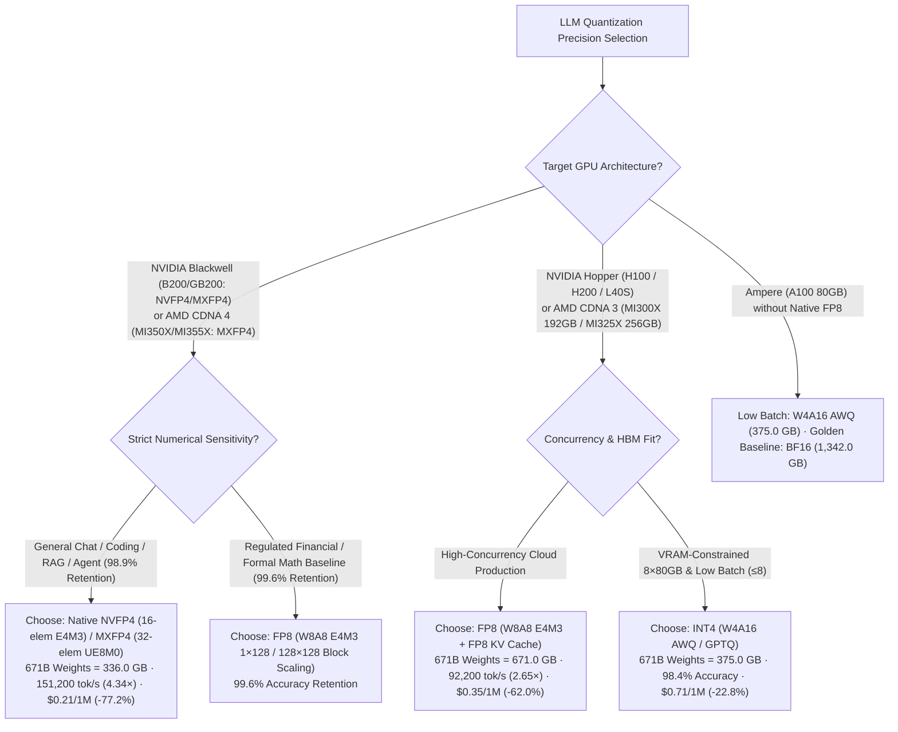
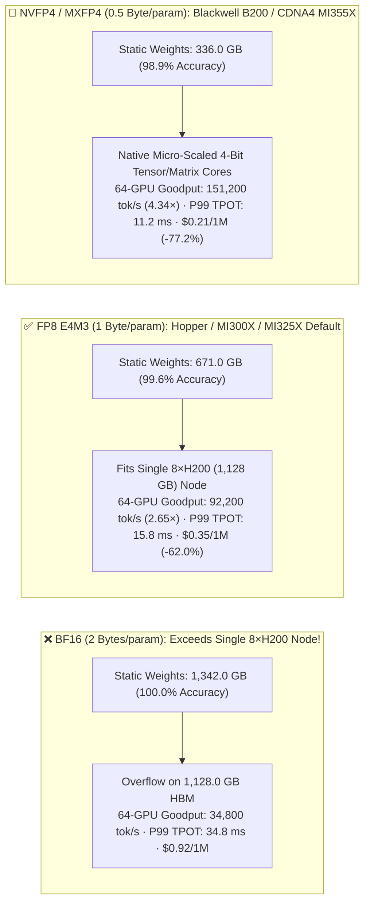
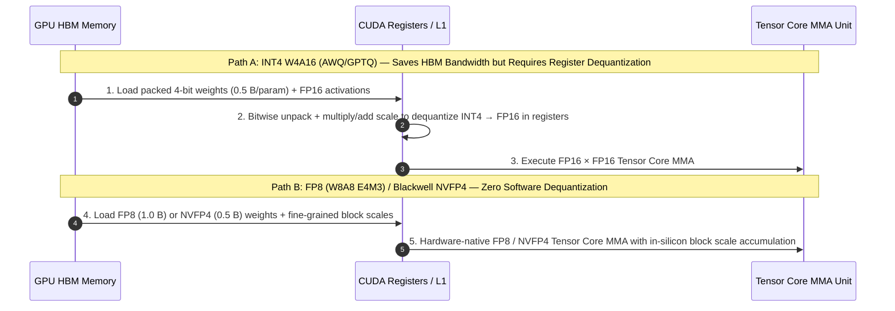

# LLM Inference Quantization Precision Selection (BF16 vs. FP8 E4M3 vs. INT4 AWQ/GPTQ vs. Blackwell NVFP4) — Architect Selection FAQ

> **Document Purpose**: Split out from [`moe-quantization-parallelism-selection-faq.en.md`](moe-quantization-parallelism-selection-faq.en.md) as a **dedicated single-decision FAQ** on **LLM Quantization Precision Selection** (companion to [`moe-parallelism-selection-faq.en.md`](moe-parallelism-selection-faq.en.md)). Using first principles, it answers: **When deploying 70B–671B LLM inference, when should an architect choose native `BF16`, Hopper/MI300X workhorse `FP8 (E4M3)`, weight-only `INT4 (AWQ/GPTQ)`, or Blackwell hardware-native `NVFP4`?**
>
> **Provenance & Data Classification**: Hardware specs for H100/H200/MI300X FP8 and B200 NVFP4 Tensor Cores are **`anonymized_reported` (`independently_reproduced=false`)**. The memory footprint, throughput, and TCO calculations in Section ⑤ come from the repository's sealed **deterministic Roofline model (`synthetic`, `experiments/moe_quantization_parallelism_selection/results.json`)**. No paid cloud multi-node GPU cluster was launched (`paid_cloud_gpu_launched=false`, `live_multinode_gpu_cluster_measurement="not_measured"`); local machine verification covers the Python CLI and unit tests (`measured_local_python_unittest_and_check_cli_only`).
> **中文版本**: [`docs/components/llm-quantization-selection-faq.md`](llm-quantization-selection-faq.md) · **Companion FAQ (MoE Parallelism)**: [`docs/components/moe-parallelism-selection-faq.en.md`](moe-parallelism-selection-faq.en.md) · **7-Card Report**: [`docs/reports/moe-quantization-parallelism-selection-cards.html`](../reports/moe-quantization-parallelism-selection-cards.html)

---

## ① 📌 Executive Summary

1. **Default to `FP8 (W8A8 E4M3 1×128 / 128×128 Fine-Grained Block Scaling)` on Hopper (`H100 / H200 / H20`) and AMD CDNA 3 (`MI300X 192GB / MI325X 256GB`)**:
   - Compared to `BF16`, `FP8 (E4M3)` halves weight and KV Cache memory (`1.0 Byte/param` vs. `2.0 Bytes/param`), shrinking 671B static weights from **`1,342.0 GB` to `671.0 GB`** (fitting inside a single `8×H200 1,128 GB` or `4×MI325X 1,024 GB` node). In our sealed Roofline model (`experiments/moe_quantization_parallelism_selection/results.json`), `FP8` retains **`99.6%` accuracy**, boosts 64-GPU SLA goodput from `34,800 tok/s` to **`92,200 tok/s` (`2.65×`)**, cuts P99 TPOT from `34.8 ms` to **`15.8 ms`**, and lowers token cost from `$0.92` to **`$0.35 / 1M tokens` (`-62.0%`)**.
2. **Use `INT4 (W4A16 AWQ/GPTQ)` Only on Legacy/VRAM-Constrained GPUs (`A100 80GB`) at Low Concurrency (`Batch ≤ 8`)**:
   - `W4A16 (AWQ)` compresses 671B weights to **`375.0 GB`** (`98.4%` accuracy retention, `45,100 tok/s` 64-GPU goodput, `26.4 ms` P99 TPOT, `$0.71 / 1M tokens`, `-22.8%`). At high batch sizes, unpacking and dequantizing 4-bit weights back to FP16 in registers makes `W4A16` slower than hardware-native `W8A8 FP8`.
3. **Adopt Hardware-Native 4-Bit Microscaling on NVIDIA Blackwell (`B200 / GB200`, SM100) and AMD CDNA 4 (`MI350X / MI355X`) — Distinguishing `NVFP4` vs. `MXFP4`**:
   - **`NVFP4` (NVIDIA Blackwell SM100 native)** uses a **16-element `FP8 E4M3` block scale** + global `FP32` tensor scale; **`MXFP4` (OCP Microscaling v1.0 standard, native on AMD CDNA 4 `MI350X/MI355X` and Blackwell)** uses a **32-element shared `UE8M0` power-of-two exponent scale** (note: CDNA 3 `MI300X/MI325X` has native FP8 Matrix Cores, not native FP4 Matrix Cores). In our sealed model, native 4-bit microscaling shrinks 671B weights to **`336.0 GB`**, retains **`98.9%` accuracy**, boosts 64-GPU goodput to **`151,200 tok/s` (`1.64×` over FP8; `4.34×` over BF16)** at **`11.2 ms` P99 TPOT**, and cuts cost to **`$0.21 / 1M tokens` (`-77.2%` vs. BF16)**.

---

## ② 🎯 Key Architect & Customer Q&A (First-Principles Deep Dive)

### Q1: Why is choosing an LLM quantization format fundamentally solving two hardware boundary equations (HBM Capacity & HBM Bandwidth)?

- **Boundary 1 — Single-Node NVLink Fit (HBM Capacity)**:
  - For a 671B MoE model, `BF16` weights require `1,342.0 GB`, exceeding a single 8×H200 (`1,128.0 GB`) node and forcing cross-node communication. Switching to `FP8` drops weights to `671.0 GB`, fitting comfortably inside one 8×H200 node (`457.0 GB` free for KV Cache) and keeping all communication inside `900 GB/s` intra-node NVLink.
- **Boundary 2 — Decode Memory-Bandwidth Roofline**:
  - Autoregressive Decode is memory-bandwidth bound. Halving bytes per parameter (`BF16 → FP8 → NVFP4`) directly halves HBM bytes transferred per generated token.

### Q2: How do `FP8 (E4M3)`, `INT8 (SmoothQuant)`, and `INT4 (W4A16 AWQ/GPTQ)` differ in numerical representation and silicon execution?

- **Why `FP8 (E4M3)` replaced uniform `INT8`**:
  - Transformer activations exhibit sharp channel outliers. Uniform `INT8` wastes dynamic range on outliers, whereas floating-point `FP8 (E4M3: 1 sign + 4 exponent + 3 mantissa)` paired with **`1×128` activation / `128×128` weight block scaling** preserves accuracy within `<0.3%` of BF16.
- **Why `W4A16 INT4` slows down at high batch sizes**:
  - `W4A16` stores 4-bit integer weights but multiplies them against FP16 activations. Because Hopper lacks native `INT4 × FP16` Tensor Core instructions, weights must be unpacked and dequantized to FP16 in registers on the fly.

### Q3: How do Blackwell `NVFP4` and OCP `MXFP4` (`MI355X` / Blackwell) prevent 4-bit accuracy collapse, and how do their SKU/kernel boundaries differ?

- **Hardware Micro-Scaling vs. Legacy Per-Row INT4**: Hardware micro-scaling attaches a fine-grained scale factor to every 16 or 32 contiguous elements and applies scales inside the hardware MMA accumulator (`98.9%` accuracy retention in our sealed model).
- **Exact Format & SKU Boundaries (`NVFP4` vs. `MXFP4`)**:
  - **`NVFP4` (NVIDIA Blackwell `B200 / GB200` SM100 native)**: **16-element `E2M1` block** with an **`FP8 (E4M3)` scale factor** + second-level `FP32` global tensor scale, executed via CUTLASS / TensorRT-LLM / SGLang SM100 `mm_fp4` kernels.
  - **`MXFP4` (OCP Microscaling v1.0, native on AMD CDNA 4 `MI350X / MI355X` and NVIDIA Blackwell)**: **32-element `E2M1` block** with a shared **`UE8M0` (8-bit power-of-two exponent) scale factor**.
  - **CDNA 3 (`MI300X / MI325X`) Boundary**: `MI300X (192GB)` and `MI325X (256GB)` are **CDNA 3** GPUs with hardware-native **`FP8` Matrix Cores**, **not** hardware-native FP4 Matrix Cores (`MXFP4` on `MI325X` is used for weight/KV storage compression with dequantization rather than native 4-bit matrix instructions).

---

## ③ 🧭 Visual Diagrams (Mermaid Decision Tree + HBM Capacity Layout + Tensor Core Pipeline)

### 3.1 LLM Quantization Precision Selection Decision Tree (`flowchart TD`)

### 3.2 671B Model HBM Footprint & 64-GPU Cluster Performance Across Precisions (`flowchart LR`)

### 3.3 `W4A16 (AWQ)` Register Dequantization vs. `W8A8 (FP8)` / `NVFP4` Native Tensor Core Pipeline (`sequenceDiagram`)

---

## ④ 📊 Architect Decision Matrix

| Dimension | `BF16 / FP16` (`bf16_pure_tp16`) | `INT4 W4A16` (`w4a16_awq_tp8`) | `FP8 E4M3 Block-Scaled` (`fp8_block_scaled_dp8_ep8`) | `NVFP4 / MXFP4` (`nvfp4_mxfp4_dp16_ep16`) |
| :--- | :--- | :--- | :--- | :--- |
| **1. Best-Fit Hardware & Scenarios** | Golden reference, RL post-training master weights | Legacy `A100 80GB`, low concurrency (`Batch ≤ 8`) | **Hopper (`H100/H200/L40S`) & CDNA 3 (`MI300X/MI325X`) Default** | **Blackwell (`B200/GB200`: `NVFP4`) & CDNA 4 (`MI355X`: `MXFP4`)** |
| **2. 671B Weights & 64-GPU Goodput (`synthetic` model)** | **`1,342.0 GB`**; `34,800 tok/s`; `34.8 ms` P99 TPOT | **`375.0 GB`**; `45,100 tok/s`; `26.4 ms` P99 TPOT | **`671.0 GB`**; **`92,200 tok/s` (`2.65×`)**; **`15.8 ms` P99 TPOT** | **`336.0 GB`**; **`151,200 tok/s` (`4.34×`)**; **`11.2 ms` P99 TPOT** |
| **3. Core Mechanism** | 16-bit floating point MMA | 4-bit weights dequantized to FP16 in registers | `1×128` act / `128×128` weight block scale + native FP8 Tensor/Matrix Core | `NVFP4` (16-elem `E4M3` scale) / `MXFP4` (32-elem `UE8M0` scale) native 4-bit MMA |
| **4. Accuracy Retention (`accuracy_retention_pct`)** | **`100.0%`** (Reference baseline) | **`98.4%`** (Slight dip on hard math/code) | **`99.6%`** (Virtually lossless production standard) | **`98.9%`** (High fidelity via hardware micro-scaling) |
| **5. Ecosystem Support** | Universal | Broad via Marlin kernels in vLLM / SGLang / TRT-LLM | Native in vLLM, SGLang, TRT-LLM, DeepGEMM | TRT-LLM / SGLang / vLLM SM100 (`NVFP4`) & ROCm CDNA4 (`MXFP4`) |
| **6. TCO Cost (`synthetic` model)** | **`$0.92 / 1M tokens`** (Baseline) | **`$0.71 / 1M tokens`** (`-22.8%`) | **`$0.35 / 1M tokens` (`-62.0%` vs. BF16)** | **`$0.21 / 1M tokens` (`-77.2%` vs. BF16)** |

---

## ⑤ 🧪 Quantitative Analytical Case Study (`experiments/moe_quantization_parallelism_selection`)

Every number below is **1-to-1 bound** to the sealed Roofline model `experiments/moe_quantization_parallelism_selection/results.json` (`synthetic` model calibrated to `anonymized_reported` specs, `independently_reproduced=false`):

| Option Key (`results.json`) | Static Weights (`weight_memory_gb`) | 64-GPU SLA Goodput (`sla_goodput_tok_s`) | P99 TPOT (`tpot_p99_ms`) | Accuracy Retention (`accuracy_retention_pct`) | Cost per 1M (`cost_per_1m_tokens_usd`) | Provenance |
| :--- | :--- | :--- | :--- | :--- | :--- | :--- |
| **1. `bf16_pure_tp16`** | `1,342.0 GB` | `34,800 tok/s` (`1.00×`) | `34.8 ms` | `100.0%` | `$0.92` | `synthetic` |
| **2. `w4a16_awq_tp8`** | `375.0 GB` | `45,100 tok/s` (`1.30×`) | `26.4 ms` | `98.4%` | `$0.71` (`-22.8%`) | `synthetic` |
| **3. `fp8_block_scaled_dp8_ep8` (Hopper/CDNA3 Default)** | **`671.0 GB`** | **`92,200 tok/s` (`2.65×`)** | **`15.8 ms`** | **`99.6%`** | **`$0.35` (`-62.0%`)** | `synthetic` |
| **4. `nvfp4_mxfp4_dp16_ep16` (Blackwell/CDNA4 Flagship)** | **`336.0 GB`** | **`151,200 tok/s` (`4.34×` vs BF16 / `1.64×` vs FP8)** | **`11.2 ms`** | **`98.9%`** | **`$0.21` (`-77.2%`)** | `synthetic` |

---

## ⑥ 🛠️ Appendix: Production Verification Checklist (Architect Checklist)

- [ ] **1. Check Single-Node NVLink Fit via `FP8` First**: If `Model_Params_B × 1.0 GB ≤ Node_HBM_GB × 0.65`, deploy `FP8` on a single 8-GPU NVLink node before considering multi-node topologies.
- [ ] **2. Verify `128×128` Fine-Grained Block Scaling for `FP8`**: Avoid legacy per-tensor static FP8; confirm `1×128` activation and `128×128` weight block scales are enabled.
- [ ] **3. Confirm `Marlin` Kernel Activation for `W4A16 (AWQ/GPTQ)`**: Verify that `MarlinLinearKernel` is active in vLLM/SGLang logs so register dequantization does not bottleneck mid-batch serving.
- [ ] **4. Calibrate Per-Head `FP8` KV Cache Scales**: Enable per-head `k_scale` / `v_scale` calibration when turning on `--kv-cache-dtype fp8_e4m3`.
- [ ] **5. Run Golden-Set Accuracy Regression Before Cutover**: Validate 200–500 domain prompts (structured JSON + multi-hop reasoning) when migrating from `BF16` to `FP8` or `NVFP4`.
