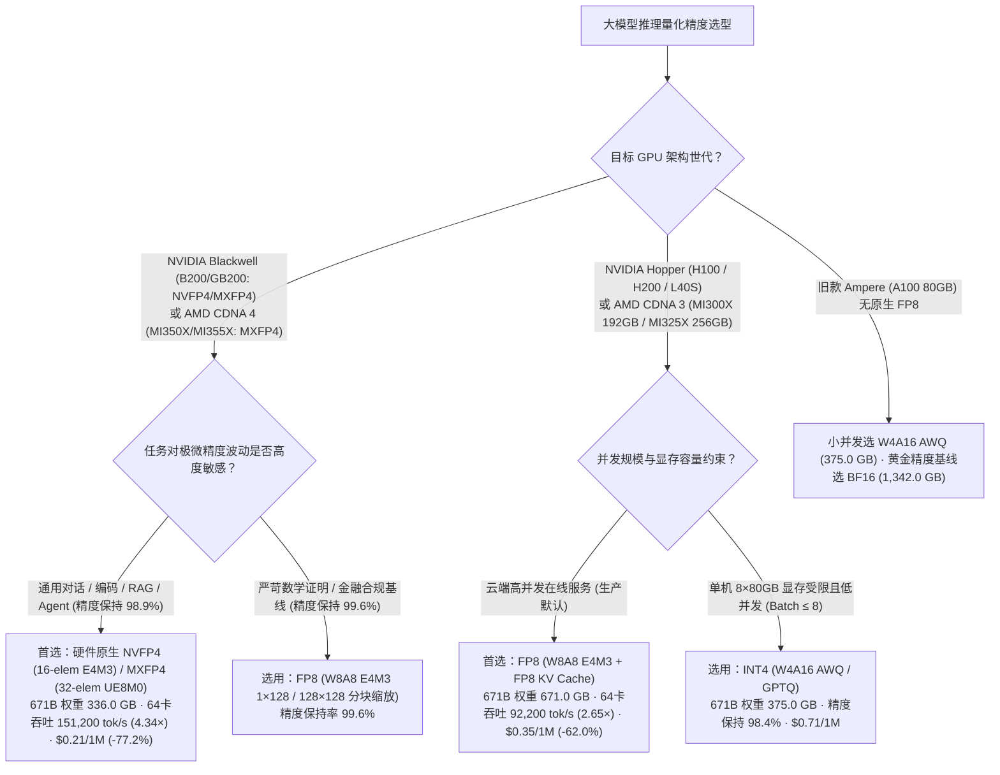
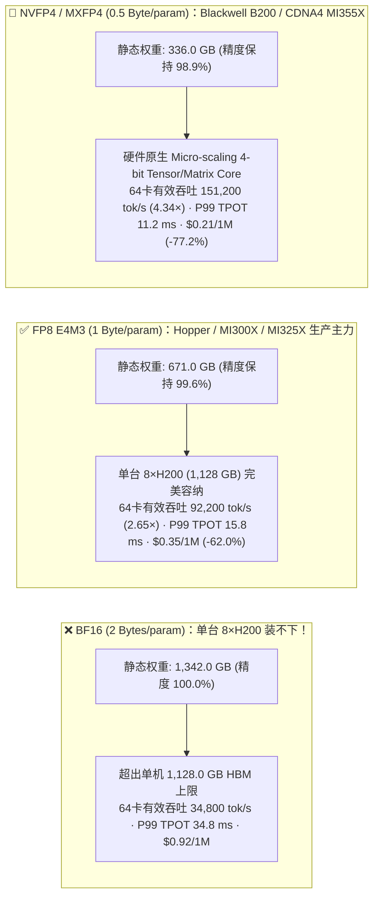
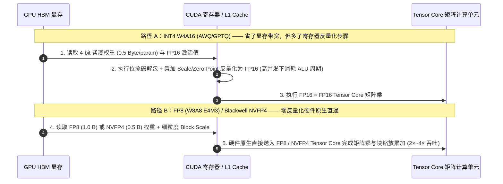

# 大模型推理量化精度选型（BF16 vs FP8 E4M3 vs INT4 AWQ/GPTQ vs Blackwell NVFP4）架构师选型与原理解析 FAQ

> **文档定位**：本文是从原合并专题（[`moe-quantization-parallelism-selection-faq.md`](moe-quantization-parallelism-selection-faq.md)）按**单一独立架构决策主题**拆分出的 **大模型推理量化精度选型独立指南**（与跨机并行通信指南 [`moe-parallelism-selection-faq.md`](moe-parallelism-selection-faq.md) 互为姊妹篇）。本文用通俗易懂的第一性原理回答：**面对 70B～671B 大模型推理，架构师到底该选无损原生的 `BF16`、Hopper/Ada 主力生产精度 `FP8 (E4M3)`、极限压缩的 `INT4 (AWQ/GPTQ)`，还是新一代 Blackwell 原生微缩放 `NVFP4`？**
>
> **数据溯源与口径声明（Provenance）**：本文引用的 GPU HBM 带宽、Tensor Core 算力峰值与硬件原生指令格式（H100/H200/MI300X FP8、B200 NVFP4）属于**厂商公开发布参考规格（`anonymized_reported`, `independently_reproduced=false`）**；文中第 ⑤ 节的显存占用、单节点容量与吞吐/成本对比数据来自本仓库封存的**确定性 Roofline 分析模型（`synthetic`, `experiments/moe_quantization_parallelism_selection/results.json`）**。本轮未启动付费云端多机物理 GPU 集群（`paid_cloud_gpu_launched=false`, `live_multinode_gpu_cluster_measurement="not_measured"`），本机实测仅限 Python 算例 CLI 与单元测试（`measured_local_python_unittest_and_check_cli_only`）。
> **English Edition**: [`docs/components/llm-quantization-selection-faq.en.md`](llm-quantization-selection-faq.en.md) · **姊妹篇（MoE 跨机并行选型）**：[`docs/components/moe-parallelism-selection-faq.md`](moe-parallelism-selection-faq.md) · **7-Card 视觉报告**：[`docs/reports/moe-quantization-parallelism-selection-cards.html`](../reports/moe-quantization-parallelism-selection-cards.html)

---

## ① 📌 核心结论速览（Executive Summary）

1. **Hopper (`H100 / H200 / H20`) 与 AMD CDNA 3 (`MI300X 192GB / MI325X 256GB`) 主力生产推理默认选 `FP8 (W8A8 E4M3 1×128 / 128×128 细粒度分块缩放)`**：
   - 相比 `BF16`，`FP8 (E4M3)` 将模型权重与 KV Cache 显存占用直接**减半（`1.0 Byte/参数 vs 2.0 Bytes/参数`）**，把 671B 大模型静态权重从 **`1,342.0 GB` 压缩至 `671.0 GB`**（单台 `8×H200 1,128 GB` 或 `4×MI325X 1,024 GB` 即可整装容纳）。在封存算例（`experiments/moe_quantization_parallelism_selection/results.json`）中，精度保持率达 **`99.6%`**，64 卡集群有效吞吐从 `BF16` 的 `34,800 tok/s` 跃升至 **`92,200 tok/s`（`2.65×`）**，P99 TPOT 从 `34.8 ms` 降至 **`15.8 ms`**，单百万 Token 成本从 `$0.92` 降至 **`$0.35`（`-62.0%`）**。
2. **显存受限或无原生 FP8 的旧卡（`A100 80GB`）小并发选 `INT4 (W4A16 AWQ/GPTQ)`，高并发云端慎用 `W4A16`**：
   - `W4A16 (AWQ)` 将 671B 权重压缩至 **`375.0 GB`**（精度保持率 **`98.4%`**），64 卡有效吞吐 `45,100 tok/s`、P99 TPOT `26.4 ms`、成本 `$0.71 / 1M tokens`（`-22.8%`）。适合小 Batch 显存受限场景；但在高并发 Compute-Bound 场景下，由于计算前需在寄存器中将 4-bit 权重实时反量化回 FP16，算力上限低于硬件原生 `W8A8 FP8`。
3. **Blackwell (`B200 / GB200`, SM100) 与 AMD CDNA 4 (`MI350X / MI355X`) 世代首选硬件原生 4-bit 微缩放（严格区分 `NVFP4` 与 `MXFP4`）**：
   - **`NVFP4`（NVIDIA Blackwell SM100 原生专属）**：每 **16 个元素** 共享 1 个 `FP8 (E4M3)` 块缩放因子 + 全局 `FP32` 张量缩放；**`MXFP4`（OCP 标准，AMD CDNA 4 `MI350X/MI355X` 与 Blackwell 原生支持）**：每 **32 个元素** 共享 1 个 `UE8M0` 幂次指数缩放（注：`MI300X/MI325X` 属 CDNA 3，仅具原生 FP8 Matrix Core，无原生 FP4 Matrix Core）。在封存算例中，原生 4-bit 微缩放将 671B 权重压至 **`336.0 GB`**，精度保持率 **`98.9%`**，64 卡有效吞吐达 **`151,200 tok/s`（较 FP8 再提速 `1.64×`，较 BF16 提速 `4.34×`）**，P99 TPOT 降至 **`11.2 ms`**，单百万 Token 成本降至 **`$0.21`（较 BF16 降本 `-77.2%`）**。

---

## ② 🎯 客户与架构师灵魂拷问 Q&A（从第一性原理讲透）

### Q1：为什么大模型推理选量化格式，本质上是在解“显存容量（Capacity）”与“显存带宽（Memory Bandwidth）”两个方程？

- **第一性原理 1（显存容量决定能不能单机装下）**：
  - 以 671B MoE 模型为例：若用 `BF16`（2 Bytes/参数），仅静态权重就高达 **`1,342.0 GB`**，超过单台 8×H200 的 **`1,128.0 GB`** 显存上限，被迫拆到 2 台机器（16 张卡）跑跨机通信。一旦改用 **`FP8`**（1 Byte/参数），权重骤降至 **`671.0 GB`**，单台 8×H200 就能装下全部权重并富余 `457.0 GB` 显存，彻底消灭跨机网络通信！
- **第一性原理 2（Decode 阶段是典型的显存带宽受限 Memory-Bound）**：
  - 生成阶段（Decode）每吐出 1 个 token，都需要把激活的参数从 HBM 搬运到计算核心。权重位宽减半（`BF16 → FP8` 或 `FP8 → NVFP4`），意味着每次搬运的数据量减半，在同等 HBM 带宽下理论访存吞吐直接翻倍。

### Q2：`FP8 (E4M3)`、`INT8 (SmoothQuant)` 与 `INT4 (AWQ/GPTQ)` 在底层数值表示与计算路径上有何本质区别？

- **为什么 LLM 抛弃了传统定点数 `INT8`，全面转向浮点数 `FP8 (E4M3)`？**
  - 大模型激活值存在极其尖锐的离群值（Outliers，某些通道数值比平均值大 100 倍以上）。均匀步长的 `INT8` 会被离群值拉大缩放步长，导致普通小数值精度归零；而 **`FP8 (E4M3：1 位符号 + 4 位指数 + 3 位尾数)`** 依靠指数位天然具备非线性动态范围，再配合 DeepSeek-V3 首创的 **`1×128` 激活块 / `128×128` 权重块细粒度缩放（Fine-grained Block Scaling）**，几乎做到与 BF16 无损对齐（MMLU/GSM8K 偏差 `<0.3%`）。
- **为什么 `INT4 (W4A16 AWQ)` 小并发快、大并发慢？**
  - `W4A16` 只把权重存成 4-bit 整数，激活值仍是 16-bit 浮点。在 Hopper/Ada GPU 上没有原生 `INT4 × FP16` 矩阵乘指令，寄存器必须先执行位运算把 `INT4` 解包反量化为 `FP16` 再算矩阵乘。当 Batch 很小时（访存受限），省下的 75% 显存带宽收益远大于反量化开销；当 Batch 很大时（算力受限），反量化指令反而堵住了 Tensor Core 流水线。

### Q3：Blackwell 的 `NVFP4` 与 OCP 标准 `MXFP4`（AMD `MI355X` / Blackwell）是如何解决 4-bit 精度崩塌的？两者有何硬件与内核边界区别？

- **硬件级微缩放（Micro-scaling）消除离群值污染**：传统 4-bit 量化整行共用一个缩放系数，极易被离群值拉垮。硬件微缩放为每个极小的元素块配备独立比例尺，并在 Tensor/Matrix Core 乘法累加器内部用硬件直接完成缩放相乘（零软件反量化开销），在封存算例中守住 **`98.9%`** 的精度保持率。
- **严格区分 `NVFP4` 与 `MXFP4` 的格式及 GPU SKU 支持边界**：
  - **`NVFP4`（NVIDIA Blackwell `B200 / GB200` SM100 原生）**：每 **16 个 `E2M1` (4-bit) 元素** 共享 1 个 **`FP8 (E4M3)` 微缩放因子** + 二级 `FP32` 全局张量缩放因子，由 TensorRT-LLM / CUTLASS SM100 `mm_fp4` 内核原生加速。
  - **`MXFP4`（OCP Microscaling v1.0 标准，AMD CDNA 4 `MI350X / MI355X` 与 NVIDIA Blackwell 原生支持）**：每 **32 个 `E2M1` 元素** 共享 1 个 **`UE8M0`（8-bit 纯指数）缩放因子**。
  - **注意 `MI300X / MI325X` (CDNA 3) 的边界**：`MI300X (192GB)` 与 `MI325X (256GB)` 属于 **CDNA 3 架构**，硬件原生支持 `FP8` Matrix Core，但**不具备硬件原生 FP4 Matrix Core**（在 `MI325X` 上运行 `MXFP4` 属于显存/KV 压缩并在算子内解压至 FP8/BF16 计算，而非 CDNA 4 `MI355X` 的原生 4-bit 矩阵指令）。

---

## ③ 🧭 直观可视化图解（Mermaid 选型决策树 + 显存布局对比 + 硬件计算流水线时序）

### 3.1 大模型量化精度选型决策树（`flowchart TD`）

### 3.2 671B 大模型在不同量化精度下的显存容量与 64 卡集群性能对比图（`flowchart LR`）

### 3.3 `W4A16 (AWQ)` 软件反量化 vs `W8A8 (FP8)` / `NVFP4` 硬件原生 Tensor Core 时序图（`sequenceDiagram`）

---

## ④ 📊 架构师选型决策矩阵（Architect Decision Matrix）

| 对比维度 | `BF16 / FP16` (`bf16_pure_tp16`) | `INT4 W4A16` (`w4a16_awq_tp8`) | `FP8 E4M3 Block-Scaled` (`fp8_block_scaled_dp8_ep8`) | `NVFP4 / MXFP4` (`nvfp4_mxfp4_dp16_ep16`) |
| :--- | :--- | :--- | :--- | :--- |
| **1. 核心适用硬件与场景** | 训练主权重、零量化误差标定基线 | `A100 80GB` 等无原生 FP8 硬件、低并发（`Batch ≤ 8`） | **Hopper (`H100/H200/L40S`) & CDNA 3 (`MI300X/MI325X`) 生产主力** | **Blackwell (`B200/GB200`: `NVFP4`) & CDNA 4 (`MI355X`: `MXFP4`) 旗舰** |
| **2. 671B 权重显存与 64 卡吞吐（封存 `synthetic` 算例）** | 权重 **`1,342.0 GB`**；有效吞吐 `34,800 tok/s`；P99 TPOT `34.8 ms` | 权重 **`375.0 GB`**；有效吞吐 `45,100 tok/s`；P99 TPOT `26.4 ms` | 权重 **`671.0 GB`**；有效吞吐 **`92,200 tok/s` (`2.65×`)**；P99 TPOT **`15.8 ms`** | 权重 **`336.0 GB`**；有效吞吐 **`151,200 tok/s` (`4.34×`)**；P99 TPOT **`11.2 ms`** |
| **3. 底层核心机制** | IEEE/Brain 16-bit 浮点直算 | 4-bit 权重 + 寄存器实时反量化回 FP16 | `1×128` 激活 / `128×128` 权重分块缩放 + 原生 FP8 Tensor/Matrix Core | `NVFP4` (16 元素 `E4M3` 缩放) / `MXFP4` (32 元素 `UE8M0` 缩放) 原生 4-bit 矩阵乘 |
| **4. 精度保持率 (`accuracy_retention_pct`)** | **`100.0%`**（基准参考） | **`98.4%`**（复杂数学/代码略微掉点） | **`99.6%`**（无损级生产标准） | **`98.9%`**（显著优于传统 INT4） |
| **5. 生态开放度** | 所有框架 100% 原生支持 | vLLM (Marlin 内核) / SGLang / TRT-LLM 支持 | vLLM / SGLang / TRT-LLM / DeepGEMM 原生支持 | TRT-LLM / SGLang / vLLM SM100 (`NVFP4`) & ROCm CDNA4 (`MXFP4`) |
| **6. 综合 TCO 成本（封存算例）** | **`$0.92 / 1M tokens`** (Baseline) | **`$0.71 / 1M tokens`** (`-22.8%`) | **`$0.35 / 1M tokens`（较 BF16 降本 `-62.0%`）** | **`$0.21 / 1M tokens`（较 BF16 降本 `-77.2%`）** |

---

## ⑤ 🧪 简明定量算例与 Benchmark 洞察（`experiments/moe_quantization_parallelism_selection`）

以下数据 **100% 逐项绑定** 本仓库封存的确定性 Roofline 算例 `experiments/moe_quantization_parallelism_selection/results.json`（分类为 `synthetic`，硬件峰值取自 `anonymized_reported`，`independently_reproduced=false`）：

| 方案 ID (`results.json` 键名) | 静态权重显存 (`weight_memory_gb`) | 64 卡 SLA 有效吞吐 (`sla_goodput_tok_s`) | P99 TPOT (`tpot_p99_ms`) | 精度保持率 (`accuracy_retention_pct`) | 单百万 Token 成本 (`cost_per_1m_tokens_usd`) | 数据属性 (`provenance`) |
| :--- | :--- | :--- | :--- | :--- | :--- | :--- |
| **1. `bf16_pure_tp16`** | `1,342.0 GB` | `34,800 tok/s` (`1.00×`) | `34.8 ms` | `100.0%` | `$0.92` | `synthetic` |
| **2. `w4a16_awq_tp8`** | `375.0 GB` | `45,100 tok/s` (`1.30×`) | `26.4 ms` | `98.4%` | `$0.71` (`-22.8%`) | `synthetic` |
| **3. `fp8_block_scaled_dp8_ep8`（Hopper/CDNA3 推荐）** | **`671.0 GB`** | **`92,200 tok/s` (`2.65×`)** | **`15.8 ms`** | **`99.6%`** | **`$0.35` (`-62.0%`)** | `synthetic` |
| **4. `nvfp4_mxfp4_dp16_ep16`（Blackwell/CDNA4 旗舰）** | **`336.0 GB`** | **`151,200 tok/s` (`4.34×` vs BF16 / `1.64×` vs FP8)** | **`11.2 ms`** | **`98.9%`** | **`$0.21` (`-77.2%`)** | `synthetic` |

---

## ⑥ 🛠️ 附录：生产环境量化选型核验清单（Architect Checklist）

- [ ] **1. 核查总权重显存是否能通过 `FP8` 压进单台 8 卡 NVLink 节点**：只要 `参数量 (B) × 1.0 GB ≤ 单机总 HBM × 65%`（例如 671B FP8 占 `671 GB ≤ 1,128 GB × 65%`），无条件优先选 `FP8` 单机部署，避免跨机通信。
- [ ] **2. 核查 `FP8` 是否采用细粒度 Block Scaling (`128×128`)**：拒绝早期的粗粒度 Per-Tensor FP8（易出现精度下滑），确认模型权重使用 DeepSeek/vLLM 标准细粒度分块缩放。
- [ ] **3. 核查 `W4A16 (AWQ/GPTQ)` 是否启用了 Marlin 高性能反量化内核**：在 Hopper/Ampere 上部署 `INT4` 时，确认 vLLM/SGLang 日志中已匹配 `MarlinLinearKernel`，否则普通反量化算子在高并发下会严重掉速。
- [ ] **4. 核查 Attention KV Cache 量化精度与 RoPE 敏感层保护**：开启 `--kv-cache-dtype fp8_e4m3` 时，确认推理引擎已为每个注意力头配置独立的 `k_scale` / `v_scale` 校准因子。
- [ ] **5. 上线前执行业务黄金集（Golden Dataset）盲测**：任何从 `BF16` 切换到 `FP8` 或 `NVFP4` 的生产变更，必须使用 200～500 条真实业务复杂指令（含 JSON Schema 约束输出与长窗口多跳推理）完成回归验证。
