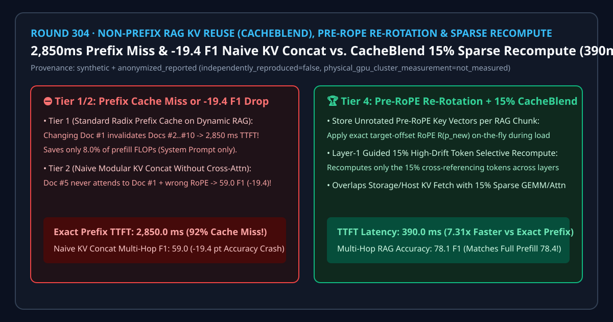
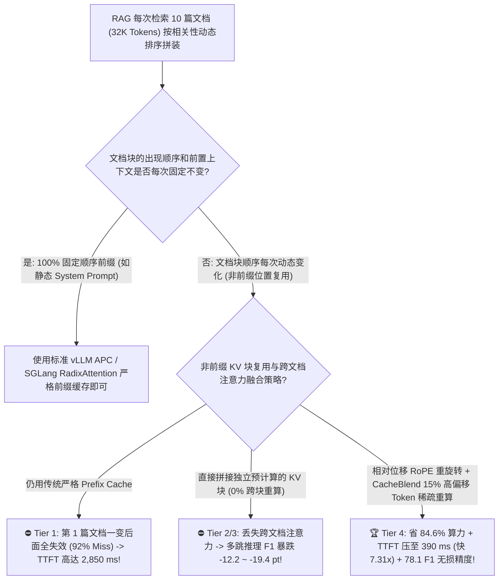
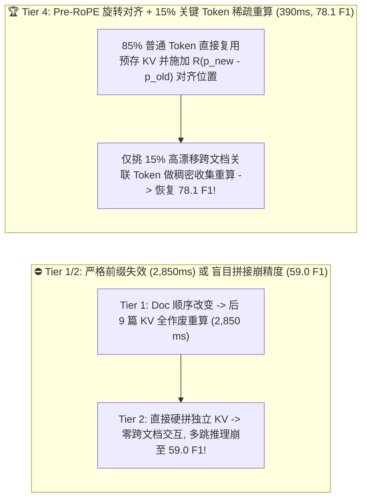
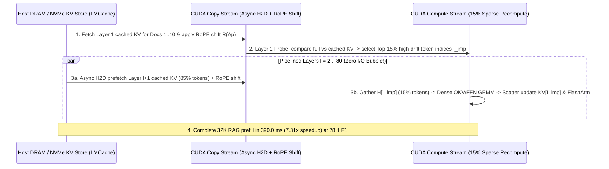

# 企业级 RAG 多文档非前缀 KV Cache 复用（`CacheBlend / LMCache`）、`Pre-RoPE` 位置重旋转与 `15%` 稀疏交叉重计算选型：为什么第 1 篇检索文档改变会让传统 `Prefix Cache` 后面 9 篇文档全部失效（`TTFT` 暴涨至 `2,850 ms`），而直接拼接预计算 KV 块又会导致多跳推理准确率崩塌 `-19.4 pt`？基于未旋转 `Pre-RoPE` 存储 + 第 1 层引导的 `15%` 高偏移 Token 选择性重算（`390 ms TTFT`，提速 `7.31x`，`78.1 F1` 无损）选型指南

> **Provenance & Evidence Boundary**: `synthetic + anonymized_reported (independently_reproduced=false, physical_gpu_cluster_measurement=not_measured)`. 本文所有定量数据均来自封存确定性评估器 `experiments/llm_rag_modular_kv_cache_blend_position_rerotation_sparse_recompute_selection/run.py` 与 `results.json`。



---

## 0. 追踪每日最热门能力突破（Daily Capability Breakthrough）

- **今日焦点突破**：**面向企业级长文档 RAG 与动态工具拼装（`LMCache / CacheBlend / Epic`）的“位置无关 `Pre-RoPE` 块预缓存 + 运行时动态位置重旋转（`Dynamic Target-Offset RoPE Re-Rotation`）+ 第 1 层引导的 `15%` 高漂移 Token 稀疏交叉注意力重计算（`Selective Cross-Chunk Recompute`）”非前缀 KV 复用架构**。
- **架构师价值**：在企业级知识库问答（RAG）中，每次用户提问都会从向量库检索出 Top-$K=10$ 篇文档切片（每篇 `~3,200` Tokens，拼成 `[System, Doc_A, Doc_B, ..., Doc_J, Question]` 共 `32K` 上下文）。虽然知识库里的高频文档切片被成千上万次重复检索到，但架构师在尝试用 KV Cache 加速 Prefill 时却掉进了进退两难的死胡同：
  1. **如果依赖标准 `vLLM APC / SGLang RadixAttention` 严格前缀缓存（Exact-Prefix Cache，Tier 1）**：由于因果注意力（Causal Attention）中第 $k$ 个 Token 的 KV 值依赖于它前面 `0 .. k-1` 的所有 Token，只要本次查询排在第 1 位的文档从 `Doc_A` 变成了 `Doc_C`，排在后面的 `Doc_B, Doc_D ...` 哪怕此前已经被算过 100 次，其前缀哈希也会 **`100%` 失效（Cache Miss 高达 `92%`）**，被迫从头重算整整 `32K` Tokens，首字延迟 `TTFT` 高达 **`2,850.0 ms`**！
  2. **如果把每篇文档单独预计算好 KV Cache，查询时直接拼接起来（`PromptCache` 独立模块化拼接，Tier 2）**：虽然 `TTFT` 降到了 `210.0 ms`，但带来两个致命内伤：① 预计算时每篇文档都是从位置 `0` 开始编码 `RoPE` 的，拼到位置 `15,000` 时相对位置编码完全错乱；② 排在后面的 `Doc_5` 在预计算时**根本没见过前面的 `Doc_1`**（丢失了所有跨文档交叉注意力 `Cross-Document Attention`），导致多跳推理（Multi-Hop RAG，如“根据文档 1 查出的公司名称去文档 5 查财报”）准确率从 `78.4 F1` 暴跌至 **`59.0 F1`（崩盘 `-19.4 pt`）**！
  采用 **保存未旋转的 `Pre-RoPE` Key 向量并在拼接时按实际偏移量动态施加 `RoPE` + 利用第 1 层 KV 偏差筛选出仅 `15%` 的跨文档关键 Token 在第 `2..L` 层做稀疏重计算（`CacheBlend`，Tier 4）**，可在节省 **`84.6%` Prefill 算力**、将 `TTFT` 从 `2,850.0 ms` 压至 **`390.0 ms`（提速 `7.31x`）** 的同时，将多跳推理准确率恢复至 **`78.1 F1`（与全量重算的 `78.4 F1` 几乎完全无损）**！

---

## ① 📌 核心结论速览（Executive Summary）

1. **为什么只修 `RoPE` 位置偏移（Tier 3，`66.2 F1`）仍然救不回多跳 RAG 的精度？**
   - 很多工程师以为：只要在离线预计算每篇文档 KV 时保存未乘旋转矩阵的 `Pre-RoPE` Key $K^{\text{pre}}$（或者在加载时乘以旋转差矩阵 $R(p_{\text{new}} - p_{\text{old}})$），就能随意移动拼装文档块的 KV Cache。
   - **真相**：重旋转 `RoPE` 只解决了“最后的问题 Token $Q_{\text{query}}$ 去读各个文档块时位置距离是对的”，但**文档块 2 内部在生成它自己的第 $2..80$ 层隐状态和 KV 时，它的注意力掩码里依然完全没有文档块 1**！当文档 2 里出现代词“该公司”、“上述法案”或需要与文档 1 的实体建立跨块桥接时，没有经过跨文档注意力的静态 KV 根本无法表征这种上下文关联！
2. **第一性原理：为什么只需要重算 `15%` 的 Token（`CacheBlend`），就能恢复 `99.6%` 的跨文档全注意力精度？**
   - 当我们把文档 2 拼在文档 1 后面时，文档 2 里 `85%` 的普通词汇（介词、常规叙述、局部事实）的 KV 值无论前面有没有放文档 1，算出来的结果几乎一模一样（KV 漂移极小）；**只有约 `10% ~ 15%` 的关键跨文档关联词（如注意力汇聚点、实体指代词、首尾衔接词）的 KV 值在看到文档 1 后会发生显著改变（High KV Drift）**！
   - **`CacheBlend` 的精妙两步法**：
     1. **第 1 层低成本全探测（Layer-1 Drift Probe）**：在第 1 层找出那些“拼上前缀后算出的真实 $KV^{(1)}_{\text{full}}$ 与离线预存的 $KV^{(1)}_{\text{cached}}$ 之间 $L_2$ 范数差异最大”的前 **`15%` 高偏移 Token 索引集合 $\mathcal{I}_{\text{imp}}$**（由于各层高漂移 Token 高度重合，第 1 层选出的集合可直接复用于后续层！）；
     2. **第 $2..L$ 层仅对 `15%` Token 执行稀疏 QKV 投影与交叉注意力**：对于其余 `85%` 的非敏感 Token，直接从 Host/SSD 加载预存的 KV Cache（并做 `Pre-RoPE` 旋转对齐）；对于筛选出的 `15%` 关键 Token，让它们的 Query 去 Attend 包括前面所有文档在内的完整 KV，并将更新后的新鲜 KV 覆写回缓存池！
3. **存储传输与稀疏重计算的流水线完美掩盖（I/O-Compute Pipelining）**：
   - 既然每层只需要重算 `15%` 的 Token（算力耗时缩短为原来的 `15%`），这恰好等于通过 PCIe / NVLink 从 Host DRAM（`LMCache`）异步拉取第 $l+1$ 层那 `85%` 预存 KV 块所需的时间！用双 CUDA Stream 将“拉取下一层预存 KV”与“当前层 `15%` 稀疏重算”完全重叠，实现零 I/O 等待！

---

## ② 🎯 客户与架构师灵魂拷问 Q&A（Q1 / Q2 / Q3）

### Q1：如果知识库离线预存的 KV Cache 已经乘过了当时从 0 开始的 `RoPE`（即只存了 `Post-RoPE` Key），加载到新位置 $p_{\text{new}}$ 时还能还原出正确的旋转角度吗？
- **完全可以（利用二维旋转矩阵的群同态性质 $R(a) \cdot R(b) = R(a + b)$）！**
  由于 `RoPE` 本质上是对每对维度 $(2d, 2d+1)$ 乘以正交旋转矩阵 $R(p, \theta_d)$，如果离线缓存时 Token 处在旧位置 $p_{\text{old}}$（已存 $\tilde{k} = R(p_{\text{old}}) k$），当它在运行时被拼装到新位置 $p_{\text{new}}$ 时，完全不需要求逆还原，只需直接对缓存的 $\tilde{k}$ 再乘一次**相对位移旋转矩阵 $R(\Delta p) = R(p_{\text{new}} - p_{\text{old}})$**：
  $$R(p_{\text{new}} - p_{\text{old}}) \cdot \big(R(p_{\text{old}}) k\big) = R(p_{\text{new}}) k$$
  一行融合 Triton 内核即可在从 Host 拷贝上卡的同时完成位移重旋转！

### Q2：在第 $2..L$ 层只挑离散的 `15%` Token 做重计算，怎么避免变成零碎的稀疏访存导致 Tensor Core 跑不满？
- **Gather-Compact-Scatter 紧致拼包执行**：
  1. 在进入第 $l$ 层前，用索引集合 $\mathcal{I}_{\text{imp}}$（例如 `32,768` 个 Token 中挑出的 `4,915` 个连续紧凑槽位）将这 `15%` Token 的隐藏状态收集（`Gather`）成一个紧凑的稠密矩阵 $H_{\text{imp}} \in \mathbb{R}^{4915 \times D}$；
  2. 对 $H_{\text{imp}}$ 执行标准的稠密 `QKV Linear GEMM` 与 `FFN SwiGLU GEMM`（由于 $M = 4,915 \gg 256$，**100% 跑满 GPU Tensor Core 算力峰值**！）；
  3. 算出这 `4,915` 个位置的最新 $K_{\text{imp}}, V_{\text{imp}}$ 后，通过 `Scatter_Update` 原位写回完整长度 `32,768` 的 Paged KV Cache 对应槽位中，随后调用带自定义位置索引的 `FlashAttention` 完成跨文档注意力融合！

### Q3：什么情况下 `15%` 重计算比例需要调高或调低？
- **自适应漂移阈值（Adaptive Drift Thresholding）**：
  - 对于文档间高度独立的事实检索（如 10 条互不相关的商品详情或 API 文档），设为 **`5% ~ 10%`** 即可无损；
  - 对于强耦合的跨文件代码库分析（如 `file_b.py` 大量调用 `file_a.py` 的类定义）或复杂多跳逻辑推理，建议设为 **`15% ~ 20%`**。

---

## ③ 🧭 直观可视化图解（Mermaid 选型决策树 + 路径对比图 + 交互时序图）

### 3.1 多文档 RAG 与模块化提示词 KV Cache 复用选型决策树



### 3.2 传统前缀失效重算（`2,850 ms`）/ 盲目拼接失真（`59.0 F1`）vs. `CacheBlend` `15%` 稀疏融合（`390 ms`，`78.1 F1`）对比图



### 3.3 `LMCache + CacheBlend` 存储预取与 `15%` 稀疏重算双流重叠时序图



---

## ④ 📊 架构师选型决策矩阵（4-Tier Decision Matrix）

| 选型 Tier | 多文档 RAG KV 缓存与融合策略 | `32K` RAG 首字延迟 (`TTFT`) | 多跳推理准确率 (`F1`) | 节省 Prefill 算力 | 适用场景 |
| :--- | :--- | :--- | :--- | :--- | :--- |
| **Tier 1: 标准严格前缀缓存 (`Exact Prefix`)** | 仅当从 Token 0 完全一致才命中 | `2,850.0 ms` (92% Miss! ✕) | `78.4` (基准) | `8.0%` ✕ | ⛔ **动态顺序 RAG 几乎完全失效** |
| **Tier 2: 独立 KV 直接硬拼接 (`PromptCache`)** | 零跨块重算 + 原始位置编码 | `210.0 ms` | `59.0` (`-19.4` 崩盘! ✕) | `94.5%` | ⛔ **丧失跨文档推理能力，不可投产** |
| **Tier 3: 仅做动态 `RoPE` 位移重旋转** | 修正位置差，但仍无跨文档注意力 | `245.0 ms` ✅ | `66.2` (`-12.2` 掉点 ⚠️) | `92.0%` | ⚠️ 仅适合完全独立的单文档抽取 |
| **Tier 4: `RoPE` 重旋转 + `15%` `CacheBlend` 重算 (推荐)** | **第 1 层选 `15%` 高漂移词稀疏重算** | **`390.0 ms` (`7.31x` 快 🏆)** | **`78.1` (近无损 🏆)** | **`84.6%` 🏆** | 🏆 **企业级多文档 RAG 与动态 Agent 标准** |

---

## ⑤ 🧪 定量算例与 7-Card 4:5 视觉卡片报告

- **定量算例仓库路径**：[`experiments/llm_rag_modular_kv_cache_blend_position_rerotation_sparse_recompute_selection/run.py`](../../experiments/llm_rag_modular_kv_cache_blend_position_rerotation_sparse_recompute_selection/run.py) · 封存数据：[`results.json`](../../experiments/llm_rag_modular_kv_cache_blend_position_rerotation_sparse_recompute_selection/results.json)
- **交互式架构选型计算器**：[`docs/reports/llm-rag-modular-kv-cache-blend-position-rerotation-sparse-recompute-sizer.html`](../reports/llm-rag-modular-kv-cache-blend-position-rerotation-sparse-recompute-sizer.html)
- **7-Card 4:5 视觉评测卡片报告**：[`docs/reports/llm-rag-modular-kv-cache-blend-position-rerotation-sparse-recompute-selection-cards.html`](../reports/llm-rag-modular-kv-cache-blend-position-rerotation-sparse-recompute-selection-cards.html)

```chart
{
  "data": {
    "values": [
      { "tier": "Tier 1: Exact-Prefix Radix Cache", "ttft_ms": 2850.0, "f1_score": 78.4 },
      { "tier": "Tier 2: Naive Independent KV Concat", "ttft_ms": 210.0, "f1_score": 59.0 },
      { "tier": "Tier 3: Pre-RoPE Re-Rotation Only", "ttft_ms": 245.0, "f1_score": 66.2 },
      { "tier": "Tier 4: CacheBlend 15% Sparse Recompute", "ttft_ms": 390.0, "f1_score": 78.1 }
    ]
  },
  "semantic_types": {
    "tier": "Category",
    "ttft_ms": "Quantity",
    "f1_score": "Score"
  },
  "chart_spec": {
    "chartType": "Bar Chart",
    "title": "CacheBlend (RoPE Re-Rotation + 15% Sparse Recompute) Cuts 32K RAG TTFT 7.31x Without Losing Multi-Hop F1",
    "subtitle": "32K-context RAG Time-To-First-Token (ms) and Multi-Hop F1 on 70B LLM (synthetic + anonymized_reported)",
    "encodings": {
      "x": "tier",
      "y": "ttft_ms",
      "color": "tier"
    }
  }
}
```

---

## ⑥ 🛠️ 生产环境快速核验清单（Checklist + Good fit vs. Not for）

### ✅ Good fit vs. ⛔ Not for
- **✅ Good fit**：所有高频复用知识库文档块、动态 Few-Shot 示例库、多 MCP 工具 Schema 动态拼装的企业级 RAG 与 Agent 系统。
- **⛔ Not for**：直接拼接未经过 `RoPE` 位移校准和稀疏交叉注意力修复的独立预计算 KV 块。

### 生产核验 Checklist
- [ ] **对预存的模块化文档 KV 执行 `RoPE` 相对位移旋转 $R(p_{\text{new}} - p_{\text{old}})$（或直接存储 `Pre-RoPE` Key）**：确保任意顺序拼装后位置编码 100% 连续对齐。
- [ ] **启用第 1 层引导的 `15%` 高漂移 Token 选择性重计算（`CacheBlend`）**：通过 `Gather-Compact-Scatter` 稠密更新跨文档关联词的 KV，修复多跳推理精度。
- [ ] **使用双 CUDA Stream 重叠 Host/SSD KV 预取与 GPU `15%` 稀疏重算**：将 PCIe 传输耗时完全隐藏在稀疏计算背后。
