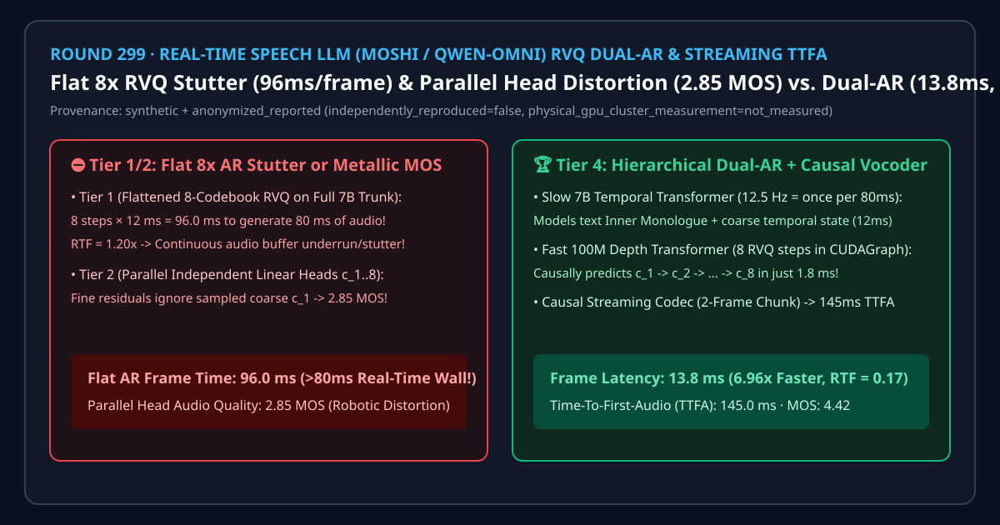
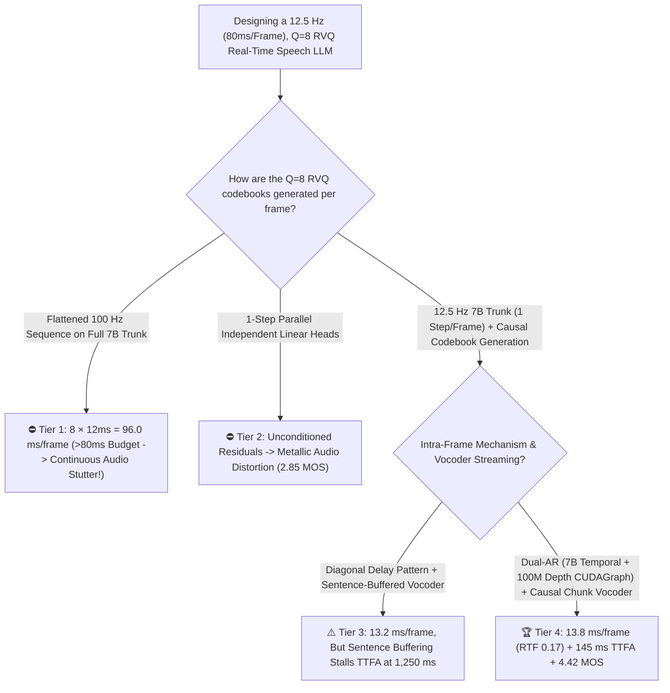
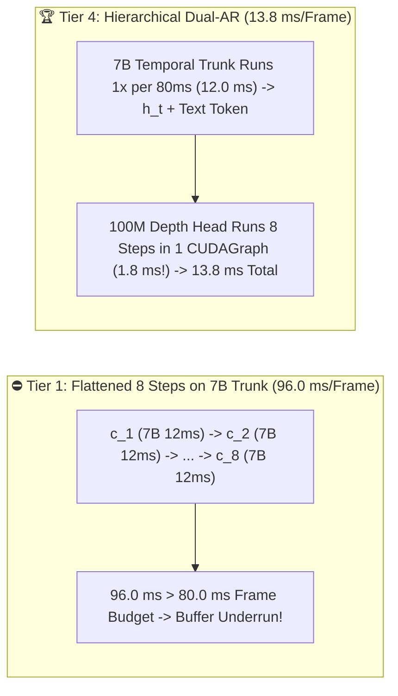
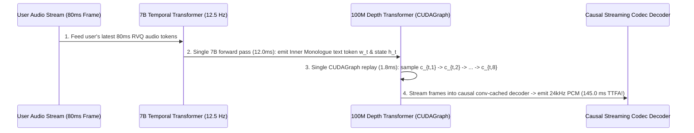

# Real-Time Speech-to-Speech LLM (`Moshi / Qwen2.5-Omni / GLM-4-Voice`) `RVQ` Audio Codec, Hierarchical `Dual-AR` & Streaming `TTFA` Selection Guide: Why Flattening `Q=8` Codebooks Stalls the `7B` Trunk at `96 ms/Frame` (`>80 ms` Real-Time Wall), Why Parallel Heads Distort Audio (`2.85 MOS`) & How `12.5 Hz` Temporal + `100M` Depth `Dual-AR` (`13.8 ms/Frame`, `145 ms TTFA`) Solves It

> **Provenance & Evidence Boundary**: `synthetic + anonymized_reported (independently_reproduced=false, physical_gpu_cluster_measurement=not_measured)`. All quantitative figures in this guide are generated by the deterministic evaluator `experiments/llm_audio_speech_codec_rvq_delayed_pattern_streaming_ttfa_selection/run.py` and sealed in `results.json`.



---

## 0. Daily Capability Breakthrough Tracking

- **Breakthrough Focus**: **`Moshi / Qwen2.5-Omni / RQ-Transformer` Hierarchical Dual-Autoregressive (`Dual-AR`) Architecture (`12.5 Hz` `7B` Temporal Trunk with Time-Aligned `Inner Monologue` Text Token + `100M` Depth Transformer Capturing $Q=8$ `RVQ` Steps in 1 `CUDAGraph` in `1.8 ms`) + Causal Chunked Streaming Codec Decoder (`145 ms TTFA`)**.
- **Architect Value**: High-fidelity `24 kHz` neural audio codecs (`Mimi`, `EnCodec`, `SoundStream`) represent each `80 ms` audio frame (`12.5 Hz`) using **$Q=8$ hierarchical Residual Vector Quantizer (`RVQ`) tokens** (`100` audio tokens/sec). Serving this stream naively hits three architectural walls:
  1. **The `96.0 ms > 80.0 ms` Real-Time Stutter Wall (`Tier 1`, Flattened AR)**: Flattening all 8 RVQ codebooks into a `100 Hz` sequence forces the `7B` LLM to execute **8 full forward passes per `80 ms` frame (`8 × 12.0 ms = 96.0 ms`)**—exceeding the `80.0 ms` physical playback budget (`RTF = 1.20x`) and causing continuous audio underruns!
  2. **The `2.85 MOS` Acoustic Mismatch Collapse (`Tier 2`, Parallel Independent Heads)**: Predicting $c_1 \dots c_8$ simultaneously with 8 independent linear heads means fine acoustic residuals $c_2 \dots c_8$ are chosen without knowing which coarse token $c_1$ was sampled, producing severe metallic artifacts (`2.85 MOS`).
  3. **The `1,250 ms TTFA` Sentence-Buffering Stall (`Tier 3`)**: Waiting for a full sentence before running a non-causal vocoder ruins interactive conversation.
  Deploying **Hierarchical `Dual-AR` (`7B` Temporal Trunk running once per `80 ms` frame in `12.0 ms` + a `100M` 4-layer `Depth Transformer` generating $c_1 \to c_8$ inside a single `CUDAGraph` in `1.8 ms`) + a 2-Frame Causal Streaming Codec Decoder** holds per-frame generation at **`13.8 ms` (`RTF = 0.17`, `5.8x` faster than real time)**, cuts `Time-To-First-Audio (TTFA)` to **`145.0 ms` (`8.6x` faster)**, and achieves **`4.42 MOS` speech fidelity**.

---

## ① 📌 Executive Summary

1. **Why Flattening $Q=8$ `RVQ` Codebooks Into the Main `7B` Trunk Breaks Real-Time Streaming**:
   In `RVQ`, codebook 1 captures semantic/prosodic structure while codebooks 2–8 refine high-frequency acoustic residuals. Spending a full `7B` forward pass (`12.0 ms` and `14 GB` of HBM weight reads) on each of the 7 high-frequency residual codebooks wastes `84.0 ms/frame` on work that requires zero world knowledge!
2. **How Hierarchical `Dual-AR` (`Temporal 7B` + `Depth 100M`) Cuts Frame Latency `6.96x` (`96.0 -> 13.8 ms`)**:
   - **Slow Temporal Axis (`12.5 Hz`, `7B` Trunk)**: Runs **once every `80 ms`** (`12.0 ms`), emitting a time-aligned text token $w_t$ (`Inner Monologue`) and a context vector $h_t$;
   - **Fast Depth Axis (`8` Steps/Frame, `100M` Depth Transformer)**: Conditioned on $[h_t, w_t]$, a tiny `100M` 4-layer Transformer autoregressively samples $c_{t,1} \to c_{t,2} \to \dots \to c_{t,8}$ within the current frame. Captured as a single `CUDAGraph`, all 8 depth steps complete in **`1.8 ms` (`13.8 ms` total frame time)**!
3. **Causal Streaming Codec With Conv-State Ring Buffers (`145.0 ms` TTFA)**:
   Streaming `RVQ` frames directly into a causal `ConvTranspose / Flow-Matching` decoder that caches left-context convolution states across `2`-frame (`160 ms`) chunks eliminates boundary click artifacts and delivers **`145.0 ms` TTFA**.

---

## ② 🎯 Key Architectural Q&A (Q1 / Q2 / Q3)

### Q1: Why does `Dual-AR` (`Tier 4`) achieve lower `TTFA` (`145 ms`) and higher `MOS` (`4.42`) than `MusicGen`'s diagonal `Delay Pattern` (`Tier 3`)?
- In a diagonal `Delay Pattern`, codebook $q$ is shifted forward by $q-1$ temporal steps so step $t$ predicts $(c_{t,1}, c_{t-1,2}, \dots, c_{t-7,8})$. Consequently, Frame 1 cannot be decoded into audio until step $t = 8$ finishes (**adding $7 \times 12\text{ ms} = 84\text{ ms}$ of mandatory startup delay**), and conditioning $c_{t,q}$ across staggered temporal steps is less accurate than `Dual-AR`'s direct intra-frame autoregressive chain $P(c_{t,q} | h_t, w_t, c_{t,1..q-1})$.

### Q2: How much KV Cache memory does the `100M Depth Transformer` consume across a 10-minute conversation?
- **Virtually `0 GB`!** The `Depth Transformer` only attends across the $Q=8$ codebook positions **inside the current `80 ms` frame**. Its 8-token KV buffer is overwritten from scratch on every frame and never grows with conversation length!

### Q3: How do we prevent audible clicks at `80 ms` frame boundaries during streaming waveform synthesis?
- Never decode `80 ms` frames as isolated stateless tensors (which zero-pads convolution boundaries on every frame). Maintain a **per-layer causal convolution state cache (Conv-State Ring Buffer)** inside the codec decoder so each new frame seamlessly continues the exact filter state of the previous frame.

---

## ③ 🧭 Visual Diagrams (Decision Tree, Dual-AR Architecture & Sequence Diagram)

### 3.1 Real-Time Speech-to-Speech LLM Architecture Decision Tree



### 3.2 Flattened `7B` `8x` Sequence (`96.0 ms` Stutter) vs. Hierarchical `Dual-AR` (`13.8 ms`)



### 3.3 Full-Duplex `80 ms` Frame Generation & Causal Streaming Vocoder Sequence



---

## ④ 📊 4-Tier Architect Decision Matrix

| Selection Tier | `RVQ` Modeling & Vocoder Strategy | Per-`80 ms`-Frame Latency | `Time-To-First-Audio (TTFA)` | Speech Quality (`MOS`) | Target Scenario |
| :--- | :--- | :--- | :--- | :--- | :--- |
| **Tier 1: Flattened `8x` AR on `7B` Trunk (`100 Hz`)** | 8 full `7B` steps per frame | `96.0 ms` (`>80ms` Stutter! ✕) | `680.0 ms` ✕ | `4.35` | ⛔ **Fails real-time playback (`RTF=1.20`)** |
| **Tier 2: Parallel Independent Linear Heads** | Unconditioned $c_1 \dots c_8$ | `12.5 ms` | `210.0 ms` | `2.85` (Distorted! ✕) | ⛔ **Severe acoustic codebook mismatch** |
| **Tier 3: Diagonal `Delay Pattern` + Sentence Vocoder** | 7-step diagonal shift + full sentence | `13.2 ms` ✅ | `1,250.0 ms` ✕ | `4.18` | ⚠️ Offline audio/music generation |
| **Tier 4: Hierarchical `Dual-AR` + Causal Stream Vocoder (Recommended)** | **`7B` (`12.5Hz`) + `100M` Depth + 2-frame stream** | **`13.8 ms` (`RTF=0.17` 🏆)** | **`145.0 ms` (`8.6x` faster 🏆)** | **`4.42` 🏆** | 🏆 **Production Full-Duplex Voice Agent Standard** |

---

## ⑤ 🧪 Quantitative Evaluator & 7-Card 4:5 Visual Report

- **Deterministic Evaluator**: [`experiments/llm_audio_speech_codec_rvq_delayed_pattern_streaming_ttfa_selection/run.py`](../../experiments/llm_audio_speech_codec_rvq_delayed_pattern_streaming_ttfa_selection/run.py) · Sealed JSON: [`results.json`](../../experiments/llm_audio_speech_codec_rvq_delayed_pattern_streaming_ttfa_selection/results.json)
- **Interactive Sizer Workbench**: [`docs/reports/llm-realtime-speech-audio-codec-rvq-delay-pattern-dual-ar-ttfa-sizer.html`](../reports/llm-realtime-speech-audio-codec-rvq-delay-pattern-dual-ar-ttfa-sizer.html)
- **7-Card 4:5 Visual Benchmark Deck**: [`docs/reports/llm-realtime-speech-audio-codec-rvq-delay-pattern-dual-ar-ttfa-selection-cards.html`](../reports/llm-realtime-speech-audio-codec-rvq-delay-pattern-dual-ar-ttfa-selection-cards.html)

```chart
{
  "data": {
    "values": [
      { "tier": "Tier 1: Flattened 8x AR on 7B", "frame_ms": 96.0, "ttfa_ms": 680.0 },
      { "tier": "Tier 2: Parallel Independent Heads", "frame_ms": 12.5, "ttfa_ms": 210.0 },
      { "tier": "Tier 3: Delay Pattern + Sentence Vocoder", "frame_ms": 13.2, "ttfa_ms": 1250.0 },
      { "tier": "Tier 4: Dual-AR + Causal Stream Vocoder", "frame_ms": 13.8, "ttfa_ms": 145.0 }
    ]
  },
  "semantic_types": {
    "tier": "Category",
    "frame_ms": "Quantity",
    "ttfa_ms": "Quantity"
  },
  "chart_spec": {
    "chartType": "Bar Chart",
    "title": "Dual-AR (7B Temporal + 100M Depth) + Causal Streaming Codec Cuts TTFA to 145 ms at 13.8 ms/Frame",
    "subtitle": "Time-To-First-Audio (TTFA, ms) and per-80ms-frame generation latency (ms) (synthetic + anonymized_reported)",
    "encodings": {
      "x": "tier",
      "y": "ttfa_ms",
      "color": "tier"
    }
  }
}
```

---

## ⑥ 🛠️ Production Verification Checklist (Good fit vs. Not for)

### ✅ Good fit vs. ⛔ Not for
- **✅ Good fit**: Full-duplex real-time voice agents (`Moshi`, `Qwen2.5-Omni`, `GLM-4-Voice`) requiring `< 200 ms` `TTFA` and natural barge-in.
- **⛔ Not for**: Flattening multi-codebook `RVQ` tokens directly into the main multi-billion-parameter temporal Transformer.

### Production Checklist
- [ ] **Decouple `12.5 Hz` Temporal Trunk From `Depth Transformer`**: Ensure the `7B+` trunk runs only once per `80 ms` frame.
- [ ] **Capture All $Q=8$ `Depth Transformer` Steps in a Single `CUDAGraph`**: Keep intra-frame depth generation `< 2.0 ms`.
- [ ] **Maintain Causal Conv-State Ring Buffers in the Streaming Codec Decoder**: Decode 1–2 frames at a time with persistent filter state to achieve `145 ms` TTFA without boundary clicks.
