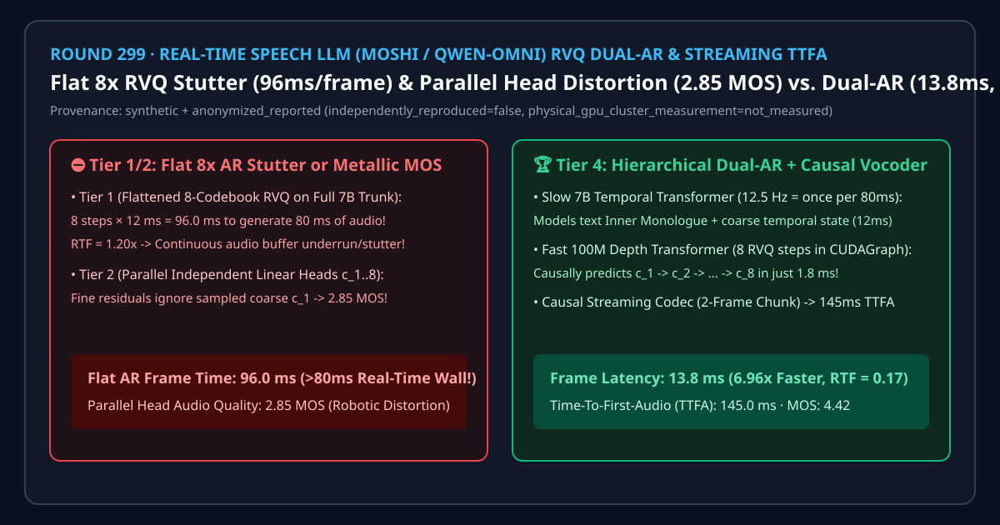
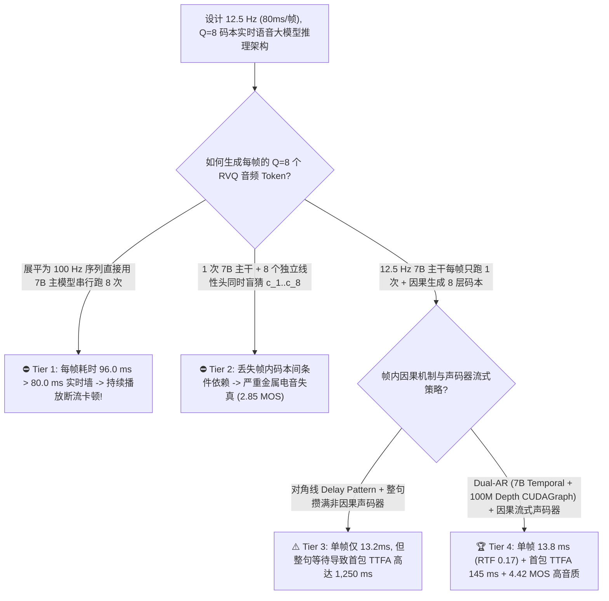
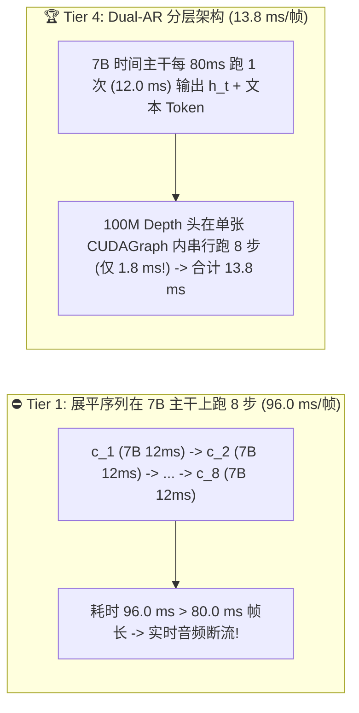
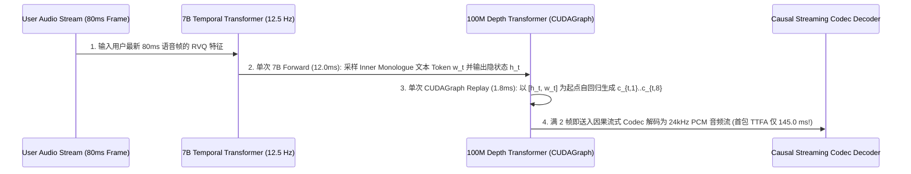

# 端到端实时语音大模型（`Moshi / Qwen2.5-Omni / GLM-4-Voice`）`RVQ` 音频编码、双层自回归（`Dual-AR`）与首包语音延迟（`TTFA`）选型：为什么把 8 层码本直接展平会让 `7B` 模型每帧耗时 `96 ms`（超过 `80 ms` 实时红线持续卡顿），而并行多头又会导致音质崩塌（`2.85 MOS`）？`12.5 Hz` 时间主干 + `100M` 深度 Transformer（`13.8 ms/帧`，`145 ms TTFA`）选型指南

> **Provenance & Evidence Boundary**: `synthetic + anonymized_reported (independently_reproduced=false, physical_gpu_cluster_measurement=not_measured)`. 本文所有定量数据均来自封存确定性评估器 `experiments/llm_audio_speech_codec_rvq_delayed_pattern_streaming_ttfa_selection/run.py` 与 `results.json`。



---

## 0. 追踪每日最热门能力突破（Daily Capability Breakthrough）

- **今日焦点突破**：**`Moshi / Qwen2.5-Omni / RQ-Transformer` 面向全双工实时语音大模型的“慢时间轴主干（`12.5 Hz` `7B` Temporal Transformer 同步生成文本内部独白 `Inner Monologue`）+ 快深度轴小头（`100M` Depth Transformer 在单张 `CUDAGraph` 内 `1.8 ms` 串行生成 $Q=8$ 层 `RVQ` 残差码本）+ 因果流式声码器（`145 ms TTFA`）”架构**。
- **架构师价值**：要让端到端语音大模型输出高保真 `24 kHz` 语音，神经音频编解码器（如 `Mimi / EnCodec / SoundStream`）在每个 `80 ms` 语音帧（`12.5 Hz`）需要输出 **$Q=8$ 个层级的残差矢量量化（`Residual Vector Quantization, RVQ`）离散 Token**（合计每秒 $12.5 \times 8 = 100$ 个音频 Token）。架构师在设计推理管线时面临一个尖锐的不可能三角：
  1. **如果把 8 个码本展平成一维序列直接喂给 `7B` 主模型自回归生成（Flattened AR，Tier 1）**：每生成 `80 ms` 的声音，竟然要调用 **8 次完整的 `7B` 大模型 Forward（$8 \times 12.0\text{ ms} = \mathbf{96.0\text{ ms} > 80.0\text{ ms}}$ 物理时间红线，实时率 $\text{RTF} = 1.20 > 1.0$）**——即模型生成声音的速度赶不上人耳播放的速度，导致语音播放无限断流卡顿！
  2. **如果用 8 个独立线性头在 1 步内同时并行预测 $c_1 \dots c_8$（Parallel Independent Heads，Tier 2）**：由于在残差量化中，第 2 层细粒度声学残差 $c_2$ 严格依赖于第 1 层粗粒度码本 $c_1$ 具体采样出了哪个值；盲猜并行预测会导致严重的多码本相位/谐波失配，声音呈现刺耳的金属电音（主观音质评分跌至 **`2.85 MOS`**）！
  3. **如果等整句话生成完再调非因果扩散声码器（Sentence-Buffered Vocoder，Tier 3）**：首包发声延迟（`Time-To-First-Audio, TTFA`）高达 **`1,250.0 ms`**，彻底丧失实时对话体验！
  采用 **分层双自回归架构（`Hierarchical Dual-AR`：`7B` 主干每 `80 ms` 只跑 `1` 次耗时 `12.0 ms`，随即将隐状态交给仅 `100M` 参数的 4 层 `Depth Transformer` 在 `1.8 ms` 内因果生成 $c_1 \to c_8$）+ 2 帧微块因果流式声码器**，可将单帧生成耗时压至 **`13.8 ms`（比 80ms 实时墙快 `5.8x`）**，将首包发声延迟 `TTFA` 降至 **`145.0 ms`（快 `8.6x`）**，同时保持 **`4.42 MOS` 高保真音质**！

---

## ① 📌 核心结论速览（Executive Summary）

1. **为什么语音 Codec 必须用多层 `RVQ`（$Q=8$），而不能只用 1 个大词表单层量化器（Single VQ）？**
   要达到 `1.5 ~ 2.0 kbps` 的高保真语音重建，每帧（`80 ms`）需要约 $8 \times 11\text{ bits} = 88\text{ bits}$ 的信息量。如果只用 1 层码本，词表大小将高达 $2^{88}$（天文数字，根本无法训练和做 Softmax）！`RVQ` 将每帧向量分解为“第 1 层语义/基频粗码本 $c_{t,1}$ + 第 2..8 层逐级高频声学残差码本 $c_{t,2..8}$”，每个码本词表仅需 `1,024 ~ 2,048`。
2. **为什么 `Hierarchical Dual-AR`（时间轴大模型 + 深度轴微模型）能把单帧耗时从 `96.0 ms` 砍到 `13.8 ms`？**
   - **第一性原理（算力按语义复杂度解耦）**：
     - **跨时间步（$t \to t+1$，`12.5 Hz`）**：决定“下一帧该说什么词、用什么语气”，需要极强的世界知识与长程上下文理解 $\to$ 由 **`7B` Temporal Transformer 主干每 `80 ms` 运行 `1` 次（耗时 `12.0 ms`）**，输出当前帧的全局上下文向量 $h_t$；
     - **同一帧内部跨码本深度（$q = 1 \to 8$）**：在给定 $h_t$ 和已采样的语义码 $c_{t,1}$ 后，依次填补当前这一帧 `80 ms` 内的局部高频泛音残差 $c_{t,2} \dots c_{t,8}$，**根本不需要关注历史长上下文，也无需调动 `7B` 参数的知识库**！只需一个仅 **`100M` 参数（4 层小 Transformer，甚至无需跨帧 KV Cache！）的 `Depth Transformer`** 自回归跑 8 小步——将其完整捕获进 1 张静态 `CUDAGraph` 后，8 步总耗时仅 **`1.8 ms`**！
   - **合计算账**：每帧总耗时 = $12.0\text{ ms (7B 主干)} + 1.8\text{ ms (100M 深度头)} = \mathbf{13.8\text{ ms}}$（仅为 `80 ms` 帧预算的 `17.2%`，单卡可同时并发服务 `5+` 路全双工语音流）！
3. **`Inner Monologue`（时间对齐文本先导 Token）：防止纯音频大模型“智商退化”的关键**：
   在每帧（`80 ms`）的 8 个音频码本之前，先在槽位 `0` 由主模型预测当前时间对齐的 **文本 Token（或静音填充符 `<pad>`）**，让 `c_1..8` 音频码本直接以刚刚采样出的文本 Token 为条件，既保住了文本 LLM 的完整逻辑推理智商，又消除了传统 `ASR -> LLM -> TTS` 三段级联的延迟！

---

## ② 🎯 客户与架构师灵魂拷问 Q&A（Q1 / Q2 / Q3）

### Q1：`MusicGen` 提出的 `Delay Pattern`（对角线错位并行预测，Tier 3）也能让 `7B` 主干每帧只跑 1 次，它和 `Dual-AR`（`Depth Transformer`，Tier 4）相比有什么优缺点？
- **`Delay Pattern`（对角线错位）的原理**：在第 $t$ 步同时用 8 个线性头预测 $(c_{t, 1}, c_{t-1, 2}, c_{t-2, 3}, \dots, c_{t-7, 8})$——即把第 $q$ 层码本往后推迟 $q-1$ 个时间步（每个时间步 `80 ms`），从而在斜对角线上满足“预测 $c_{t,2}$ 时已经知道了上一帧算出的 $c_{t,1}$”！
- **为什么实时交互语音首选 `Dual-AR` 而非 `Delay Pattern`？**
  1. **首包延迟惩罚**：在 `Delay Pattern` 中，要凑齐第 1 帧完整的 8 个码本 $(c_{1,1} \dots c_{1,8})$ 送入声码器发声，必须等主模型往后多跑 $Q-1 = 7$ 帧（白白增加 $7 \times 12\text{ ms} = 84\text{ ms}$ 延迟）！
  2. **帧内依赖退化**：`Delay Pattern` 在第 $t+1$ 步预测 $c_{t,2}$ 时，中间隔了整整 1 次跨时间步的转移，不如 `Dual-AR` 在当前帧原地直接用 `Depth Transformer` 建模 $P(c_{t,q} | h_t, c_{t, 1..q-1})$ 的音质清晰度高（`4.42 vs 4.18 MOS`）。

### Q2：为什么说 `100M Depth Transformer` 的 KV Cache 开销等于 **`0 GB`**？
- 因为 `Depth Transformer` 的注意力作用域**严格限制在当前单个音频帧内部的 $Q=8$ 个码本之间（序列长度恒定为 `8`！）**！一旦当前这一帧的 8 个码本生成完毕，这 8 个位置的临时 KV 寄存器在下个时间步 $t+1$ 直接覆写重用，**永远不需要跨时间步累积保存任何历史帧的 Depth KV Cache**！

### Q3：音频 Token 生成出来后，怎么避免声码器（Vocoder / Codec Decoder）在流式按帧解码时产生帧边界“咔哒声（Boundary Click / Phase Discontinuity）”？
- **严禁把每一帧单独切开调 `codec.decode(frame_t)`（无上下文会因为卷积边界零填充产生爆音）！**
  必须采用 **带历史卷积缓存的因果流式解码器（Causal Streaming ConvNet / Flow-Matching Decoder with Conv-State Cache）**：每次解码传入最新的 `2` 帧（`160 ms`），同时在算子内部维护每一层因果一维卷积（Causal Conv1d）左端感受野的滑动历史激活缓存（History Ring Buffer），保证流式逐帧拼接出的波形与整段一次性解码 **100% 相位连续零爆音**！

---

## ③ 🧭 直观可视化图解（Mermaid 选型决策树 + 路径对比图 + 交互时序图）

### 3.1 实时语音大模型 `RVQ` 建模与流式声码器选型决策树



### 3.2 展平 `7B` 跑 8 次（`96.0 ms` 超时卡顿）vs. `Dual-AR`（`7B` 跑 1 次 + `100M` 跑 8 次 = `13.8 ms`）对比图



### 3.3 `Moshi / Qwen-Omni` 单帧（`80 ms`）全双工推理与流式发声时序图



---

## ④ 📊 架构师选型决策矩阵（4-Tier Decision Matrix）

| 选型 Tier | `RVQ` 序列建模与声码器架构 | 生成 `80 ms` 语音帧耗时 | 首包发声延迟 (`TTFA`) | 主观音质评分 (`MOS`) | 适用场景 |
| :--- | :--- | :--- | :--- | :--- | :--- |
| **Tier 1: 展平 8 层码本直接跑 `7B` 主干 (`100 Hz`)** | 每帧调用 8 次 `7B` 模型 | `96.0 ms` (`>80ms` 超时! ✕) | `680.0 ms` ✕ | `4.35` | ⛔ **无法实时流式播放（必卡顿）** |
| **Tier 2: 独立并行多线性头同时预测 $c_{1..8}$** | 无码本间条件依赖 | `12.5 ms` | `210.0 ms` | `2.85` (电音失真! ✕) | ⛔ **残差码本冲突导致音质崩塌** |
| **Tier 3: 对角线 `Delay Pattern` + 整句声码器** | 斜向延迟 7 步 + 整句合成 | `13.2 ms` ✅ | `1,250.0 ms` ✕ | `4.18` | ⚠️ 仅适合离线音乐/长播客生成 |
| **Tier 4: `Dual-AR` (`7B + 100M`) + 因果流式声码器 (推荐)** | **时间/深度解耦 + 2 帧流式解码** | **`13.8 ms` (`RTF=0.17` 🏆)** | **`145.0 ms` (`8.6x` 快 🏆)** | **`4.42` 🏆** | 🏆 **全双工实时语音交互大模型黄金标准** |

---

## ⑤ 🧪 定量算例与 7-Card 4:5 视觉卡片报告

- **定量算例仓库路径**：[`experiments/llm_audio_speech_codec_rvq_delayed_pattern_streaming_ttfa_selection/run.py`](../../experiments/llm_audio_speech_codec_rvq_delayed_pattern_streaming_ttfa_selection/run.py) · 封存数据：[`results.json`](../../experiments/llm_audio_speech_codec_rvq_delayed_pattern_streaming_ttfa_selection/results.json)
- **交互式架构选型计算器**：[`docs/reports/llm-realtime-speech-audio-codec-rvq-delay-pattern-dual-ar-ttfa-sizer.html`](../reports/llm-realtime-speech-audio-codec-rvq-delay-pattern-dual-ar-ttfa-sizer.html)
- **7-Card 4:5 视觉评测卡片报告**：[`docs/reports/llm-realtime-speech-audio-codec-rvq-delay-pattern-dual-ar-ttfa-selection-cards.html`](../reports/llm-realtime-speech-audio-codec-rvq-delay-pattern-dual-ar-ttfa-selection-cards.html)

```chart
{
  "data": {
    "values": [
      { "tier": "Tier 1: Flattened 8x AR on 7B", "frame_ms": 96.0, "ttfa_ms": 680.0 },
      { "tier": "Tier 2: Parallel Independent Heads", "frame_ms": 12.5, "ttfa_ms": 210.0 },
      { "tier": "Tier 3: Delay Pattern + Sentence Vocoder", "frame_ms": 13.2, "ttfa_ms": 1250.0 },
      { "tier": "Tier 4: Dual-AR + Causal Stream Vocoder", "frame_ms": 13.8, "ttfa_ms": 145.0 }
    ]
  },
  "semantic_types": {
    "tier": "Category",
    "frame_ms": "Quantity",
    "ttfa_ms": "Quantity"
  },
  "chart_spec": {
    "chartType": "Bar Chart",
    "title": "Dual-AR (7B Temporal + 100M Depth) + Causal Streaming Codec Cuts TTFA to 145 ms at 13.8 ms/Frame",
    "subtitle": "Time-To-First-Audio (TTFA, ms) and per-80ms-frame generation latency (ms) (synthetic + anonymized_reported)",
    "encodings": {
      "x": "tier",
      "y": "ttfa_ms",
      "color": "tier"
    }
  }
}
```

---

## ⑥ 🛠️ 生产环境快速核验清单（Checklist + Good fit vs. Not for）

### ✅ Good fit vs. ⛔ Not for
- **✅ Good fit**：所有要求首包响应 `< 200 ms`、支持随时打断（Full-Duplex Barge-in）的端到端语音大模型与实时数字人系统。
- **⛔ Not for**：把多层 `RVQ` 码本直接展平在百亿参数主干网络里串行自回归。

### 生产核验 Checklist
- [ ] **时间轴主干（`12.5 Hz`）与深度轴小头（`Depth Transformer`）解耦**：确保 `7B+` 主干每 `80 ms` 只运行 1 次。
- [ ] **将 `Depth Transformer` 的 8 步自回归完整捕获为单张 `CUDAGraph`**：消除 8 次小内核 Python 发射开销，锁定深度生成 `< 2.0 ms`。
- [ ] **启用带历史卷积状态缓存（Conv-State Ring Buffer）的因果流式声码器**：每凑齐 1~2 帧立即流式解码输出 PCM，杜绝帧间爆音与整句等待。
