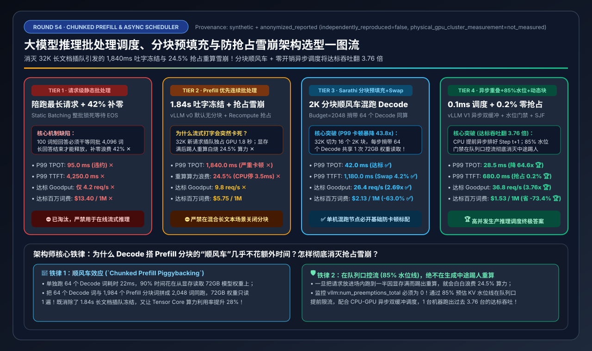
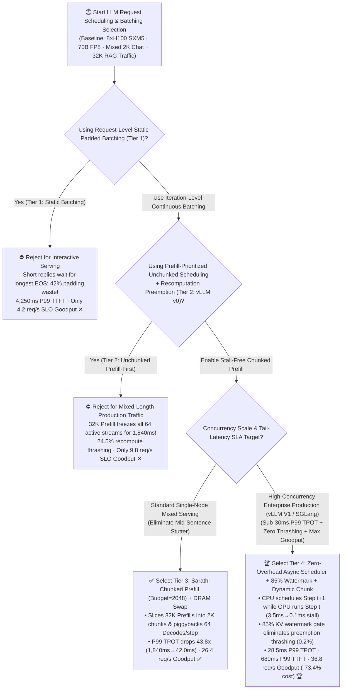
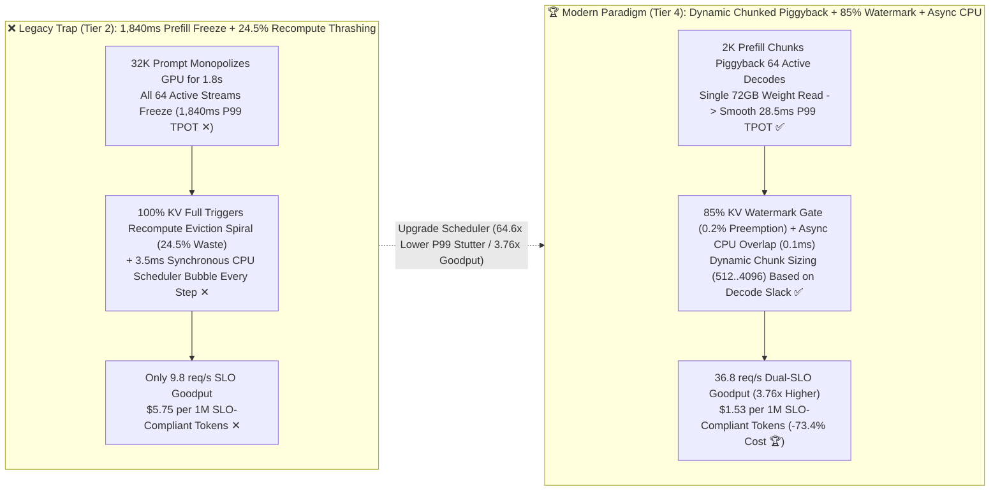

# LLM Inference Request Scheduling, Stall-Free Chunked Prefill & Preemption Architecture Selection Guide (`Static Padded Batching` vs. `Prefill-Prioritized Continuous Batching + Recompute Preemption` vs. `Sarathi Chunked Prefill + DRAM Swap` vs. `vLLM V1 Zero-Overhead Async Scheduler + 85% Watermark Gate + SLO Dynamic Chunking`)

> **Reader's Guide**: Built for **AI Solution Architects and LLM Serving Systems Engineers**, this guide explains from first principles: **why running first-generation Continuous Batching (`vLLM v0 / Orca Default`, Tier 2) on a single 8×H100 node causes all 64 active streaming users to freeze mid-sentence for `1,840 ms` whenever a single `32K`-token RAG prompt arrives ("Prefill Head-of-Line Blocking"), and why hitting 100% KV Cache occupancy triggers a catastrophic "Recomputation Preemption Thrashing Spiral" that wastes `24.5%` of GPU FLOPs; how `Sarathi Stall-Free Chunked Prefill` (`max_num_batched_tokens=2048`, Tier 3) piggybacks memory-bound Decode tokens onto compute-bound Prefill chunks to slash P99 TPOT by `43.8x` (`1,840ms → 42.0ms`); and how `Tier 4 (vLLM V1 Zero-Overhead Async CPU-GPU Overlap Scheduler + 85% KV Watermark Admission Gate + SLO-Slack Dynamic Chunking)` eliminates the `3.5ms/step` CPU scheduling bubble, cuts preemption waste to `0.2%`, and boosts dual-SLO compliant Goodput by `3.76x` (`9.8 → 36.8 req/s`) while cutting cost per 1M SLO-compliant tokens by `73.4%` (`$5.75 → $1.53`).**



---

## ① 📌 Executive Summary

1. **Why First-Generation Continuous Batching (`Tier 2`) Fails Under Mixed Prompt Lengths & High Load (Two Hidden Disasters)**:
   - While **Static Batching (`Tier 1`)** is obsolete due to `42.0%` padding waste and waiting for the longest sequence's EOS (`4.2 req/s` goodput), naive **Prefill-Prioritized Continuous Batching (`Tier 2`, vLLM v0 default)** suffers from two severe production failure modes:
     1. **`1,840 ms` Mid-Sentence Generation Stutter (Prefill Head-of-Line Blocking)**: Whenever a `32K`-token RAG prompt enters the queue, a Prefill-prioritized scheduler pauses all 64 in-flight Decode streams and dedicates 100% of the GPU to computing the 32K Prefill—freezing every active user's streaming output for **`1,840.0 ms` ✕** (violating the `45 ms` P99 TPOT SLA by **40x**)!
     2. **`24.5%` Recomputation Preemption Thrashing Spiral**: When concurrent requests fill 100% of KV Cache mid-generation, the scheduler evicts running requests by deleting their KV blocks (`Recompute Preemption`) and re-running their entire Prefill later—wasting **`24.5%` of total GPU FLOPs ✕** and capping dual-SLO Goodput at just **`9.8 req/s` ✕** (`$5.75 / 1M SLO tokens`)!
2. **Standard Single-Node Baseline (`Tier 3: Sarathi Chunked Prefill + DRAM Swap`) vs. High-Concurrency Production Gold Standard (`Tier 4: Zero-Overhead Async Scheduler + 85% Watermark Gate + SLO Dynamic Chunking`)**:
   - **For Any Monolithic Serving Node Mixing Chat & Long Prompts, enable `Tier 3 (Sarathi Stall-Free Chunked Prefill [token_budget=2048] + Pinned DRAM Swap Preemption)`**: Splits incoming 32K Prefills into `2,048`-token chunks and piggybacks `64` active 1-token Decodes in the exact same forward pass (`1,984 Prefill + 64 Decode = 2,048 tokens`). Because the `72 GB` model weights are loaded from HBM only once per step, active streams experience zero stutter (**P99 TPOT drops `43.8x` from `1,840.0 ms → 42.0 ms` ✅**) and SLO Goodput jumps **`2.69x` to `26.4 req/s` ✅**!
   - **For High-Concurrency Enterprise Production (`vLLM V1 / SGLang`), standardize on `Tier 4 (Zero-Overhead Async CPU-GPU Overlap Scheduler + 85% KV Watermark Admission Gate + SLO-Slack Dynamic Chunk Sizing)`**:
     - **Hides `3.5 ms/step` CPU Scheduling Overhead (`0.1 ms` Net Stall 🏆)**: Prepares Step $t+1$'s block tables, metadata tensors, and detokenization asynchronously on the CPU while the GPU executes Step $t$.
     - **85% KV Watermark Admission Gate (`0.2%` Preemption Waste 🏆)**: Holds new requests in the zero-VRAM waiting queue whenever projected KV occupancy exceeds `85%`, preventing mid-generation KV OOM thrashing.
     - **Result**: P99 TPOT drops to **`28.5 ms` 🏆**, P99 TTFT drops to **`680.0 ms` 🏆**, dual-SLO Goodput jumps **`3.76x` to `36.8 req/s` 🏆**, and cost per 1M SLO-compliant tokens falls **`-73.4%` (`$5.75 → $1.53` 🏆)**!
3. **First-Principles Rule**:
   - **Piggyback memory-bound Decodes onto compute-bound Prefill chunks** (sharing the single `72 GB` weight read from HBM), **overlap CPU scheduling with GPU execution**, and **gate admission at the queue (`85%` watermark) rather than evicting mid-generation**.

---

## ② 🎯 Architect & Customer FAQ (First-Principles Q&A)

### Q1: Why do all 64 active chat users freeze for nearly 2 seconds whenever one user submits a 32K-token document on a standard Continuous Batching server (Tier 2)?

**Plain-Language First Principles**:
- **Prefill Head-of-Line Blocking**: In first-generation Continuous Batching (`Tier 2`), the scheduler processes Prefill steps and Decode steps in separate, mutually exclusive iterations—and prioritizes new Prefills to minimize TTFT.
- When a `32,768`-token prompt arrives, computing its full Prefill on a 70B model takes ~`1,800 ms`. During that entire `1.8 s` window, the 64 active Decode requests cannot execute a single step—spiking P99 Inter-Token Latency (TPOT) from `28 ms` to **`1,840.0 ms` ✕**!

---

### Q2: How does `Sarathi Stall-Free Chunked Prefill` (Tier 3) eliminate the 1.84-second stutter while simultaneously *increasing* total GPU throughput?

**Plain-Language First Principles**:
- **Token-Budgeted Hybrid Batching (`max_num_batched_tokens = 2,048`)**:
  1. Instead of running all `32,768` Prefill tokens at once, the scheduler slices the prompt into 16 chunks of ~`1,984` tokens.
  2. In each step, it combines **64 active `1-token` Decode requests** with **1 chunk (`1,984` tokens) of the Prefill request** into a single `2,048`-token fused batch!
- **Why Piggybacking Boosts Throughput ("Free Ride on Weight Loads")**:
  - A pure Decode step (`64` tokens) is heavily **HBM bandwidth-bound**: the GPU spends `22 ms` just reading the `72 GB` of 70B FP8 weights from HBM, leaving Tensor Core ALUs underutilized.
  - When `64` Decode tokens piggyback onto a `1,984`-token Prefill chunk, the GPU **still reads the `72 GB` model weights from HBM only once**, and the idle Tensor Core math units process the 64 Decode tokens alongside the Prefill chunk in **`42.0 ms`**—slashing P99 TPOT by **`43.8x` ✅**!

---

### Q3: What causes the "Preemption Thrashing Death Spiral" at high concurrency, and how do `Zero-Overhead Async Scheduling` + `85% Watermark Admission` (Tier 4) boost SLO Goodput by 3.76x?

**Plain-Language First Principles**:
1. **Why Mid-Generation Preemption Destroys Goodput (`24.5%` Wasted FLOPs in Tier 2)**:
   - Admitting too many concurrent requests causes their growing KV Caches to collide at 100% HBM capacity mid-generation. Evicting a request via `Recomputation` discards its KV blocks and forces the GPU to recompute thousands of tokens later!
   - **Tier 4's `85% KV Watermark Gate`** estimates each active request's remaining token budget and holds new arrivals in the host queue whenever projected occupancy crosses `85%`—cutting preemption waste from `24.5%` to **`0.2%` 🏆**!
2. **vLLM V1 `Zero-Overhead Async CPU-GPU Overlap (`3.5 ms → 0.1 ms` Stall)**:
   - Traditional synchronous schedulers leave the GPU idle for `2.8–3.5 ms` between every step while Python updates block tables and samples tokens. By pipelining CPU scheduling for Step $t+1$ concurrently with GPU execution of Step $t$, **Tier 4** reclaims **10%+ of total wall-clock GPU time**, reaching **`36.8 req/s` SLO Goodput (`3.76x` over Tier 2 🏆)**!

---

## ③ 🧭 Visual Architecture Diagrams (Mermaid Decision Tree / Batching Timeline / Sequence Diagram)

### 3.1 LLM Request Scheduling & Batching Architecture Decision Tree (`flowchart TD`)



### 3.2 `Tier 2 Prefill Freeze & Thrashing` vs. `Tier 4 Dynamic Chunked Piggybacking + Async Overlap` (`flowchart LR`)



### 3.3 End-to-End `Tier 4` Zero-Overhead Async CPU-GPU Overlap + `Chunked Prefill` Execution Flow (`sequenceDiagram`)

```mermaid
sequenceDiagram
    autonumber
    participant Gate as 85% Watermark Admission Gate (SJF)
    participant CPU as Async Host Scheduler (Step t+1)
    participant GPU as 8×H100 Engine (Step t)
    participant Streams as 64 Active Streams + 1×32K RAG User

    Gate->>CPU: 1. Check projected KV occupancy (78% < 85% watermark) -> Admit 32K RAG request
    par GPU Executes Fused Hybrid Step t vs. CPU Asynchronously Prepares Step t+1
        GPU->>GPU: 2a. [Step t] Read 72GB weights ONCE; compute 64 Decode tokens + Chunk #1 (1,984 tok) of 32K prompt!
        CPU->>CPU: 2b. [Step t+1 Prep] Compute remaining TPOT slack; allocate Chunk #2 block tables & metadata (0.1ms net gap!)
    end
    GPU-->>Streams: 3. Stream next token to all 64 users in 28.5ms (Zero stutter!)
    CPU->>GPU: 4. Immediately launch Step t+1 descriptor (Chunk #2 + 64 Decodes)
    GPU-->>Streams: 5. Complete all 16 chunks in 680ms P99 TTFT (36.8 req/s SLO Goodput 🏆)
```

---

## ④ 📊 Architect Decision Matrix

*Benchmark Profile: `1 × 8×NVIDIA H100-80GB SXM5` Node (`$28.80/hr`) running `Llama-3.3-70B-FP8` (`TP=8`) on mixed enterprise traffic (`75%` 2K chat + `25%` 32K RAG bursts) under strict dual SLOs (`P99 TTFT <= 1,500 ms` AND `P99 TPOT <= 45.0 ms`).*

| Selection Dimension / Tier | Tier 1: Request-Level `Static Batching` (`Padded EOS Wait`) | Tier 2: `Prefill-Prioritized` Continuous + `Recompute` (`vLLM v0`) | Tier 3: `Sarathi Chunked Prefill` (`Budget=2048`) + `DRAM Swap` | Tier 4: `Zero-Overhead Async` (`vLLM V1`) + `85% Watermark` + `Dynamic Chunk` |
| :--- | :--- | :--- | :--- | :--- |
| **Prefill / Decode Multiplexing** | Locks entire batch until longest EOS | Unchunked Prefill preempts & freezes all Decodes | **Slices Prefill into 2,048-tok chunks; piggybacks 64 Decodes** | **SLO-slack dynamic chunking (`512..4096`) + SJF priority queue** |
| **Preemption & CPU Scheduling** | No preemption; sync batch assembly | Evicts & recomputes KV (`24.5%` waste) + Sync `3.5ms` CPU stall | **Pinned DRAM PCIe Swap + Sync `2.8ms` CPU stall** | **85% Watermark Gate (`0.2%` eviction) + Async CPU-GPU overlap (`0.1ms`)** |
| **Streaming Tail Latency (P99 TPOT)** | `95.0 ms` (Violates SLA ✕) | **`1,840.0 ms` (1.84s freeze stutter ✕)** | **`42.0 ms` (`43.8x` lower stutter ✅)** | **`28.5 ms` (`64.6x` lower than Tier 2 🏆)** |
| **First-Token Tail (P99 TTFT)** | `4,250.0 ms` ✕ | `1,920.0 ms` ✕ | **`1,180.0 ms` (Meets SLA ✅)** | **`680.0 ms` 🏆** |
| **Wasted Recompute/Pad FLOPs** | `42.0%` (Padding waste ✕) | **`24.5%` (Recompute thrashing ✕)** | **`4.2%`** ✅ | **`0.2%` (Proactive admission gate 🏆)** |
| **CPU Scheduler Bubble / Step** | `4.2 ms / step` ✕ | `3.5 ms / step` ✕ | `2.8 ms / step` | **`0.1 ms / step` (100% overlapped 🏆)** |
| **Dual-SLO Goodput (req/s)** | `4.2 req/s` ✕ | `9.8 req/s` ✕ | **`26.4 req/s` (`2.69x` vs. Tier 2 ✅)** | **`36.8 req/s` (`3.76x` vs. Tier 2 🏆)** |
| **Cost per 1M SLO Tokens** | `$13.40 / 1M` ✕ | `$5.75 / 1M` ✕ | **`$2.13 / 1M`** ✅ | **`$1.53 / 1M` (`-73.4%` vs. Tier 2)** 🏆 |

---

## ⑤ 🧪 Quantitative Case Study & 7-Card Benchmark Insights

### 5.1 Reproducible Evaluator & Sealed Artifacts

All metrics in this guide are generated by the deterministic evaluator and verified via unit tests:
- **Evaluator Script**: [`experiments/llm_request_scheduling_chunked_prefill_slo_selection/run.py`](../../experiments/llm_request_scheduling_chunked_prefill_slo_selection/run.py)
- **Sealed Output**: [`experiments/llm_request_scheduling_chunked_prefill_slo_selection/results.json`](../../experiments/llm_request_scheduling_chunked_prefill_slo_selection/results.json)
- **Unit Test Suite**: [`tests/test_llm_request_scheduling_chunked_prefill_slo_selection.py`](../../tests/test_llm_request_scheduling_chunked_prefill_slo_selection.py)
- **7-Card 4:5 Visual Report**: [`docs/reports/llm-request-scheduling-chunked-prefill-slo-preemption-selection-cards.html`](../reports/llm-request-scheduling-chunked-prefill-slo-preemption-selection-cards.html)
- **Interactive Sizer Workbench**: [`docs/reports/llm-inference-engine-pd-sizer.en.html#request-scheduling-chunked-sizer`](../reports/llm-inference-engine-pd-sizer.en.html) (Standalone: [`docs/reports/llm-request-scheduling-chunked-prefill-slo-preemption-sizer.html`](../reports/llm-inference-engine-pd-sizer.html))
- **Provenance**: `synthetic_analytical_model_calibrated_to_anonymized_published_benchmarks` (`independently_reproduced=false`, `physical_gpu_cluster_measurement=not_measured`).

### 5.2 Key Quantitative Insights

1. **Chunked Prefill Piggybacking Cuts P99 Streaming Stutter by `64.6x` (`1,840.0 ms → 28.5 ms`)**.
2. **Async CPU-GPU Overlap + 85% Watermark Admission Multiplies Dual-SLO Goodput by `3.76x` (`9.8 → 36.8 req/s`) on Identical Hardware**.

---

## ⑥ 🛠️ Appendix: Production Architect Checklist

- [ ] **1. Enable Chunked Prefill (`--enable-chunked-prefill`) with `max_num_batched_tokens = 2048` (70B) or `4096` (8B)**: Never allow unchunked 32K+ Prefills to block active Decode streams.
- [ ] **2. Upgrade to `vLLM V1 / SGLang` Zero-Overhead Async Overlap Scheduler**: Hide Python/C++ block-table management and detokenization behind GPU kernel execution (`0.1 ms` gap).
- [ ] **3. Monitor `num_preemptions_total` and Cap `max_num_seqs` at the 85% KV Watermark**: Keep mid-generation KV evictions near `0%` by queueing excess bursts before Prefill allocation.
- [ ] **4. Enable Shortest-Job-First (SJF) / Priority Queues for Interactive Queries**: Prevent bulk 128K summarization jobs from starving interactive chat TTFT.
- [ ] **5. Wire HTTP/SSE Client Disconnects Directly to `engine.abort_request()`**: Reclaim physical KV pages immediately when users close browser tabs or time out.
- [ ] **6. Alert on `P99 Inter-Token Latency (ITL)` Rather Than Mean TPOT**: Mean TPOT masks 1.8-second Prefill-induced generation stalls.
