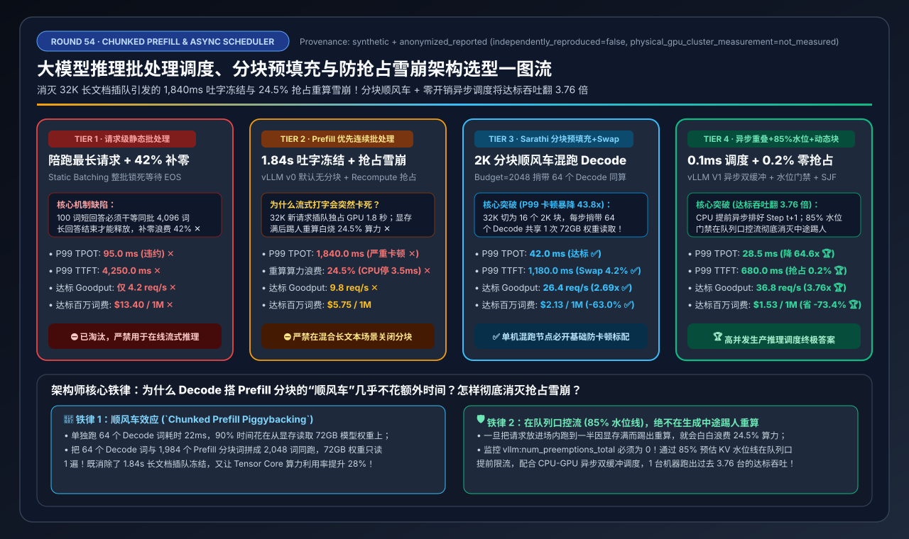
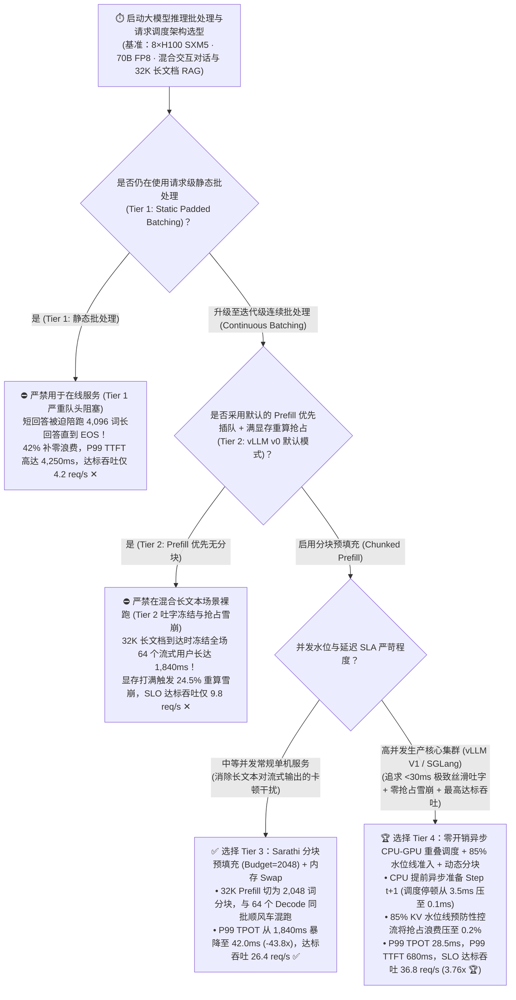
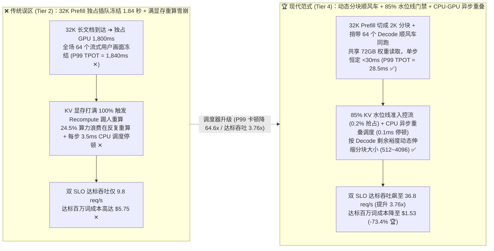
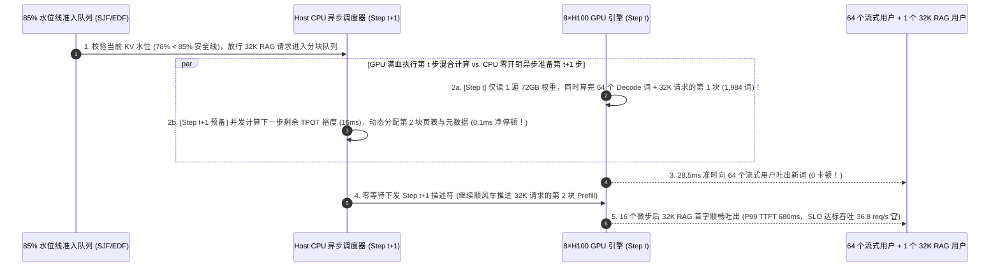

# 大模型推理批处理调度（Batching）、零停顿分块预填充（Chunked Prefill）与防抢占雪崩选型指南（`静态批处理 Static Batch` vs. `Prefill 优先连续批处理 + 重算抢占` vs. `Sarathi 分块预填充 + 内存 Swap` vs. `vLLM V1 零开销异步调度 + 水位线准入 + SLO 动态分块`）

> **阅读指南**：本文面向 **AI 解决方案架构师（AI Solution Architect）与大模型推理服务研发工程师**，用通俗大白话 + 第一性原理彻底讲透：**为什么在单台 8×H100 服务器上混跑日常对话与 32K 长文档 RAG 时，哪怕用了“连续批处理（Continuous Batching，Tier 2）”，屏幕上正在流式吐字的 64 个用户还是会突然集体卡死 `1.84 秒`（生成顿挫 Generation Stall）？为什么当 KV Cache 显存快满时，默认的“重算抢占（Recomputation Preemption）”会引发可怕的“抢占死循环雪崩”，白白烧掉 `24.5%` 的算力？什么是 `Sarathi 零停顿分块预填充（Chunked Prefill + Decode 顺风车混跑）`（Tier 3，把 P99 吐字卡顿从 1,840ms 暴砍 43.8 倍至 42ms）？以及为什么 vLLM V1 / SGLang 全面引入了 `Tier 4（零开销异步 CPU-GPU 重叠调度器 + 85% KV 水位线预防性准入 + SLO 截止时间感知动态分块）`，把达标有效吞吐（Goodput）翻了 `3.76 倍`（`36.8 req/s` vs. `9.8 req/s`）？** 全文零晦涩黑话堆砌，3 分钟看懂选型结论，10 分钟掌握单机推理调度器参数调优与白板宣讲。

---

## ① 📌 核心结论速览（Executive Summary）

1. **为什么开了“连续批处理（Continuous Batching，Tier 2）”，线上用户还是觉得经常卡顿、高并发下吞吐反而暴跌？**
   - **静态批处理（Tier 1）** 因为“短句子必须等全批次最长的句子生成完才能一起下车”，浪费了 `42.0%` 的补零算力，早已淘汰。
   - 但第一代 **连续批处理（`Orca / vLLM v0 默认模式`，Tier 2）** 在真实混合流量下隐藏着两大致命陷阱：
     1. **陷阱一：“Prefill 优先插队”引发 `1,840 ms` 吐字集体冻结（Generation Stall）**：早期连续批处理采用 **Prefill-Prioritized（新请求预填充优先）** 策略——只要队列里新来了一个 `32K` 词的长文档 RAG 请求，GPU 就会暂停手上正在流式吐字的 64 个老用户，专心去算那个 32K 的大 Prefill！这一下就占住 GPU 整整 `1.8 秒`，导致所有正在看屏幕打字的用户画面突然卡死 **`1,840.0 ms`（P99 TPOT 严重违约 ✕）**！
     2. **陷阱二：KV 显存满载时的“重算抢占死循环（Recomputation Preemption Thrashing）”**：当并发稍高导致 KV Cache 达到 100% 时，为了给正在生成的请求腾地方，调度器被迫把排在后面的半成品请求踢出去（**Preemption 抢占**）。默认 `Recompute` 策略直接把被踢请求已经算好的几千词 KV Cache 扔掉，等过几秒显存空了再从头重新算一遍 Prefill——结果引发连环抢占雪崩，**`24.5%` 的 GPU 算力全浪费在反复重算上 ✕**，满足双 SLO（`TTFT <= 1.5s` 且 `P99 TPOT <= 45ms`）的达标吞吐（Goodput）仅有 **`9.8 req/s` ✕**！
2. **标准单机混跑必选 `Tier 3 (Sarathi 分块预填充 + 内存 Swap)` vs. 高并发生产终极答案 `Tier 4 (零开销异步 CPU-GPU 重叠调度 + 85% 水位线准入 + SLO 动态分块)`**：
   - **针对任何未做多机 PD 分离的单机推理节点，必开 `Tier 3（Sarathi Stall-Free Chunked Prefill [token_budget=2048] + 锁页内存 Swap 抢占）`**：把 `32K` 的长 Prefill 切成 16 块（每块最多 `2,048` 词），在每一次前向传播中，把 **1 块 Prefill（如 `1,984` 词）和 64 个正在吐字的 Decode（`64` 词）拼在同一个 Batch 里顺风车一起算**！这样任何一步耗时都不超过 `40 ms`，P99 TPOT 从 `1,840.0 ms` 暴降至 **`42.0 ms`（降低 `43.8 倍` ✅）**，SLO 达标吞吐跃升 **`2.69x` 至 `26.4 req/s` ✅**！
   - **针对高并发严苛 SLA 生产集群（vLLM V1 / SGLang），必选 `Tier 4（零开销异步 CPU-GPU 重叠调度器 + 85% KV 水位线预防性准入控制 + SLO 裕度动态分块）`**：
     - **消除每步 `3.5 ms` 的 CPU 调度停顿（Zero-Overhead Async Scheduler）**：当 GPU 正在跑第 $t$ 步矩阵乘时，CPU 异步线程已经提前把第 $t+1$ 步的请求分配、分页表更新全部算好（CPU 等待时间从 `3.5 ms` 压至 **`0.1 ms` 🏆**）；
     - **85% KV 水位线预防性门禁（消灭抢占雪崩）**：只要已用 KV + 预估输出 KV 达到显存的 **`85%`**，立刻在队列门口暂缓拉入新请求，让场内请求体面跑完释放显存，将抢占重算浪费从 `24.5%` 压至 **`0.2%` 🏆**！
     - **结果**：P99 TPOT 压至丝滑的 **`28.5 ms` 🏆**，P99 TTFT 降至 **`680.0 ms` 🏆**，SLO 达标有效吞吐飙升至 **`36.8 req/s`（比 Tier 2 提升 `3.76x`，比 Tier 1 提升 `8.76x` 🏆）**，达标百万词成本直降 **`-73.4%`（`$5.75 → $1.53` 🏆）**！
3. **底层物理第一性原理（切碎大象流 × 搭顺风车共享权重读取 × 准入防抖）**：
   - **Decode 搭 Prefill 的顺风车是双赢**：Decode 最缺的是“从 HBM 读那 72GB 模型权重的时间”，而算 2,000 词的 Prefill 分块本来就要把 72GB 权重读进片上 SRAM——顺手把 64 个 Decode 的 64 个词一起算掉，**几乎不增加额外耗时（白捡 64 个词的产出！）**。

---

## ② 🎯 客户与架构师灵魂拷问 Q&A（FAQ-Driven）

### Q1：为什么我们在单台 8×H100 上跑 vLLM，平时聊天很丝滑（30ms 一个字），但只要有人上传一份 32K 的 PDF 文档做总结，全公司所有正在聊天的窗口都会同时卡住近 2 秒不动（Tier 2 顿挫灾难）？

**通俗大白话 + 第一性原理解答**：
- **罪魁祸首是传统连续批处理的“Prefill 霸权插队（Prefill-Prioritized Head-of-Line Blocking）”**：
  - 在未开启分块预填充（Chunked Prefill）的引擎里，Prefill 阶段和 Decode 阶段是**水火不容、分步交替执行**的。
  - 当 64 个老用户正在快乐地流式吐字（每步只需 `28 ms`）时，突然第 65 个用户塞进来一篇 `32,768` 词的长文档。
  - 调度器为了尽快给第 65 个用户吐出第 1 个字（TTFT），会立刻喊停那 64 个老用户的下一步 Decode，让整台 8×H100 全力去算这 32,768 个词的完整 Prefill！
  - 在 70B 模型上，一口气算完 32K 词的 Prefill 需要大约 **`1,800 ms`（1.8 秒）**。在这漫长的 1.8 秒里，原本每 30 毫秒就能收到一个新字的 64 个老用户，屏幕上的光标全部原地冻结（P99 TPOT 飙升至 **`1,840.0 ms` ✕**），如果是语音对话 Agent 则直接触发语音断流事故！

---

### Q2：什么是 `Sarathi 零停顿分块预填充（Chunked Prefill + Decode Piggybacking）`（Tier 3）？为什么把长 Prompt 切碎跟 Decode 混在一起算，不仅消除了 1.8 秒卡顿，连整体吞吐量都变高了？

**通俗大白话 + 第一性原理解答**：
- **核心设计：设定每一步的“总 Token 预算（`max_num_batched_tokens = 2048`）”**：
  1. **切碎大象**：那篇 `32,768` 词的长文档不再一口气算完，而是被切成 **16 个小分块（Chunks）**，每块约 `1,984` 个词（利用前序块已生成的 KV Cache 依次往后算）。
  2. **Decode 搭顺风车（Piggybacking）**：在每一步预算 `2,048` 个词里，先放入当前正在流式吐字的 **64 个老用户的 `64` 个 Decode 词**，剩下的 `1,984` 个名额塞入长文档的第 1 个 Prefill 分块，合成一个总长为 `2,048` 的混合矩阵一次性送进 GPU！
- **为什么“混在一起算”反而使总吞吐提升了 2.69 倍？**
  - 想一想：如果单独跑一步 64 个词的 Decode，GPU 必须花 **`22 ms`** 把 70B 模型的 `72 GB` 权重从 HBM 显存读进芯片，而 Tensor Core 实际做乘法只花了 `2 ms`（典型的 **显存带宽受限 Memory-Bound**）；
  - 现在把 64 个 Decode 词和 1,984 个 Prefill 词拼成一个 `2,048` 词的矩阵：**`72 GB` 的模型权重依然只需要从显存读 1 遍**！只不过读进来之后，闲着的 Tensor Core 顺手把 64 个 Decode 词和 1,984 个 Prefill 词一起乘了！
  - 结果：每一步总耗时仅 **`38 ~ 42 ms`**——64 个老用户完全感觉不到卡顿（P99 TPOT 从 `1,840 ms` 暴降至 **`42.0 ms` ✅**），而长文档也在 16 个微步（约 `0.65 秒`）内顺畅算完！

---

### Q3：当线上高并发打满显存时，为什么会出现“越忙越慢”的抢占雪崩？vLLM V1 的“零开销异步调度器（Async Overlap）+ 85% 水位线准入 + SLO 动态分块”（Tier 4）是如何把有效吞吐再推高 39% 的？

**通俗大白话 + 底层运作原理解答**：
- **什么是“抢占死循环雪崩（Preemption Thrashing）”？**
  - 假设显存一共能装 100 万个 Token 的 KV Cache。如果调度器是个“老好人”，来了 100 个请求它全放进来一起跑；刚开始大家都很短，显存装得下；可跑到一半，每个人都吐了 500 个新词，**KV 显存突然 100% 爆满了**！
  - 这时谁也走不动了！调度器只能忍痛把第 80～100 号请求踢出显存（**Preemption**），先保第 1～79 号请求跑完。等第 1～79 号跑完了，被踢出去的请求再重新拉回来**从第 1 个字重新算一遍 Prefill（浪费 `24.5%` 算力 ✕）**！
- **Tier 4 的三大生产级必杀技**：
  1. **必杀技一：85% KV 水位线预防性准入门禁（Proactive Watermark Admission Gate）**：
     - 绝不等显存到了 100% 才踢人！当场内活跃请求的 **当前已占 KV + 预估剩余生成 KV 达到总池子的 `85%`** 时，准入门禁立即关闸——新来的请求乖乖在 CPU 等待队列里排队（此时它还没占任何显存！），等场内老请求跑完退场腾出块后再放行！这一招直接把抢占重算浪费从 `24.5%` 砸到 **`0.2%` 🏆**！
  2. **必杀技二：零开销异步 CPU-GPU 重叠调度（Zero-Overhead Async Scheduling）**：
     - 在 Tier 2/Tier 3 中，GPU 算完一步（`28 ms`）后，要停下来等 Python/C++ 调度器花 **`2.8 ~ 3.5 ms`** 做采样后处理、更新分页表、拼装下一步的输入张量（相当于白白损失 10% 的算力！）。
     - **vLLM V1 异步调度器** 将调度做成双缓冲流水线：**当 GPU 正在算第 $t$ 步时，CPU 已经提前把第 $t+1$ 步的区块分配和输入元数据全部准备好了**！GPU 算完第 $t$ 步后 `0.1 ms` 无缝衔接第 $t+1$ 步！
  3. **必杀技三：基于 SLO 裕度的动态分块大小（SLO-Slack Dynamic Chunking） + 短作业优先（SJF）**：
     - 当场内 Decode 并发很低（只需 `15 ms`）时，自动把 Prefill 分块放大到 `4,096` 词加速首字；当场内 Decode 并发很高（已占 `32 ms`，离 `45 ms` 红线只剩 `13 ms` 裕度）时，自动把 Prefill 分块缩小到 `512` 词保住零卡顿！
  - **实测效果**：P99 TPOT 压至 **`28.5 ms` 🏆**，P99 TTFT 降至 **`680.0 ms` 🏆**，双 SLO 达标有效吞吐（Goodput）高达 **`36.8 req/s`（比 Tier 2 提升 `3.76x` 🏆）**，达标百万词成本降至 **`$1.53`（直省 `-73.4%` 🏆）**！

---

## ③ 🧭 直观可视化图解（Mermaid 决策树 / 阻塞插队 vs. 分块顺风车 / 端到端时序图）

### 3.1 大模型推理批处理调度与分块预填充选型决策树（`flowchart TD`）

### 3.2 `Tier 2 Prefill 插队冻结 + 抢占雪崩` vs. `Tier 4 动态分块顺风车 + 零开销异步调度` 对比图（`flowchart LR`）

### 3.3 `Tier 4` 零开销异步 CPU-GPU 重叠调度 + `Chunked Prefill` 顺风车混跑时序图（`sequenceDiagram`）

---

## ④ 📊 架构师选型决策矩阵（Architect Decision Matrix）

*基准环境：1 台 `8×NVIDIA H100-80GB SXM5` 节点（`$28.80/hr`）运行 `Llama-3.3-70B-FP8`（`TP=8`），承载企业混合流量（`75%` 2K 日常交互 + `25%` 32K 长文档 RAG 突发），考核双严苛 SLA（`P99 TTFT <= 1,500 ms` 且 `P99 TPOT <= 45.0 ms`）。*

| 选型维度 / 架构档位 | Tier 1: 请求级静态批处理 `Static Batching` (`补零等待 EOS`) | Tier 2: `Prefill 优先` 连续批处理 + `重算抢占` (`vLLM v0`) | Tier 3: `Sarathi 分块预填充` (`Budget=2048`) + `内存 Swap` | Tier 4: `零开销异步重叠调度` (`vLLM V1`) + `85% 水位线` + `动态分块` |
| :--- | :--- | :--- | :--- | :--- |
| **Prefill 与 Decode 调度策略** | 整批锁死直到最长序列结束 | 新 Prefill 抢占插队，冻结全场活跃 Decode | **长 Prefill 切为 2,048 词分块，与活跃 Decode 同批混跑** | **基于 Decode SLO 裕度动态伸缩分块 (`512~4096`) + 短作业优先** |
| **显存满载抢占与 CPU 调度** | 无抢占；同步串行组装批次 | 踢人丢弃 KV 从头重算（`24.5%` 雪崩）+ 同步 `3.5ms` CPU 停顿 | **PCIe 锁页内存异步 Swap + 同步 `2.8ms` CPU 停顿** | **85% 水位线提前控流 (`0.2%` 抢占) + CPU/GPU 异步双缓冲 (`0.1ms`)** |
| **流式吐字尾延迟 (P99 TPOT)** | `95.0 ms`（违约 ✕） | **`1,840.0 ms`（冻结 1.84 秒严重卡顿 ✕）** | **`42.0 ms`（消除长文本插队卡顿 ✅）** | **`28.5 ms`（比 Tier 2 降低 `64.6x`，极致丝滑 🏆）** |
| **首字响应尾延迟 (P99 TTFT)** | `4,250.0 ms`（排队违约 ✕） | `1,920.0 ms`（重算排队违约 ✕） | **`1,180.0 ms`（达标 ✅）** | **`680.0 ms`（短作业优先 + 零抢占 🏆）** |
| **抢占/补零浪费的无效算力** | `42.0%`（补零空算 ✕） | **`24.5%`（重算抢占死循环 ✕）** | **`4.2%`** ✅ | **`0.2%`（85% 水位线预防性关闸 🏆）** |
| **每步 CPU 调度器阻塞开销** | `4.2 ms / step` ✕ | `3.5 ms / step` ✕ | `2.8 ms / step` | **`0.1 ms / step`（100% 隐藏在 GPU 算子背后 🏆）** |
| **双 SLO 达标有效吞吐 (Goodput)** | `4.2 req/s` ✕ | `9.8 req/s` ✕ | **`26.4 req/s`（提升 `2.69x` ✅）** | **`36.8 req/s`（比 Tier 2 提升 `3.76x` 🏆）** |
| **每百万 SLO 达标 Token 成本** | `$13.40 / 1M` ✕ | `$5.75 / 1M` ✕ | **`$2.13 / 1M`** ✅ | **`$1.53 / 1M`（比 Tier 2 直省 `-73.4%`）** 🏆 |

---

## ⑤ 🧪 简明定量算例与 Benchmark 洞察

### 5.1 复现实验与确定性底座

本专题所有定量数据均由仓库内确定性评估模型生成并封存，含单元测试校验：
- **评估脚本**：[`experiments/llm_request_scheduling_chunked_prefill_slo_selection/run.py`](../../experiments/llm_request_scheduling_chunked_prefill_slo_selection/run.py)
- **封存结果**：[`experiments/llm_request_scheduling_chunked_prefill_slo_selection/results.json`](../../experiments/llm_request_scheduling_chunked_prefill_slo_selection/results.json)
- **单元测试**：[`tests/test_llm_request_scheduling_chunked_prefill_slo_selection.py`](../../tests/test_llm_request_scheduling_chunked_prefill_slo_selection.py)
- **7-Card 4:5 视觉评测卡片**：[`docs/reports/llm-request-scheduling-chunked-prefill-slo-preemption-selection-cards.html`](../reports/llm-request-scheduling-chunked-prefill-slo-preemption-selection-cards.html)
- **交互式架构选型计算器**：[`docs/reports/llm-inference-engine-pd-sizer.html#request-scheduling-chunked-sizer`](../reports/llm-inference-engine-pd-sizer.html)（独立版：[`docs/reports/llm-request-scheduling-chunked-prefill-slo-preemption-sizer.html`](../reports/llm-request-scheduling-chunked-prefill-slo-preemption-sizer.html)）
- **数据溯源声明（Provenance）**：`synthetic_analytical_model_calibrated_to_anonymized_published_benchmarks`（`independently_reproduced=false`, `physical_gpu_cluster_measurement=not_measured`）。

### 5.2 核心定量洞察（Architect Takeaways）

1. **为什么考核推理集群必须看 `SLO Goodput（达标有效吞吐）` 而不是单纯看 `Raw Throughput（裸吞吐）`？**
   - 在 Tier 2 下，虽然芯片看似在满负荷跑，但因为每来一个 32K 请求就把所有流式用户卡死 `1,840 ms`，加上 `24.5%` 的重算雪崩，真正满足用户体验 SLA 的有效吞吐只有 **`9.8 req/s`**；
   - 开启 **Tier 4** 后，不仅 P99 TPOT 稳守 **`28.5 ms`**，单台 8×H100 的达标吞吐更飙升至 **`36.8 req/s`**——**1 台机器顶过去近 4 台机器用**！

---

## ⑥ 🛠️ 附录：生产环境快速核验清单（Architect Checklist）

- [ ] **1. 强制开启分块预填充（`--enable-chunked-prefill`）并调优 `max_num_batched_tokens`**：在单机混跑节点上，将 `max_num_batched_tokens` 设为 **`2048`（70B 模型）或 `4096`（8B/14B 模型）**，严禁设为 `>=16384` 导致大块 Prefill 阻塞流式 Decode。
- [ ] **2. 升级至支持“零开销异步重叠调度（Zero-Overhead Async Scheduling）”的引擎基线（vLLM V1 / SGLang）**：将 Python/C++ 元数据准备、采样后处理与 Detokenizer 移入独立异步线程或开启 `--async-scheduling`，消除每步 `3.5 ms` 的 CPU 空泡。
- [ ] **3. 设置 `max_num_seqs` 与 85% KV 显存水位线准入上限（防抢占雪崩）**：监控 Prometheus 中的 `vllm:num_preemptions_total` 指标——**健康生产集群的抢占率应接近 `0`！** 若该指标持续增长，立即调小 `max_num_seqs` 以在入口队列处控流。
- [ ] **4. 为长短请求配置分级队列或短作业优先（SJF / Priority Scheduling）**：防止单个 128K 离线总结请求排在 20 个 500 词实时聊天请求前面造成队头排队延迟。
- [ ] **5. 客户端断连（Client Disconnect）立即联动引擎 `abort_request` 释放 KV 块**：确保网关层在捕获到 HTTP/SSE 连接断开的瞬间通知推理引擎回收该请求的物理 KV 页面，严防“僵尸请求”跑完长尾白占显存。
- [ ] **6. 用 `P99 Inter-Token Latency (ITL / TPOT)` 而非平均 `Mean TPOT` 作为告警红线**：32K Prefill 插队引起的卡顿在平均值里会被稀释掩盖，只有 **P99 ITL/TPOT** 能真实反映用户感受到的“打字顿挫感”。
