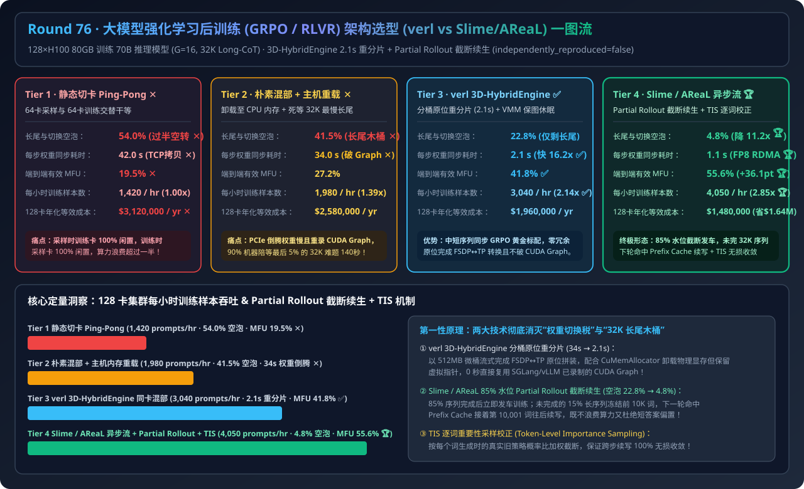
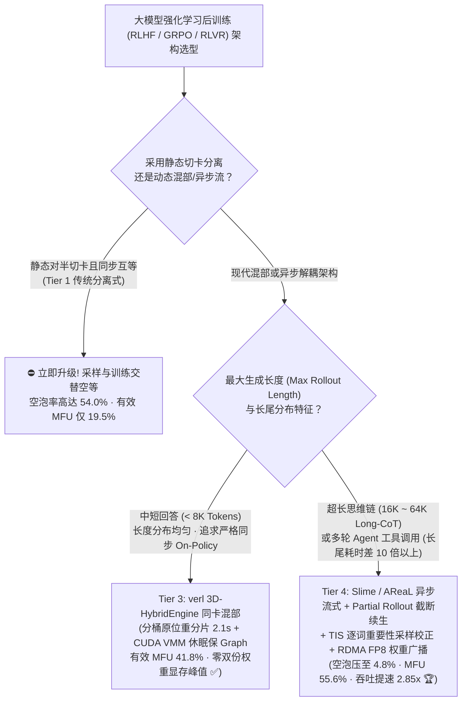
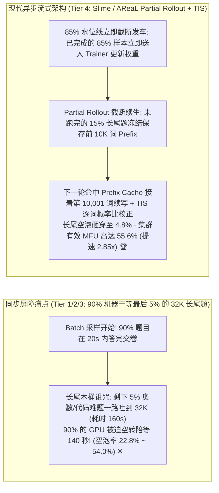
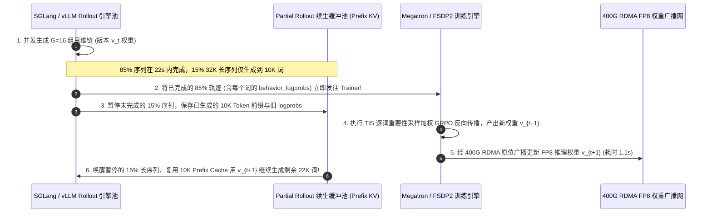

# 大模型强化学习后训练（`RLHF / GRPO / RLVR`）集群架构选型指南（`静态切卡分离式 Ping-Pong` vs. `朴素同卡混部 + 主机内存倒腾` vs. `verl 3D-HybridEngine 同卡混部 + VMM 休眠` vs. `Slime / AReaL 异步流式解耦 + Partial Rollout 截断续生 + TIS 逐词重要性采样`）

> **适用角色**：AI 解决方案架构师（AI Solution Architect）、大模型后训练（RLHF / GRPO / RLVR）算法与基础设施负责人、Reasoning 模型与 Agent 训练架构师  
> **阅读目标**：3 分钟掌握 128×H100 80GB 集群训练 70B 推理模型（`GRPO G=16`，最大 `32K` 长思维链）的四档 RL 框架选型铁律，10 分钟吃透 **为什么静态切卡（一半跑 vLLM 采样、一半跑 FSDP 训练）会让 `54.0%` 的算力在互相干等中蒸发**、**`verl 3D-HybridEngine` 如何在 `2.1 秒` 内零冗余完成 `FSDP ↔ vLLM TP` 原位权重重分片**、以及 **在 `32K` 超长思维链（95% 样本 18 秒跑完，5% 难题卡 160 秒）下，`THUDM Slime / AReaL` 如何通过“Partial Rollout 截断续生 + TIS 逐词重要性采样”将长尾空泡压至 `4.8%` 并提速 `2.85 倍`**！  
> **数据来源说明（Provenance）**：本文定量数据来自仓库内封存的确定性解析模型（[`experiments/llm_rl_post_training_verl_slime_arch_selection/run.py`](../../experiments/llm_rl_post_training_verl_slime_arch_selection/run.py) 与 [`results.json`](../../experiments/llm_rl_post_training_verl_slime_arch_selection/results.json)，校准自 HybridFlow/`verl`、THUDM `Slime` / `AReaL` 与 DeepSeek-R1 / Kimi-k1.5 公开基准，`independently_reproduced=false`，`physical_gpu_cluster_measurement=not_measured`）。

---

## 📌 一、核心结论速览（Executive Summary）

1. **为什么跑 GRPO / RLVR 强化学习时，传统“静态对半切卡（Tier 1）”和“朴素同卡卸载重载（Tier 2）”会让价值千万的 GPU 集群空泡率高达 41%～54%？**：
   - **Tier 1（静态切卡分离式 Ping-Pong 阻塞架构：64 卡跑 vLLM Rollout + 64 卡跑 FSDP Trainer）的干等灾难**：在同步 On-Policy RL 中，当 64 张采样卡花 160 秒吐长思维链时，另外 64 张训练卡 **100% 空转干等**；等采样完通过 TCP/gRPC 拷贝 140GB 权重又要卡顿 **`42.0 秒` ✕**！随后训练卡算反向传播时，64 张采样卡又反过来干等——全集群空泡率高达 **`54.0%`（有效 MFU 仅 `19.5%` ✕）**！
   - **Tier 2（朴素同卡混部 + 主机 CPU 内存倒腾权重）的两大痛点**：虽然让 128 张卡一起先做 Rollout 再一起做训练消除了切卡互等，但每次切换要把百 GB 权重卸载到 CPU 内存再按新并行度重新加载（耗时 **`34.0 秒/步` 且破坏 CUDA Graph ✕**）；更致命的是，在 `32K` 长思维链任务中，**90% 的简单题在 18 秒内就生成完了，但所有 128 张 GPU 必须陪着最后 5% 还在死磕 32K 长度的难题空等 140 秒（长尾木桶效应导致 `41.5%` 空泡率 ✕）**！
2. **什么时候选“`verl` 3D-HybridEngine 同卡混部（Tier 3）”，什么时候必须上“`Slime / AReaL` 异步流式 + Partial Rollout 截断续生（Tier 4）”？**：
   - **中短序列（`< 8K Tokens`）与严格同步 On-Policy 训练（首选 Tier 3 `verl 3D-HybridEngine 同卡混部 + CUDA VMM 休眠唤醒`）**：通过 **3D-HybridEngine 分桶原位重分片（Bucketed In-Place Resharding）**，直接利用机内 NVLink 将训练态的 `FSDP/Megatron (TP×PP×DP)` 分片在 **`2.1 秒`** 内重组为推理态的 `vLLM/SGLang (Rollout TP)` 权重（**零双倍显存峰值，快 `16.2 倍` ✅**），配合 `CuMemAllocator` 保持虚拟地址不变，使 MFU 跃升至 **`41.8%`（吞吐提升 `2.14x` ✅）**。
   - **超长思维链（`16K–64K` Long-CoT RLVR）与多轮工具调用 Agent 训练（首选 Tier 4 `THUDM Slime / AReaL 异步流式解耦 + Partial Rollout 截断续生 + TIS 逐词重要性采样`）**：当一个 Batch 里 **`85%` 的请求已经生成完毕**时，**不再傻等剩下 15% 的 32K 慢请求**！直接把那 15% 未跑完请求的前缀与 KV Cache **原位暂停冻结（Partial Rollout）**，立即用已完成的 85% 样本更新模型权重，并在下一轮用新权重接着刚才暂停的 KV Cache 往后续写！配合 **TIS（Token-Level Importance Sampling 逐词重要性采样比截断）** 修正跨步策略陈旧度，将空泡率从 `54.0%` 砸穿至 **`4.8%`（降低 `11.2 倍` 🏆）**，有效 MFU 飙至 **`55.6%`（吞吐提升 `2.85x`，128 卡集群年省 `$1,640,000` 🏆）**！
3. **一句话握手机制本质**：
   - **大模型 RL 后训练架构的第一性原理，是“用 `verl` 3D-HybridEngine + CUDA VMM 消灭训练与推理之间的权重搬运税（`42s → 1.1~2.1s`），并用 `Slime / AReaL` 的 Partial Rollout（85% 水位截断续生）+ 逐词 TIS 修正彻底砍掉 32K 长思维链的木桶长尾等待”！**

---

## 🎯 二、客户与架构师灵魂拷问 Q&A（FAQ-Driven First Principles）

### Q1：为什么在同一个 GPU 上从 FSDP 训练切换到 vLLM 推理（权重重分片 Resharding）会轻易触发 OOM 或卡顿 30 多秒？`verl` 的 `3D-HybridEngine` 是怎么做到 2.1 秒零冗余切换的？

- **通俗大白话拆解**：
  1. **训练和推理对权重的“切法”完全不同**：
     - **训练态（FSDP / ZeRO-3）**：为了省出显存存梯度和优化器状态，70B 模型的权重被切碎分散在 64 或 128 张卡上。
     - **推理态（vLLM / SGLang Rollout）**：为了降低单次生成延迟，每 4 张或 8 张卡（机内 `TP=4/8`）必须拼凑出一份完整的 70B 权重。
     - **传统笨办法（Tier 2）**：如果一次性对整个 70B 模型做 `AllGather` 拼出推理权重，显存里会同时存在“训练分片 + 完整推理权重”，瞬间多占 `140 GB` 直接 OOM；如果先卸载到 CPU 内存再读回来，PCIe 带宽限制导致每步卡死 `34 秒`！
  2. **`verl 3D-HybridEngine` 的两大核心绝招**：
     - **第一招：微组全收集（Micro-Group AllGather）**：发现在标准 3D 并行中，只需在同轨 DP×PP 子组内部做小规模通信就能拼出推理 TP 所需的分片，通信量骤减 `8 倍`。
     - **第二招：分桶流式原位转换 + CUDA VMM 休眠（Bucketed In-Place Refit）**：每次只开一个 `512 MB` 的微缓冲桶，逐层拼好并原地拷入 vLLM 的虚拟内存空间（对于 FP8/NVFP4 甚至直接原位量化复用视图），**全程额外显存开销 `< 1 GB`，128 卡切换仅需 `2.1 秒`！**

---

### Q2：在训练 DeepSeek-R1 这类 `32K` 长思维链推理模型时，为什么同步混部架构（Tier 3）还会浪费 22.8% 的算力？什么是“长尾木桶诅咒（Long-Tail Rollout Straggler）”？

- **第一性原理现场还原**：
  - 在一轮 `Batch = 1,024` 条题目的 GRPO 采样中：
    - 800 道中等题生成了 `2,000 ~ 4,000 Tokens`，在 **第 20 秒** 就全部答完交卷了；
    - 200 道较难题生成了 `12,000 Tokens`，在 **第 60 秒** 交卷；
    - 但最后 **10 道奥数/复杂代码死循环题** 一路狂吐到 **`32,768 Tokens` 上限，直到第 160 秒才跑完**！
  - **可怕的后果**：在第 60 秒到第 160 秒这整整 **100 秒** 时间里，128 张 H100 上面有 **120 张卡已经无事可做（或 Batch=1 空转）**，全集群都在干等那最后 10 条长尾序列跑完才能进入 FSDP 反向传播！

---

### Q3：`THUDM Slime` 与 `AReaL` 的“Partial Rollout（部分采样截断续生）”和“TIS（逐词重要性采样）”是如何消灭这 100 秒长尾干等的？

- **三步破局闭环（Tier 4 核心机制）**：
  1. **Step 1：85% 水位线立即发车（Watermark Cut-Off）**：
     - 当本轮采样池中已有 `85%`（或凑齐 1 个完整训练 Batch）的序列生成结束时，**立刻吹哨停止本轮采样，绝不等待那 15% 的 32K 慢序列**！
  2. **Step 2：未完序列 KV Cache 冻结续生（Partial Rollout Continuation，绝不丢弃重算！）**：
     - 那 15% 刚吐到 `10,000 词` 还没说完的慢序列怎么办？如果直接丢弃，那前面算的 10,000 词算力就白费了，而且训练集里永远缺少长难题样本（Length Bias）！
     - **Slime 的做法**：把这 15% 未完成序列的已生成 Token（`x_{1..10000}`）保留在缓冲区（或保留 KV Cache），等模型完成一步权重更新（$\theta_{t} \to \theta_{t+1}$）后，在下一轮直接以 `x_{1..10000}` 作为 Prefix Cache 命中前缀，**接着从第 `10,001` 个词往后继续吐完剩下的 22,000 词**！
  3. **Step 3：逐词重要性采样校正（Token-Level Importance Sampling, `TIS`）**：
     - 因为这条长序列的前半截是由旧策略 $\pi_{\theta_t}$ 生成的，后半截是由新策略 $\pi_{\theta_{t+1}}$ 生成的（存在 1 步策略偏移 Off-Policy Staleness），在计算 GRPO 梯度时，对每个位置 $k$ 精确乘以生成该词时的旧策略概率比并做双边截断：
       $$\rho_k = \min\left(\frac{\pi_{\theta_{\text{current}}}(y_k \mid x, y_{<k})}{\pi_{\theta_{\text{behavior}}}(y_k \mid x, y_{<k})},\; c_{\text{tis}}\right)$$
     - **最终效果**：既 100% 砍掉了长尾干等（空泡率从 `22.8%` 压至 **`4.8%` 🏆**），又保证了数学/代码准确率的 **100% 无损收敛**！

---

## 🧭 三、直观可视化图解（Mermaid 决策树 / 流水线对比 / 时序图）

### 3.1 大模型强化学习后训练（GRPO / RLVR）集群架构选型决策树

---

### 3.2 传统同步干等长尾（Tier 1/2/3）vs. Slime 异步流式 + Partial Rollout 截断续生（Tier 4）对比

---

### 3.3 Tier 4 `Slime / AReaL 异步 Partial Rollout 截断续生 + TIS 修正` 端到端时序图

---

## 📊 四、架构师选型决策矩阵（Architect Decision Matrix）

*基准场景：**128×H100 80GB SXM5 集群** 训练 `70B` 推理大模型（`GRPO G=16`，最大输出长度 `32K Tokens`）。*

| 评估维度 | Tier 1: 静态切卡分离式 Ping-Pong | Tier 2: 朴素同卡混部 + CPU 权重倒腾 | Tier 3: `verl` 3D-HybridEngine 同卡混部 | Tier 4: `Slime / AReaL` 异步流 + Partial Rollout + TIS |
| :--- | :--- | :--- | :--- | :--- |
| **执行拓扑与切换机制** | 64卡采样 + 64卡训练同步互等 | 128卡混部 + 卸载至主机内存重载 | **分桶原位重分片 + CUDA VMM 保图休眠** | **异步流水线 + 85% 水位截断续生 + TIS** |
| **长尾与切换空泡占比** | `54.0%` (一半卡永远在干等 ✕) | `41.5%` (卸载慢 + 32K 长尾干等 ✕) | `22.8%` (切换快，但仍受 32K 同步长尾限制) | **`4.8%` (空泡降低 `11.2x` 🏆)** |
| **每步权重重分片/同步耗时** | `42.0 s` (TCP/gRPC 全量拷贝 ✕) | `34.0 s` (PCIe 倒腾 + 重录图 ✕) | **`2.1 s` (NVLink 分桶原位重分片 ✅)** | **`1.1 s` (RDMA FP8 原位广播 🏆)** |
| **集群端到端有效 MFU** | `19.5%` ✕ | `27.2%` ✕ | **`41.8%` ✅** | **`55.6%` (`2.85x` 跃升 🏆)** |
| **每小时完成训练样本数** | `1,420 prompts/hr` (`1.00x`) | `1,980 prompts/hr` (`1.39x`) | **`3,040 prompts/hr` (`2.14x` ✅)** | **`4,050 prompts/hr` (`2.85x` 🏆)** |
| **128 卡集群年化等效成本** | `$3,120,000 / yr` | `$2,580,000 / yr` | `$1,960,000 / yr` | **`$1,480,000 / yr` (年省 `$1.64M` 🏆)** |

---

## 🧪 五、简明定量算例与 7-Card Benchmark 洞察

### 5.1 128 卡 H100 长思维链 RLVR 训练吞吐与成本核算

在 [`experiments/llm_rl_post_training_verl_slime_arch_selection/run.py`](../../experiments/llm_rl_post_training_verl_slime_arch_selection/run.py) 中，我们对 128 卡集群进行了定量对比：
- **权重重分片提速 `16.2 ~ 38.2 倍`（`42.0s → 2.1s → 1.1s`）**：通过 `verl` 3D-HybridEngine 分桶原位重分片与 CUDA VMM 保虚拟指针休眠，彻底告别了把权重卸载到 CPU 内存并重新录制 CUDA Graph 的 34 秒停顿。
- **32K 长思维链训练提速 `2.85 倍`（年省 `$1,640,000`）**：引入 `Slime / AReaL` 的 **Partial Rollout 截断续生 + TIS 逐词重要性采样** 后，消除了 90% 机器陪等最后 5% 难题的 140 秒长尾空泡，每小时样本吞吐从 `1,420` 飙升至 **`4,050 prompts/hr`**！

### 5.2 配套交互式工作台与 7-Card 4:5 视觉评测报告

- 🧮 **交互式大模型 RL 后训练架构与空泡率计算器**：[`docs/reports/llm-rl-post-training-colocated-vs-disaggregated-verl-slime-architecture-sizer.html`](../reports/llm-rl-post-training-colocated-vs-disaggregated-verl-slime-architecture-sizer.html)（以及总工作台 [`llm-inference-engine-pd-sizer.html`](../reports/llm-inference-engine-pd-sizer.html)）
- 📊 **7-Card 4:5 视觉基准评测报告**：[`docs/reports/llm-rl-post-training-colocated-vs-disaggregated-verl-slime-architecture-selection-cards.html`](../reports/llm-rl-post-training-colocated-vs-disaggregated-verl-slime-architecture-selection-cards.html)

---

## 🛠️ 六、附录：生产环境快速核验清单（Architect Checklist）

- [ ] **1. 严禁使用阻塞式 Ping-Pong 静态切卡架构（Tier 1）**：中短序列任务直接采用 **`verl` 同卡混部（Colocated HybridEngine）**，超长思维链与多轮 Agent 任务采用 **`Slime / AReaL` 异步流式 + Partial Rollout**。
- [ ] **2. 开启 CUDA VMM `CuMemAllocator` 零拷贝休眠与 FP8 原位权重重分片**：确保 Rollout 阶段休眠让出显存给 FSDP 时不改变虚拟地址指针，避免每步重新捕获 SGLang/vLLM CUDA Graph。
- [ ] **3. 对 `>16K` 长思维链开启 Partial Rollout 截断续生（严禁直接丢弃未完长序列）**：设置 `80%~85%` 批次完成水位线；未完成序列必须保留已生成前缀在下一轮续写，防止模型学出“故意只写短答案”的长度偏置（Length Bias）。
- [ ] **4. 异步与续生序列必须开启逐词重要性采样（`TIS: Token-Level Importance Sampling`）**：在 Rollout 引擎记录每个 Token 生成时的行为策略对数概率 `behavior_logprob`，训练时按 $\min(\pi_{\text{new}}/\pi_{\text{old}}, c)$ 逐词加权并设置最大陈旧步数上限（`max_staleness <= 2`）。
- [ ] **5. 在训练侧启用长短序列动态装箱（Sequence Packing / ZigZag Ring Attention）**：将不同长度的已完结 CoT 轨迹无补零拼接（`cu_seqlens` varlen FlashAttention）以保证 FSDP 反向传播阶段负载均衡。
