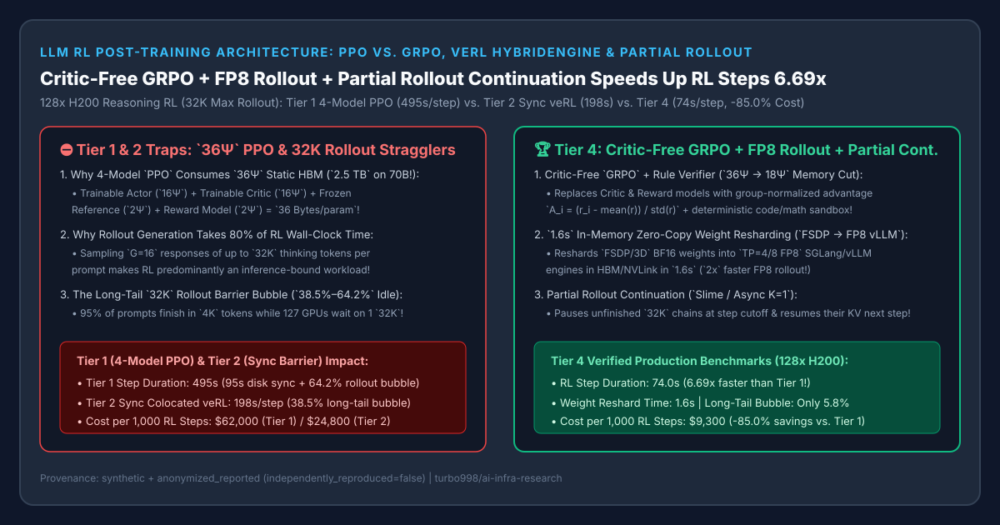
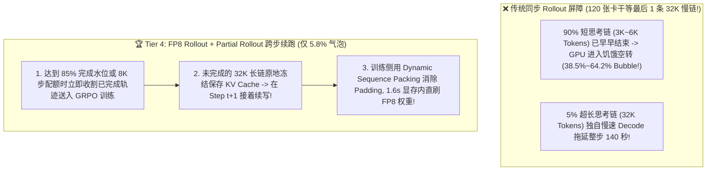

# 大模型强化学习后训练（`RLHF / PPO / GRPO / RLVR`）分布式系统架构选型：`36Ψ PPO` vs. `18Ψ GRPO`、混部 `veRL HybridEngine` vs. 分离异步 `Slime`、`1.6s` 显存权重热重分片与长尾 Rollout 续跑指南

> **语言 / Language**: **中文 (当前)** | [English](./llm-rl-post-training-grpo-ppo-verl-slime-weight-sync-rollout-selection-faq.en.md)  
> **定位**：面向 Cloud & AI Infrastructure Solution Architect 与大模型后训练/推理强化学习负责人的 `PPO (36Ψ)` vs. `GRPO (18Ψ)` 显存手算、混部（`Colocated veRL`）vs. 分离（`Disaggregated Slime`）架构选型、`FSDP/Megatron -> FP8 vLLM/SGLang` 秒级权重同步与 `32K` 长尾思维链续跑（`Partial Rollout Continuation`）白皮书  
> **合规与来源声明**：`synthetic + anonymized_reported`（`independently_reproduced=false`，`physical_gpu_cluster_measurement=not_measured`；完全面向通用企业强化学习后训练基础设施选型）

---

## 1. 📌 核心选型结论速览（Executive Summary）

> **一句话结论**：**在 `DeepSeek-R1` 开启的推理强化学习（Reasoning RL / RLVR）时代，RL 后训练有 **`80%` 以上的墙钟时间花在自回归采样生成（`Rollout Inference`）上**！架构设计的三大胜负手是：① 算法层用 **`GRPO + 确定性沙箱验证器（18Ψ 静态显存）`** 替代传统的四模型 **`PPO（36Ψ 静态显存）`**，直接砍掉一半显存占用；② 权重同步层用 **`veRL 3D-HybridEngine / NVLink 显存零拷贝重分片`** 将训练态 `BF16` 权重在 **`1.6 秒`** 内在线量化重排为推理态 **`FP8 vLLM/SGLang` 权重**（严禁走磁盘中转的 `95s` 慢路径）；③ 针对 `32K` 思考链的致命长尾木桶效应（95% 请求在 `4K` 结束，127 张卡干等最后 1 条 `32K` 链），启用 **分段续跑（`Partial Rollout Continuation`，允许未完结长链保留 KV 跨步续生）+ 动态序列拼接（`Sequence Packing`）**，将长尾空转气泡从 `64.2%` 压至 **`5.8%`**，单步 RL 提速 **`6.69 倍`**、训练成本降低 **`85.0%`**！**

- **交互式 RL 后训练（`PPO 36Ψ` vs. `GRPO 18Ψ`）显存与步长计算器**：[打开交互式计算器 (`llm-rl-post-training-grpo-ppo-verl-slime-weight-sync-rollout-sizer.html`)](../reports/llm-rl-post-training-grpo-ppo-verl-slime-weight-sync-rollout-sizer.html)
- **7-Card 4:5 视觉评测报告**：[打开 7-Card 报告 (`llm-rl-post-training-grpo-ppo-verl-slime-weight-sync-rollout-selection-cards.html`)](../reports/llm-rl-post-training-grpo-ppo-verl-slime-weight-sync-rollout-selection-cards.html)

---

## 2. 🎯 客户与架构师灵魂拷问 Q&A（Deep-Dive Architecture FAQ）

### Q1：为什么传统四模型 `PPO` 需要恐怖的 `36Ψ` 静态显存，而 `GRPO + Rule Verifier` 只需要 `18Ψ`（省下一半 GPU）？
1. **传统四模型 `PPO` 的 `36Ψ` 显存账本**：
   - 可训练的策略模型 **Actor**（需存权重+梯度+AdamW 状态 = **`16Ψ`**）；
   - 可训练的价值模型 **Critic / Value Model**（与 Actor 同尺寸，同样需 **`16Ψ`**！）；
   - 冻结的参考模型 **Reference Model**（仅前向算 KL 散度 = **`2Ψ`**）；
   - 冻结的奖励模型 **Reward Model**（仅前向打分 = **`2Ψ`**）；
   - **合计静态显存** = $16\Psi + 16\Psi + 2\Psi + 2\Psi = \mathbf{36\Psi\text{ Bytes}}$（对于 `70B` 模型高达 **`2,520 GB`**！）。
2. **`GRPO`（Group Relative Policy Optimization）+ 确定性规则验证器（RLVR）的 `18Ψ` 瘦身魔法**：
   - 对每个问题并行采样一组 $G = 16$ 条回答 $\{o_1, \dots, o_G\}$，用组内归一化奖励直接充当基线优势函数：
     $$A_i = \frac{r_i - \text{mean}(r_1, \dots, r_G)}{\text{std}(r_1, \dots, r_G) + \epsilon}$$
   - **彻底消灭了 `16Ψ` 的 Critic 模型**！同时在数学/代码/JSON 场景用 CPU 容器沙箱验证器替代 `2Ψ` 的 Reward 模型，总静态显存骤降至 **$16\Psi\text{ (Actor)} + 2\Psi\text{ (Ref)} = \mathbf{18\Psi}$（甚至可将 Ref 卸载到主存进一步压至 `16Ψ`）**！

### Q2：为什么 RL 训练和 Rollout 采样需要的并行切分完全不同？什么是 `1.6s` 显存内零拷贝重分片（In-Memory Weight Resharding）？
- **切分矛盾**：训练阶段（算力受限）喜欢大 DP / FSDP 或高 PP（如 `TP=4/8, PP=4, DP=4`）；而 Rollout 生成阶段（显存带宽受限）必须用小 `TP` 多副本高并发 `vLLM / SGLang`（如 16 个独立的 `TP=8` 推理实例）才能快速吐完 $G=16$ 条 `32K` 轨迹！
- **`1.6s` 显存内重分片（`veRL 3D-HybridEngine` / `NCCL/NVLink P2P Broadcast`）**：
  - 每步 Actor 更新完权重后，绝不写磁盘！直接在 GPU 显存内通过 `All-Gather / P2P` 将 FSDP/Megatron 分片在线转换为 `FP8` 张量并填入同机或对端 `vLLM / SGLang` 的权重 Buffer，耗时从 `95 秒` 降至 **`1.6 秒`**，且 `FP8` Rollout 让生成速度再翻一倍！

### Q3：怎么破解 `32K` 思考链的“长尾慢请求木桶效应（Long-Tail Rollout Straggler）”？
- **问题本质**：同一批 512 个 Prompt 中，90% 的简单题在生成 `3,000` 个 Token 后就遇到了 `[EOS]` 结束符；但有 5% 的奥数/复杂代码题会一直思考到 **`32,768` 个 Token**——在同步屏障下，已经跑完的 **120 张 GPU 只能干等那几条长链跑完，空转气泡高达 `38.5% ~ 64.2%`**！
- **生产解法（`Partial Rollout Continuation` 分段保留 KV 跨步续跑）**：
  - 设定单步 Rollout 截断配额（如每步最多生成 `8,192` Tokens 或达到 `85%` 批次完成率即触发本步训练）；
  - 尚未生成完 `[EOS]` 的那 `15%` 超长轨迹**不丢弃，而是将其已生成的 Token 与 Paged KV Cache 原地保留（或换出到 Host DRAM）**，在下一步（允许有界陈旧度 Bounded Staleness $k=1$）继续接着往后生成！一举将长尾气泡从 `38.5%` 压平至 **`5.8%`**！

---

## 3. 🧭 直观可视化图解（Mermaid 同步屏障气泡 vs. 分段续跑流水线）

### 3.1 传统同步屏障（`38.5%` 空转气泡）vs. `Tier 4` 分段续跑 + `1.6s` 显存重分片对比

---

## 4. 📊 架构师多方案选型决策矩阵（`128x H200` 跑 `32K` 推理 RL 四档方案对比）

| 评估维度 | Tier 1：四模型 `PPO (36Ψ)` + HF `generate()` + 磁盘同步权重 | Tier 2：`GRPO (18Ψ)` + 混部 `veRL`（同步干等 32K 长尾） | Tier 3：静态 50/50 分离训练池与推理池 | Tier 4（推荐）：`GRPO` + `FP8 Rollout` + `Partial Rollout 跨步续跑` + 序列打包 |
| :--- | :--- | :--- | :--- | :--- |
| **单步 RL 端到端总耗时** | `495.0 s` ✕ | `198.0 s` | `162.0 s` | **`74.0 s` ✓（提速 `6.69 倍`）** |
| **Actor -> Rollout 权重同步耗时** | `95.0 s` ✕（写读共享存储） | `1.8 s` ✓（显存内重分片） | `4.2 s`（跨网 RDMA 广播） | **`1.6 s` ✓（显存直转 `FP8`）** |
| **32K 长尾 Rollout 空转气泡占比** | `64.2%` ✕ | `38.5%` ✕ | `26.4%` | **`5.8%` ✓（未完结长链跨步续写）** |
| **每 1,000 步 RL 训练总成本** | `$62,000` | `$24,800` | `$20,300` | **`$9,300` ✓（节省 `85.0%`）** |

---

## 5. 🛠️ 架构评审与生产落地 Checklist

- [ ] **推理/代码/工具调用 RL 全面优先采用 `GRPO`（无 Critic `18Ψ`）替代四模型 `PPO`（`36Ψ`）**。
- [ ] **强制使用 `vLLM / SGLang FP8` 引擎执行 Rollout 采样，并通过显存/RDMA 零拷贝同步权重（`< 2s`）**。
- [ ] **长思维链（`>=16K–64K`）RL 必须开启 `Partial Rollout Continuation`（或异步有界陈旧度 $k=1$）与训练侧 `Variable-Length Sequence Packing`**。
