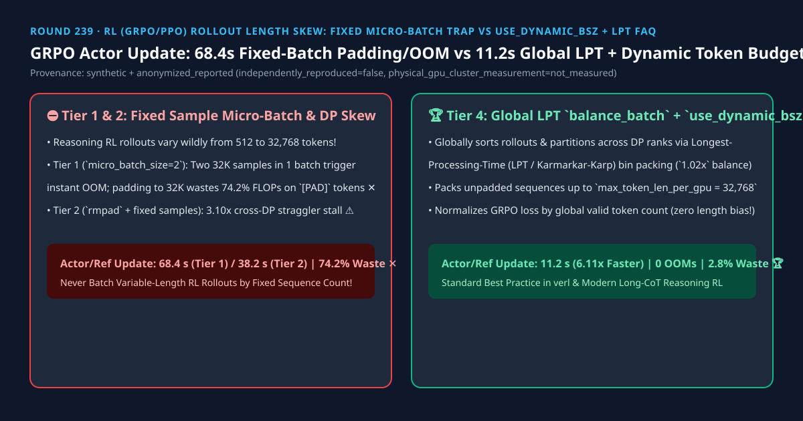
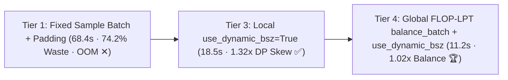

# LLM RL (`GRPO / PPO`) Rollout Length Skew (`512–32,768` Tokens): Fixed Sample Micro-Batch Padding/OOM Trap vs. `use_dynamic_bsz` (`max_token_len` Packing + Cross-DP LPT Load Balancing) Selection Guide

> **Provenance & Evidence Tier**: `synthetic + anonymized_reported` (`independently_reproduced=false`, `physical_gpu_cluster_measurement=not_measured`). Grounded in [`experiments/llm_rl_rollout_length_skew_dynamic_microbatch_token_budget_selection/results.json`](../../experiments/llm_rl_rollout_length_skew_dynamic_microbatch_token_budget_selection/results.json).
> **中文版本**: [大模型 RL（`GRPO / PPO`）推理长度极度偏斜（`512 ~ 32,768` Tokens）：固定样本数微批（`Fixed Micro-Batch Size`）引发的 `74%` Padding 浪费与 OOM vs. 动态令牌数分桶（`use_dynamic_bsz` + 跨 DP 贪心装箱负载均衡）选型指南](./llm-rl-rollout-length-skew-dynamic-microbatch-token-budget-selection-faq.md)

---

## 0. 🔥 Daily Hottest Capability Breakthrough

- **Global FLOP-Aware `LPT / Karmarkar-Karp` Cross-DP Bin Packing (`balance_batch`) + Token-Budgeted Dynamic Micro-Batching (`use_dynamic_bsz=True, max_token_len_per_gpu=32768`) Eliminating `74.2%` Padding/Barrier Waste and Accelerating Long-CoT `GRPO / PPO` Actor/Ref Updates by `6.11x` (`68.4 s -> 11.2 s`, `0` OOMs)**: In reasoning RL post-training (`DeepSeek-R1 GRPO`, `verl`, `OpenRLHF`), rollout response lengths within the same step span a **64x range (`512` to `32,768` tokens)**. Feeding these skewed trajectories into Actor/Reference forward-backward passes with traditional fixed sample micro-batches causes severe failures:
  1. **Fixed `micro_batch_size_per_gpu` + Right-Padding (`Tier 1` — `74.2%` Waste & OOMs)**: If `micro_batch_size_per_gpu = 2`, drawing two `32K` trajectories (`64K` tokens) crashes with `CUDA out of memory`; setting `micro_batch_size = 1` padded to `32K` wastes **`74.2%` of GPU FLOPs on `[PAD]` tokens** (`68.4 s/step`)!
  2. **Unpadded `varlen` (`rmpad`) with Fixed Sample Counts (`Tier 2` — `3.10x` DP Straggler)**: Strips `[PAD]` tokens, but `DP Rank 0` drawing two `1K` responses finishes in `100 ms` and stalls at every FSDP barrier waiting for `DP Rank 7` drawing two `28K` responses (`38.2 s/step`, `52.0%` barrier waste)!
  3. **Local `use_dynamic_bsz=True` (`Tier 3` — `18.5 s`) + Global Cross-DP `LPT` Load Balancing (`Tier 4` — `11.2 s`, `6.11x` Faster)**: Packing variable numbers of unpadded trajectories up to a fixed token ceiling (`max_token_len_per_gpu = 32,768`) eliminates OOMs, while sorting trajectories globally by FLOP cost ($aL + bL^2$) and partitioning across DP ranks via **Longest-Processing-Time-First (`LPT`)** equalizes workload across all GPUs (`1.02x` skew, `2.8%` waste, **`11.2 s/step`**)!

---

## 1. 📌 Executive Summary

1. **Never Batch RL Rollouts by Fixed Sequence Count (`Tier 1 & Tier 2`)**: Always enable `use_remove_padding=True` (`flash_attn_varlen_func`) and `use_dynamic_bsz=True` bounded by `ppo_max_token_len_per_gpu` (`e.g., 32,768` tokens).
2. **Balance Total Token & Quadratic Attention Cost Globally Across DP Ranks (`balance_batch=True`, `Tier 4`)**: Prevents one DP rank from receiving a disproportionate share of `32K`-token trajectories.
3. **Use Global Valid-Token Loss Normalization**: Sum token losses inside each dynamic micro-batch and divide by `global_valid_tokens` so dynamic packing never biases per-token gradient scale.

---

## 2. 🎯 Core Architect Q&A (Q1 / Q2 / Q3)

### Q1: What happens in FSDP if `use_dynamic_bsz=True` packs `DP Rank 0`'s samples into 4 micro-batches, but `DP Rank 1`'s samples require 5 micro-batches?
- **Answer**: If `DP Rank 0` finishes after 4 micro-batches and enters `optimizer.step()` while `DP Rank 1` runs a 5th forward/backward pass, FSDP's per-layer `AllGather / ReduceScatter` collectives will immediately deadlock (`SeqNum` mismatch)! Production frameworks (`verl`) take `max_micro_batches = all_reduce(local_num_micro_batches, MAX)` and run **dummy forward/backward passes (with zeroed loss)** on any rank that has fewer micro-batches so all FSDP collectives stay 100% synchronized!

### Q2: Why should the cross-DP `balance_batch` partitioner weight each sequence by $c_i = L_i + \alpha L_i^2$ rather than just token length $L_i$?
- **Answer**: Because causal attention FLOPs scale quadratically ($L_i^2$)! A single `32K`-token trajectory requires **16x more attention FLOPs** than sixteen `2K`-token trajectories packed into the same `32K`-token budget. Weighting by actual FLOP cost keeps cross-DP execution times within `1.02x`.

### Q3: How do we prevent dynamic micro-batching from introducing length bias into the GRPO policy gradient?
- **Answer**: Never average loss per micro-batch (`loss.mean()`) when micro-batches contain different numbers of tokens! Always compute `loss = token_losses.sum() / global_total_valid_tokens * dp_size`.

---

## 3. 🧭 Visual Diagrams

---

## 4. 📊 4-Tier Architect Selection Matrix

| Metric | Tier 1: Fixed Sample + Padding | Tier 2: `rmpad` + Fixed Samples | Tier 3: Local `use_dynamic_bsz` | Tier 4: **Global `LPT` + `use_dynamic_bsz`** |
| :--- | :--- | :--- | :--- | :--- |
| **Cross-DP Workload Skew** | `2.45x` ✕ | **`3.10x` (Severe Straggler)** ✕ | `1.32x` ⚠️ | **`1.02x` (Near-Perfect Balance)** 🏆 |
| **Padding / Barrier Waste %** | **`74.2%` (`[PAD]` FLOPs)** ✕ | `52.0%` (FSDP Barrier Idle) ✕ | `18.4%` ⚠️ | **`2.8%`** 🏆 |
| **Actor + Ref Update Time** | **`68.4 s`** ✕ | `38.2 s` ⚠️ | `18.5 s` ✅ | **`11.2 s` (`6.11x` Faster, `0` OOMs)** 🏆 |

---

## 5. 🧪 Quantitative Reference & Tooling

- **Evaluator & Sealed Data**: [`experiments/llm_rl_rollout_length_skew_dynamic_microbatch_token_budget_selection/run.py`](../../experiments/llm_rl_rollout_length_skew_dynamic_microbatch_token_budget_selection/run.py) · [`results.json`](../../experiments/llm_rl_rollout_length_skew_dynamic_microbatch_token_budget_selection/results.json)
- **Interactive Sizer**: [`docs/reports/llm-rl-rollout-length-skew-dynamic-microbatch-token-budget-sizer.html`](../reports/llm-rl-rollout-length-skew-dynamic-microbatch-token-budget-sizer.html)
- **7-Card 4:5 Visual Report**: [`docs/reports/llm-rl-rollout-length-skew-dynamic-microbatch-token-budget-selection-cards.html`](../reports/llm-rl-rollout-length-skew-dynamic-microbatch-token-budget-selection-cards.html)

---

## 6. 🛠️ Good Fit vs. Not For & Production Checklist

- **✅ Good fit**: All Long-CoT reasoning RL (`GRPO`, `PPO`, `RLOO`, `Reinforce++`) pipelines enabling `use_remove_padding=True`, `use_dynamic_bsz=True`, and `balance_batch=True`.
- **⛔ Not for**: Fixed sample-count micro-batches on variable-length reasoning rollouts.
- [ ] Enable `use_dynamic_bsz=True`, `use_remove_padding=True`, and `balance_batch=True` in `verl` / RL training configs.
- [ ] Pad uneven micro-batch counts across DP ranks with zero-loss dummy micro-batches to keep FSDP collectives aligned.
