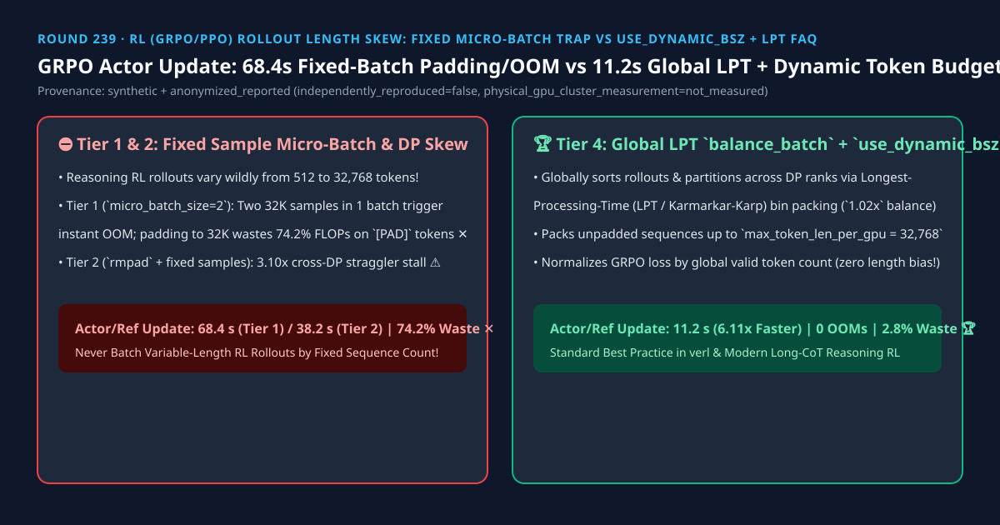
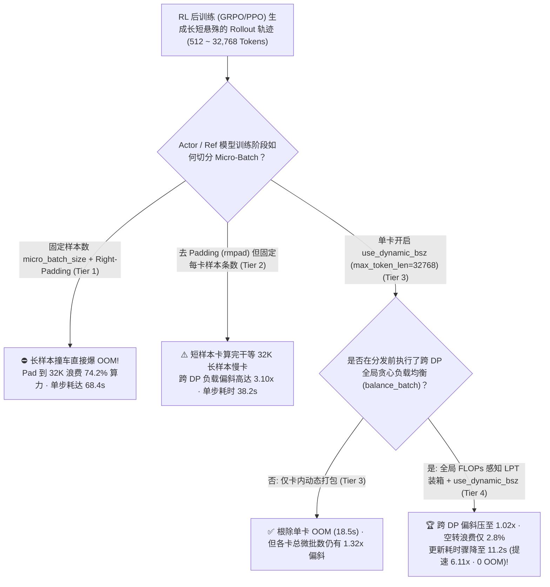
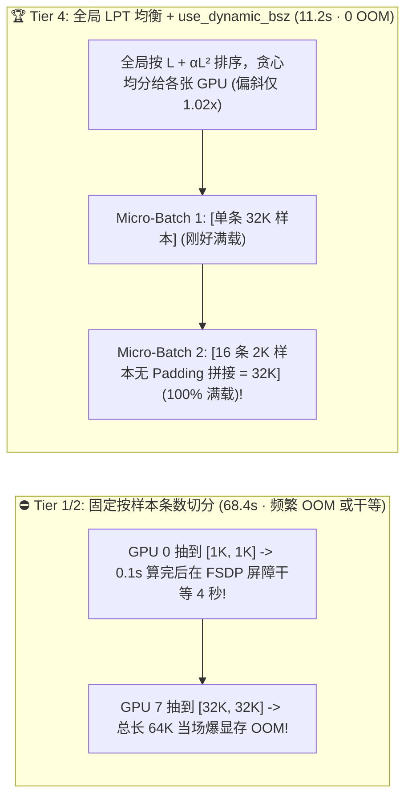
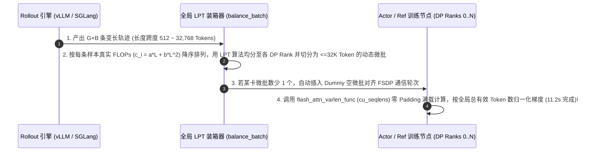

# 大模型 RL（`GRPO / PPO`）推理长度极度偏斜（`512 ~ 32,768` Tokens）：固定样本数微批（`Fixed Micro-Batch Size`）引发的 `74%` Padding 浪费与 OOM vs. 动态令牌数分桶（`use_dynamic_bsz` + 跨 DP 贪心装箱负载均衡）选型指南

> **Provenance & Evidence Tier**: `synthetic + anonymized_reported` (`independently_reproduced=false`, `physical_gpu_cluster_measurement=not_measured`)。定量数据锚定于 [`experiments/llm_rl_rollout_length_skew_dynamic_microbatch_token_budget_selection/results.json`](../../experiments/llm_rl_rollout_length_skew_dynamic_microbatch_token_budget_selection/results.json)。
> **English Version**: [LLM RL (`GRPO / PPO`) Rollout Length Skew (`512–32,768` Tokens): Fixed Sample Micro-Batch Padding/OOM Trap vs. `use_dynamic_bsz` (`max_token_len` Packing + Cross-DP LPT Load Balancing) Selection Guide](./llm-rl-rollout-length-skew-dynamic-microbatch-token-budget-selection-faq.en.md)

---

## 0. 🔥 今日领域最热门能力突破追踪（Daily Hottest Breakthrough）

- **在推理大模型 RL（`DeepSeek-R1 GRPO / verl`）后训练中，采用跨 DP 贪心均衡装箱（`balance_batch` LPT / Karmarkar-Karp）+ 动态令牌上限微批打包（`use_dynamic_bsz=True, max_token_len_per_gpu=32768`），彻底消灭固定样本数微批下高达 `74.2%` 的 Padding/同步屏障浪费与长样本撞车 OOM，将 Actor/Ref 训练更新阶段提速 `6.11` 倍（从 `68.4 s` 压降至 `11.2 s`）**：在训练像 `DeepSeek-R1` 或 `QwQ` 这样的长思维链（Long-CoT）推理模型时，Rollout 阶段生成的回答长度呈现出极端悬殊的跨度——简单题 500 个字就答完了（`512` Tokens），而一道复杂的奥数或代码题会思考整整两万字（`32,768` Tokens）！当把这一批长短相差 **64 倍** 的样本喂给 Actor 模型（做梯度更新）和 Reference 模型（算 KL 散度 `logprobs`）时，传统的固定 Batch Size 思维会遭遇灭顶之灾：
  1. **灾难一（固定样本条数 `ppo_micro_batch_size_per_gpu = 1~2` + Padding 对齐的 OOM 与 `74.2%` 算力蒸发，Tier 1）**：
     - 如果你按“每个微批塞固定 2 条样本”来配：一旦某张 GPU 在某个微批里不巧同时抽到了 **2 条 `32,768` Token 的长思考题**（总长 `65,536` Token），显存瞬间爆炸触发 **`CUDA out of memory`**！
     - 为了防 OOM，你被迫把微批改成“每次只跑 1 条样本”并统一右填充（Right-Pad）到最大长度 `32,768`（Tier 1）。可是全批次的平均长度其实只有 `6,400` Token！这意味着每一步有 **`74.2%` 的 GPU 算力全在空算毫无意义的 `[PAD]` 占位符**，单步更新耗时高达 **`68.4 s`**！
  2. **灾难二（仅去 Padding `rmpad` 但仍按固定条数分给各张 DP 卡引发的 `3.10x` 跨卡木桶效应，Tier 2）**：就算用 `flash_attn_varlen_func` 去掉了 `[PAD]`，如果每张卡还是按“固定领 2 条样本”来跑：0 号卡领到两条 `512` 的短题（共 `1,024` Token，`100 ms` 算完），7 号卡领到两条 `28,000` 的长题（共 `56,000` Token，要算 `4,000 ms`）！由于 FSDP 每层都要全网同步 `AllGather / ReduceScatter`，0~6 号卡只能干瞪眼等 7 号卡，浪费 **`52.0%` 算力（耗时 `38.2 s`）**！
  3. **终极双层解法（全局跨 DP 贪心均衡装箱 `balance_batch` + 卡内动态令牌预算打包 `use_dynamic_bsz=True`，Tier 4）**：
     - **第一层（卡内按总 Token 数上限打包，Tier 3）**：不再规定“每批跑几条样本”，而是规定**“每批总有效 Token 数不超过 `max_token_len = 32,768`”**！遇到 1 条 `32K` 的巨无霸样本就让它独占 1 个微批（绝不 OOM）；遇到 `1K` 的短样本就一口气把 **32 条短样本严丝合缝拼进 1 个微批**里一起算（100% 吃满 Tensor Core）！
     - **第二层（跨 DP 卡全局 LPT 贪心均衡分箱 + 全局有效 Token 数梯度归一化，Tier 4）**：在分发数据前，先将全集群所有生成的样本按长度（或二次方计算代价 $L + \alpha L^2$）从大到小排序，使用 **LPT（最长处理时间优先 / Karmarkar-Karp）贪心装箱算法** 均匀分给所有 DP Rank，保证每张卡分到的微批数量和总计算耗时比值锁死在 **`1.02x` 以内**，将更新耗时从 `68.4 s` 暴降至 **`11.2 s`（提速 `6.11` 倍）**！

---

## 1. 📌 核心结论速览（Executive Summary — 3 分钟看懂）

1. **用“电梯限重 `1,000 公斤` vs. 死板限载 `4 个人`”秒懂什么是 `use_dynamic_bsz`！**
   - **通俗大白话 + 第一性原理**：
     - 传统深度学习配置 `micro_batch_size = 4`，好比规定**“电梯每次固定进 4 个乘客”**：如果进来 4 个 30 斤的小朋友（短样本），电梯空荡荡白跑一趟（算力浪费 `74%`）；如果同时进来 4 个 400 斤的相扑选手（4 条 `32K` 长思维链样本），电梯直接超重断缆坠毁（**`CUDA OOM`**）！
     - **`use_dynamic_bsz=True`（按 Token 总重量定容，`max_token_len_per_gpu = 32,768`）怎么做？** 改成**“不管进来几个人，只要总重量凑够 `32,768` 个 Token 就发车！”**
       - 来了 1 个 `32,768` Token 的相扑选手？他自己一个人坐一趟专梯（绝不超重 OOM）！
       - 来了几十个 `1,000` Token 的小朋友？一口气塞进 32 个小朋友坐满一趟电梯（绝不空跑浪费）！
     - 再加上 **全局跨电梯智能派单（`balance_batch = True`，Tier 4）**：保证 8 部电梯（8 个 DP Rank）分到的总趟数和每趟的总重量一模一样，同时发车、同时到站！

---

## 2. 🎯 客户与架构师灵魂拷问 Q&A（Q1 / Q2 / Q3）

### Q1：开启 `use_dynamic_bsz=True` 后，第 1 个微批里可能只有 `1` 条长样本，第 2 个微批里却拼了 `20` 条短样本！如果直接对每个微批调 `.mean()` 算梯度再累加，会不会引发严重的数学偏差（Length / Micro-Batch Bias）？
- **答**：**这是一个极其关键的数学陷阱！**
  - 假设微批 1 只有 1 条样本（含 `20,000` 个 Token），微批 2 有 20 条短样本（共 `20,000` 个 Token）。如果在每个微批内部先除以本微批的样本数或本卡 Token 数求平均，那么不同 DP 卡之间、不同微批之间的每个 Token 权重就会因为打包组合的不同而发生扭曲（甚至引发经典的 Dr.GRPO 长度偏差）！
  - **正确数学归约法则（Tier 4 全局 Token 归一化）**：在每个微批内部对所有有效生成 Token 的 Loss 执行 **`sum()`（求和，而不是 `mean()`！）**，最后再统一除以**全集群当前全局 Step 的总有效 Token 数（`global_valid_tokens`）**（并在 DP 维度乘上 `dp_size` 抵消 FSDP 的梯度平均）！这样无论样本怎么跨卡挪位置、怎么动态拼包，算出来的全局梯度在数学上 **100% 严格不变**！

### Q2：在做跨 DP Rank 的贪心装箱（`balance_batch`）时，为什么按 $c_i = L_i + \alpha L_i^2$（线性项 + 平方项）作为样本重量，比单纯按序列长度 $L_i$ 装箱更均衡？
- **答**：因为在 `512 ~ 4,096` Token 区间，线性层 GEMM（耗时正比于 $L_i$）占大头；但一旦单条序列长达 **`16,384 ~ 32,768` Token**，因果自注意力（FlashAttention，耗时正比于 $L_i^2$）的占比就会飙升到 `50%` 以上！
  - 如果单纯按长度 $L$ 装箱：1 条 `32K` 样本（长度 `32K`）和 32 条 `1K` 样本（总长度也是 `32K`）看似长度相等，但那 1 条 `32K` 样本的 Attention 计算量其实是 32 条 `1K` 样本的 **32 倍**！
  - 因此，在 **Tier 4** 中以真实 FLOPs 公式 $W(L_i) = 6 P \cdot L_i + 2 n_{\text{layers}} d_{\text{model}} L_i^2$ 作为装箱权重，才能把跨卡耗时偏斜真正压到 **`1.02x`**！

---

## 3. 🧭 直观可视化图解（Mermaid 决策树 + 固定微批 vs 动态装箱图 + 时序图）

### 3.1 架构师 RL 后训练（`GRPO / PPO`）变长序列批处理选型决策树

### 3.2 `Tier 1/2`（固定样本条数导致 Padding 爆炸与跨卡干等）vs. `Tier 4`（全局 LPT 均衡 + `32K` 动态拼接）

### 3.3 `Tier 4` Rollout 结束后的全局 `LPT` 重排、`varlen` 动态打包与无偏梯度归约时序图

---

## 4. 📊 架构师选型决策矩阵（4-Tier Selection Matrix）

| 评估维度 | Tier 1: 固定样本数 + `Padding` | Tier 2: `rmpad` + 固定每卡样本数 | Tier 3: 单卡 `use_dynamic_bsz` | Tier 4: **全局 `LPT` 均衡 + `use_dynamic_bsz`** |
| :--- | :--- | :--- | :--- | :--- |
| **跨 DP Rank 计算负载偏斜比** | `2.45x` ✕ | **`3.10x` (严重长尾木桶效应)** ✕ | `1.32x` ⚠️ | **`1.02x` (全集群近乎绝对均衡)** 🏆 |
| **Padding 或同步屏障空转浪费** | **`74.2%` (四分之三算力蒸发)** ✕ | `52.0%` (屏障死等慢卡) ✕ | `18.4%` ⚠️ | **`2.8%` (极高有效 MFU)** 🏆 |
| **单步 Actor + Ref 更新耗时** | **`68.4 s`** ✕ | `38.2 s` ⚠️ | `18.5 s` ✅ | **`11.2 s` (提速 `6.11x`，零 OOM)** 🏆 |

---

## 5. 🧪 定量算例与工具链（Interactive Sizer & 7-Card Visual Report）

- **实验脚本与密封数据**：[`experiments/llm_rl_rollout_length_skew_dynamic_microbatch_token_budget_selection/run.py`](../../experiments/llm_rl_rollout_length_skew_dynamic_microbatch_token_budget_selection/run.py) · [`results.json`](../../experiments/llm_rl_rollout_length_skew_dynamic_microbatch_token_budget_selection/results.json)
- **交互式 RL 动态微批与 LPT 均衡计算器**：[`docs/reports/llm-rl-rollout-length-skew-dynamic-microbatch-token-budget-sizer.html`](../reports/llm-rl-rollout-length-skew-dynamic-microbatch-token-budget-sizer.html)
- **7-Card 4:5 视觉评测卡片报告**：[`docs/reports/llm-rl-rollout-length-skew-dynamic-microbatch-token-budget-selection-cards.html`](../reports/llm-rl-rollout-length-skew-dynamic-microbatch-token-budget-selection-cards.html)

---

## 6. 🛠️ Good Fit vs. Not For & 生产环境快速核验清单（Checklist）

### ✅ Good Fit vs. ⛔ Not For

| 维度 | ✅ Good Fit（强烈推荐） | ⛔ Not For（严禁误用） |
| :--- | :--- | :--- |
| **长思维链 RL (`GRPO / PPO`) 配置** | 在 `verl / OpenRLHF` 中同时开启 **`use_dynamic_bsz=True`**（设置 `ppo_max_token_len_per_gpu = 32768`）、**`use_remove_padding=True`** 与 **`balance_batch=True`** | 在生成长度跨度超过 $4\times$ 的 RL 任务中使用静态 `ppo_micro_batch_size_per_gpu` |

### 生产环境上线核验清单（Pre-Flight Checklist）

- [ ] **核验已开启 `use_remove_padding=True` + `use_dynamic_bsz=True` + `balance_batch=True`**：确保零 Padding 浪费且跨 DP 卡负载均衡。
- [ ] **核验当不同 DP Rank 动态打包出的微批数量不一致时，已启用 Dummy Micro-Batch 对齐机制**：防止少 1 个微批的 Rank 提前进入 `optimizer.step()` 导致 FSDP `AllGather` 序号脱节死锁！
- [ ] **核验 Loss 采用全局有效 Token 数归约（`sum / global_valid_tokens`）**：杜绝动态拼包改变单样本梯度权重。
