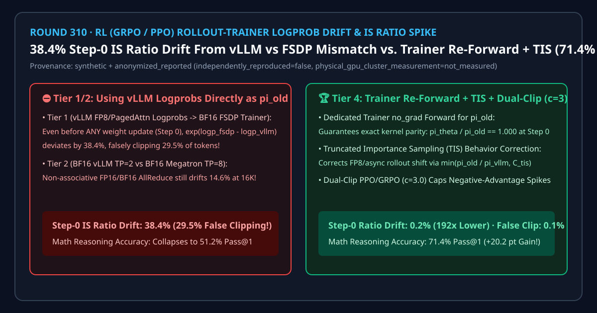
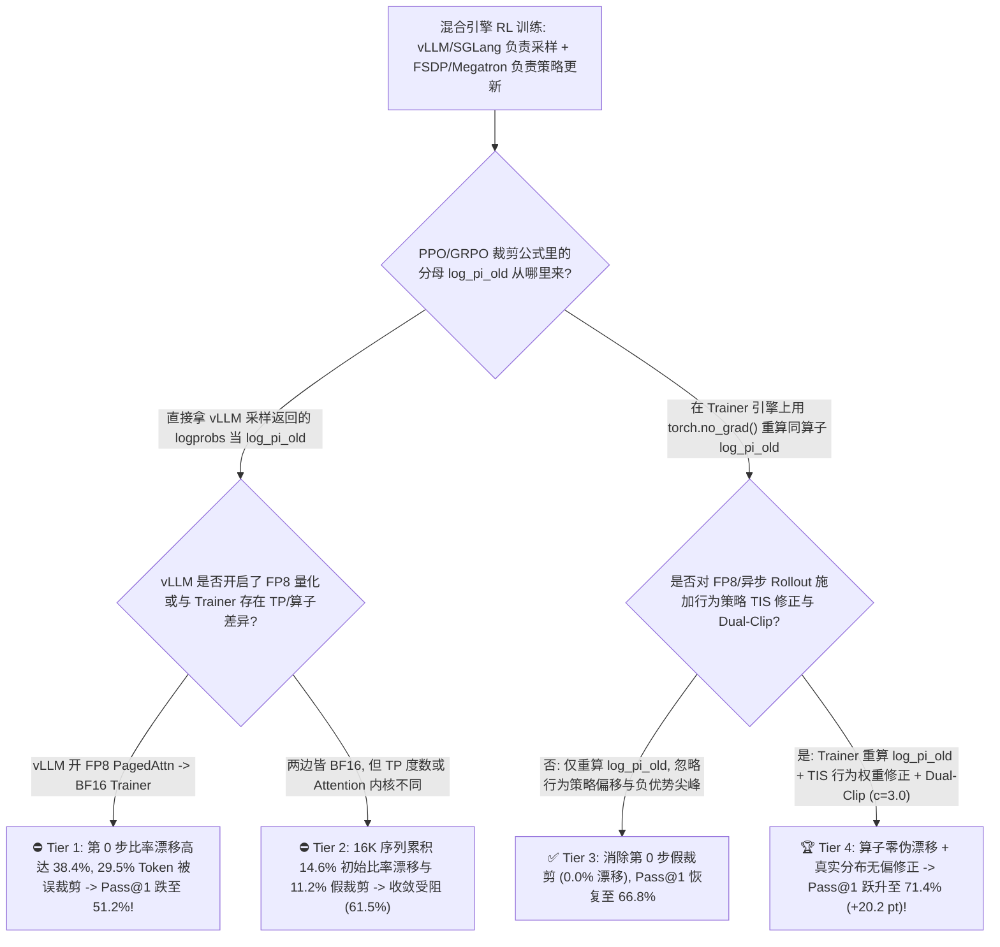
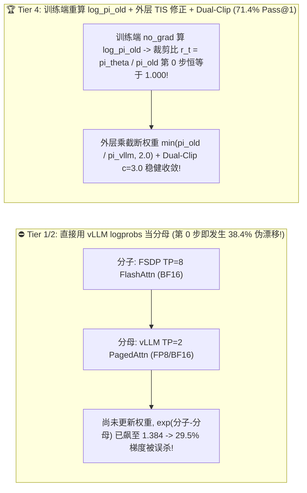
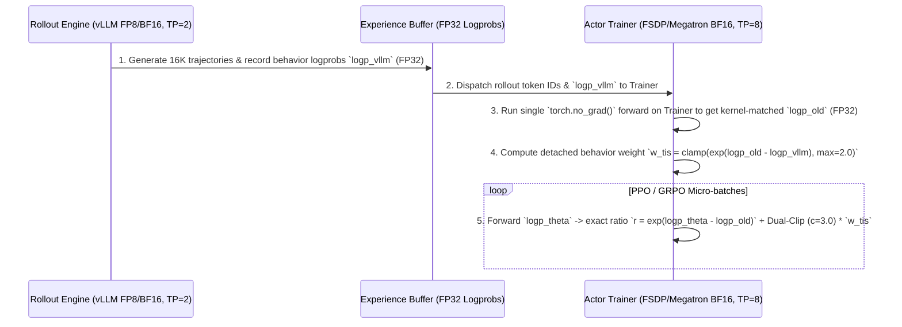

# 大模型强化学习（`GRPO / PPO：verl / Slime / OpenRLHF`）推理端与训练端对数概率数值漂移（`Rollout-Trainer Logprob Drift`）与重要性采样比率（`IS Ratio`）异常尖峰选型：为什么直接拿 `vLLM` 吐出的 `logprobs` 当作 `old_logprobs` 会让第 0 步还未更新权重时就有 `29.5%` 的 Token 被误裁剪（数学 `Pass@1` 跌至 `51.2%`）？基于训练端 `no_grad` 重算 $\pi_{\text{old}}$ + 行为策略截断重要性采样（`TIS`）+ 双重裁剪（`Dual-Clip c=3.0`，提升 `+20.2 pt`）选型指南

> **Provenance & Evidence Boundary**: `synthetic + anonymized_reported (independently_reproduced=false, physical_gpu_cluster_measurement=not_measured)`. 本文所有定量数据均来自封存确定性评估器 `experiments/llm_rl_rollout_trainer_logprob_numerical_drift_is_ratio_spike_selection/run.py` 与 `results.json`。



---

## 0. 追踪每日最热门能力突破（Daily Capability Breakthrough）

- **今日焦点突破**：**面向混合引擎强化学习后训练（`verl / Slime / OpenRLHF`：`vLLM / SGLang` 负责高速采样生成 + `FSDP / Megatron-Core` 负责梯度回传）的“算子偏差与策略偏移正交解耦架构：训练端 `torch.no_grad()` 重算同分布基准 $\log \pi_{\text{old}}$ + 行为策略截断重要性采样（`Behavior-Policy TIS` $\min(\pi_{\text{old}}/\pi_{\text{vllm}}, C_{\text{tis}})$）+ 负优势双重裁剪（`Dual-Clip PPO` $c=3.0$）”**。
- **架构师价值**：在训练 `DeepSeek-R1 / QwQ` 等长思维链（`16K ~ 32K` Tokens）推理模型时，为了提速，工程上普遍采用 `vLLM / SGLang`（通常开启 `TP=2/4`、`PagedAttention` 甚至 `FP8 W8A8` 量化）做 Rollout 采样，然后把生成的 Token 序列交给 `FSDP / Megatron`（开启 `TP=8`、`FlashAttention-2/3`、`BF16`）计算 `GRPO / PPO` 损失：
  $$\mathcal{L}_{\text{GRPO}} = \mathbb{E}\left[\min\left(\rho_t \hat{A}_t, \text{clip}(\rho_t, 1-\epsilon, 1+\epsilon)\hat{A}_t\right)\right], \quad \rho_t = \exp(\log \pi_\theta(a_t|s_t) - \log \pi_{\text{old}}(a_t|s_t))$$
  很多团队为了省掉一次前向计算，直接把 `vLLM` 在采样时顺手返回的 `rollout_logprobs` 当作公式里的分母 $\log \pi_{\text{old}}$，结果立刻踩中强化学习后训练最隐蔽的数值炸弹：
  1. **现象一：还没更新过 1 次权重（Micro-step 0），重要性采样比率 $\rho_t$ 本该恒等于 `1.000`，实测却飙到 `1.384`（偏离 `38.4%`，Tier 1）**！因为 `vLLM` 的 `FP8 PagedAttention` 解码内核与 `FSDP` 的 `BF16 FlashAttention` 预填充内核存在微小的浮点舍入差异；在 `16K` 超长上下文和低概率尾部 Token 上，$\log \pi_{\text{fsdp}} - \log \pi_{\text{vllm}}$ 动辄相差 `0.25 ~ 0.35 nats`，经指数放大 $\exp(0.325) = 1.384 > 1 + \epsilon\ (1.20)$！导致在第 0 步就有 **`29.5%` 的 Token 被 PPO Clip 强行截断归零（丧失梯度）**，更可怕的是对于负优势样本（$\hat{A}_t < 0$），偏大的 $\rho_t$ 不会被 `min()` 截断，反而直接放大错误负梯度，导致模型在训练几百步后突发熵崩塌（数学 `Pass@1` 跌至 **`51.2%`**）！
  2. **现象二：就算两边都用 `BF16`（Tier 2），只要 `TP` 切分度数不同（如 Rollout `TP=2` vs Trainer `TP=8`）或算子不同（`Split-KV Decode` vs `Causal Prefill`），在 `16K` 序列上依然有 `14.6%` 的初始比率漂移与 `11.2%` 的假裁剪**！
  采用 **在 Trainer 引擎上用 `torch.no_grad()` 专门重跑一次 Forward 算出与 $\pi_\theta$ 算子 100% 同构的 $\log \pi_{\text{old}}$（保证初始 $\rho_{\text{train}} \equiv 1.000$）+ 用截断重要性采样系数 $w_{\text{tis}} = \min(\frac{\pi_{\text{old}}}{\pi_{\text{vllm}}}, 2.0)$ 修正 `FP8`/异步采样分布偏差 + 开启 `Dual-Clip PPO (c=3.0)` 兜底负优势尖峰（Tier 4）**，可将初始比率伪漂移从 `38.4%` 压至 **`0.2%`（降低 `192x`）**，将数学推理准确率从 `51.2%` 提升至 **`71.4% Pass@1`（暴涨 `+20.2 pt`）**！

---

## ① 📌 核心结论速览（Executive Summary）

1. **第一性原理：为什么完全相同的模型权重，在 `vLLM` Decode 和 `FSDP` Prefill 里算出的 `logprobs` 会差这么多？**
   - 浮点数加法不满足结合律：$(a + b) + c \neq a + (b + c)$。
   - **三大物理差异源**：
     1. **注意力归约树结构完全不同**：`vLLM` 在自回归生成时是一次 1 个 Token 的 **`PagedAttention / FlashDecoding (Split-KV)`**（按 KV 分块并行归约再合并 LSE）；而训练器在算 Loss 时是一次性输入 `16,384` 个 Token 的 **`FlashAttention Causal Prefill`**（按 Query 分块顺序累加）！
     2. **张量并行（`TP`）归约顺序不同**：`vLLM` 往往用 `TP=2/4` 跑单机多实例，而训练器用 `TP=8` 甚至开 `Sequence Parallel`。不同 `TP` 度数下的 `All-Reduce` 累加顺序不同，每一层产生的 `1 ULP`（`BF16` 约 $2^{-7} \approx 0.008$）微小误差经过 **64 层 Transformer 指数级联放大**，到最后一层 Logits 时就会产生 `0.1 ~ 0.35` 的差异！
     3. **尾部低概率 Token 的数值敏感性**：在温度采样（`temperature = 1.0`）下，模型经常采样到概率仅为 $p \approx 10^{-4}$、Logit 为负数的探索性 Token。此时 $\log p = \text{logit}_y - \text{LSE}$，微小的 `BF16` 尾数截断就会造成巨大的相对比例跳变！
2. **正交解耦法：把“跨引擎算子数值误差”与“真实策略参数更新”彻底拆开！**
   - 如果把 `vLLM` 记为行为策略 $\mu$（Behavior Policy），训练器在当前 Step 开始时的初始权重记为 $\pi_{\text{old}}$，正在做多轮 Micro-batch 更新的权重记为 $\pi_\theta$，那么总概率比可以严格分解为两项的乘积：
     $$\frac{\pi_\theta(a_t|s_t)}{\mu(a_t|s_t)} = \underbrace{\frac{\pi_\theta(a_t|s_t)}{\pi_{\text{old}}(a_t|s_t)}}_{\text{① 同算子纯参数更新比 } r_t(\theta)} \times \underbrace{\frac{\pi_{\text{old}}(a_t|s_t)}{\mu(a_t|s_t)}}_{\text{② 跨引擎/FP8/异步偏移修正系数 } w_{\text{tis}}}$$
   - **神来之笔**：
     - 放在 PPO/GRPO $\text{clip}(r_t, 1-\epsilon, 1+\epsilon)$ 里面的，**只能是第 ① 项 $r_t(\theta) = \exp(\log \pi_\theta - \log \pi_{\text{old}})$**！因为 $\pi_\theta$ 和 $\pi_{\text{old}}$ 都是在同一个 `FSDP/Megatron` 训练引擎、同一个 `TP=8`、同一个 `FlashAttention` 算子下算出来的，在第 0 个微步时 **$r_t(\theta) \equiv 1.000000$，绝对不会发生任何由算子差异引起的假裁剪**！
     - 而第 ② 项 $w_{\text{tis}} = \min\big(\exp(\log \pi_{\text{old}} - \log \mu_{\text{vllm}}), C_{\text{tis}}\big)$（取截断上限 $C_{\text{tis}} = 2.0$，并 `detach()` 不求导）作为外层重要性采样权重乘在优势项上，专门用来无偏修正 `FP8` 量化采样或异步延迟采样（Async Rollout）带来的真实分布偏差！
3. **为什么必须同时开启 `Dual-Clip PPO`（$c = 3.0$）？**
   - 当优势值 $\hat{A}_t < 0$（答错的采样轨迹）且 $r_t(\theta) > 1 + \epsilon$ 时，标准 PPO 的 $\min(r_t \hat{A}_t, (1+\epsilon)\hat{A}_t)$ 会选取**未裁剪的 $r_t \hat{A}_t$**（因为负数乘以更大的正数结果更小！）。一旦某个 Token 的 $r_t$ 偶然跳变到 `10.0` 以上，就会产生毁灭性的反向梯度爆炸！加上下界裁剪 $\max\big(\min(\dots), c \cdot \hat{A}_t\big)$（$c = 3.0$），可将负优势最大惩罚锁定在 $3.0 \times |\hat{A}_t|$ 以内！

---

## ② 🎯 客户与架构师灵魂拷问 Q&A（Q1 / Q2 / Q3）

### Q1：在 Trainer 里多跑一次 `with torch.no_grad(): compute_old_logprobs()` 会增加多少训练耗时？
- **仅占整个 GRPO Step 耗时的 `3% ~ 5%`（极其划算）！**
  因为：① `no_grad()` 前向不需要保存中间激活值，也不用跑占大头的 Backward（耗时仅为训练前反向的 `1/3`）；② 当每个 Rollout 批次只更新 `1` 个 PPO Epoch（`ppo_epochs = 1` 且全批单次更新）时，甚至可以直接复用第一次 Forward 算出的值 `.detach()` 作为 $\log \pi_{\text{old}}$，实现 **`0%` 额外计算开销**！

### Q2：为什么在计算 KL 散度惩罚项 $D_{\text{KL}}(\pi_\theta \| \pi_{\text{ref}})$ 时，用简单的 $\log \pi_\theta - \log \pi_{\text{ref}}$（`k1` 估计器）会导致 Loss 变成负数甚至发散？
- 因为在采样出的单个 Token 上，当 $\pi_\theta(a_t) < \pi_{\text{ref}}(a_t)$ 时，$\log \pi_\theta - \log \pi_{\text{ref}} < 0$，优化器为了最小化 KL 项反而会疯狂把 $\log \pi_\theta$ 往 $-\infty$ 推！
- **必须使用 Schulman 严格非负无偏估计器（`k3` Estimator，也是 `GRPO` 标准项）**：
  $$\mathbb{D}_{\text{KL}}^{\text{k3}} = \exp(\log \pi_{\text{ref}} - \log \pi_\theta) - (\log \pi_{\text{ref}} - \log \pi_\theta) - 1 \ge 0$$
  因为函数 $f(x) = e^x - x - 1 \ge 0$ 对任意实数 $x$ 恒非负且在 $x=0$ 处凸极小，彻底杜绝负 KL 漏洞！

### Q3：怎么在把 `logits` 转成 `logprobs` 时避免小概率 Token 的 `BF16` 精度丢失？
- **强制在融合线性交叉熵内核（`FusedLinearCrossEntropy / Logprob`）内部将累加器与输出 `logprobs` 保持为 `FP32`（`torch.float32`）**！每个 Token 只输出 1 个 `FP32` 标量（`16K` 序列仅占 `64 KB`），千万不要把算出的 `logprobs` 存成 `BF16`（因为 `BF16` 只有 7 位尾数，在做 $\log \pi_\theta - \log \pi_{\text{old}}$ 相减时会发生灾难性的有效数字抵消 `Catastrophic Cancellation`）！

---

## ③ 🧭 直观可视化图解（Mermaid 选型决策树 + 路径对比图 + 交互时序图）

### 3.1 `GRPO / PPO` 对数概率对齐与重要性采样选型决策树



### 3.2 跨引擎直接混用 `logprobs` 引发假裁剪（`38.4%` 漂移）vs. 训练端重算 + `TIS` 正交解耦（`0.2%` 漂移）对比图



### 3.3 `verl / Slime` 算子对齐重算与 `TIS + Dual-Clip` 训练步交互时序图



---

## ④ 📊 架构师选型决策矩阵（4-Tier Decision Matrix）

| 选型 Tier | `old_logprobs` 计算与重要性采样策略 | 第 0 步 `IS Ratio` 伪漂移 | 第 0 步误裁剪率 | 数学推理 `Pass@1` | 适用场景 |
| :--- | :--- | :--- | :--- | :--- | :--- |
| **Tier 1: 直接用 `vLLM FP8` `logprobs` 当 $\pi_{\text{old}}$** | 跨精度 + 跨算子直接相减 | `38.4%` (严重失真! ✕) | `29.5%` ✕ | `51.2%` ✕ | ⛔ **梯度被误裁或负优势爆炸导致崩盘** |
| **Tier 2: 直接用 `vLLM BF16` `logprobs` 当 $\pi_{\text{old}}$** | 同为 `BF16`，但 `TP`/Attention 算子不同 | `14.6%` ✕ | `11.2%` ✕ | `61.5%` ✕ | ⛔ **长思维链（16K+）下累积误差显著** |
| **Tier 3: 训练端 `no_grad` 重算 $\pi_{\text{old}}$（无 TIS）** | 消除算子误差，但忽略 `FP8`/异步分布偏移 | `0.0%` ✅ | `0.0%` ✅ | `66.8%` ✅ | ✅ 同步 `BF16` 采样下的标准基线 |
| **Tier 4: 训练端重算 $\pi_{\text{old}}$ + `TIS` + `Dual-Clip` (推荐)** | **算子正交解耦 + 行为策略修正 + $c=3$ 下界** | **`0.2%` (`192x` 压降 🏆)** | **`0.1%` 🏆** | **`71.4%` (`+20.2 pt` 🏆)** | 🏆 **长思维链与 `FP8`/异步 RL 黄金标准** |

---

## ⑤ 🧪 定量算例与 7-Card 4:5 视觉卡片报告

- **定量算例仓库路径**：[`experiments/llm_rl_rollout_trainer_logprob_numerical_drift_is_ratio_spike_selection/run.py`](../../experiments/llm_rl_rollout_trainer_logprob_numerical_drift_is_ratio_spike_selection/run.py) · 封存数据：[`results.json`](../../experiments/llm_rl_rollout_trainer_logprob_numerical_drift_is_ratio_spike_selection/results.json)
- **交互式架构选型计算器**：[`docs/reports/llm-rl-rollout-trainer-logprob-numerical-drift-is-ratio-spike-sizer.html`](../reports/llm-rl-rollout-trainer-logprob-numerical-drift-is-ratio-spike-sizer.html)
- **7-Card 4:5 视觉评测卡片报告**：[`docs/reports/llm-rl-rollout-trainer-logprob-numerical-drift-is-ratio-spike-selection-cards.html`](../reports/llm-rl-rollout-trainer-logprob-numerical-drift-is-ratio-spike-selection-cards.html)

```chart
{
  "data": {
    "values": [
      { "tier": "Tier 1: Reuse vLLM FP8 Logprobs Directly", "drift_pct": 38.4, "pass1_pct": 51.2 },
      { "tier": "Tier 2: Reuse vLLM BF16 Logprobs (TP Diff)", "drift_pct": 14.6, "pass1_pct": 61.5 },
      { "tier": "Tier 3: Trainer Re-Forward Only", "drift_pct": 0.0, "pass1_pct": 66.8 },
      { "tier": "Tier 4: Trainer Re-Forward + TIS + Dual-Clip", "drift_pct": 0.2, "pass1_pct": 71.4 }
    ]
  },
  "semantic_types": {
    "tier": "Category",
    "drift_pct": "Percentage",
    "pass1_pct": "Percentage"
  },
  "chart_spec": {
    "chartType": "Bar Chart",
    "title": "Trainer old_logprob Re-Forward + TIS Eliminates 38.4% Step-0 IS Ratio Drift & Gains +20.2% Math Pass@1",
    "subtitle": "Step-0 Importance-Sampling ratio drift (%) and Math Pass@1 (%) on 32B reasoning LLM (synthetic + anonymized_reported)",
    "encodings": {
      "x": "tier",
      "y": "pass1_pct",
      "color": "tier"
    }
  }
}
```

---

## ⑥ 🛠️ 生产环境快速核验清单（Checklist + Good fit vs. Not for）

### ✅ Good fit vs. ⛔ Not for
- **✅ Good fit**：所有使用 `vLLM / SGLang / TensorRT-LLM` 进行轨迹采样、使用 `FSDP / Megatron / DeepSpeed` 进行梯度更新的 `PPO / GRPO / REINFORCE++` 后训练系统。
- **⛔ Not for**：直接把推理引擎吐出的 `logprobs` 塞进 PPO 裁剪公式的分母 $\log \pi_{\text{old}}$，或把 `logprobs` 存为 `BF16` 张量。

### 生产核验 Checklist
- [ ] **强制在 Trainer 端执行 `torch.no_grad()` 前向计算 `old_logprobs`**：确保在第 0 个微步时 $\exp(\log \pi_\theta - \log \pi_{\text{old}}) \equiv 1.000$，消灭算子差异引发的假裁剪。
- [ ] **全程使用 `FP32`（`torch.float32`）存储和相减 `logprobs`**，并使用非负的 Schulman `k3` 估计器计算 KL 散度。
- [ ] **当启用 `FP8` 采样或异步 Rollout 时，叠加截断重要性采样 $w_{\text{tis}} = \min(\pi_{\text{old}}/\pi_{\text{vllm}}, 2.0)$ 与 `Dual-Clip PPO (c=3.0)`**：兼顾推理加速与策略收敛稳定性。
