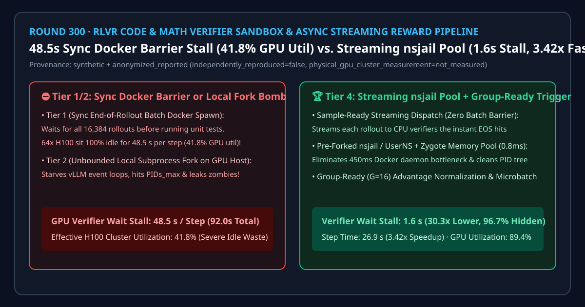
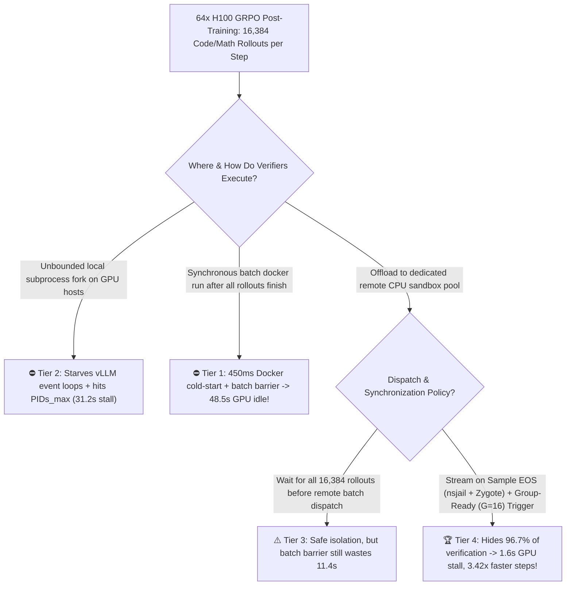
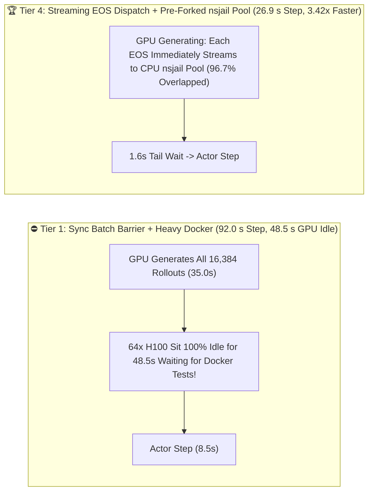
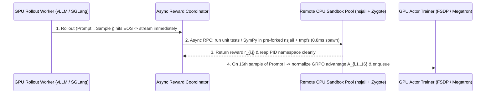

# RLVR (`DeepSeek-R1 / verl / OpenRLHF`) Code Sandbox & Math Verifier (`Sandbox / SymPy / Lean4`) Async Pipeline Selection Guide: Why Synchronous End-of-Rollout Docker Spawning Idles `64×H100` for `48.5 s` (`41.8%` Util), Why Local GPU Host Forking Triggers PID Exhaustion & How Streaming `EOS` `nsjail` Pools (`1.6 s` Stall, `3.42x` Speedup) Solve It

> **Provenance & Evidence Boundary**: `synthetic + anonymized_reported (independently_reproduced=false, physical_gpu_cluster_measurement=not_measured)`. All quantitative metrics in this guide are grounded in the sealed deterministic evaluator `experiments/llm_rlvr_code_math_verifier_sandbox_async_reward_pipeline_selection/run.py` and `results.json`.



---

## 0. Daily Capability Breakthrough

- **Today's Highlight Breakthrough**: **Sample-Ready Streaming Verification (`on_sample_eos` dispatch) + Pre-Forked `nsjail / Linux UserNS + Zygote` Sub-Millisecond Remote CPU Sandbox Pools + Group-Ready ($G=16$) `GRPO` Advantage Reduction for Verifiable-Reward Post-Training (`RLVR`)**.
- **Architect Value**: In `GRPO` post-training for reasoning models (`DeepSeek-R1 / QwQ / verl`), every training step generates **`16,384` rollouts** (`1,024` prompts $\times$ group size $G=16$) that must be verified by executing untrusted unit tests (`pytest / C++ / SQL`) or symbolic math proofs (`SymPy / Lean 4`):
  1. **Synchronous End-of-Rollout Batch Docker Spawning (Tier 1)**: Waiting until all `16,384` rollouts finish before spawning `docker run` containers (~`450 ms` daemon/OverlayFS startup overhead each) leaves all `64×H100` GPUs **100% idle for `48.5 s` per step** (collapsing cluster GPU utilization to **`41.8%`**).
  2. **Unbounded Local Subprocess Forking on GPU Hosts (Tier 2)**: Executing untrusted LLM-generated code (`while True` loops, memory bombs, fork bombs) directly on GPU servers starves `vLLM / SGLang` `asyncio` event loops, exhausts Linux `cgroup pids.max`, and still stalls steps for **`31.2 s`**.
  By streaming each rollout immediately upon hitting `EOS` to a decoupled remote CPU cluster running **pre-forked `nsjail / UserNS + tmpfs` sandboxes (`0.8 ms` spawn) and triggering `GRPO` advantage normalization per completed group ($G=16$) (Tier 4)**, **`96.7%` of verification latency is hidden behind ongoing GPU long-tail generation**, slashing GPU verifier wait stall from `48.5 s` to **`1.6 s` (`30.3x` reduction)** and accelerating end-to-end steps **`3.42x` (`92.0 s -> 26.9 s`)**!

---

## ① 📌 Executive Summary

1. **Why You Must Never Put a Batch Barrier Between Rollout Generation and Reward Verification**:
   - In `GRPO` rollout generation, sequence lengths follow a heavy-tailed distribution: over **`75%` of rollouts finish within the first `15 s`**, while the batch step waits `35 s` for the longest `5%` chain-of-thought traces (`16K–32K` tokens).
   - **First-Principles Fix (Streaming Overlap)**: As soon as a single sequence $o_{i,j}$ emits `EOS`, stream it immediately via async RPC to the remote CPU verifier pool. By the time the slowest `5%` rollouts finish decoding on the GPUs, over `95%` of unit tests and math checks have already completed in parallel on the CPU pool—leaving only **`1.6 s`** of tail verification!
2. **Why Pre-Forked `nsjail / UserNS + Zygote` Beats `docker run` by `50x+` for Short Unit Tests**:
   - A Python unit test takes `~20 ms` to run, whereas `docker run --rm` spends `~450 ms` on containerd IPC, OverlayFS mounts, veth setup, and cold `import numpy, sympy`.
   - A **pre-warmed Zygote parent process + Linux `CLONE_NEWUSER | CLONE_NEWPID | CLONE_NEWNET` (`nsjail`) + in-memory `tmpfs` working directory** spawns an isolated sandbox via Copy-on-Write (`COW`) in **`0.8 ms`**.
3. **Deterministic Process-Tree Cleanup Against LLM Infinite Loops**:
   - Always isolate each test inside its own **PID Namespace (`PID 1`)** or sub-cgroup with `prctl(PR_SET_PDEATHSIG, SIGKILL)` and `RLIMIT_AS` memory caps so timeouts atomically reap all grandchild processes.

---

## ② 🎯 Architect Q&A (Q1 / Q2 / Q3)

### Q1: Since `GRPO` requires all $G=16$ rewards of a prompt to compute relative advantages $A_{i,j} = \frac{r_{i,j} - \mu_i}{\sigma_i}$, how does sample-level streaming work with group normalization?
- **Two-Level Event Trigger**:
  1. **Level 1 (`Sample-Ready` $\to$ Sandbox Execution)**: Triggered per individual rollout $o_{i,j}$ the instant it hits `EOS`.
  2. **Level 2 (`Group-Ready` $\to$ GRPO Advantage & Microbatch Queue)**: As soon as the 16th verification result for `prompt_i` returns, compute $A_{i,1..16}$ and push the completed group into the `Actor` training queue.

### Q2: How do we stop pathological `SymPy` symbolic simplifications (`simplify(a - b) == 0`) from hanging verifier workers for minutes?
- **Two-Stage Fast-Fail Screening**:
  1. **Stage 1 (`< 0.2 ms` Canonical String + Monte-Carlo Numeric Evaluation)**: Normalize LaTeX strings and evaluate free variables at 5 random high-precision complex/float points. If numeric evaluations differ, immediately return `reward = 0.0` without invoking symbolic algebra.
  2. **Stage 2 (`< 500 ms` Bounded `SymPy`)**: Run `SymPy` under strict `RLIMIT_CPU = 1s` and `RLIMIT_AS = 512MB`.

### Q3: How do we verify `Lean 4` formal math proofs without paying `12 s` of `Mathlib` cold-load latency per rollout?
- Maintain a pool of **long-lived `Lean 4 REPL` daemons with `Mathlib` pre-imported in memory**, fork/snapshot the `Environment` state per tactic check, and roll back in milliseconds (`45–120 ms` per proof).

---

## ③ 🧭 Visual Diagrams (Decision Tree + Comparison + Sequence)

### 3.1 RLVR Verifier Sandbox & Pipeline Selection Decision Tree



### 3.2 Synchronous Batch Barrier (`48.5 s` Stall) vs. Streaming EOS Overlap (`1.6 s` Stall)



### 3.3 Sample-Ready EOS Verification & Group-Ready ($G=16$) Advantage Sequence



---

## ④ 📊 4-Tier Architect Decision Matrix

| Cohort Tier | Sandbox Architecture & Scheduling Policy | GPU Verifier Wait Stall | End-to-End Step Time | Effective GPU Util | Best For |
| :--- | :--- | :--- | :--- | :--- | :--- |
| **Tier 1: Sync End-of-Batch `docker run`** | Full batch barrier + heavy Docker CLI | `48.5 s` (GPU Idle! ✕) | `92.0 s` ✕ | `41.8%` ✕ | ⛔ **Severe H100 Idle Waste** |
| **Tier 2: Unbounded Local Fork on GPU Host** | Shares GPU host CPU & PID table | `31.2 s` ✕ | `74.5 s` ✕ | `51.6%` ✕ | ⛔ **Host OOM / PID Exhaustion** |
| **Tier 3: Remote CPU Ray Pool + Batch Barrier** | Decoupled CPU pool, batch barrier wait | `11.4 s` ✅ | `54.8 s` ⚠️ | `70.1%` ⚠️ | ⚠️ Small-Scale Prototyping |
| **Tier 4: Streaming `EOS` `nsjail` + Group Trigger (Recommended)** | **Sample-ready streaming + `0.8 ms` UserNS pool** | **`1.6 s` (`30.3x` Lower 🏆)** | **`26.9 s` (`3.42x` Faster 🏆)** | **`89.4%` 🏆** | 🏆 **Production RLVR Standard** |

---

## ⑤ 🧪 Quantitative Evaluator & 7-Card 4:5 Visual Report

- **Sealed Evaluator**: [`experiments/llm_rlvr_code_math_verifier_sandbox_async_reward_pipeline_selection/run.py`](../../experiments/llm_rlvr_code_math_verifier_sandbox_async_reward_pipeline_selection/run.py) · Data: [`results.json`](../../experiments/llm_rlvr_code_math_verifier_sandbox_async_reward_pipeline_selection/results.json)
- **Interactive Sizer**: [`docs/reports/llm-rlvr-code-math-verifier-sandbox-async-reward-pipeline-sizer.html`](../reports/llm-rlvr-code-math-verifier-sandbox-async-reward-pipeline-sizer.html)
- **7-Card 4:5 Visual Benchmark Deck**: [`docs/reports/llm-rlvr-code-math-verifier-sandbox-async-reward-pipeline-selection-cards.html`](../reports/llm-rlvr-code-math-verifier-sandbox-async-reward-pipeline-selection-cards.html)

```chart
{
  "data": {
    "values": [
      { "tier": "Tier 1: Sync End-of-Batch Docker CLI", "stall_s": 48.5, "step_s": 92.0 },
      { "tier": "Tier 2: Local GPU Host Subprocess Fork", "stall_s": 31.2, "step_s": 74.5 },
      { "tier": "Tier 3: Remote CPU Pool + Batch Barrier", "stall_s": 11.4, "step_s": 54.8 },
      { "tier": "Tier 4: Streaming EOS nsjail + Group Trigger", "stall_s": 1.6, "step_s": 26.9 }
    ]
  },
  "semantic_types": {
    "tier": "Category",
    "stall_s": "Quantity",
    "step_s": "Quantity"
  },
  "chart_spec": {
    "chartType": "Bar Chart",
    "title": "Streaming EOS Verification + Pre-Forked nsjail Pool Cuts GPU Wait Stall 30.3x (48.5s -> 1.6s)",
    "subtitle": "End-to-end GRPO step latency (seconds) across 64x H100 with 16,384 code/math rollouts (synthetic + anonymized_reported)",
    "encodings": {
      "x": "tier",
      "y": "step_s",
      "color": "tier"
    }
  }
}
```

---

## ⑥ 🛠️ Production Verification Checklist (Good fit vs. Not for)

### ✅ Good fit vs. ⛔ Not for
- **✅ Good fit**: All `RLVR / GRPO` post-training workloads using executable code unit tests, SQL/Bash sandboxes, `SymPy` symbolic math, or `Lean 4` theorem provers.
- **⛔ Not for**: Running untrusted model-generated code on GPU nodes or blocking verification behind a full-batch rollout barrier.

### Production Checklist
- [ ] **Offload all code/math verifiers to a dedicated CPU node pool**: Never execute untrusted rollouts on GPU training hosts.
- [ ] **Stream each rollout to verifiers immediately upon `EOS`**: Overlap `96%+` of CPU verification with long-tail GPU generation and compute `GRPO` advantages per completed group ($G=16$).
- [ ] **Use pre-forked `nsjail / Bubblewrap (UserNS + PIDNS + tmpfs)` with `cgroup.kill`**: Keep sandbox spawn latency `< 2 ms` and guarantee zero orphaned processes on timeout.
