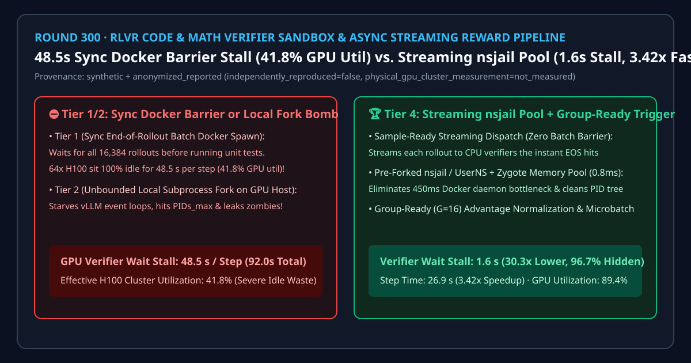
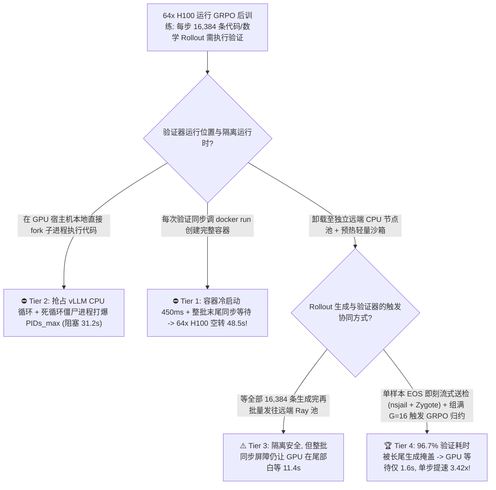
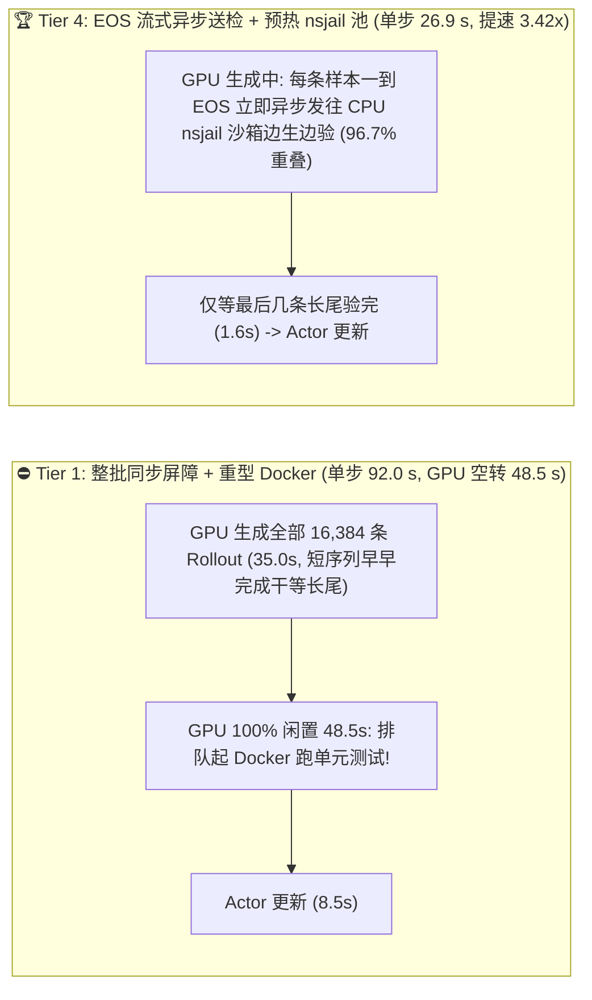

# 大模型强化学习可验证奖励（`RLVR：DeepSeek-R1 / verl / OpenRLHF`）代码沙箱与数学验证器（`Sandbox / SymPy / Lean4`）异步流水线选型：为什么在 `16,384` 条 Rollout 结束后同步起 Docker 容器会让 `64×H100` 空转 `48.5 s`（利用率跌至 `41.8%`），而直接在 GPU 宿主机无界 `fork` 又会打爆 `PID` 与 CPU 事件循环？基于 `EOS` 单样本流式触发 + 预热 `nsjail / UserNS` 远端 CPU 池 + 按组（$G=16$）就绪归约（等待压至 `1.6 s`，端到端提速 `3.42x`）选型指南

> **Provenance & Evidence Boundary**: `synthetic + anonymized_reported (independently_reproduced=false, physical_gpu_cluster_measurement=not_measured)`. 本文所有定量数据均来自封存确定性评估器 `experiments/llm_rlvr_code_math_verifier_sandbox_async_reward_pipeline_selection/run.py` 与 `results.json`。



---

## 0. 追踪每日最热门能力突破（Daily Capability Breakthrough）

- **今日焦点突破**：**面向 `DeepSeek-R1 / QwQ / verl` 可验证奖励强化学习（`RLVR: Reinforcement Learning with Verifiable Rewards`）的“单条样本 `EOS` 即刻流式下发（`Sample-Ready Streaming Dispatch`）+ 预分叉 `nsjail / Linux UserNS + Zygote` 亚毫秒 CPU 沙箱池 + `GRPO` 组满（$G=16$）即刻优势归约”异构解耦架构**。
- **架构师价值**：在代码生成（`LiveCodeBench / SWE-bench` 单元测试执行）、数学定理证明（`SymPy` 符号化简 / `Lean 4` 编译校验）与 SQL/工具调用的 `GRPO` 后训练中，每个训练 Step（例如 `1,024` 个 Prompt $\times$ 每组 $G=16$ 条采样 = **`16,384` 条思维链 Rollout**）都需要调用外部 CPU 验证器来计算精准的 `0/1` 规则奖励（Rule-based Verifiable Reward）。如果架构设计不当，整个百卡 H100 集群都会沦为等待 CPU 跑单元测试的“昂贵暖气片”：
  1. **如果在全部 `16,384` 条 Rollout 生成完毕后，同步阻塞调用 `docker run` 批量跑验证（Tier 1）**：一方面 `dockerd` 守护进程串行创建 OverlayFS 挂载、虚拟网卡与 cgroup 的冷启动开销高达 `350 ~ 600 ms/容器`；另一方面所有验证工作被死死堆在生成阶段的末尾（同步屏障之后），导致 `64×H100` 在每步训练中**100% 空转干等 `48.5 s`**（有效 GPU 利用率跌至 **`41.8%`**）！
  2. **如果图省事直接在 GPU 训练节点本地用 `multiprocessing / subprocess.Popen` 并发跑大模型生成的代码（Tier 2）**：大模型在探索期经常写出死循环（`while True`）、内存炸弹（`[0] * 10**10`）、`fork` 炸弹甚至误删宿主机文件的恶意/缺陷代码；同时数千个 `pytest / SymPy` 进程瞬间抢占 GPU 宿主机的 CPU 核与内核 `PID / dentry` 锁，直接饿死 `vLLM / SGLang` 的 Python `asyncio` 调度循环，导致每步仍有 **`31.2 s` 阻塞**且频繁触发宿主机 `Resource temporarily unavailable (EAGAIN)` 崩溃！
  采用 **远端独立 CPU 沙箱池（预热 `nsjail / UserNS + tmpfs` 进程池，单次隔离启动仅 `0.8 ms`）+ 单样本 `EOS` 流式异步下发 + 按 Prompt 组（$G=16$）就绪即算 `GRPO` 优势值（Tier 4）**，可将 **`96.7%` 的 CPU 代码测试与数学校验耗时完美隐藏在 GPU 长尾生成过程中**，将每步末尾的 GPU 等待时间从 `48.5 s` 压降至 **`1.6 s`（暴降 `30.3x`）**，端到端单步耗时从 `92.0 s` 缩短至 **`26.9 s`（提速 `3.42x`）**！

---

## ① 📌 核心结论速览（Executive Summary）

1. **为什么 `RLVR` 的代码/数学验证绝不能等“整批 Rollout 全部生成完”再开始跑（Batch Barrier Trap）？**
   - 在 `GRPO` 采样中，`16,384` 条序列的生成长度呈极度偏斜的长尾分布：超过 **`75%` 的短/中序列在前 `15 s` 内就已经输出 `<|endoftext|>` (`EOS`) 结束了**，而全批的完成时间被最慢的 `5%` 超长思维链（如 `16K ~ 32K tokens`，耗时 `35 s`）拖住。
   - **第一性原理（利用长尾生成时间窗掩盖 CPU 验证耗时）**：只要某一条轨迹 $o_{i,j}$ 输出了 `EOS`，它的文本就已经固定，**完全不需要等其他样本**！立即通过异步 RPC 将该样本流式发往远端 CPU 验证池执行单元测试；当最后那 `5%` 的长尾序列终于在 GPU 上解码完成时，前面 `95%+` 的样本早已在 CPU 集群上验完拿到分数了，GPU 只需再等最后几条样本的 **`1.6 s`** 即可无缝切入 `Actor` 反向传播！
2. **为什么高频单元测试沙箱首选 `nsjail / Bubblewrap / Linux UserNS + Zygote 预导入池`，而不是 `docker run`？**
   - 执行一段耗时仅 `20 ms` 的 Python 算法题单元测试，如果走标准 `docker run --rm`，容器引擎创建 RootFS 层、分配 Bridge 网络命名空间和启动全新 Python 解释器 `import numpy, sympy` 就要耗费 **`450 ms+`（有效负载比不足 `5%`）**！
   - 采用 **Zygote 预导入父进程（预先在内存中 `import` 好常用科学计算库与 `SymPy`）+ `clone(CLONE_NEWUSER | CLONE_NEWPID | CLONE_NEWNS | CLONE_NEWNET)` (`nsjail`) + 内存文件系统 `tmpfs` + `seccomp-bpf` 系统调用白名单**，可在 **`0.8 ms`** 内通过写时复制（`COW`）派生出一个无网络、只读根文件系统的安全隔离沙箱，吞吐提升 **`50x` 以上**！
3. **如何彻底杜绝大模型生成的死循环子进程变成“宿主机僵尸/孤儿进程”？**
   - 大模型生成的代码经常自身再调用 `os.fork()` 或启动多线程，单纯在父进程对顶层 `pid` 调 `process.kill()` 会留下子孙进程继续吃满 CPU。
   - **黄金准则**：每个测试用例必须放入独立的 **PID Namespace（`CLONE_NEWPID`，沙箱内主进程为 `PID 1`）** 或专属子 `cgroup`，并在子进程启动时调用 `prctl(PR_SET_PDEATHSIG, SIGKILL)` + `setrlimit(RLIMIT_AS / RLIMIT_CPU)`；一旦超时（如 `3.0 s`），直接销毁该 PID Namespace 的 `PID 1` 或向 `cgroup.kill` 写入 `1`，由 Linux 内核原子级清剿整棵进程树！

---

## ② 🎯 客户与架构师灵魂拷问 Q&A（Q1 / Q2 / Q3）

### Q1：`GRPO` 计算相对优势值 $A_{i,j} = \frac{r_{i,j} - \text{mean}(\mathbf{r}_i)}{\text{std}(\mathbf{r}_i)}$ 需要同一个 Prompt 的全部 $G=16$ 个奖励分数，单条流式验证怎么和按组归一化配合？
- **两级流式触发器（Two-Level Streaming Trigger）**：
  1. **一级触发（Sample-Ready $\to$ Verifier）**：粒度是**单条样本 $o_{i,j}$**。只要第 $j$ 条采样撞到 `EOS`，不等同组的其他 15 条，立刻发给远端 CPU 沙箱跑 `pytest / SymPy` 拿标量分 $r_{i,j}$；
  2. **二级触发（Group-Ready $\to$ Advantage & Trainer Queue）**：在协调器维护一个原子计数器 `group_done_count[prompt_i]`。一旦第 $i$ 个 Prompt 的 $G=16$ 条样本全部从验证池返回得分，立即在微秒级算出该组的均值与标准差，完成优势归一化 $A_{i,1..16}$，并将这 16 条完整训练样本推入 `Actor` 的训练微批次准备队列（甚至支持流水线式的 `Logprob` 预计算）！

### Q2：`SymPy` 数学公式等价性校验（`simplify(a - b) == 0`）经常在复杂嵌套根式或三角函数上卡死几分钟，如何防止它拖垮验证池？
- **两阶段快速短路 + 内存/指令硬限流**：
  1. **阶段 1（`< 0.2 ms` 字符串规范化与浮点蒙特卡洛快筛）**：先做 LaTeX 正则规范化直接比对字符串；若不等，对表达式中的自由变量随机代入 5 组高精度复数/浮点数求值——只要数值不等，**`100%` 判定为答案错误，立即返回 `reward = 0.0`**，绝不进入慢速符号代数化简！
  2. **阶段 2（`< 500 ms` 受限 `SymPy` 符号化简）**：仅对通过数值快筛的候选答案启动带 `SIGALRM / RLIMIT_CPU = 1s` 与 `RLIMIT_AS = 512MB` 硬上限的 `SymPy` 子进程，超时即按预筛结果兜底，彻底消灭 `SymPy` 正则/多项式展开指数爆炸导致的 Worker 假死。

### Q3：如果训练 `Lean 4` 形式化定理证明模型，每次校验都要加载几 GB 的 `Mathlib` 依赖，怎么做到毫秒级验证？
- **严禁每次验证从磁盘冷启动 `lean --run` 重新加载 `.olean` 头文件！**
  必须在远端 CPU 沙箱节点常驻 **预加载好 `Mathlib` 环境的 `Lean 4 REPL` 守护进程池**，通过 `Environment` 对象快照在内存中对大模型生成的证明步骤执行增量式类型检查（Incremental Type-Checking），并在单次校验后瞬间回滚内存状态，将单条定理验证耗时从 `12.0 s` 压降至 **`45 ~ 120 ms`**！

---

## ③ 🧭 直观可视化图解（Mermaid 选型决策树 + 路径对比图 + 交互时序图）

### 3.1 `RLVR` 代码沙箱与数学验证器流水线选型决策树



### 3.2 传统整批同步屏障验证（`48.5 s` GPU 空转）vs. 单样本 `EOS` 流式重叠验证（`1.6 s` 等待）对比图



### 3.3 单样本 `EOS` 异步验证与 `Group-Ready` ($G=16$) 优势归约交互时序图

```mermaid
sequenceDiagram
    participant VLLM as GPU Rollout Worker (vLLM / SGLang)
    participant Coord as Async Reward Coordinator
    participant Pool as Remote CPU Sandbox Pool (nsjail + Zygote)
    participant Train as GPU Actor Trainer (FSDP / Megatron)

    Note over VLLM,Pool: 阶段 1: 边生成边验证 (Overlap Verification with Long-Tail Generation)
    VLLM->>Coord: 1. Sample (Prompt i, Rollout j) hits EOS at t=6.2s (stream immediately!)
    Coord->>Pool: 2. Async RPC: execute pytest / SymPy in pre-forked nsjail + tmpfs (0.8ms spawn)
    Pool-->>Coord: 3. Return verifiable scalar reward r_{i,j} ∈ {0.0, 1.0} (clean PID tree via cgroup.kill)
    Note over Coord: 4. When all G=16 samples for Prompt i return -> compute GRPO group z-score A_{i,1..16}
    Coord->>Train: 5. Push ready group (Prompt i) to microbatch buffer; only 1.6s tail wait after last EOS!
```

---

## ④ 📊 架构师选型决策矩阵（4-Tier Decision Matrix）

| 选型 Tier | 验证器隔离架构与调度策略 | 每步 GPU 等待验证耗时 | 端到端单步耗时 | 有效 GPU 利用率 | 适用场景 |
| :--- | :--- | :--- | :--- | :--- | :--- |
| **Tier 1: 整批生成后同步调 `docker run`** | 全批屏障 + 重型容器冷启动 | `48.5 s` (GPU 空转! ✕) | `92.0 s` ✕ | `41.8%` ✕ | ⛔ **严重浪费昂贵 H100 算力** |
| **Tier 2: GPU 宿主机本地直接无界 `fork`** | 共享 GPU 宿主机内核与 CPU | `31.2 s` ✕ | `74.5 s` ✕ | `51.6%` ✕ | ⛔ **死循环/炸弹代码直接搞崩训练节点** |
| **Tier 3: 独立远端 CPU Ray 池 + 整批屏障** | 远端隔离但等全部生成完才验 | `11.4 s` ✅ | `54.8 s` ⚠️ | `70.1%` ⚠️ | ⚠️ 中小规模实验过渡方案 |
| **Tier 4: `EOS` 流式送检 + 预热 `nsjail` 池 + 组满触发 (推荐)** | **边生成边验 + 亚毫秒 `UserNS` 沙箱** | **`1.6 s` (`30.3x` 压降 🏆)** | **`26.9 s` (`3.42x` 提速 🏆)** | **`89.4%` 🏆** | 🏆 **大规模代码/数学 `RLVR` 生产标准** |

---

## ⑤ 🧪 定量算例与 7-Card 4:5 视觉卡片报告

- **定量算例仓库路径**：[`experiments/llm_rlvr_code_math_verifier_sandbox_async_reward_pipeline_selection/run.py`](../../experiments/llm_rlvr_code_math_verifier_sandbox_async_reward_pipeline_selection/run.py) · 封存数据：[`results.json`](../../experiments/llm_rlvr_code_math_verifier_sandbox_async_reward_pipeline_selection/results.json)
- **交互式架构选型计算器**：[`docs/reports/llm-rlvr-code-math-verifier-sandbox-async-reward-pipeline-sizer.html`](../reports/llm-rlvr-code-math-verifier-sandbox-async-reward-pipeline-sizer.html)
- **7-Card 4:5 视觉评测卡片报告**：[`docs/reports/llm-rlvr-code-math-verifier-sandbox-async-reward-pipeline-selection-cards.html`](../reports/llm-rlvr-code-math-verifier-sandbox-async-reward-pipeline-selection-cards.html)

```chart
{
  "data": {
    "values": [
      { "tier": "Tier 1: Sync End-of-Batch Docker CLI", "stall_s": 48.5, "step_s": 92.0 },
      { "tier": "Tier 2: Local GPU Host Subprocess Fork", "stall_s": 31.2, "step_s": 74.5 },
      { "tier": "Tier 3: Remote CPU Pool + Batch Barrier", "stall_s": 11.4, "step_s": 54.8 },
      { "tier": "Tier 4: Streaming EOS nsjail + Group Trigger", "stall_s": 1.6, "step_s": 26.9 }
    ]
  },
  "semantic_types": {
    "tier": "Category",
    "stall_s": "Quantity",
    "step_s": "Quantity"
  },
  "chart_spec": {
    "chartType": "Bar Chart",
    "title": "Streaming EOS Verification + Pre-Forked nsjail Pool Cuts GPU Wait Stall 30.3x (48.5s -> 1.6s)",
    "subtitle": "End-to-end GRPO step latency (seconds) across 64x H100 with 16,384 code/math rollouts (synthetic + anonymized_reported)",
    "encodings": {
      "x": "tier",
      "y": "step_s",
      "color": "tier"
    }
  }
}
```

---

## ⑥ 🛠️ 生产环境快速核验清单（Checklist + Good fit vs. Not for）

### ✅ Good fit vs. ⛔ Not for
- **✅ Good fit**：所有包含单元测试执行（Python/C++/SQL/Bash）、形式化数学证明（`Lean 4 / Coq`）、符号代数（`SymPy`）或仿真环境交互的 `RLVR / GRPO / RFT` 后训练流水线。
- **⛔ Not for**：在 GPU 训练节点本地直接 `exec()` 模型生成的不受信任代码，或在整批 Rollout 全部结束后串行调 `docker run`。

### 生产核验 Checklist
- [ ] **物理隔离 GPU 节点与代码执行沙箱节点**：将所有代码/数学验证器部署在独立的廉价高主频 CPU 节点池上，确保 GPU 节点的 CPU 核 100% 服务于推理引擎与数据加载。
- [ ] **消除整批验证屏障（Enable Sample-Ready Streaming Verification）**：配置推理引擎在每条序列命中 `EOS` 时立即通过异步队列流式送检，并在同一 Prompt 的 $G$ 条采样凑齐后立刻计算 `GRPO` 组内优势值。
- [ ] **采用 `nsjail / Bubblewrap (UserNS + PIDNS + tmpfs)` + `Zygote` 预加载池 + `cgroup.kill`**：将单次沙箱启动开销控制在 `< 2 ms`，开启 `RLIMIT_AS` 内存硬限制与 `PID Namespace` 原子级清剿，杜绝超时死循环子进程残留。
