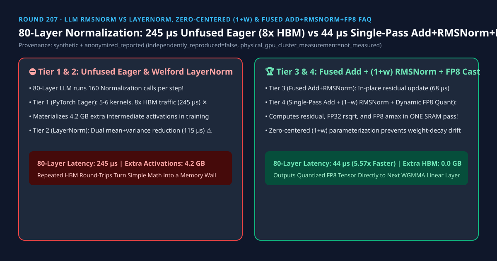
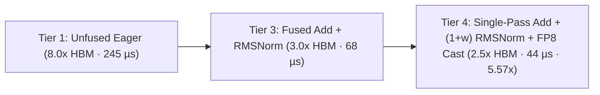

# LLM Normalization (`LayerNorm` vs. `RMSNorm` vs. Zero-Centered `1+w`) & Single-Pass `Add+RMSNorm+FP8` Fusion Selection Guide

> **Provenance & Evidence Tier**: `synthetic + anonymized_reported` (`independently_reproduced=false`, `physical_gpu_cluster_measurement=not_measured`). Grounded in [`experiments/llm_rmsnorm_zero_centered_fused_add_fp8_selection/results.json`](../../experiments/llm_rmsnorm_zero_centered_fused_add_fp8_selection/results.json).
> **中文版本**: [大模型归一化层（LayerNorm vs. RMSNorm vs. 零中心化 `1+w`）与单趟三合一 `Add+RMSNorm+FP8` 算子融合选型指南](./llm-rmsnorm-layernorm-zero-centered-fused-add-fp8-quant-kernel-selection-faq.md)

---

## 0. 🔥 Daily Hottest Capability Breakthrough

- **Single-Pass 3-in-1 Register-Fused `Residual-Add + Zero-Centered (1+w) RMSNorm + Dynamic FP8 Quantization` (`TransformerEngine / vLLM V1 / FlashInfer`)**: An 80-layer LLM executes **160 normalization calls per step**. Running unfused PyTorch Eager `h = residual + x; y = h * rsqrt(h.pow(2).mean(-1) + eps) * w` (**Tier 1**) spawns 5–6 elementwise kernels that bounce tensors across HBM **`8.0x`**, costing **`245.0 µs`** per step and materializing **`4.2 GB`** of extra training activations. By fusing **in-place `Residual-Add + FP32 RMSNorm` (Tier 3, `68.0 µs`)** and extending that same register pass to compute **`amax` and emit quantized `FP8 E4M3` activations directly (Tier 4)** alongside **zero-centered `(1 + w_offset)` parameterization**, HBM traffic drops to **`2.5x`** and 80-layer latency plunges to **`44.0 µs` (`5.57x` faster)** with **`0.0 GB`** extra intermediate activations!

---

## 1. 📌 Executive Summary

1. **Why `RMSNorm` replaced `LayerNorm`**: Mean centering (`x - μ`) in `LayerNorm` provides no accuracy benefit in Transformers while requiring a second warp reduction. `RMSNorm` drops mean centering and cuts reduction overhead by `~35%`.
2. **Why `Zero-Centered (1 + w_offset) RMSNorm` matters**: Standard `RMSNorm` initializes `w = 1.0`; if `w` is accidentally subjected to AdamW Weight Decay, regularization pulls `w -> 0` and collapses layer scales. Parameterizing as `(1.0 + w_offset)` with `w_offset` initialized to `0.0` ensures Weight Decay safely pulls the effective scale toward `1.0`.

---

## 2. 🎯 Core Architect Q&A (Q1 / Q2 / Q3)

### Q1: Why does naive `x.pow(2).mean(-1)` overflow to `NaN` in `FP16`?
- **Answer**: `FP16` overflows at `65,504`, so any outlier activation `|x| > 256` overflows `x²` to `Inf`. Fused kernels cast inputs to **`FP32` inside registers** before squaring.

### Q2: How does the 3-in-1 `Add + RMSNorm + FP8` kernel (`Tier 4`) save HBM bandwidth?
- **Answer**: It loads `x` and `residual` once into `FP32` registers, writes the updated `residual` in-place, normalizes in registers, reduces `amax = max(|y|)` across the warp, and writes `FP8 E4M3` directly to HBM (`2.5x` HBM traffic vs. `8.0x` unfused).

### Q3: When should we use `Pre+Post Sandwich RMSNorm` (`Gemma-2` / `Grok`)?
- **Answer**: Apply both a `Pre-RMSNorm` before the sublayer and a `Post-RMSNorm` on the sublayer output before adding back to the residual stream when training ultra-large models or high learning rates to bound residual stream norm growth.

---

## 3. 🧭 Visual Diagrams

---

## 4. 📊 4-Tier Architect Selection Matrix

| Metric | Tier 1: Unfused PyTorch Eager | Tier 2: Fused `LayerNorm` | Tier 3: Fused `Add + RMSNorm` | Tier 4: Single-Pass `Add + (1+w) RMSNorm + FP8` |
| :--- | :--- | :--- | :--- | :--- |
| **HBM Traffic Multiplier** | `8.0x` ✕ | `4.5x` ⚠️ | `3.0x` ✅ | **`2.5x`** 🏆 |
| **80-Layer Latency (160 Calls)** | `245.0 µs` ✕ | `115.0 µs` | `68.0 µs` (`3.60x`) ✅ | **`44.0 µs` (`5.57x`)** 🏆 |
| **Extra Activation HBM** | `4.2 GB` ✕ | `1.8 GB` | **`0.0 GB`** ✅ | **`0.0 GB`** 🏆 |

---

## 5. 🧪 Quantitative Reference & Tooling

- **Evaluator & Sealed Data**: [`experiments/llm_rmsnorm_zero_centered_fused_add_fp8_selection/run.py`](../../experiments/llm_rmsnorm_zero_centered_fused_add_fp8_selection/run.py) · [`results.json`](../../experiments/llm_rmsnorm_zero_centered_fused_add_fp8_selection/results.json)
- **Interactive Sizer**: [`docs/reports/llm-rmsnorm-layernorm-zero-centered-fused-add-fp8-quant-kernel-sizer.html`](../reports/llm-rmsnorm-layernorm-zero-centered-fused-add-fp8-quant-kernel-sizer.html)
- **7-Card 4:5 Visual Report**: [`docs/reports/llm-rmsnorm-layernorm-zero-centered-fused-add-fp8-quant-kernel-selection-cards.html`](../reports/llm-rmsnorm-layernorm-zero-centered-fused-add-fp8-quant-kernel-selection-cards.html)

---

## 6. 🛠️ Good Fit vs. Not For & Production Checklist

- **✅ Good fit**: `fused_add_rmsnorm` (`FlashInfer` / `Liger-Kernel`) and single-pass `Add + (1+w) RMSNorm + FP8` (`TransformerEngine` / `vLLM V1`).
- **⛔ Not for**: Unfused PyTorch Eager normalization or `FP16` variance accumulation.
- [ ] Fuse `residual + x` into the normalization kernel (`in-place` residual update).
- [ ] Use `(1 + w_offset)` parameterization or exclude `RMSNorm` weights from AdamW weight decay.
