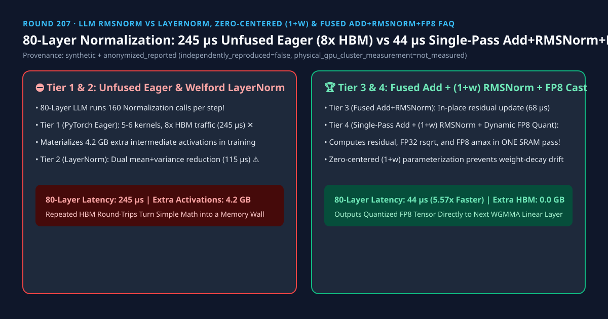
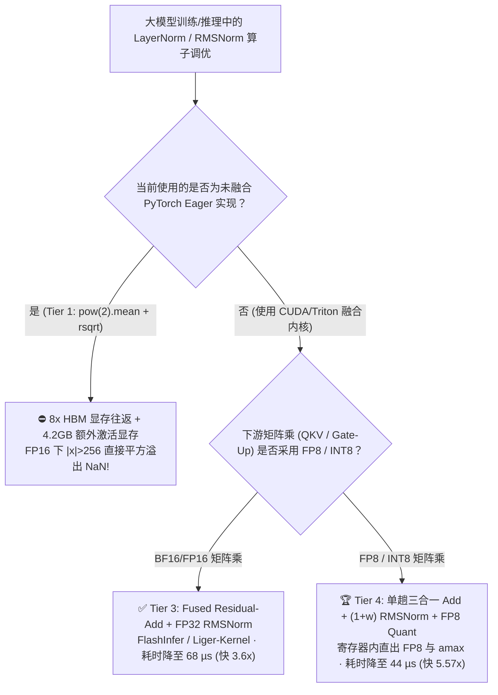
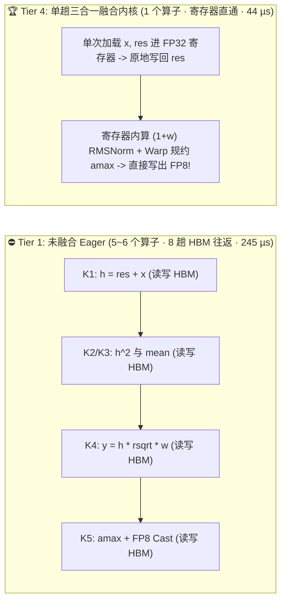
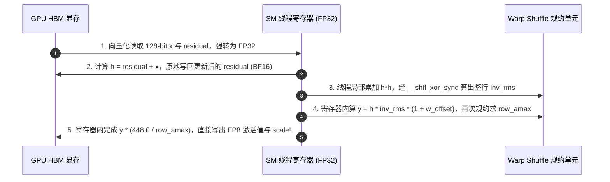

# 大模型归一化层（LayerNorm vs. RMSNorm vs. 零中心化 `1+w`）与单趟三合一 `Add+RMSNorm+FP8` 算子融合选型指南

> **Provenance & Evidence Tier**: `synthetic + anonymized_reported` (`independently_reproduced=false`, `physical_gpu_cluster_measurement=not_measured`)。定量数据锚定于 [`experiments/llm_rmsnorm_zero_centered_fused_add_fp8_selection/results.json`](../../experiments/llm_rmsnorm_zero_centered_fused_add_fp8_selection/results.json)。
> **English Version**: [LLM Normalization (`LayerNorm` vs. `RMSNorm` vs. Zero-Centered `1+w`) & Single-Pass `Add+RMSNorm+FP8` Fusion Selection Guide](./llm-rmsnorm-layernorm-zero-centered-fused-add-fp8-quant-kernel-selection-faq.en.md)

---

## 0. 🔥 今日领域最热门能力突破追踪（Daily Hottest Breakthrough）

- **单趟三合一寄存器融合内核（`Single-Pass Fused Residual-Add + Zero-Centered (1+w) RMSNorm + Dynamic FP8 Quantization`）将 80 层大模型归一化耗时从 `245 µs` 压降至 `44 µs`（提速 `5.57` 倍）**：在一个 80 层的现代大模型（如 `Llama-3-70B` / `Qwen-2.5-72B`）中，每个生成步或训练步都要调用 **160 次（甚至在 Pre+Post Sandwich Norm 架构中高达 320 次）归一化算子**！如果直接运行未融合的 PyTorch 原生代码 `h = residual + x; y = h * rsqrt(h.pow(2).mean(-1) + eps) * w`（Tier 1），每一次调用都会被拆成 **5~6 个逐元素小内核**，在 HBM 显存与核心之间来回折腾 **`8` 趟读写**，不仅白白耗费 **`245.0 µs`**，还在训练前向阶段多制造 **`4.2 GB`** 的中间激活值显存！通过采用 `FlashInfer / Liger-Kernel` 的 **`Fused Add + RMSNorm`（Tier 3）** 以及 `TransformerEngine / vLLM V1` 的 **单趟三合一 `Add + (1+w) RMSNorm + 动态 Per-Token FP8 量化`（Tier 4）**，在 GPU SRAM 寄存器内**单次遍历**同时完成原地残差累加、FP32 均方根倒数、零中心化 `(1 + w)` 缩放以及 `amax` 统计并直出 `FP8 E4M3` 张量送入下一层 `WGMMA` 矩阵乘，将 HBM 读写压缩至极限的 **`2.5x`**，耗时骤降至 **`44.0 µs`（快 `5.57` 倍）**，额外激活值显存归零！

---

## 1. 📌 核心结论速览（Executive Summary — 3 分钟看懂）

1. **为什么所有主流大模型都抛弃了 `LayerNorm`，全面转向 `RMSNorm`？**
   - **通俗大白话 + 第一性原理**：传统 `LayerNorm`（Tier 2）要算两件事——先求平均值 `μ` 把数据平移到 0 中心（`x - μ`），再求方差 `σ²` 做缩放。后续学术界与工业界发现：**平移均值 `μ` 对 Transformer 精度毫无贡献，真正起稳定作用的是方差缩放**！去掉均值平移后的 **`RMSNorm`（均方根归一化）** 省掉了一半的跨线程 Warp 规约（Reduction），计算量减少约 `30%~40%`，模型收敛效果完全一致。
2. **什么是 `Zero-Centered (1 + w) RMSNorm`（Gemma / Qwen / DeepSeek 都在用的隐藏技巧）？**
   - 传统 `RMSNorm` 的权重 `w` 初始化为 `1.0`（`y = norm(x) * w`）。如果工程师不小心对所有参数开启了 **Weight Decay（权重衰减 L2 正则化，每次把参数往 `0.0` 拉）**，训练几万亿 Token 后，`RMSNorm` 的权重 `w` 会被强行拉向 `0`，导致每层输出幅值萎缩！而 **零中心化参数化（`Zero-Centered RMSNorm`）** 将公式改写为 **`y = norm(x) * (1.0 + w_offset)`**，其中可训练参数 `w_offset` **初始化为 `0.0`**！这样当 Weight Decay 把 `w_offset` 往 `0` 拉时，等效缩放系数 `(1.0 + w_offset)` 是被安全地拉向 **`1.0`（恒等缩放）**，彻底免疫权重衰减漂移！

---

## 2. 🎯 客户与架构师灵魂拷问 Q&A（Q1 / Q2 / Q3）

### Q1：为什么手写 PyTorch `x.pow(2).mean(-1)` 在 `FP16` 下会直接炸出 `NaN / Inf`？
- **答**：因为 `FP16` 的最大可表示数值只有 **`65,504`**！只要隐藏层激活值里有一个离群元素 `|x| > 256`（在大模型中极为常见），在 `FP16` 下计算 `x.pow(2)` 就会瞬间超过 `65,536` 溢出为 `Inf`，进而导致整行归一化变成 `NaN`！而在融合算子（Tier 3 / Tier 4）内部，加载 `FP16/BF16` 元素进寄存器的第一拍就会强转为 **`FP32`（上限 `3.4 × 10^38`）** 再算平方和，从根源上杜绝平方溢出。

### Q2：为什么把“残差加法（Residual Add）”和“下游 FP8 动态量化”都塞进 `RMSNorm` 内核能提速 `5.57` 倍？
- **答**：在 Transformer 中，数据流永远是固定的三连击：`前一层输出 x -> 加上残差 residual -> 做 RMSNorm -> 量化为 FP8 送给下一层 QKV/FFN 矩阵乘`。如果分成三个算子写，数据必须 **进出 HBM 显存 3 次**。而 **Tier 4 单趟三合一内核** 把 `x` 和 `residual` 读进寄存器后，算完 `h = residual + x` 原地写回 `residual`，紧接着在同一个寄存器里算完 `y = rmsnorm(h)`，再顺手用一次 Warp Shuffle 求得整行最大值 `amax = max(|y|)`，直接除以缩放因子写出 `FP8` 结果——**原本 3 个算子的工作在 1 次寄存器驻留中全部干完**！

### Q3：什么是 `Pre-LN + Post-LN Sandwich Norm`（三明治归一化，如 Gemma-2 / Grok / Chameleon）？
- **答**：在万亿参数或高学习率训练中，仅靠 `Pre-LN`（进入 Attention/FFN 前归一化）无法阻止残差主干自身的幅值无限膨胀。因此 `Sandwich Norm` 在 Attention/FFN **输出加回残差主干之前，再加一道 `Post-RMSNorm`**，把每层残差增量的范数严格锁死在可控区间内。

---

## 3. 🧭 直观可视化图解（Mermaid 决策树 + HBM 往返对比图 + 寄存器流水时序图）

### 3.1 架构师归一化算子与融合策略选型决策树

### 3.2 未融合 Eager（8 趟 HBM）vs. 单趟三合一融合内核（2.5 趟 HBM）数据流对比

### 3.3 Tier 4 单趟三合一 `Add + (1+w) RMSNorm + Dynamic FP8` 寄存器级时序图

---

## 4. 📊 架构师选型决策矩阵（4-Tier Selection Matrix）

| 评估维度 | Tier 1: 未融合 PyTorch Eager | Tier 2: 传统 Fused `LayerNorm` | Tier 3: 融合 `Add + RMSNorm` (`FlashInfer`/`Liger`) | Tier 4: 单趟三合一 `Add + (1+w) RMSNorm + FP8` |
| :--- | :--- | :--- | :--- | :--- |
| **每层调用启动内核数** | `5 ~ 6` 个 ✕ | `2 ~ 3` 个 | `1` 个 (+ 独立量化) | **`1` 个 (三合一全包)** 🏆 |
| **HBM 显存读写倍数** | `8.0x` ✕ | `4.5x` ⚠️ | `3.0x` | **`2.5x` (理论物理极限)** 🏆 |
| **80 层 (160 次) 累计耗时** | `245.0 µs` ✕ | `115.0 µs` | `68.0 µs` (`3.60x` 提速) ✅ | **`44.0 µs` (`5.57x` 提速)** 🏆 |
| **训练额外激活值显存** | `4.2 GB` ✕ | `1.8 GB` | **`0.0 GB` (原地残差)** ✅ | **`0.0 GB` (原地残差)** 🏆 |
| **Weight Decay 漂移免疫** | 无（传统 `w` 易被拉向 0） | 无 | 可选 | **原生支持 `(1 + w_offset)` 零中心化** 🏆 |

---

## 5. 🧪 定量算例与工具链（Interactive Sizer & 7-Card Visual Report）

- **实验脚本与密封数据**：[`experiments/llm_rmsnorm_zero_centered_fused_add_fp8_selection/run.py`](../../experiments/llm_rmsnorm_zero_centered_fused_add_fp8_selection/run.py) · [`results.json`](../../experiments/llm_rmsnorm_zero_centered_fused_add_fp8_selection/results.json)
- **交互式归一化融合计算器**：[`docs/reports/llm-rmsnorm-layernorm-zero-centered-fused-add-fp8-quant-kernel-sizer.html`](../reports/llm-rmsnorm-layernorm-zero-centered-fused-add-fp8-quant-kernel-sizer.html)
- **7-Card 4:5 视觉评测卡片报告**：[`docs/reports/llm-rmsnorm-layernorm-zero-centered-fused-add-fp8-quant-kernel-selection-cards.html`](../reports/llm-rmsnorm-layernorm-zero-centered-fused-add-fp8-quant-kernel-selection-cards.html)

---

## 6. 🛠️ Good Fit vs. Not For & 生产环境快速核验清单（Checklist）

### ✅ Good Fit vs. ⛔ Not For

| 维度 | ✅ Good Fit（强烈推荐） | ⛔ Not For（严禁误用） |
| :--- | :--- | :--- |
| **大模型推理与预训练归一化** | 启用 `fused_add_rmsnorm`（将上一层输出与残差相加并原地更新残差）以及 `Add + RMSNorm + FP8 Quant` 单趟三合一算子 | 在模型代码中保留未融合的 `residual = residual + x; x = rmsnorm(residual)` 分离调用 |
| **优化器 Weight Decay 与精度设置** | 使用 `(1 + w_offset)` 零中心化参数化，或在 AdamW 中将所有 `norm.weight` 加入 `no_decay_params` 豁免列表 | 在 `FP16` 下直接执行未强转 `FP32` 的 `x.pow(2)`，或对初始化为 `1.0` 的 `RMSNorm` 权重施加高强度 Weight Decay |

### 生产环境上线核验清单（Pre-Flight Checklist）

- [ ] **核验 `Residual-Add` 已与 `RMSNorm` 原地融合**：检查模型前向代码是否调用 `flashinfer.norm.fused_add_rmsnorm` 或 `LigerRMSNorm`，消除独立的 `+` 算子。
- [ ] **核验内部平方和累加精度为 `FP32`**：确认自定义或 Triton 归一化算子在计算 `x * x` 前已执行 `.to(tl.float32)`。
- [ ] **核验 `RMSNorm` 权重豁免 Weight Decay 或采用 `(1+w)` 参数化**：检查训练脚本的优化器参数分组（Parameter Groups），确保 1D 归一化缩放向量不被 L2 正则化拉向零。
