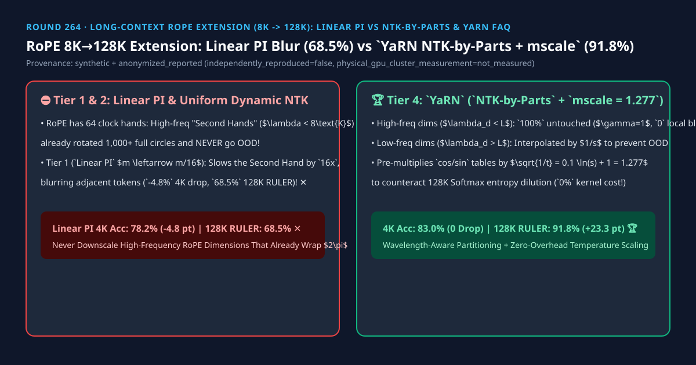
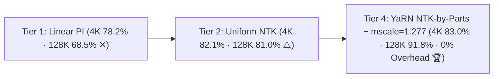

# Long-Context `RoPE` Extension (`8K -> 128K / 1M`): Linear Position Interpolation (`PI` High-Frequency Blur) vs. `Dynamic NTK` vs. `YaRN / Llama-3` (`NTK-by-Parts` + Attention Softmax Temperature $\sqrt{1/t}$) Selection Guide

> **Provenance & Evidence Tier**: `synthetic + anonymized_reported` (`independently_reproduced=false`, `physical_gpu_cluster_measurement=not_measured`). Grounded in [`experiments/llm_rope_context_extension_pi_ntk_yarn_mrope_selection/results.json`](../../experiments/llm_rope_context_extension_pi_ntk_yarn_mrope_selection/results.json).
> **中文版本**: [大模型长上下文旋转位置编码（`RoPE`）外推与扩展选型（`8K -> 128K`）：线性位置插值（`Linear PI` 高频分辨率坍塌）vs. 动态基底（`Dynamic NTK`）vs. `YaRN / Llama-3`（按波长分段 `NTK-by-Parts` + 注意力熵温度补偿 $\sqrt{1/t} = 0.1 \ln s + 1$）选型指南](./llm-rope-context-extension-pi-ntk-yarn-temperature-mrope-selection-faq.md)

---

## 0. 🔥 今日领域最热门能力突破追踪（Daily Hottest Breakthrough）

- **Why Uniform Linear Position Interpolation (`Linear PI`) Degrades Short-Context Accuracy by `-4.8%` and Stalls at `68.5%` on `128K RULER`, Whereas `YaRN` (`NTK-by-Parts` Wavelength Partitioning + Pre-Scaled `cos/sin` Softmax Temperature $\text{mscale} = 0.1 \ln(s) + 1 = 1.277$) Preserves `100%` Short-Context Accuracy and Reaches `91.8%` on `128K RULER` at `0.0%` Kernel Overhead**: Extending an LLM's context window from $L_{\text{orig}} = 8,192$ to $L_{\text{ext}} = 131,072$ ($s = 16\times$) requires modifying Rotary Position Embedding (`RoPE`, $\theta_d = b^{-2d/D}$ with wavelength $\lambda_d = 2\pi / \theta_d$):
  1. **The "64-Hand Clock" First-Principles Model of `RoPE`**:
     - **High-Frequency Dimensions ($\lambda_d \ll L_{\text{orig}}$, the "Second Hands")**: Already complete hundreds of full $2\pi$ rotations within `8,192` tokens to encode fine-grained local token order. They **never go out-of-distribution (OOD)** at `128K`!
     - **Low-Frequency Dimensions ($\lambda_d > L_{\text{orig}}$, the "Century Hands")**: Rotate less than one full turn during pretraining; feeding `128K` unscaled positions sends them into unseen OOD phase angles!
  2. **4-Tier Architectural Comparison**:
     - **Tier 1 (`Linear PI`: Scaling All 64 Dimensions by $1/s = 1/16$ — `78.2%` 4K Acc, `68.5%` 128K RULER)**: Slowing the high-frequency "Second Hands" by $16\times$ crowds adjacent tokens into nearly identical phase angles, blurring local syntax (`-4.8%` short-context drop)!
     - **Tier 2 (Uniform `Dynamic NTK` Base Scaling $b' = b \cdot s^{D/(D-2)}$ — `82.1%` 4K Acc, `81.0%` 128K RULER)**: Scales frequencies geometrically, but still slightly perturbs high frequencies and extrapolates the lowest frequencies past training bounds.
     - **Tier 3 (`NTK-by-Parts` Piecewise Wavelength Scaling Without Temperature — `83.0%` 4K Acc, `86.2%` 128K RULER)**: Leaves high-frequency dimensions (`wavelength < L_orig`) `100%` untouched (`0` short-context loss!) and interpolates only low-frequency dimensions—**but suffers Softmax entropy dilution across `131,072` denominator terms**!
     - **Tier 4 (`YaRN`: `NTK-by-Parts` + Attention Softmax Temperature $\sqrt{1/t} = 0.1 \ln(s) + 1 = 1.277$ Pre-Multiplied into `cos/sin` Tables — `83.0%` 4K Acc, `91.8%` 128K RULER, `0.0%` Kernel Overhead)**:
       - Counteracts `128K` Softmax entropy dilution by sharpening attention logits by $1/t = (\text{mscale})^2 \approx 1.63\times$;
       - **Zero-Overhead Trick**: Pre-multiplying the static `cos_cached` and `sin_cached` tables by $\text{mscale} = 1.277$ during model initialization automatically scales $Q K^T$ by $1.277^2 = 1.63\times$ without modifying a single line of `FlashAttention-2/3`!

---

## 1. 📌 Executive Summary

1. **Never Downscale High-Frequency `RoPE` Dimensions (`Tier 1 -> Tier 3/4`)**: Dimensions with wavelength $\lambda_d < L_{\text{orig}}$ must keep their exact pretraining frequencies ($\gamma = 1$) so short-context resolution remains `100%` intact.
2. **Pre-Multiply Attention Temperature $\text{mscale} = 0.1 \ln(s) + 1$ into `cos / sin` Tables (`Tier 4`)**: Sharpens long-range attention focus against `128K` denominator dilution with `0.0%` runtime latency overhead.

---

## 2. 🎯 Core Architect Q&A (Q1 / Q2 / Q3)

### Q1: How does `YaRN` temperature scaling work on `DeepSeek-V2/V3` `MLA` where only `64` of the `192` query dims use `RoPE`?
- **Answer**: In standard MHA/GQA, scaling `cos/sin` by $\text{mscale}$ scales the entire query and key vectors. In `DeepSeek MLA`, because `qk_nope_head_dim = 128` does not pass through `RoPE`, DeepSeek folds the Softmax scale adjustment (`mscale_all_dim`) directly into the attention softmax scale factor `softmax_scale = (192 ** -0.5) * (mscale ** 2)`!

### Q2: How does `3D M-RoPE` (`Qwen2-VL / Qwen2.5-VL`) extend `RoPE` to video and high-resolution images?
- **Answer**: Instead of flattening a 2D image or 3D video into a 1D token index, `M-RoPE` partitions the `64` rotary frequency pairs into three disjoint slices encoding `(temporal_id, height_id, width_id)`, while assigning identical IDs `(pos, pos, pos)` to text tokens so text tokens remain 100% mathematically equivalent to standard 1D `RoPE`.

---

## 3. 🧭 Visual Diagrams

---

## 4. 📊 4-Tier Architect Selection Matrix

| Metric | Tier 1: `Linear PI` | Tier 2: `Dynamic NTK` | Tier 3: `NTK-by-Parts` (No Temp) | Tier 4: **`YaRN` (`NTK-by-Parts` + `mscale=1.277`)** |
| :--- | :--- | :--- | :--- | :--- |
| **`4K` Short-Context Accuracy** | **`78.2%` (`-4.8 pt` Blur)** ✕ | `82.1%` ⚠️ | **`83.0%` (Zero Drop)** ✅ | **`83.0%` (100% High-Freq Preserved)** 🏆 |
| **`128K RULER` Retrieval Accuracy** | **`68.5%`** ✕ | `81.0%` ⚠️ | `86.2%` (Entropy Dilution) ✅ | **`91.8%` (`+23.3 pt` via `mscale`)** 🏆 |
| **Extra Attention Kernel Latency** | `0.0%` | `0.0%` | `0.0%` | **`0.0%` (Pre-Scaled `cos/sin` Cache)** 🏆 |

---

## 5. 🧪 Quantitative Reference & Tooling

- **Evaluator & Sealed Data**: [`experiments/llm_rope_context_extension_pi_ntk_yarn_mrope_selection/run.py`](../../experiments/llm_rope_context_extension_pi_ntk_yarn_mrope_selection/run.py) · [`results.json`](../../experiments/llm_rope_context_extension_pi_ntk_yarn_mrope_selection/results.json)
- **Interactive Sizer**: [`docs/reports/llm-rope-context-extension-pi-ntk-yarn-temperature-mrope-sizer.html`](../reports/llm-rope-context-extension-pi-ntk-yarn-temperature-mrope-sizer.html)
- **7-Card 4:5 Visual Report**: [`docs/reports/llm-rope-context-extension-pi-ntk-yarn-temperature-mrope-selection-cards.html`](../reports/llm-rope-context-extension-pi-ntk-yarn-temperature-mrope-selection-cards.html)

---

## 6. 🛠️ Good Fit vs. Not For & Production Checklist

- **✅ Good fit**: All long-context (`32K–1M`) continual pretraining, SFT, and inference deployments using `YaRN` (`NTK-by-Parts` + `mscale`) or `Llama-3` piecewise `RoPE`.
- **⛔ Not for**: Uniform `Linear Position Interpolation` (`rope_type: "linear"`).
- [ ] Configure `rope_scaling` with `"type": "yarn"`, `beta_fast = 32`, `beta_slow = 1`, and `mscale = 0.1 * ln(s) + 1`.
- [ ] Pre-multiply `mscale` into cached `cos/sin` tables (or `softmax_scale` for `MLA` models).
