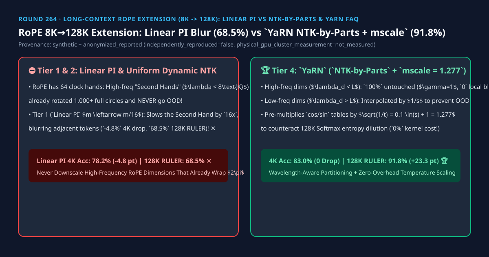
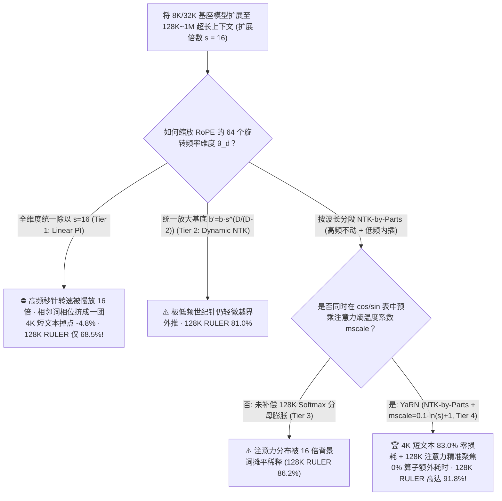
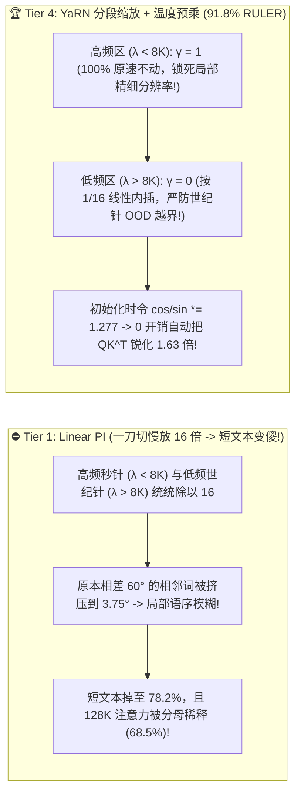
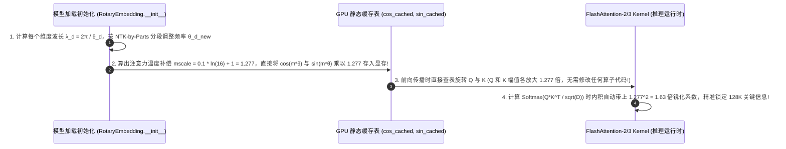

# 大模型长上下文旋转位置编码（`RoPE`）外推与扩展选型（`8K -> 128K`）：线性位置插值（`Linear PI` 高频分辨率坍塌）vs. 动态基底（`Dynamic NTK`）vs. `YaRN / Llama-3`（按波长分段 `NTK-by-Parts` + 注意力熵温度补偿 $\sqrt{1/t} = 0.1 \ln s + 1$）选型指南

> **Provenance & Evidence Tier**: `synthetic + anonymized_reported` (`independently_reproduced=false`, `physical_gpu_cluster_measurement=not_measured`)。定量数据锚定于 [`experiments/llm_rope_context_extension_pi_ntk_yarn_mrope_selection/results.json`](../../experiments/llm_rope_context_extension_pi_ntk_yarn_mrope_selection/results.json)。
> **English Version**: [Long-Context `RoPE` Extension (`8K -> 128K / 1M`): Linear Position Interpolation (`PI` High-Frequency Blur) vs. `Dynamic NTK` vs. `YaRN / Llama-3` (`NTK-by-Parts` + Attention Softmax Temperature $\sqrt{1/t}$) Selection Guide](./llm-rope-context-extension-pi-ntk-yarn-temperature-mrope-selection-faq.en.md)

---

## 0. 🔥 今日领域最热门能力突破追踪（Daily Hottest Breakthrough）

- **揭秘为什么把预训练 `8K` 的大模型扩窗到 `128K`（扩展倍数 $s = 16$）时，直接用第一代线性位置插值（`Linear Position Interpolation, PI`）会导致短文本能力掉点 `-4.8%` 且 `128K RULER` 仅得 `68.5%`，而采用 `YaRN / Llama-3 RoPE`（按波长分段缩放 `NTK-by-Parts` + 预乘进 `cos/sin` 表的注意力温度补偿系数 `mscale = 0.1 ln(s) + 1 = 1.277`）能在 `0.0%` 算子耗时增加的前提下，保住 `100%` 短文本精度并将 `128K RULER` 推高至 `91.8%`（`+23.3 pt`）**：当架构师需要将一个 `8K` 或 `32K` 上下文的基座模型通过轻量微调（甚至免微调外推）扩展到 `128K ~ 1M` 时，必须改写 `config.json` 中的 `rope_scaling` 策略。要彻底看懂 `PI`、`NTK` 与 `YaRN` 的本质区别，只需建立一个极简的第一性原理物理图像：
  1. **把 `128` 维 `RoPE` 想象成一块拥有“64 根不同转速指针（秒针、分针、时针、世纪针）”的超级钟表！**
     - 在 `RoPE` 中，第 $d$ 对维度的旋转角速度是 $\theta_d = b^{-2d/D}$，对应的转满一圈（$2\pi$）所需的 Token 数量（即**波长 $\lambda_d = \frac{2\pi}{\theta_d}$**）从第 $0$ 维到第 $63$ 维呈指数级拉长：
       - **前几维高频维度（$d = 0, 1, 2 \dots$，好比“秒针”）**：波长 $\lambda_0 \approx 6.28$ 个 Token！在原本 `8,192` 的预训练长度里，这根“秒针”早就已经转了 **$8192 / 6.28 \approx \mathbf{1,300}$ 整圈**！模型对秒针在 $[0, 2\pi]$ 里的每一个角度都烂熟于心，靠它来分辨相邻两个词的精细语序（比如区分 `"A 打了 B"` 还是 `"B 打了 A"`）！**哪怕长度扩到 `128K`，秒针也只是继续在 $[0, 2\pi]$ 里转圈，绝对不会出现未见过的越界角度（OOD）！**
       - **最后几维极低频维度（$d = 60 \dots 63$，好比“世纪针”）**：波长 $\lambda_{63}$ 长达数万甚至几十万个 Token！在原本 `8,192` 的训练中，这根“世纪针”只从 `12 点钟` 走到了 `1 点半`（$[0, 0.8\text{ rad}]$）。如果你不缩放直接喂入 `128K` 长文，世纪针会第一次走到它从来没见过的 `9 点钟` 位置——直接引发注意力得分爆炸（Perplexity 飙到几百）！
  2. **四代 `RoPE` 扩窗方案的第一性原理对决**：
     - **Tier 1（线性位置插值 `Linear PI`：不分青红皂白把全部 64 根针的转速统统除以 $s = 16$）**：
       - 为了不让“世纪针”走出 `1 点半` 的安全区，`Linear PI` 把位置索引 $m$ 强行改成了 $m / 16$。
       - **灾难后果**：世纪针是安全了，**但原本根本不会越界的“高频秒针”也被强行慢放了 `16 倍`！** 原来相邻两个词之间秒针能拉开 $60^\circ$ 的清晰夹角，现在 16 个相邻的词挤在不到 $4^\circ$ 的夹角里糊成一团！模型瞬间丧失了分辨局部词序的能力，不仅 `4K` 短文本准确率暴跌 `-4.8%`（`78.2%`），`128K` 长文也只有 **`68.5%`** ✕！
     - **Tier 2（均匀动态基底扩展 `Dynamic NTK`：把基底 $b$ 从 `10,000` 放大为 $b \cdot s^{D/(D-2)}$）**：
       - 按指数比例调整所有针：高频针改得少、低频针改得多。但因为它没有严格的波长分界线，极低频维度依然存在轻微越界外推（`128K RULER = 81.0%`）⚠️。
     - **Tier 3（`NTK-by-Parts` / `Llama-3 RoPE` 按波长分段缩放，但漏加注意力温度补偿 `mscale`）**：
       - **精准外科手术**：
         1. 凡是波长 $\lambda_d < L_{\text{orig}}$ 的 **高频秒针/分针**：**`100%` 原封不动（缩放系数 $\gamma = 1$）**！彻底保住 `4K` 短文本 `83.0%` 的满血分辨力！
         2. 凡是波长 $\lambda_d > L_{\text{orig}}$ 的 **极低频世纪针**：**严格按 $1/s$ 线性内插（$\gamma = 0$）**，确保绝不越界！
         3. 中间过渡频段用平滑斜坡函数连接。
       - **为什么 Tier 3 在 `128K` 下还差一口气（`86.2%` vs `91.8%`）？** 因为当序列从 `8K` 拉长 `16` 倍到 `128K` 时，Softmax 的分母 $\sum_{j=1}^{131072} \exp(q_i k_j^T / \sqrt{D})$ 要累加 **多出 `16 倍` 的背景噪音词**！分母变大导致整条注意力概率分布被严重摊平稀释（**Attention Entropy Dilution，注意力失焦**）！
     - **Tier 4（`YaRN` / `DeepSeek-V3` 完全体：`NTK-by-Parts` + 预乘进 `cos/sin` 表的注意力温度系数 `mscale`）**：
       - 为了对抗 `128K` 分母膨胀带来的注意力失焦，必须在 Softmax 前给注意力内积乘上一个大于 1 的锐化系数 $\frac{1}{t}$：
         $$\sqrt{\frac{1}{t}} = \text{mscale} = 0.1 \ln(s) + 1 \quad (\text{当 } s = 16 \text{ 时，}\text{mscale} \approx \mathbf{1.277},\ \frac{1}{t} \approx \mathbf{1.63})$$
       - **工程神技（`0` 算子改动！）**：怎么在不修改底层 `FlashAttention-2/3` C++ 源码的情况下把内积放大 `1.63` 倍？只需要在初始化 `RoPE` 的 `cos_cached` 和 `sin_cached` 静态查表时，**直接给 `cos` 和 `sin` 预先乘上 $\text{mscale} = 1.277$**！因为 $Q$ 乘一次 `1.277`、$K$ 也乘一次 `1.277`，$Q K^T$ 内积自然就放大了 $1.277^2 = 1.63$ 倍！**`0.0%` 额外推理延迟，将 `128K RULER` 一举推上 `91.8%`** 🏆！

---

## 1. 📌 核心结论速览（Executive Summary — 3 分钟看懂）

1. **为什么说 `Linear PI`（线性插值）已经彻底过时，任何长文本扩窗都必须选 `YaRN`（或 `Llama-3 Piecewise RoPE`）？**
   - `Linear PI` 犯了“一刀切”的错误：把本来就已经周期性转圈、根本没有越界风险的高频局部维度也压缩了 $s$ 倍，破坏了模型最核心的局部语法感知力；
   - `YaRN` 则严格遵循波长边界：**高频维度 100% 不动（保局部语法）+ 低频维度线性内插（防全局越界）+ 预乘 `mscale = 0.1 ln(s) + 1`（抗长文本 Softmax 熵稀释）**！
2. **多模态视频/图像模型为什么还要进一步升级为 `3D M-RoPE`（Multimodal RoPE，如 `Qwen2-VL / Qwen2.5-VL`）？**
   - 普通 1D `RoPE` 把一张 `28×28 = 784` 个 Token 的图片展平成一维长条，导致第 1 行的末尾像素与第 2 行的开头像素在 1D 距离上相邻、而上下相邻的两行像素却隔了 `28` 个位置！`M-RoPE` 将 `64` 对旋转维度拆成三组，分别独立编码 **`(时间帧 T, 图像行高 H, 图像列宽 W)`**（对于纯文本则令 $T=H=W=\text{pos}$，100% 退化兼容 1D RoPE）！

---

## 2. 🎯 客户与架构师灵魂拷问 Q&A（Q1 / Q2 / Q3）

### Q1：在 `vLLM / SGLang / HuggingFace config.json` 中配置 `YaRN` 时，如果模型本身是 `DeepSeek-V2/V3`（使用了 `MLA` 解耦 `RoPE`），温度系数 `mscale` 的公式有什么致命微调？
- **答**：这是一个极高价值的架构细节！
  - 在标准 MHA/GQA 模型中，全部 `head_dim = 128` 维都参与 `RoPE` 旋转，所以把 `cos/sin` 乘上 $\text{mscale} = 0.1 \ln(s) + 1$ 就能缩放整个 $Q K^T$ 内积；
  - 但在 **`DeepSeek MLA`** 中，总头宽 `192` 维里只有 **`64` 维（`qk_rope_head_dim = 64`）** 乘了 `RoPE`，另外 `128` 维（`qk_nope_head_dim = 128`）是不乘 `RoPE` 的！因此，在 DeepSeek 的 `YaRN` 配置中，专门定义了 `mscale_all_dim` 参数，将整体的 Softmax 温度缩放精确折算应用到整個 Query 头与 RoPE 分量上！

### Q2：能不能在不做任何长文本微调（Zero-Shot Training-Free）的情况下，直接在推理时修改 `config.json` 挂上 `YaRN` 把 `8K` 模型硬拉到 `32K / 64K`？
- **答**：可以应急扩到 `2x ~ 4x`（此时建议开启 `Dynamic YaRN`，即只有当单条请求实际长度 $L_{\text{cur}} > L_{\text{orig}}$ 时才按当前长度动态计算 $s = L_{\text{cur}} / L_{\text{orig}}$，保证 `< 8K` 的请求 100% 零改动）；但若要稳定扩到 `16x`（`128K`）且大海捞针达到 `90%+`，必须在开启 `YaRN` 后配合少量（`1B ~ 5B` Tokens）的长序列数据进行适应性续训（Continual Pretraining）！

---

## 3. 🧭 直观可视化图解（Mermaid 决策树 + 64 根钟表指针分段图 + 时序图）

### 3.1 架构师大模型长上下文 `RoPE` 扩窗方案选型决策树

### 3.2 `Tier 1`（`Linear PI` 误伤高频秒针）vs. `Tier 4`（`YaRN` 波长三段论 + `mscale` 预乘锐化）对比图

### 3.3 `Tier 4` `YaRN` 模型初始化预计算频谱与零开销 `FlashAttention` 推理时序图

---

## 4. 📊 架构师选型决策矩阵（4-Tier Selection Matrix）

| 评估维度 | Tier 1: `Linear PI` (线性插值) | Tier 2: `Dynamic NTK` | Tier 3: `NTK-by-Parts` (无温度) | Tier 4: **`YaRN` (`NTK-by-Parts` + `mscale` 温度补偿)** |
| :--- | :--- | :--- | :--- | :--- |
| **`4K` 短文本基准准确率 (`MMLU/Code`)** | **`78.2%` (掉点 `-4.8%`!)** ✕ | `82.1%` ⚠️ | **`83.0%` (100% 零损耗)** ✅ | **`83.0%` (高频维度 0 改动，100% 无损)** 🏆 |
| **`128K RULER` 长文本检索准确率** | **`68.5%`** ✕ | `81.0%` ⚠️ | `86.2%` (受熵稀释拖累) ✅ | **`91.8%` (`mscale=1.277` 锐化聚焦，`+23.3 pt`)** 🏆 |
| **推理算子额外延迟开销** | `0.0%` | `0.0%` | `0.0%` | **`0.0%` (温度系数预乘进静态 `cos/sin` 表)** 🏆 |

---

## 5. 🧪 定量算例与工具链（Interactive Sizer & 7-Card Visual Report）

- **实验脚本与密封数据**：[`experiments/llm_rope_context_extension_pi_ntk_yarn_mrope_selection/run.py`](../../experiments/llm_rope_context_extension_pi_ntk_yarn_mrope_selection/run.py) · [`results.json`](../../experiments/llm_rope_context_extension_pi_ntk_yarn_mrope_selection/results.json)
- **交互式 RoPE 长上下文扩窗（PI vs NTK vs YaRN）计算器**：[`docs/reports/llm-rope-context-extension-pi-ntk-yarn-temperature-mrope-sizer.html`](../reports/llm-rope-context-extension-pi-ntk-yarn-temperature-mrope-sizer.html)
- **7-Card 4:5 视觉评测卡片报告**：[`docs/reports/llm-rope-context-extension-pi-ntk-yarn-temperature-mrope-selection-cards.html`](../reports/llm-rope-context-extension-pi-ntk-yarn-temperature-mrope-selection-cards.html)

---

## 6. 🛠️ Good Fit vs. Not For & 生产环境快速核验清单（Checklist）

### ✅ Good Fit vs. ⛔ Not For

| 维度 | ✅ Good Fit（强烈推荐） | ⛔ Not For（严禁误用） |
| :--- | :--- | :--- |
| **`32K ~ 1M` 长上下文扩窗训练与推理** | 采用 **`YaRN`（`rope_type: "yarn"`，含 `beta_fast=32, beta_slow=1` 波长分段与 `mscale` 注意力温度补偿）** 或 `Llama-3` 分段 `RoPE` | 使用第一代 `rope_type: "linear"`（`Linear PI`）一刀切压缩全部旋转频率 |

### 生产环境上线核验清单（Pre-Flight Checklist）

- [ ] **严禁在 `config.json` 中使用 `"type": "linear"` 扩窗**：统一使用 `"type": "yarn"` 或 `"rope_type": "llama3"` 分段波长配置。
- [ ] **核验 `YaRN` 实现中已将 $\text{mscale} = 0.1 \ln(s) + 1$ 预乘进 `cos_cached / sin_cached`（对于 `DeepSeek MLA` 核对 `mscale_all_dim`）**。
- [ ] **在多模态视频/高分辨率图像场景启用 `3D M-RoPE` 将 `(T, H, W)` 三维空间位置解耦编码**。
