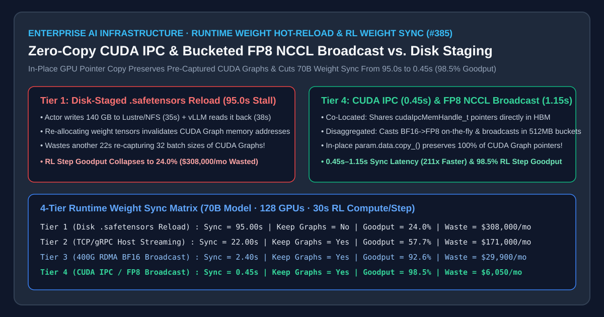

# LLM Runtime Weight Hot-Reload & RL Actor-to-Rollout Weight Sync Guide: `Zero-Copy CUDA IPC` & `Bucketed FP8 NCCL Broadcast` vs. Disk Staging

> **Language**: [中文](./llm-runtime-weight-hot-reload-rl-nccl-broadcast-cuda-ipc-sync-selection-faq.md) | **English (Current)**  
> **Audience**: Cloud & AI Infrastructure Solution Architects and RL Post-Training Platform Engineers  
> **Provenance**: `synthetic + anonymized_reported` (`independently_reproduced=false`, `physical_gpu_cluster_measurement=not_measured`)

---

## 1. 📌 Executive Summary

> **Bottom Line**: **In online Reinforcement Learning (`GRPO / PPO` where `70B–671B` Actor weights must be synchronized into `vLLM / SGLang` rollout engines after every `30-second` step) and zero-downtime canary model swaps, dumping `.safetensors` to shared storage and reloading `vLLM` (`Tier 1`) stalls every step for `95.0 seconds` (`35s` disk write + `38s` disk read + `22s` `CUDA Graph` recapture)—collapsing RL step Goodput to `24.0%` and burning `$308,000/month` in idle GPU time across `128` GPUs! Production RL and hot-reload frameworks (`veRL`, `SLIME`, `OpenRLHF`) deploy `Zero-Copy CUDA IPC Memory Handles (cudaIpcGetMemHandle)` for co-located engines (`0.45 sec` sync) and `512MB-Bucketed On-the-Fly FP8 Quantized RDMA NCCL Broadcast` (`1.15 sec` sync) with in-place `param.data.copy_()` into pre-allocated `vLLM` buffers (`Tier 4`)—preserving `100%` of pre-captured `CUDA Graphs` and lifting RL step Goodput to `98.5%` (`-$301,950/month` saved).**

- **Interactive Runtime Weight Hot-Reload & RL Sync Sizer**: [Open Interactive Sizer (`llm-runtime-weight-hot-reload-rl-nccl-broadcast-cuda-ipc-sync-sizer.html`)](../reports/llm-runtime-weight-hot-reload-rl-nccl-broadcast-cuda-ipc-sync-sizer.html)
- **7-Card 4:5 Visual Report**: [Open 7-Card Report (`llm-runtime-weight-hot-reload-rl-nccl-broadcast-cuda-ipc-sync-selection-cards.html`)](../reports/llm-runtime-weight-hot-reload-rl-nccl-broadcast-cuda-ipc-sync-selection-cards.html)

---

## 2. 📊 4-Tier Runtime Weight Synchronization Matrix (`70B Model` · `128 GPUs` · `30s RL Compute/Step`)

| Metric | Tier 1: Shared Disk `.safetensors` Reload | Tier 2: TCP/gRPC Host-Staged In-Place Stream | Tier 3: Disaggregated `400G RDMA BF16 NCCL Broadcast` | Tier 4 (Recommended): `CUDA IPC` (`0.45s`) / Bucketed `FP8 NCCL Broadcast` (`1.15s`) |
| :--- | :--- | :--- | :--- | :--- |
| **`70B` Weight Sync Latency** | `95.00 sec` ✕ | `22.00 sec` ✕ | `2.40 sec` | **`0.45 sec (IPC) / 1.15 sec (RDMA)` ✓ (`211x` faster)** |
| **Preserves `CUDA Graphs` In-Place** | No ✕ (`22s` re-compile) | **Yes ✓ (`copy_()`)** | **Yes ✓** | **Yes ✓ (`0s` re-capture)** |
| **RL Step Effective Goodput** | `24.0%` ✕ (`76%` idle) | `57.7%` | `92.6%` | **`98.5%` ✓** |
| **Monthly Wasted Sync GPU Cost** | `$308,000 / mo` ✕ | `$171,000 / mo` | `$29,900 / mo` | **`$6,050 / mo` ✓ (`-$301,950/mo` saved)** |

---

## 3. 🛠️ Production Readiness Checklist

- [ ] **Always Mutate Existing `vLLM` Parameter Buffers In-Place (`param.data.copy_()`)** rather than allocating new tensor objects so captured `CUDA Graph` virtual memory pointers remain valid.
- [ ] **Gather and Broadcast FSDP Shards in `512 MB` Streaming Buckets with On-the-Fly `BF16 -> FP8` Quantization** + two-stage `vLLM` wake-up (`tags=["weights"]` then `tags=["kv_cache"]`) to prevent peak HBM OOM during weight synchronization.
