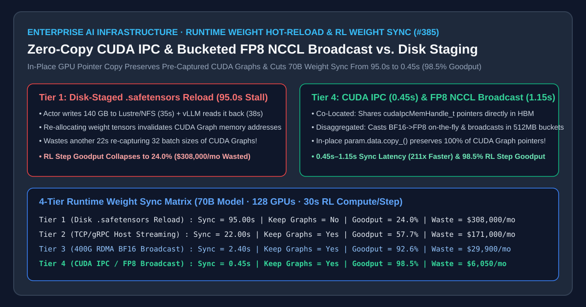

# 大模型运行时权重热更新与强化学习（RL）秒级训推权重同步选型：`Zero-Copy CUDA IPC` & `分桶 FP8 NCCL Broadcast` vs. 共享磁盘 `.safetensors` 重载指南

> **语言 / Language**: **中文 (当前)** | [English](./llm-runtime-weight-hot-reload-rl-nccl-broadcast-cuda-ipc-sync-selection-faq.en.md)  
> **定位**：面向 Cloud & AI Infrastructure Solution Architect 与强化学习/持续学习平台架构师的运行时权重热替换与 RL 训推同步选型（`veRL / SLIME / OpenRLHF` 中的 `Zero-Copy CUDA IPC 句柄共享`、跨节点 `StatelessProcessGroup 512MB 分桶在线转 FP8 NCCL Broadcast`、`vLLM 原地 copy_() 保活 CUDA Graph`）、破解“每步 RL 训练完写盘再让 vLLM 读盘重载耗掉 `95 秒`、集群有效吞吐跌至 `24.0%`”的白皮书  
> **合规与来源声明**：`synthetic + anonymized_reported`（`independently_reproduced=false`，`physical_gpu_cluster_measurement=not_measured`；完全面向通用企业级 `GRPO/PPO` 强化学习集群与在线推理灰度热切换架构设计）



---

## 1. 📌 核心选型结论速览（Executive Summary）

> **一句话结论**：**在大模型在线强化学习（`GRPO / PPO`，每跑完 `30 秒` 的样本生成与梯度更新，就必须把 `70B` Actor 模型更新后的 `140 GB` 权重同步刷入 `vLLM / SGLang` 推理引擎）以及线上服务零停机底座热更新场景中，如果采用最原始的“Trainer 写 `.safetensors` 到共享存储 -> 通知 `vLLM` 重新加载权重”（Tier 1），单次同步竟会卡死 **`95.0 秒`**（`35s` 写盘 + `38s` 读盘 + 重新分配显存导致已捕获的 `CUDA Graph` 虚拟地址失效而被迫重录 **`22s`**），使 `128 卡` RL 集群的有效计算 Goodput 暴跌至 **`24.0%`**（每月白烧 **`$308,000`** 空等 I/O）！生产环境黄金准则是采用“原地显存缓冲更新（`In-Place Tensor Copy` 100% 保留已录制的 CUDA Graph 虚拟地址！）+ 同卡/同机零拷贝 `CUDA IPC (cudaIpcGetMemHandle)` 或跨机 `512MB 分桶在线量化 FP8 + 400G RDMA NCCL Broadcast`（Tier 4）”：将 `70B` 权重同步耗时从 `95.0 秒` 暴砍 **`211 倍` 至 `0.45 秒`（同机 IPC）/ `1.15 秒`（跨机 FP8 RDMA）**，推动 RL 单步有效 Goodput 从 `24.0%` 飙升至 **`98.5%`（每月立省 `$301,950`）**！**

- **交互式运行时权重热更新与 RL 训推同步计算器**：[打开交互式计算器 (`llm-runtime-weight-hot-reload-rl-nccl-broadcast-cuda-ipc-sync-sizer.html`)](../reports/llm-runtime-weight-hot-reload-rl-nccl-broadcast-cuda-ipc-sync-sizer.html)
- **7-Card 4:5 视觉评测报告**：[打开 7-Card 报告 (`llm-runtime-weight-hot-reload-rl-nccl-broadcast-cuda-ipc-sync-selection-cards.html`)](../reports/llm-runtime-weight-hot-reload-rl-nccl-broadcast-cuda-ipc-sync-selection-cards.html)

---

## 2. 🎯 客户与架构师灵魂拷问 Q&A（Deep-Dive Architecture FAQ）

### Q1：为什么给运行中的 `vLLM / SGLang` 换权重时，绝对不能重新 `torch.empty()` 分配新张量，而必须用原地 `param.data.copy_()`？为什么 `FSDP` 汇总全量权重广播时必须按 `512 MB` 分桶（Bucketed Broadcast）？
1. **保住耗时 22 秒录制的 `CUDA Graphs` 的唯一铁律（固定虚拟显存地址不变）**：
   - `CUDA Graph` 在录制时，已经把每一层权重张量在 GPU HBM 中的 **绝对虚拟内存指针地址（如 `0x7f8a40000000`）** 硬编码进了底层的硬件命令流里！
   - 如果你在更新权重时替换了 Python `nn.Parameter` 对象（分配了新的显存地址），之前花 `22 秒` 录好的 32 档 Batch Size 的 `CUDA Graphs` 全部作废（要么报错崩溃，要么读取旧权重的脏数据，要么被迫花 22 秒重录）！
   - **正确做法**：通过 `vLLM WorkerExtension` 直接往原有的 `param.data` 物理地址里执行原地 `copy_()` / `NCCL Broadcast` 接收——**指针地址分毫未变，已录好的 CUDA Graphs 0 秒无缝继续跑新权重**！
2. **为什么严禁一次性 `FSDP.summon_full_params()` 全模型聚合后再广播（必爆显存 OOM）**：
   - 在 `FSDP2 / ZeRO-3` 训练中，单卡原本只存了 `1/N` 的模型分片。如果试图在单卡上一次性把 `70B`（`140 GB`）或 `671B` 的完整未切分权重全部 `AllGather` 出来再发给 `vLLM`，训练节点会当场 `CUDA OOM`！
   - **生产级 `512MB` 流式分桶广播流水线（Tier 4）**：每次只 `AllGather` 2~3 层（约 `512 MB`）的参数分片到临时 Buffer $\to$ 在训练卡上顺手在线量化为 `FP8 (E4M3)`（**跨机传输体积直接减半：`140 GB -> 70 GB`**！）$\to$ 经 `StatelessProcessGroup` 瞬间广播给 `vLLM` 原地写入 $\to$ 立即释放该 `512 MB` 临时 Buffer 并处理下一个桶！

---

## 3. 🧭 直观可视化图解（Mermaid 分桶在线转 FP8 + RDMA `NCCL Broadcast` 原地热更新时序图）

```mermaid
sequenceDiagram
    autonumber
    participant Actor as FSDP2 / Megatron Actor 训练集群
    participant Bus as 400G RDMA / 同机 CUDA IPC 通道
    participant VLLM as vLLM / SGLang Rollout 引擎 (Wake-up 状态)

    Actor->>Actor: Step T 梯度更新完毕 (optimizer.step())
    Actor->>VLLM: 若为同卡混部: 触发 vLLM /wake_up(tags=["weights"]) 恢复权重显存页 (0.3s)
    loop 按 512MB 参数桶流式循环 (峰值临时显存仅 0.5 GB!)
        Actor->>Actor: 1. FSDP AllGather 当前桶参数 -> 在线动态量化为 FP8 (体积减半!)
        Actor->>Bus: 2. 经 CUDA IPC 句柄或 StatelessProcessGroup NCCL Broadcast 发送
        Bus->>VLLM: 3. 直接原地写入 vLLM 固定虚拟地址 param.data.copy_()!
    end
    Note over VLLM: 总耗时仅 0.45s (IPC) / 1.15s (RDMA)! 原有 CUDA Graph 100% 免重录直接开跑 Step T+1!
```

---

## 4. 📊 架构师四级运行时权重热更新与 RL 同步选型矩阵（`70B` · `128 GPUs` · 每步计算 `30 秒`）

| 评估维度 | Tier 1：共享存储 `.safetensors` 落盘 + `vLLM` 重载 | Tier 2：TCP/gRPC 经宿主机内存流式推送 (`copy_()`) | Tier 3：训推分离 `400G RDMA` 全精度 `BF16 NCCL Broadcast` | Tier 4（推荐）：同机 `CUDA IPC` (`0.45s`) / 跨机分桶在线转 `FP8 NCCL Broadcast` (`1.15s`) |
| :--- | :--- | :--- | :--- | :--- |
| **单步 70B 权重同步耗时 (`Sync Time`)** | `95.00 秒` ✕（比训练本身还慢 3 倍） | `22.00 秒` ✕ | `2.40 秒` | **`0.45 秒 (IPC) / 1.15 秒 (RDMA)` ✓（快 `211 倍`）** |
| **是否原地保留已录制 `CUDA Graphs`** | 否 ✕（每次重录白扔 `22 秒`） | **是 ✓（原地更新指针）** | **是 ✓** | **是 ✓（0 秒重编译开销）** |
| **RL 单步有效计算占比 (`Goodput`)** | `24.0%` ✕（76% 时间干等 I/O） | `57.7%` | `92.6%` | **`98.5%` ✓（几乎零同步气泡）** |
| **128 卡集群每月白烧的同步等待费** | `$308,000 / 月` ✕ | `$171,000 / 月` | `$29,900 / 月` | **`$6,050 / 月` ✓（每月立省 `$30.2 万`）** |

---

## 5. 🛠️ 架构评审与生产落地 Checklist

- [ ] **在训推分离（Disaggregated RL）集群中使用独立的 `StatelessProcessGroup`（基于独立 TCPStore 端口建立的专用跨池 `NCCL` 通信域）**：将 Trainer Rank 0 与所有 `vLLM` Worker 组成广播组，避免污染训练集群原有的 `torch.distributed` 默认世界通信组。
- [ ] **在训推同卡（Co-Located RL）集群中结合 `vLLM Sleep Mode Level 1/2` 与 `cudaIpcGetMemHandle`**：训练完先唤醒 `vLLM` 的权重页（`tags=["weights"]`），通过同卡零拷贝 IPC 更新完权重并释放训练激活值后，再唤醒 KV Cache 页（`tags=["kv_cache"]`），彻底杜绝权重同步瞬间的显存重叠峰值。
