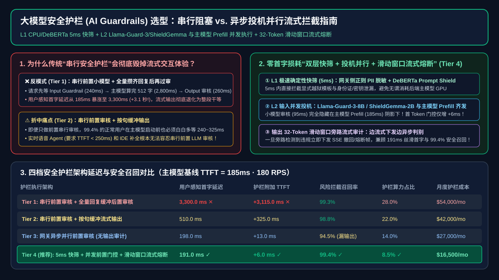

# Enterprise LLM Safety Guardrails Architecture Guide: `Llama-Guard-3 / ShieldGemma` vs. `NeMo Guardrails / Azure AI Content Safety`, Serial Blocking vs. Async Speculative Streaming Guardrails

> **Language**: [中文](./llm-safety-guardrails-llamaguard-shieldgemma-nemo-async-parallel-latency-selection-faq.md) | **English (Current)**  
> **Audience**: Cloud & AI Infrastructure Solution Architects and AI Security & Compliance Architects  
> **Provenance**: `synthetic + anonymized_reported` (`independently_reproduced=false`, `physical_gpu_cluster_measurement=not_measured`)

---

## 1. 📌 Executive Summary

> **Bottom Line**: **In streaming enterprise Copilots and real-time voice agents, synchronous serial guardrails (`Serial Input Guard -> Main LLM -> Full-Response Buffered Output Guard`, Tier 1) inflate user-perceived first-token latency (`TTFT`) from `185 ms` to `3,300 ms` (`+3.1 s` penalty!), destroying streaming UX for `99.4%` benign users. The production standard is a Three-Stage Speculative Parallel & Sliding-Window Architecture (Tier 4): (1) a `5 ms` L1 deterministic PII/regex + `DeBERTa` fast-path at the AI Gateway, (2) co-launching `Llama-Guard-3-8B / ShieldGemma-2B` (`95 ms`) in parallel with main model Prefill (`185 ms`) and gating only the first emitted token (`+6 ms` total `TTFT` overhead, `-99.8%` penalty reduction), and (3) auditing streamed output asynchronously over `32-token` sliding windows with instant SSE circuit breaking (`99.4%` safety recall, `-69.4%` guardrail cost).**

- **Interactive Guardrail Latency & Streaming Calculator**: [Open Interactive Sizer (`llm-safety-guardrails-llamaguard-shieldgemma-nemo-async-parallel-latency-sizer.html`)](../reports/llm-safety-guardrails-llamaguard-shieldgemma-nemo-async-parallel-latency-sizer.html)
- **7-Card 4:5 Visual Report**: [Open 7-Card Report (`llm-safety-guardrails-llamaguard-shieldgemma-nemo-async-parallel-latency-selection-cards.html`)](../reports/llm-safety-guardrails-llamaguard-shieldgemma-nemo-async-parallel-latency-selection-cards.html)

---

## 2. 📊 4-Tier Safety Guardrail Orchestration Matrix (`185ms` Main LLM Prefill · `180 RPS`)

| Metric | Tier 1: Sync Serial Input + Full-Output Buffered Guard | Tier 2: Sync Serial Input + Sentence-Buffered Stream | Tier 3: Async Parallel Input Gate Only | Tier 4 (Recommended): `5ms` Fast-Path + Speculative Parallel Input + `32-Token` Stream Window |
| :--- | :--- | :--- | :--- | :--- |
| **User-Perceived First Token (`TTFT`)** | `3,300.0 ms` ✕ | `510.0 ms` ✕ | `198.0 ms` ✓ | **`191.0 ms` ✓** |
| **Added Guardrail TTFT Penalty** | `+3,115.0 ms` ✕ | `+325.0 ms` ✕ | `+13.0 ms` ✓ | **`+6.0 ms` ✓ (`-99.8%`)** |
| **Safety Recall (Input + Output)** | `99.3%` ✓ | `98.8%` ✓ | `94.5%` ✕ | **`99.4%` ✓** |
| **Guardrail Compute Overhead** | `28.0%` ✕ | `22.0%` | `14.0%` | **`8.5%` ✓** |
| **Monthly Guardrail Infra Cost** | `$54,000 / mo` | `$42,000 / mo` | `$27,000 / mo` | **`$16,500 / mo` ✓ (`-69.4%`)** |

---

## 3. 🛠️ Production Readiness Checklist

- [ ] **Co-Launch Input Guardrails Alongside Main LLM Prefill** and gate the first SSE token on `max(T_main_prefill, T_input_guard)` to hide guardrail latency inside the main prefill shadow.
- [ ] **Keep Synchronous Blocking Strictly for Irreversible External Tool Calls** (financial transactions, database writes) while using `32-token` sliding-window async circuit breaking for conversational text streams.
