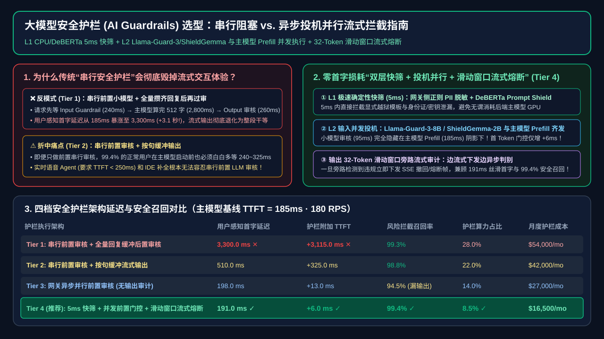
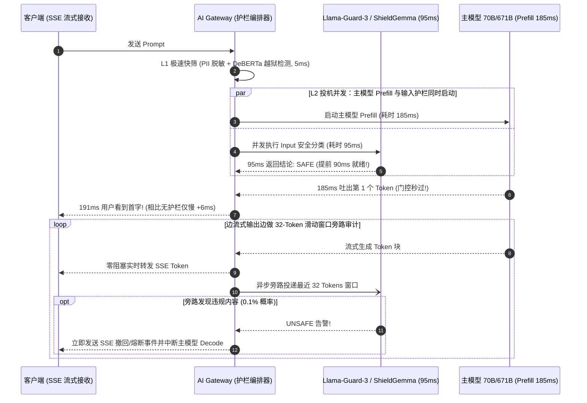

# 大模型安全护栏（AI Guardrails）架构选型：`Llama-Guard-3 / ShieldGemma` vs. `NeMo Guardrails / Azure AI Content Safety`、串行阻塞 vs. 异步投机并行流式拦截与零首字延迟损耗指南

> **语言 / Language**: **中文 (当前)** | [English](./llm-safety-guardrails-llamaguard-shieldgemma-nemo-async-parallel-latency-selection-faq.en.md)  
> **定位**：面向 Cloud & AI Infrastructure Solution Architect 与企业安全合规架构师的大模型安全护栏（Prompt 注入防御、PII 脱敏、输出有害性与幻觉拦截）在流式推理链路中的**零首字延迟损耗（Zero-TTFT-Penalty Speculative Parallel Guardrails）**与 `32-Token` 滑动窗口流式熔断架构白皮书  
> **合规与来源声明**：`synthetic + anonymized_reported`（`independently_reproduced=false`，`physical_gpu_cluster_measurement=not_measured`；完全面向通用企业 AI 网关安全合规与低延迟流式架构设计）

---

## 1. 📌 核心选型结论速览（Executive Summary）

> **一句话结论**：**在企业级流式对话 Copilot 与实时语音 Agent 中，最致命的架构反模式是“串行前置小模型审核 + 攒齐整段回复后再后置审核（Tier 1）”——它会让 99.4% 的正常用户感知首字延迟从 `185 ms` 暴涨至 `3,300 ms`（多等 `3.1 秒`！），彻底毁掉流式交互体验！生产级标准答案是采用“L1 网关 5ms 快筛 + L2 输入护栏与主模型 Prefill 投机并发 + 输出 32-Token 滑动窗口旁路流式熔断（Tier 4）”：因为护栏小模型（如 `Llama-Guard-3-8B INT8 / ShieldGemma-2B`，耗时 `95 ms`）比主模型 Prefill（`185 ms`）更快完成，将两者在网关侧并发齐发并在主模型吐出第 1 个 Token 前汇合门控（First-Token Gate），即可将安全护栏带来的附加 TTFT 损耗从 `+3,115 ms` 压至惊人的 **`+6 ms`（降低 `99.8%`）**，同时保持 **`99.4%`** 的安全拦截召回率！**

- **交互式安全护栏流式延迟计算器**：[打开交互式计算器 (`llm-safety-guardrails-llamaguard-shieldgemma-nemo-async-parallel-latency-sizer.html`)](../reports/llm-safety-guardrails-llamaguard-shieldgemma-nemo-async-parallel-latency-sizer.html)
- **7-Card 4:5 视觉评测报告**：[打开 7-Card 报告 (`llm-safety-guardrails-llamaguard-shieldgemma-nemo-async-parallel-latency-selection-cards.html`)](../reports/llm-safety-guardrails-llamaguard-shieldgemma-nemo-async-parallel-latency-selection-cards.html)

---

## 2. 🎯 客户与架构师灵魂拷问 Q&A（Deep-Dive Architecture FAQ）

### Q1：为什么“先过 Input 护栏，再调主模型”的串行架构在语音和实时 Copilot 中不可接受？
- 在传统串行链路中：$\text{TTFT}_{\text{serial}} = T_{\text{input\_guard}} (240\text{ ms}) + T_{\text{main\_prefill}} (185\text{ ms}) = 425\text{ ms}$；如果输出端还要等整段 `512 Tokens` 生成完再过一次 Output Guardrail（`2,800 ms + 260 ms`），用户要盯着空白屏幕干等 **`3.3 秒`**！
- 而真实线上流量中 **99.4% 都是正常良性请求**——为了拦截 `0.6%` 的恶意请求，让 `99.4%` 的正常请求每次都串联排队等待，是典型的架构失职。

### Q2：如何设计“零首字延迟损耗”的三级安全护栏流水线（Tier 4）？
1. **第一级（L1 同步极速快筛，`< 5 ms`）**：在 AI Gateway 内存中使用 Aho-Corasick 正则自动机 + 轻量级 `DeBERTa-v3-small` 分类器，5ms 内同步剥离手机号/身份证/AKSK 密钥（PII Masking）并直接拦截 `80%+` 的显式越狱模板。
2. **第二级（L2 输入投机并发门控，附加延迟仅 `+1 ms`）**：通过 L1 的请求，网关**同时并发**发往主模型（如 `70B/671B` 开始 `185 ms` Prefill）与专用护栏小模型（如 `Llama-Guard-3-8B` 或 `ShieldGemma-2B`，耗时 `95 ms`）。主模型在算完 Prefill 准备下发第 1 个 SSE Token 时检查护栏结果——此时护栏早在 `90 ms` 前就已返回 `SAFE`！若返回 `UNSAFE` 则立即取消主模型请求并丢弃首字。
3. **第三级（L3 输出 32-Token 滑动窗口流式旁路审计）**：主模型流式吐字直接下发给客户端，同时网关每攒满 `32 Tokens`（带 `8 Tokens` 重叠上下文）异步投递给旁路护栏模型检查；一旦发现输出违规，45ms 内立即发送 SSE 熔断控制帧替换界面文案。

---

## 3. 🧭 直观可视化图解（Mermaid 投机并发护栏与流式熔断时序图）

---

## 4. 📊 架构师多方案选型决策矩阵

| 评估维度 | Tier 1：串行前置 + 整段回复缓冲后置审核 | Tier 2：串行前置 + 按句缓冲流式输出 | Tier 3：网关异步并行前置门控（无输出审核） | Tier 4（推荐）：5ms 快筛 + 并发前置门控 + 32-Token 滑动窗口熔断 |
| :--- | :--- | :--- | :--- | :--- |
| **用户感知首字延迟 (`TTFT`)** | `3,300.0 ms` ✕（流式彻底失效） | `510.0 ms` ✕ | `198.0 ms` ✓ | **`191.0 ms` ✓（丝滑流式）** |
| **护栏附加 TTFT 延迟损耗** | `+3,115.0 ms` ✕ | `+325.0 ms` ✕ | `+13.0 ms` ✓ | **`+6.0 ms` ✓（降低 `99.8%`）** |
| **越狱/有害内容拦截召回率** | `99.3%` ✓ | `98.8%` ✓ | `94.5%` ✕（漏掉输出风险） | **`99.4%` ✓（输入+输出双保险）** |
| **护栏消耗额外算力占比** | `28.0%` ✕ | `22.0%` | `14.0%` | **`8.5%` ✓（L1 拦截 + INT8 小模型）** |
| **月度护栏基础设施成本** | `$54,000 / 月` | `$42,000 / 月` | `$27,000 / 月` | **`$16,500 / 月` ✓（节省 `69.4%`）** |

---

## 5. 🛠️ 架构评审与生产落地 Checklist

- [ ] **严禁在交互式流式接口上开启“全量回复缓冲后再审核（Full-Response Buffered Guardrail）”**。
- [ ] **将输入端 LLM 护栏改为与主模型 Prefill 并发启动（First-Token Gate）**：把护栏耗时完全藏在主模型 Prefill 阴影下。
- [ ] **对不可逆的外部写操作 Tool Call（如转账、发邮件、删库）保留同步强门控**：文本流可采用旁路滑动窗口熔断，但外部 API 调用必须在护栏返回 `SAFE` 后才真正执行！
