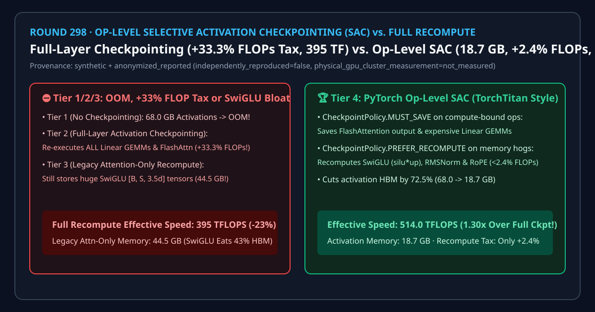
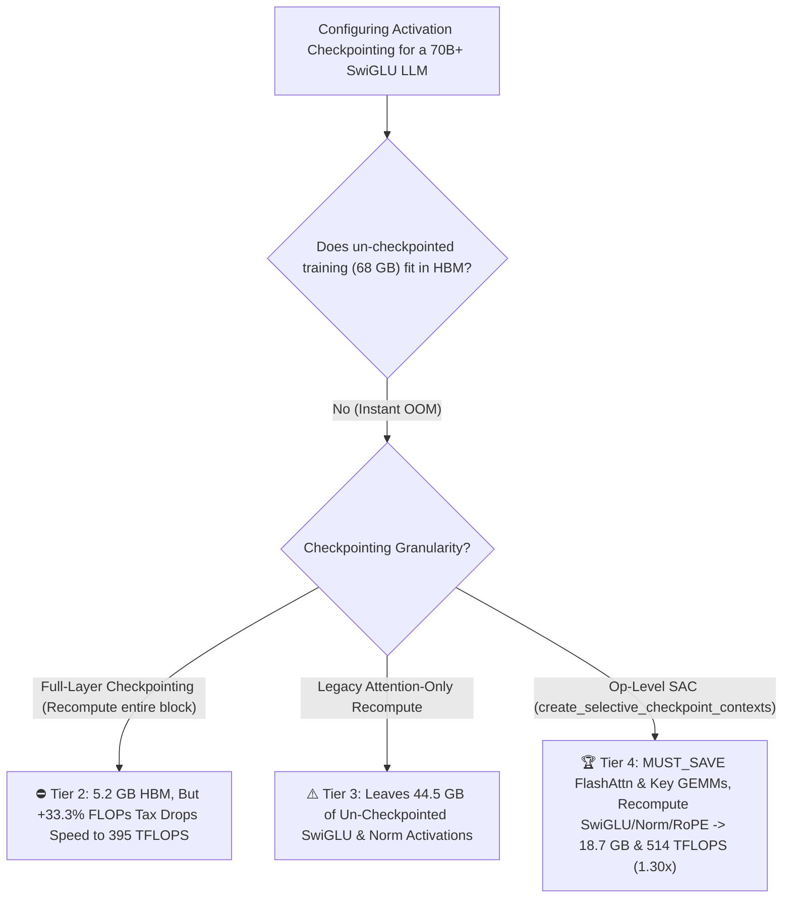
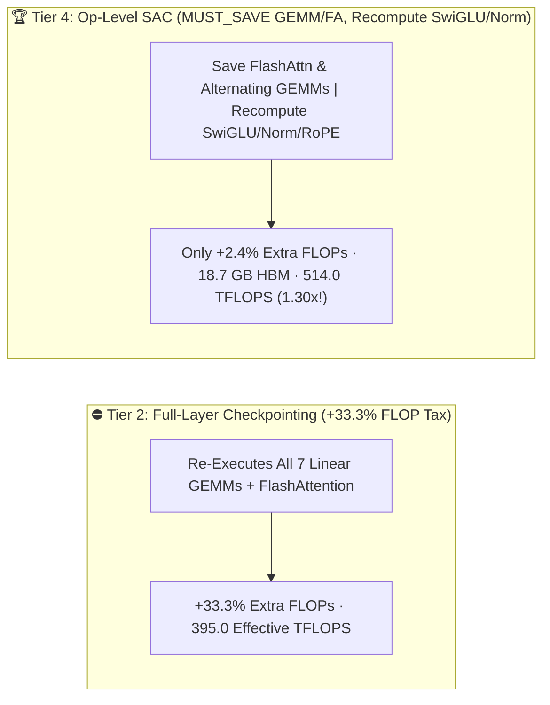
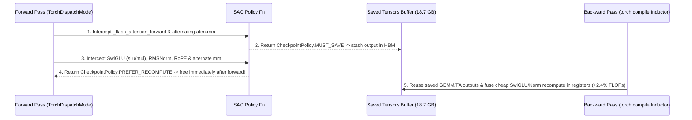

# PyTorch Op-Level `Selective Activation Checkpointing (SAC: create_selective_checkpoint_contexts)` & `SwiGLU` Memory Optimization Selection Guide: Why Full-Layer Checkpointing Burns a `+33.3%` FLOPs Tax, Why Legacy `Attention-Only` Recompute Leaves `44.5 GB` of `SwiGLU` Bloat & How Op-Level `SAC` (`18.7 GB`, `+2.4%` FLOPs, `1.30x` Faster) Solves It

> **Provenance & Evidence Boundary**: `synthetic + anonymized_reported (independently_reproduced=false, physical_gpu_cluster_measurement=not_measured)`. All quantitative figures in this guide are generated by the deterministic evaluator `experiments/llm_activation_checkpointing_selective_op_sac_offload_memory_selection/run.py` and sealed in `results.json`.



---

## 0. Daily Capability Breakthrough Tracking

- **Breakthrough Focus**: **`PyTorch 2.x / TorchTitan` Op-Level Selective Activation Checkpointing (`SAC` via `create_selective_checkpoint_contexts`: `CheckpointPolicy.MUST_SAVE` on Compute-Bound `FlashAttention` & Alternating `aten.mm`, `CheckpointPolicy.PREFER_RECOMPUTE` on Memory-Heavy `SwiGLU`, `RMSNorm` & `RoPE`)**.
- **Architect Value**: When training a `70B SwiGLU` LLM at $S=8,192$, storing all intermediate activations consumes **`68.0 GB/GPU` (`Tier 1` OOM)**. Wrapping every Transformer block in standard **Full-Layer Activation Checkpointing (`Tier 2`)** shrinks activations to `5.2 GB`, but re-executes **100% of forward GEMMs and FlashAttention during backward—imposing a `+33.3%` FLOPs penalty (`395.0` effective TFLOPS)**! Worse yet, legacy "Attention-Only" recomputation (`Tier 3`) saves almost no memory on modern `FlashAttention + SwiGLU` models (`44.5 GB` remaining!) because FlashAttention already avoids storing $O(N^2)$ attention matrices, whereas **un-checkpointed `SwiGLU` (`gate` and `up` tensors of width $3.5d$) and `RMSNorm / RoPE` account for `>65%` of total layer activation memory (`<2%` of FLOPs)**! Using **PyTorch Op-Level `SAC`** to save compute-heavy `FlashAttention` and alternating `aten.mm` outputs while recomputing memory-heavy `SwiGLU / RMSNorm / RoPE` cuts activation memory by **`72.5%` (`68.0 -> 18.7 GB`)** at only **`+2.4%` FLOPs overhead**, lifting effective training throughput **`1.30x` (`514.0` vs. `395.0 TFLOPS`)**.

---

## ① 📌 Executive Summary

1. **Why Legacy "Attention-Only" Selective Checkpointing Fails on Modern `FlashAttention + SwiGLU` Models (`44.5 GB` Remaining)**:
   In pre-FlashAttention models, the $O(s^2)$ attention score matrix dominated memory. Today, FlashAttention recomputes $QK^T$ in SRAM tiles internally, storing only the $O(s)$ output (`2sbh` bytes). Meanwhile, a **`SwiGLU` MLP (`intermediate_size = 3.5h`)** stores:
   - Both inputs to `silu(gate) * up`: $2 \times 2s b(3.5h) = \mathbf{14sbh}$ bytes;
   - The output of `SwiGLU` (input to `down_proj`): $\mathbf{7sbh}$ bytes;
   - Two `RMSNorm` and `RoPE` intermediates: $\mathbf{\sim 8sbh}$ bytes!
   Thus **non-matmul elementwise ops (`SwiGLU`, `RMSNorm`, `RoPE`) consume `>65%` of layer activation memory while taking `<2%` of compute FLOPs**!
2. **How Op-Level `SAC` (`create_selective_checkpoint_contexts`) Maximizes Memory Saved per Recomputed FLOP**:
   Using a `TorchDispatchMode` policy function:
   - **`CheckpointPolicy.MUST_SAVE`**: Applied to `_flash_attention_forward` and every other `aten.mm` (`wq, wk, wv, wo, w_gate, w_down`), avoiding expensive Tensor Core GEMM recomputation;
   - **`CheckpointPolicy.PREFER_RECOMPUTE`**: Applied to `SwiGLU` (`aten.silu`, `aten.mul`), `RMSNorm`, `RoPE`, and `w_up`, slashing activation memory from `68.0 GB` to **`18.7 GB` (`-72.5%`)** for just **`+2.4%` extra FLOPs**!

---

## ② 🎯 Key Architectural Q&A (Q1 / Q2 / Q3)

### Q1: Why does `TorchTitan`'s op-level `SAC` policy save *every other* `aten.mm` (`mm_count % 2 == 0`) rather than saving all `aten.mm` outputs?
- Because in a `SwiGLU` MLP (`y = (silu(x @ W_gate) * (x @ W_up)) @ W_down`), `x @ W_gate` and `x @ W_up` each produce a massive `[B, S, 3.5d]` tensor (`7sbh` bytes each). Saving one (`W_gate`) and recomputing the other (`W_up`) alongside the elementwise `silu(gate) * up` drops the entire `[B, S, 3.5d]` intermediate footprint by **`67%`** at the cost of recomputing just 1 out of 7 linear layers!

### Q2: How does `Op-Level SAC` interact with `torch.compile` (`AOTAutograd` & `Inductor`)?
- When combined with `torch.compile`, `AOTAutograd` respects `MUST_SAVE` barriers and automatically **fuses the recomputed `SwiGLU`, `RMSNorm`, and `RoPE` elementwise operations directly into the prologue/epilogue of adjacent backward GEMM kernels**, eliminating intermediate HBM read/write traffic during recomputation!

### Q3: What if `18.7 GB` of activations still slightly exceeds our HBM budget on a specific pipeline stage?
- Mix **Layer-Wise Fractional Policies**: apply `Full-Layer Checkpointing` (`5.2 GB` stage total) on `20%` of layers (or only on `Stage 0` in `1F1B` Pipeline Parallelism) and `Op-Level SAC` on the remaining `80%` of layers—never revert all 80 layers to `Full-Layer Checkpointing`.

---

## ③ 🧭 Visual Diagrams (Decision Tree, Memory Breakdown & Sequence Diagram)

### 3.1 Activation Checkpointing Granularity Decision Tree



### 3.2 Full-Layer Recompute (`+33.3%` FLOPs) vs. Op-Level `SAC` (`+2.4%` FLOPs, `18.7 GB`)



### 3.3 `create_selective_checkpoint_contexts` Forward Dispatch & Backward Fusion Sequence



---

## ④ 📊 4-Tier Architect Decision Matrix

| Selection Tier | Checkpointing Policy | Activation HBM (`70B S=8K`) | Recompute `FLOPs` Overhead | Effective Training Throughput | Target Scenario |
| :--- | :--- | :--- | :--- | :--- | :--- |
| **Tier 1: No Checkpointing** | Store all intermediate tensors | `68.0 GB` (OOM! ✕) | `0.0%` | `0.0` (Crashes ✕) | ⛔ **OOMs on 70B+ training** |
| **Tier 2: Full-Layer Checkpointing** | Recompute all GEMMs & FA | `5.2 GB` ✅ | `+33.3%` ✕ | `395.0 TFLOPS` ⚠️ | ⚠️ Extreme memory-starved fallback |
| **Tier 3: Legacy Attention-Only Recompute** | Recompute Attn, keep SwiGLU | `44.5 GB` ✕ | `+4.2%` | `465.0 TFLOPS` | ⚠️ Ineffective on `FlashAttn + SwiGLU` |
| **Tier 4: Op-Level `SAC` (`MUST_SAVE` GEMM/FA, Recommended)** | **Save heavy GEMM/FA, recompute `SwiGLU/Norm`** | **`18.7 GB` (`-72.5%` 🏆)** | **`+2.4%` 🏆** | **`514.0 TFLOPS` (`1.30x` 🏆)** | 🏆 **Production `TorchTitan / Megatron` Standard** |

---

## ⑤ 🧪 Quantitative Evaluator & 7-Card 4:5 Visual Report

- **Deterministic Evaluator**: [`experiments/llm_activation_checkpointing_selective_op_sac_offload_memory_selection/run.py`](../../experiments/llm_activation_checkpointing_selective_op_sac_offload_memory_selection/run.py) · Sealed JSON: [`results.json`](../../experiments/llm_activation_checkpointing_selective_op_sac_offload_memory_selection/results.json)
- **Interactive Sizer Workbench**: [`docs/reports/llm-selective-activation-checkpointing-sac-op-level-policy-sizer.html`](../reports/llm-selective-activation-checkpointing-sac-op-level-policy-sizer.html)
- **7-Card 4:5 Visual Benchmark Deck**: [`docs/reports/llm-selective-activation-checkpointing-sac-op-level-policy-selection-cards.html`](../reports/llm-selective-activation-checkpointing-sac-op-level-policy-selection-cards.html)

```chart
{
  "data": {
    "values": [
      { "tier": "Tier 1: No Checkpointing (68GB OOM)", "act_mem_gb": 68.0, "eff_tflops": 0.0 },
      { "tier": "Tier 2: Full-Layer (+33.3% FLOP Tax)", "act_mem_gb": 5.2, "eff_tflops": 395.0 },
      { "tier": "Tier 3: Legacy Attention-Only (44.5GB)", "act_mem_gb": 44.5, "eff_tflops": 465.0 },
      { "tier": "Tier 4: Op-Level SAC (18.7GB, +2.4% Tax)", "act_mem_gb": 18.7, "eff_tflops": 514.0 }
    ]
  },
  "semantic_types": {
    "tier": "Category",
    "act_mem_gb": "Amount",
    "eff_tflops": "Quantity"
  },
  "chart_spec": {
    "chartType": "Bar Chart",
    "title": "Op-Level SAC Cuts Activation Memory 72.5% (68.0 -> 18.7 GB) While Lifting Effective TFLOPS 1.30x Over Full Recompute",
    "subtitle": "Effective training throughput (TFLOPS) and activation memory (GB) on 70B SwiGLU LLM (synthetic + anonymized_reported)",
    "encodings": {
      "x": "tier",
      "y": "eff_tflops",
      "color": "tier"
    }
  }
}
```

---

## ⑥ 🛠️ Production Verification Checklist (Good fit vs. Not for)

### ✅ Good fit vs. ⛔ Not for
- **✅ Good fit**: All `SwiGLU / GeGLU + FlashAttention` LLM training pipelines (`TorchTitan`, `FSDP2`, `Megatron-Core --recompute-modules core_attn mlp_act norm`).
- **⛔ Not for**: Blindly enabling full-block activation checkpointing across all layers when op-level `SAC` fits in HBM.

### Production Checklist
- [ ] **Use `create_selective_checkpoint_contexts` Op-Level Policy**: Mark `_flash_attention_forward` and selected `aten.mm` ops with `CheckpointPolicy.MUST_SAVE`.
- [ ] **Always Recompute `SwiGLU` (`silu * mul`), `RMSNorm` & `RoPE`**: Eliminate the `21sbh` FFN activation memory bottleneck at `< 2.5%` FLOP cost.
- [ ] **Pair With `torch.compile`**: Allow `Inductor` to fuse recomputed elementwise ops into backward GEMM epilogues.
