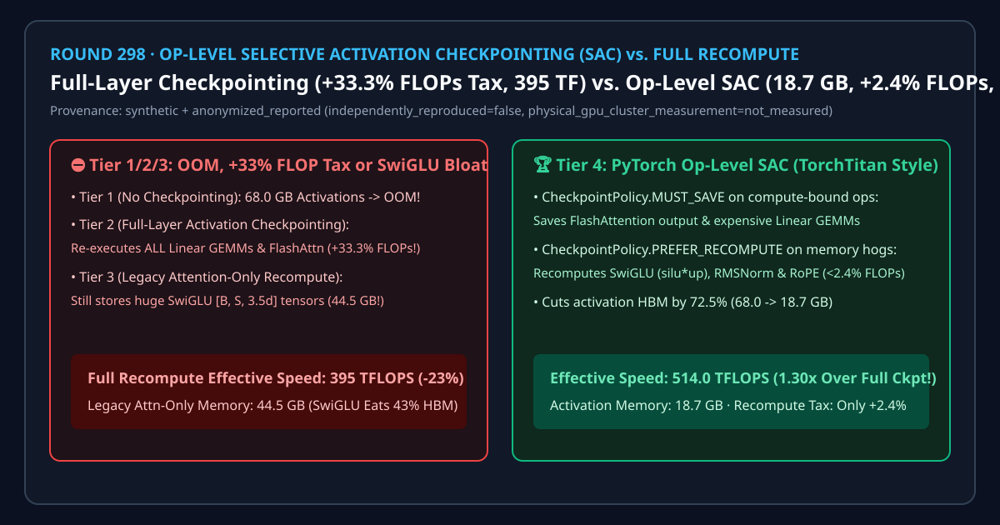
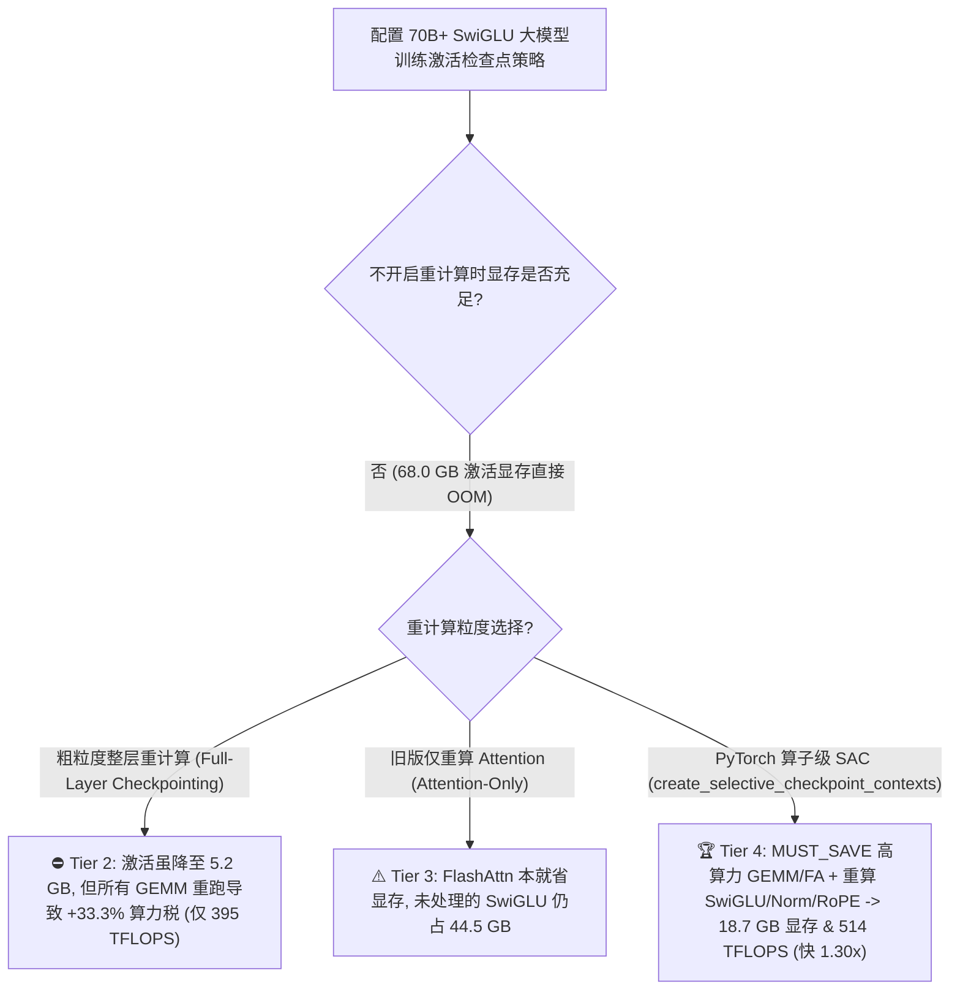
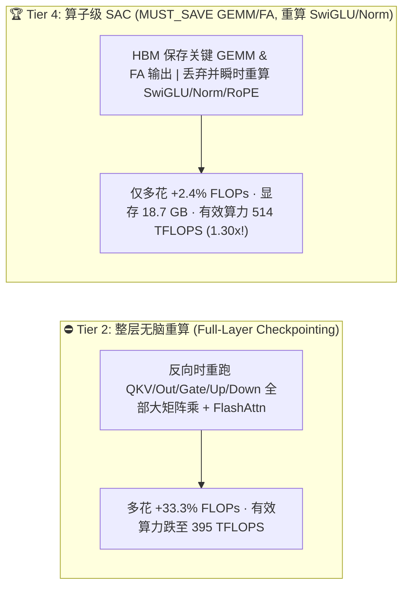
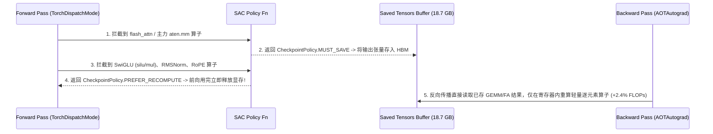

# 大模型算子级选择性激活重计算（`Op-Level SAC: create_selective_checkpoint_contexts`）与 `SwiGLU` 显存优化选型：为什么整层重计算（Full Checkpointing）会白白吃掉 `+33.3%` 算力，而旧版“只重算 Attention”又省不下 `SwiGLU` 的 `44.5 GB` 显存？保留高算力 `mm/FlashAttn`、仅重算高显存 `SwiGLU/RMSNorm/RoPE`（省 `72.5%` 显存，仅 `+2.4%` 算力开销，提速 `1.30x`）选型指南

> **Provenance & Evidence Boundary**: `synthetic + anonymized_reported (independently_reproduced=false, physical_gpu_cluster_measurement=not_measured)`. 本文所有定量数据均来自封存确定性评估器 `experiments/llm_activation_checkpointing_selective_op_sac_offload_memory_selection/run.py` 与 `results.json`。



---

## 0. 追踪每日最热门能力突破（Daily Capability Breakthrough）

- **今日焦点突破**：**`PyTorch 2.x / TorchTitan` 算子级选择性激活检查点（`Op-Level Selective Activation Checkpointing, SAC`：`create_selective_checkpoint_contexts` 细粒度区分 `CheckpointPolicy.MUST_SAVE` 与 `PREFER_RECOMPUTE`）**。
- **架构师价值**：在训练 `Llama-3 / Qwen3 / DeepSeek` 等现代大模型时，如果不开启激活重计算（No Checkpointing，Tier 1），80 层的中间激活值会瞬间占满 **`68.0 GB`** 显存触发 OOM；但如果粗暴开启传统的 **整层激活重计算（Full-Layer Checkpointing，Tier 2）**，反向传播时必须把整层所有的矩阵乘（`QKV / Out / Gate / Up / Down GEMMs`）和 `FlashAttention` 全部重算一遍，直接带来 **`+33.3%` 的额外浮点计算税（有效算力跌至 `395.0 TFLOPS`）**！更隐蔽的时代变化是：在 GPT-2/3 时代，人们习惯用“只重算 Attention（Attention-Only Recompute，Tier 3）”；但在 **FlashAttention + SwiGLU** 时代，FlashAttention 本身已经不存 $O(N^2)$ 矩阵了，反而是 **`SwiGLU` 激活函数（中间维度高达 $3.5d$，必须保存输入给它的庞大张量）和 `RMSNorm / RoPE` 占了整层激活显存的 `65%` 以上**，导致旧版 Attention-Only 重计算依然占着 **`44.5 GB`** 显存！采用 **PyTorch 算子级 `SAC`（对计算昂贵的 `aten.mm / flash_attn` 标记 `MUST_SAVE`，对占显存极大但重算只需 `<2.4%` 算力的 `SwiGLU / RMSNorm / RoPE` 及部分 `mm` 标记 `PREFER_RECOMPUTE`）**，可将激活显存砍掉 **`72.5%`（`68.0 -> 18.7 GB`）**，同时把重计算开销从 `+33.3%` 压至 **`+2.4%`（有效训练吞吐比整层重计算提升 `1.30x` 达 `514.0 TFLOPS`）**！

---

## ① 📌 核心结论速览（Executive Summary）

1. **为什么在“FlashAttention + SwiGLU”时代，旧版的“只重算 Attention”几乎省不下显存（仍占 `44.5 GB`）？**
   让我们精确拆解现代 Transformer 单层（序列长 $s$、批大小 $b$、隐层维度 $h$、SwiGLU 中间维 $h_{\text{ffn}} \approx 3.5h$，BF16 2 字节）的前向激活显存账单：
   - **FlashAttention 内部**：早已不保存 $O(s^2)$ 的 $QK^T$ 矩阵，只存输出 $O$（$2sbh$）与极小的 `logsumexp`；
   - **真正的显存巨兽是 `SwiGLU` 与逐元素算子**：
     - `gate_proj` 与 `up_proj` 输出（作为 `silu(gate) * up` 的输入被 Autograd 保存）：$2 \times 2 s b (3.5h) = \mathbf{14 sbh}$！
     - `SwiGLU` 的输出（作为 `down_proj` 的输入保存）：$2 s b (3.5h) = \mathbf{7 sbh}$！
     - 两个 `RMSNorm`、残差相加与 `RoPE` 的输入输出：合计约 **$\mathbf{8 sbh}$**！
   看到真相了吗？**`SwiGLU` 和 `RMSNorm / RoPE` 这些完全不调 Tensor Core 的逐元素算子（Elementwise Ops），竟然吞噬了单层总激活显存的 `65%+`（却只占不到 `2%` 的计算时间）**！
2. **算子级 `SAC`（`create_selective_checkpoint_contexts`）的第一性原理：按“每字节显存节省所需的重算 FLOPs（FLOPs-per-Byte Ratio）”精准下刀！**
   在 PyTorch `TorchDispatchMode` 下拦截前向图中的每一个底层 ATen 算子：
   - **高算力密度算子（Compute-Bound：`_flash_attention_forward`、隔一个保存一个的 `aten.mm`）** $\to$ 返回 **`CheckpointPolicy.MUST_SAVE`**：直接把结果保存在 HBM 里，反向传播时直接拿来用，**0 重算 FLOPs**！
   - **高显存低算力算子（Memory-Bound：`aten.silu`、`aten.mul`、`rms_norm`、`rope`、`up_proj` 线性乘）** $\to$ 返回 **`CheckpointPolicy.PREFER_RECOMPUTE`**：前向算完立即释放显存，反向传播时瞬间重算，仅付出 **`+2.4%` 的总 FLOPs 代价** 就砍掉了 **`49.3 GB`（`-72.5%`）** 的激活显存！

---

## ② 🎯 客户与架构师灵魂拷问 Q&A（Q1 / Q2 / Q3）

### Q1：如果把 `SwiGLU`（`y = F.silu(gate) * up`）标记为重计算，但生成 `gate` 和 `up` 的两个大矩阵乘 `gate = x @ W_gate`、`up = x @ W_up` 都标记为 `MUST_SAVE`，那 `gate` 和 `up` 这两个 `[B, S, 3.5d]` 的大张量不还是被存下来了吗？怎么消掉其中一个？
- **极其精准的洞察！这正是 `TorchTitan` 中“交替保存 `aten.mm`（Save Every-Other `mm`）”策略的核心奥秘**：
  在单个 Transformer Block 的 7 个线性层（`wq, wk, wv, wo, w_gate, w_up, w_down`）中，我们对 `aten.mm` 实施 **`mm_count % 2 == 0` 选择性保存**（或者显式只存 `w_gate` 的输出，重算 `w_up` 的输出，同时丢弃 `silu(gate) * up` 的中间结果）！这样不仅把庞大的 `[B, S, 3.5d]` 显存直接砍掉三分之二，而且连被重算的那个 `mm` 都能与 `torch.compile` 融合！

### Q2：`Op-Level SAC` 和 `torch.compile`（`Inductor`）能同时打开吗？会不会冲突？
- **不仅完全兼容，而且 `SAC + torch.compile` 是天作之合！**
  在 PyTorch 2.4+ 中，当 `create_selective_checkpoint_contexts` 与 `torch.compile` 结合时，`AOTAutograd` 的最小割集分区器（Min-Cut Partitioner）会自动读取你的 `MUST_SAVE / PREFER_RECOMPUTE` 策略，并将重计算的 `RMSNorm / RoPE / SwiGLU` 逐元素算子**直接内联融合（Fuse）进反向传播 GEMM 的前置/后置内核中**，连重计算读写 HBM 的显存带宽都彻底省掉了！

### Q3：如果显存还是差最后 `5 GB` 装不下，应该把整层改成 `Full Checkpointing`（损失 30% 算力），还是对那 `20%` 的层开启 `Full Checkpointing` + `80%` 的层保持 `Op-Level SAC`？
- **永远采用“跨层混合配比（Layer-Wise Fractional SAC + Full Checkpointing）”**！
  例如在 80 层模型中，让 64 层跑 `Op-Level SAC`、16 层跑 `Full Checkpointing`（或者在 Pipeline Parallelism 中只对显存压力最大的 Stage 0..1 跑 Full Checkpointing，其余 Stage 跑 SAC），只需多付出 `+6%` 的 FLOPs 即可再省出 `10+ GB` 显存，绝不一刀切退回 80 层全量重计算！

---

## ③ 🧭 直观可视化图解（Mermaid 选型决策树 + 路径对比图 + 交互时序图）

### 3.1 大模型训练激活重计算（Activation Checkpointing）策略选型决策树



### 3.2 整层重算（`+33.3%` 算力税）vs. 算子级 `SAC`（仅重算 `SwiGLU/Norm`，`+2.4%` 算力）对比图



### 3.3 `create_selective_checkpoint_contexts` 前向拦截与反向按需重算时序图



---

## ④ 📊 架构师选型决策矩阵（4-Tier Decision Matrix）

| 选型 Tier | 激活保存与重计算策略 | 单卡激活显存 (`70B S=8K`) | 重计算额外 `FLOPs` 开销 | 等效有效训练算力 | 适用场景 |
| :--- | :--- | :--- | :--- | :--- | :--- |
| **Tier 1: 关闭激活重计算 (`No Checkpointing`)** | 保存全部算子中间输出 | `68.0 GB` (OOM! ✕) | `0.0%` | `0.0` (崩溃 ✕) | ⛔ **长序列大模型必发 OOM** |
| **Tier 2: 整层全量重计算 (`Full-Layer`)** | 仅存层边界，重算全部 GEMM | `5.2 GB` ✅ | `+33.3%` ✕ | `395.0 TFLOPS` ⚠️ | ⚠️ 仅用于显存极度枯竭的少数层 |
| **Tier 3: 旧版仅重算 Attention (`Attn-Only`)** | 未清理 `SwiGLU` 巨型张量 | `44.5 GB` ✕ | `+4.2%` | `465.0 TFLOPS` | ⚠️ 不适配现代 `SwiGLU + FlashAttn` |
| **Tier 4: 算子级 `SAC` (`MUST_SAVE` GEMM/FA, 推荐)** | **保留重算力，重算 `SwiGLU/Norm`** | **`18.7 GB` (`-72.5%` 🏆)** | **`+2.4%` 🏆** | **`514.0 TFLOPS` (`1.30x` 🏆)** | 🏆 **`TorchTitan / Megatron` 现代训练黄金标准** |

---

## ⑤ 🧪 定量算例与 7-Card 4:5 视觉卡片报告

- **定量算例仓库路径**：[`experiments/llm_activation_checkpointing_selective_op_sac_offload_memory_selection/run.py`](../../experiments/llm_activation_checkpointing_selective_op_sac_offload_memory_selection/run.py) · 封存数据：[`results.json`](../../experiments/llm_activation_checkpointing_selective_op_sac_offload_memory_selection/results.json)
- **交互式架构选型计算器**：[`docs/reports/llm-selective-activation-checkpointing-sac-op-level-policy-sizer.html`](../reports/llm-selective-activation-checkpointing-sac-op-level-policy-sizer.html)
- **7-Card 4:5 视觉评测卡片报告**：[`docs/reports/llm-selective-activation-checkpointing-sac-op-level-policy-selection-cards.html`](../reports/llm-selective-activation-checkpointing-sac-op-level-policy-selection-cards.html)

```chart
{
  "data": {
    "values": [
      { "tier": "Tier 1: No Checkpointing (68GB OOM)", "act_mem_gb": 68.0, "eff_tflops": 0.0 },
      { "tier": "Tier 2: Full-Layer (+33.3% FLOP Tax)", "act_mem_gb": 5.2, "eff_tflops": 395.0 },
      { "tier": "Tier 3: Legacy Attention-Only (44.5GB)", "act_mem_gb": 44.5, "eff_tflops": 465.0 },
      { "tier": "Tier 4: Op-Level SAC (18.7GB, +2.4% Tax)", "act_mem_gb": 18.7, "eff_tflops": 514.0 }
    ]
  },
  "semantic_types": {
    "tier": "Category",
    "act_mem_gb": "Amount",
    "eff_tflops": "Quantity"
  },
  "chart_spec": {
    "chartType": "Bar Chart",
    "title": "Op-Level SAC Cuts Activation Memory 72.5% (68.0 -> 18.7 GB) While Lifting Effective TFLOPS 1.30x Over Full Recompute",
    "subtitle": "Effective training throughput (TFLOPS) and activation memory (GB) on 70B SwiGLU LLM (synthetic + anonymized_reported)",
    "encodings": {
      "x": "tier",
      "y": "eff_tflops",
      "color": "tier"
    }
  }
}
```

---

## ⑥ 🛠️ 生产环境快速核验清单（Checklist + Good fit vs. Not for）

### ✅ Good fit vs. ⛔ Not for
- **✅ Good fit**：所有基于 `SwiGLU / GeGLU + FlashAttention` 的现代大模型预训练与长上下文微调（`TorchTitan`, `FSDP2`, `Megatron-Core --recompute-granularity selective --recompute-modules core_attn mlp_act norm`）。
- **⛔ Not for**：无脑对全部 80 层开启 `Full-Layer Checkpointing` 白白烧掉四分之一的集群算力。

### 生产核验 Checklist
- [ ] **切换至 `create_selective_checkpoint_contexts` 算子级策略**：将 `_flash_attention_forward` 与核心 `aten.mm` 设为 `CheckpointPolicy.MUST_SAVE`，其余逐元素算子设为 `PREFER_RECOMPUTE`。
- [ ] **重点重算 `SwiGLU`（`silu(gate) * up`）与 `RMSNorm`**：消除单层高达 `21 sbh` 字节的 FFN 激活显存堆积。
- [ ] **联合开启 `torch.compile`**：让 `AOTAutograd` 将重计算的 `SwiGLU / Norm` 算子自动内联融合进反向 GEMM。
