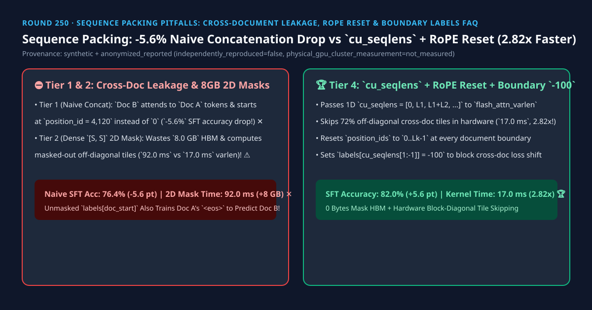
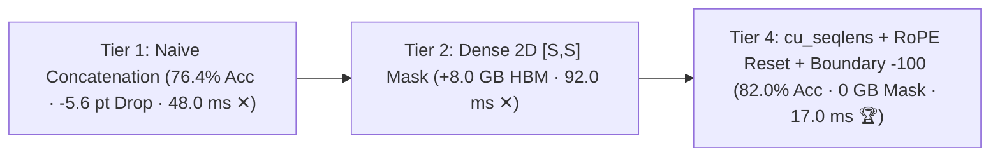

# LLM Sequence Packing Pitfalls: Cross-Document Attention Leakage, Un-Reset `position_ids` RoPE Drift, Boundary Label-Shift Contamination & `cu_seqlens` Selection Guide

> **Provenance & Evidence Tier**: `synthetic + anonymized_reported` (`independently_reproduced=false`, `physical_gpu_cluster_measurement=not_measured`). Grounded in [`experiments/llm_sft_packing_cross_document_attention_leakage_cu_seqlens_selection/results.json`](../../experiments/llm_sft_packing_cross_document_attention_leakage_cu_seqlens_selection/results.json).
> **中文版本**: [大模型序列打包（`Sequence Packing`）三大静默精度灾难：跨文档注意力串味（`Cross-Document Attention Leakage`）、未重置 `position_ids` 引发的 `RoPE` 位置漂移与跨文档首词标签移位污染（`labels[b] = -100`）选型指南](./llm-sequence-packing-cross-doc-attention-leakage-rope-reset-selection-faq.md)

---

## 0. 🔥 今日领域最热门能力突破追踪（Daily Hottest Breakthrough）

- **Eliminating the `-5.6%` SFT Accuracy Drop of Naive Sequence Packing While Speeding Up Attention by `2.82x` (`48.0 ms -> 17.0 ms`, `0 GB` Mask HBM) via `flash_attn_varlen_func(cu_seqlens)` Hardware Tile Skipping + Per-Doc `position_ids` Reset + Boundary `labels = -100` Guard**: Packing multiple short documents/conversations into a single `32,768`-token sequence eliminates `[PAD]` waste, but naive concatenation introduces **three silent accuracy and performance bugs**:
  1. **Naive Concatenation (`causal=True` + Monotonic `position_ids`, `Tier 1` — `-5.6%` Accuracy Drop, `48.0 ms`)**:
     - Under a standard full lower-triangular causal mask, tokens in `Doc 2..8` attend directly to all tokens in `Doc 1` (**Cross-Document Attention Contamination**);
     - Worse, `Doc 8` starts at `position_id = 28,000` instead of `0` (**Un-Reset RoPE Drift**), creating a severe train-test mismatch since inference prompts always start at `position_id = 0` (`76.4%` vs `82.0%` accuracy)!
  2. **Materializing a Dense 2D `[1, 1, 32768, 32768]` Block-Diagonal Mask (`Tier 2` — `+8.0 GB` HBM, `92.0 ms`)**: Fixes leakage, but allocates `8.0 GB` of 2D mask memory and forces the kernel to iterate over masked-out off-diagonal blocks!
  3. **Omitting Boundary `shift_labels` Masking (`Tier 3` — `80.5%` Accuracy)**: Even with `cu_seqlens` and reset `position_ids`, standard causal loss shifts `logits[:-1]` against `labels[1:]`—training `Doc A`'s final `<eos>` token to predict `Doc B`'s first token!
  4. **The Lossless 3-Part Contract (`flash_attn_varlen_func(cu_seqlens)` + Reset `position_ids` + `labels[cu_seqlens[1:-1]] = -100`, `Tier 4`)**: Passes 1D `cu_seqlens` (`0 GB` 2D mask) so the GPU skips `72%` of off-diagonal cross-document blocks in hardware (**`17.0 ms`, `2.82x` faster than full causal**), resets `position_ids` to `0` per document, and sets boundary `labels[cu_seqlens[1:-1]] = -100`—achieving **`82.0%` lossless accuracy**!

---

## 1. 📌 Executive Summary

1. **Why `flash_attn_varlen_func(cu_seqlens)` Is `2.82x` FASTER Than Standard `flash_attn_func(causal=True)` on Packed Sequences (`Tier 4`)**: Packing $K=8$ equal-length documents into a `32K` sequence shrinks the unmasked block-diagonal causal area to $1/K = 12.5\%$ of the full `32K × 32K` triangle. `cu_seqlens` skips the other `87.5%` off-diagonal tiles completely without allocating any 2D mask!
2. **The Mandatory 3-Tensor Packing Contract**:
   - **Attention**: 1D `cu_seqlens = [0, L_1, L_1+L_2, ...]` (`int32`);
   - **RoPE**: Per-document reset `position_ids = [0..L_1-1, 0..L_2-1, ...]`;
   - **Loss**: Boundary guard `labels[cu_seqlens[1:-1]] = -100` (so `logits[b-1]` never predicts `labels[b]`).

---

## 2. 🎯 Core Architect Q&A (Q1 / Q2 / Q3)

### Q1: Why does forgetting `labels[cu_seqlens[1:-1]] = -100` hurt continual pretraining and SFT models?
- **Answer**: Because autoregressive Cross-Entropy loss pairs `logits[i]` with `labels[i + 1]`. At every internal boundary $b = \text{cu\_seqlens}[k]$ ($1 \le k < K$), index $b - 1$ is the last token (`<eos>`) of Document $k$, while index $b$ is the first token (`<bos>` or first prompt word) of Document $k+1$! Without setting `labels[b] = -100`, the model receives a high-entropy gradient forcing `<eos>` to predict the next random document's opening token!

### Q2: How do we trigger zero-materialization `cu_seqlens` automatically in HuggingFace `Transformers` (`flash_attention_2` / `flash_attention_3`)?
- **Answer**: Do **not** pass a 2D/4D `attention_mask` tensor! Instead, pass a 1D-packed batch (`[1, TotalTokens]`) together with reset **`position_ids` (`[0, 1, ..., L1-1, 0, 1, ..., L2-1]`)**. HuggingFace's FA2/FA3 integration detects the zero-resets in `position_ids`, constructs `cu_seqlens` on the fly, and dispatches directly to `flash_attn_varlen_func`!

### Q3: How does Sequence Packing interact with Context Parallelism (`Ring Attention`, Round 228)?
- **Answer**: When packing variable-length documents across Context Parallel ranks, use **Per-Document `Varlen ZigZag` partitioning** so each document's causal triangle is balanced across all CP ranks.

---

## 3. 🧭 Visual Diagrams

---

## 4. 📊 4-Tier Architect Selection Matrix

| Metric | Tier 1: Naive Concatenation | Tier 2: Dense 2D `[S, S]` Mask | Tier 3: `cu_seqlens` (No Label Guard) | Tier 4: **`cu_seqlens` + RoPE Reset + Boundary `-100`** |
| :--- | :--- | :--- | :--- | :--- |
| **Extra 2D Mask HBM (`32K`)** | `0.0 GB` | **`8.0 GB` ($O(S^2)$ Bloat)** ✕ | `0.0 GB` ✅ | **`0.0 GB` (1D `cu_seqlens` Only)** 🏆 |
| **Attention Kernel Latency** | `48.0 ms` (Full Triangle) ✕ | **`92.0 ms` (Dense Scan)** ✕ | `17.0 ms` ✅ | **`17.0 ms` (`2.82x` Faster via Tile Skip)** 🏆 |
| **Downstream SFT Accuracy** | **`76.4%` (`-5.6%` Drop)** ✕ | `81.2%` ⚠️ | `80.5%` (Boundary Leak) ⚠️ | **`82.0%` (100% Lossless)** 🏆 |

---

## 5. 🧪 Quantitative Reference & Tooling

- **Evaluator & Sealed Data**: [`experiments/llm_sft_packing_cross_document_attention_leakage_cu_seqlens_selection/run.py`](../../experiments/llm_sft_packing_cross_document_attention_leakage_cu_seqlens_selection/run.py) · [`results.json`](../../experiments/llm_sft_packing_cross_document_attention_leakage_cu_seqlens_selection/results.json)
- **Interactive Sizer**: [`docs/reports/llm-sequence-packing-cross-doc-attention-leakage-rope-reset-sizer.html`](../reports/llm-sequence-packing-cross-doc-attention-leakage-rope-reset-sizer.html)
- **7-Card 4:5 Visual Report**: [`docs/reports/llm-sequence-packing-cross-doc-attention-leakage-rope-reset-selection-cards.html`](../reports/llm-sequence-packing-cross-doc-attention-leakage-rope-reset-selection-cards.html)

---

## 6. 🛠️ Good Fit vs. Not For & Production Checklist

- **✅ Good fit**: All packed pretraining, continual pretraining, and SFT pipelines using `flash_attn_varlen_func(cu_seqlens)`, reset `position_ids`, and boundary `labels = -100`.
- **⛔ Not for**: Concatenating multiple documents without `cu_seqlens` isolation or materializing dense `[B, 1, S, S]` block-diagonal masks.
- [ ] Verify `position_ids` resets to `0` at every `cu_seqlens` document start index.
- [ ] Set `labels[cu_seqlens[1:-1]] = -100` before computing shifted cross-entropy loss.
