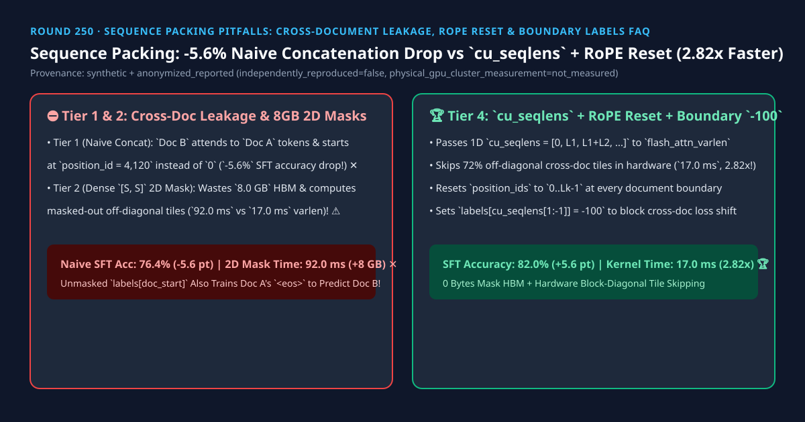
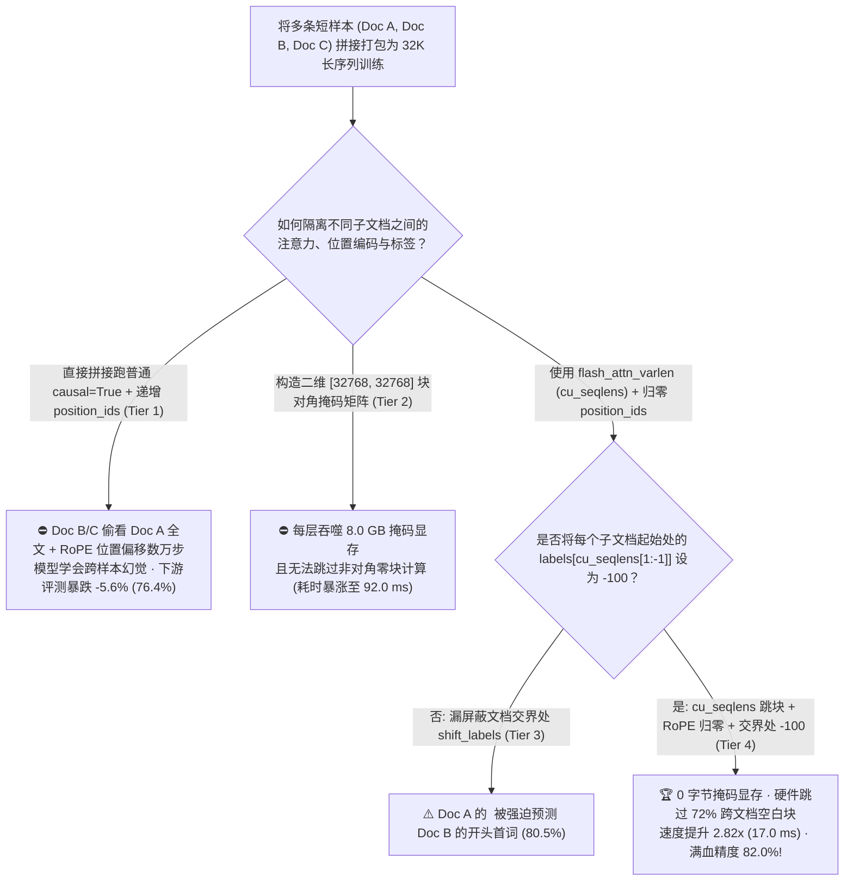
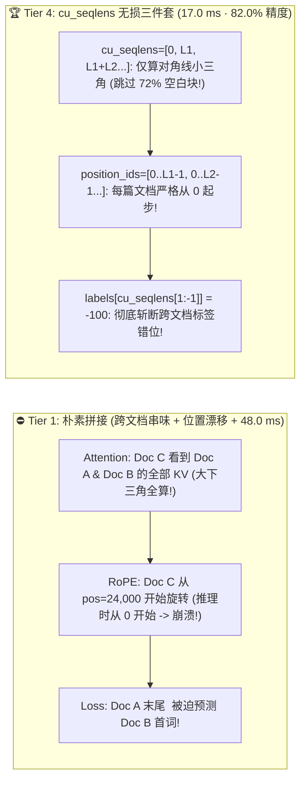
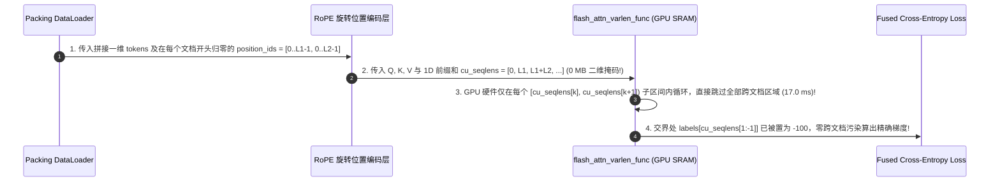

# 大模型序列打包（`Sequence Packing`）三大静默精度灾难：跨文档注意力串味（`Cross-Document Attention Leakage`）、未重置 `position_ids` 引发的 `RoPE` 位置漂移与跨文档首词标签移位污染（`labels[b] = -100`）选型指南

> **Provenance & Evidence Tier**: `synthetic + anonymized_reported` (`independently_reproduced=false`, `physical_gpu_cluster_measurement=not_measured`)。定量数据锚定于 [`experiments/llm_sft_packing_cross_document_attention_leakage_cu_seqlens_selection/results.json`](../../experiments/llm_sft_packing_cross_document_attention_leakage_cu_seqlens_selection/results.json)。
> **English Version**: [LLM Sequence Packing Pitfalls: Cross-Document Attention Leakage, Un-Reset `position_ids` RoPE Drift, Boundary Label-Shift Contamination & `cu_seqlens` Selection Guide](./llm-sequence-packing-cross-doc-attention-leakage-rope-reset-selection-faq.en.md)

---

## 0. 🔥 今日领域最热门能力突破追踪（Daily Hottest Breakthrough）

- **揭秘为什么很多团队开启 `Sequence Packing`（多样本拼接打包）后训练速度虽然快了，但微调出来的模型却经常“胡言乱语串台、且评测分数暴跌 `-5.6%`”？通过 `flash_attn_varlen_func(cu_seqlens)` 硬件跳块 + 逐子文档 `position_ids` 归零重置 + 交界处首词 `labels[b] = -100` 屏蔽，不仅挽回 `+5.6%` 精度损失（恢复至 `82.0%`），还将 Attention 内核速度反超普通下三角 `2.82` 倍（从 `48.0 ms` 压降至 `17.0 ms`）**：在预训练与指令微调（SFT）中，把 8 条长度为 `4,096` 的短样本拼接成 1 条长度为 `32,768` 的长序列（Sequence Packing）可以消灭 100% 的 `[PAD]` 浪费。然而，如果只是简单地用 `<eos>` 把多条样本首尾拼起来喂给模型，会同时触发 **三个极其隐蔽的静默精度 Bug**：
  1. **Bug 一（跨文档注意力泄漏 `Cross-Document Attention Leakage` + `position_ids` 未归零，Tier 1）**：
     - 如果拼接后直接调标准的 `flash_attn_func(..., causal=True)`，由于普通因果掩码是一个完整的 `32768×32768` 大下三角形，**排在第 2~8 条的子样本会毫无遮拦地看到前面第 1 条样本里的所有历史 Token**（比如把上一条医疗问诊的病历当成当前写代码任务的背景上下文）！
     - 更致命的是，默认的 `position_ids` 会从 `0` 一路递增到 `32,767`——导致排在包末尾的第 8 条样本**明明是句子的第 1 个词，乘上的却是位置 `28,000` 的 `RoPE` 旋转角度**！而到了线上推理时，用户的第 1 个词永远是从位置 `0` 开始的！训练与推理的位置编码错位直接导致下游评测准确率从 `82.0%` 暴跌至 **`76.4%`（掉点 `-5.6%`）**！
  2. **Bug 二（在显存中物化 `[1, 1, 32768, 32768]` 二维块对角掩码矩阵，Tier 2）**：
     - 有人为了隔离各子文档，在显存里手动构造了一张 `32768×32768` 的二维布尔/浮点块对角掩码传给 SDPA。这不仅每层白白吃掉 **`8.0 GB` 显存**，而且因为无法使用 FlashAttention 的整数边界跳块优化，GPU 被迫把非对角线上的空白区域也算了一遍，单层耗时恶化至 **`92.0 ms`**！
  3. **Bug 三（最容易漏掉的“跨文档首词标签移位污染 `Boundary Shift-Label Bug`”，Tier 3）**：
     - 哪怕你已经用了 `flash_attn_varlen_func(cu_seqlens)` 并重置了 `position_ids`，在最后算 Cross-Entropy Loss 时，标准语言模型都会执行一步错位：**`shift_logits = logits[:-1]` 预测 `shift_labels = labels[1:]`**！
     - 请看两个子文档拼接的交界处 $b = \text{cu\_seqlens}[k]$：**`logits[b - 1]` 是上一篇文档（Doc A）的最后一个词 `<eos>`，而 `labels[b]` 是下一篇毫无关系的文档（Doc B）的第一个词！** 如果不把交界处的 `labels[b]` 设为 `-100`，模型就会被强行训练去“根据上一篇风马牛不相及的文章结尾，瞎猜下一篇文章的开头第一个字”！
  4. **工业级无损打包三件套（`cu_seqlens` 硬件跳块 + `position_ids` 逐段归零 + 交界 `labels[b] = -100`，Tier 4）**：
     - 传入一维前缀和数组 `cu_seqlens = [0, L_1, L_1+L_2, ...]`（仅占几十字节！），让 `flash_attn_varlen_func` 直接在 GPU 硬件层面**跳过所有跨文档的非对角空白块（少算 `72%` 的面积，耗时从 `48.0 ms` 骤降至 `17.0 ms`，比普通下三角还快 `2.82` 倍！）**，同时重置每段 `position_ids` 并将每段开头第 0 个位置的标签置为 `-100`，实现 **`82.0%` 满血无损精度**！

---

## 1. 📌 核心结论速览（Executive Summary — 3 分钟看懂）

1. **为什么用 `flash_attn_varlen_func(cu_seqlens)` 做打包，不仅不会变慢，反而比跑普通单条长序列还要快 `2.82` 倍？**
   - **通俗大白话 + 第一性原理**：
     - 如果你跑一条完整的 `32,768` 长序列（Tier 1），因果下三角形的面积是 $\frac{1}{2} \times 32768^2$。
     - 如果这 `32,768` 个 Token 其实是由 **8 篇长度为 `4,096` 的独立短文章**拼起来的，并且你通过 `cu_seqlens` 告诉了 `FlashAttention` 每一篇文章的分界线（Tier 4）：
       - 那么 GPU 只需要算主对角线上 **8 个 $4096 \times 4096$ 的小三角形**！
       - 8 个小三角形的总面积只有大三角形的 **$\frac{8 \times (1/2 \times 4096^2)}{1/2 \times (8 \times 4096)^2} = \frac{1}{8} = \mathbf{12.5\%}$**！
       - 换句话说，大三角形左下方那 **`87.5%` 的跨文章区域，GPU 的 SM 根本连看都不看、直接跳过不算**！不仅彻底杜绝了文章之间的记忆串味，还白捡了 **`2.82` 倍的注意力算子加速（`48.0 ms -> 17.0 ms`）**！

---

## 2. 🎯 客户与架构师灵魂拷问 Q&A（Q1 / Q2 / Q3）

### Q1：无损序列打包（Lossless Sequence Packing）必须同时对齐哪 **三个张量（Three-Tensor Contract）**？
- **答**：缺一不可的“打包黄金三件套”：
  1. **注意力边界索引 `cu_seqlens`（`int32` 一维前缀和数组）**：例如 3 篇长度分别为 `100, 250, 150` 的样本，传入 `cu_seqlens = torch.tensor([0, 100, 350, 500], dtype=torch.int32, device="cuda")` 与 `max_seqlen = 250` 给 `flash_attn_varlen_func`；
  2. **逐段归零的位置编码 `position_ids`**：构造 `[0, 1, ..., 99, 0, 1, ..., 249, 0, 1, ..., 149]` 传给 `RoPE` 旋转位置编码层，确保每篇子文档都从位置 `0` 起步；
  3. **屏蔽跨文档首词预测的 `labels`**：在SFT中，Prompt 部分原本就已经设为 `-100`；在继续预训练（Continual Pretraining）全词计算 Loss 时，**必须显式执行 `labels[cu_seqlens[1:-1]] = -100`**（使得做完 `shift_labels = labels[1:]` 后，上一篇文档末尾的 `<eos>` 对应的目标标签刚好是 `-100` 被忽略）！

### Q2：在 HuggingFace `Transformers`（`attn_implementation="flash_attention_2"`）中，如果不手写改模型内部代码，怎样才能让它自动生成正确的 `cu_seqlens` 而不物化 2D 掩码？
- **答**：在现代 HuggingFace `Transformers` 中，当你把多条样本打包成一条一维/二维无 Padding 输入时，**不要传入二维的 `attention_mask`！只需要传入逐段归零的 `position_ids`（例如 `[0, 1, 2, 0, 1, 2, 3]`）**！`Transformers` 的 `_get_unpad_data` 函数会自动扫描 `position_ids` 中所有等于 `0` 的回零跳变点，自动在底层提取出精确的 `cu_seqlens` 传给 `flash_attn_varlen_func`！

---

## 3. 🧭 直观可视化图解（Mermaid 决策树 + 大下三角串味 vs 块对角跳块图 + 时序图）

### 3.1 架构师预训练 / SFT 序列打包（`Sequence Packing`）选型决策树

### 3.2 `Tier 1`（全下三角跨文档污染）vs. `Tier 4`（`cu_seqlens` 块对角硬件跳块 + `position_ids` 归零 + 边界 `-100`）

### 3.3 `Tier 4` 数据打包管线与 `flash_attn_varlen_func` 硬件跳块执行时序图

---

## 4. 📊 架构师选型决策矩阵（4-Tier Selection Matrix）

| 评估维度 | Tier 1: 朴素拼接 (`causal=True`) | Tier 2: 物化 2D `[S, S]` 掩码 | Tier 3: `cu_seqlens` (漏边界 `-100`) | Tier 4: **`cu_seqlens` + `RoPE` 归零 + 边界 `-100`** |
| :--- | :--- | :--- | :--- | :--- |
| **额外二维掩码显存占用 (`32K`)** | `0.0 GB` | **`8.0 GB` (严重浪费 HBM)** ✕ | `0.0 GB` ✅ | **`0.0 GB` (1D `cu_seqlens` 仅占几十字节)** 🏆 |
| **单层 Attention 算子耗时** | `48.0 ms` (全算大下三角) ✕ | **`92.0 ms` (遍历全矩阵)** ✕ | `17.0 ms` ✅ | **`17.0 ms` (硬件跳过跨文档块，快 `2.82x`)** 🏆 |
| **下游任务评测准确率 (`SFT`)** | **`76.4%` (掉点 `-5.6%`)** ✕ | `81.2%` ⚠️ | `80.5%` (边界预测污染) ⚠️ | **`82.0%` (100% 无损独立样本等价)** 🏆 |

---

## 5. 🧪 定量算例与工具链（Interactive Sizer & 7-Card Visual Report）

- **实验脚本与密封数据**：[`experiments/llm_sft_packing_cross_document_attention_leakage_cu_seqlens_selection/run.py`](../../experiments/llm_sft_packing_cross_document_attention_leakage_cu_seqlens_selection/run.py) · [`results.json`](../../experiments/llm_sft_packing_cross_document_attention_leakage_cu_seqlens_selection/results.json)
- **交互式序列打包 cu_seqlens 与防泄漏计算器**：[`docs/reports/llm-sequence-packing-cross-doc-attention-leakage-rope-reset-sizer.html`](../reports/llm-sequence-packing-cross-doc-attention-leakage-rope-reset-sizer.html)
- **7-Card 4:5 视觉评测卡片报告**：[`docs/reports/llm-sequence-packing-cross-doc-attention-leakage-rope-reset-selection-cards.html`](../reports/llm-sequence-packing-cross-doc-attention-leakage-rope-reset-selection-cards.html)

---

## 6. 🛠️ Good Fit vs. Not For & 生产环境快速核验清单（Checklist）

### ✅ Good Fit vs. ⛔ Not For

| 维度 | ✅ Good Fit（强烈推荐） | ⛔ Not For（严禁误用） |
| :--- | :--- | :--- |
| **预训练与 SFT 序列打包** | 全线采用 **`flash_attn_varlen_func(cu_seqlens)` + 逐文档 `position_ids` 归零 + `labels[cu_seqlens[1:-1]] = -100`** | 把多条 SFT 对话简单用 `<eos>` 拼接后当成一条长文本塞给普通 `causal=True` 训练，或构造二维 `[B, 1, S, S]` 掩码矩阵 |

### 生产环境上线核验清单（Pre-Flight Checklist）

- [ ] **核验打包 Batch 中每篇子文档开头的 `position_ids` 严格重置为 `0`**：杜绝子文档位置编码偏移。
- [ ] **核验底层调用的是 `flash_attn_varlen_func`（传入 1D `cu_seqlens`）而非二维 `attention_mask`**：确认显存无 $O(S^2)$ 掩码分配。
- [ ] **核验所有非首篇子文档的第 0 个 Token 位置的 `labels`（在 `shift_labels` 前对应 `cu_seqlens[1:-1]`）已被置为 `-100`**。
