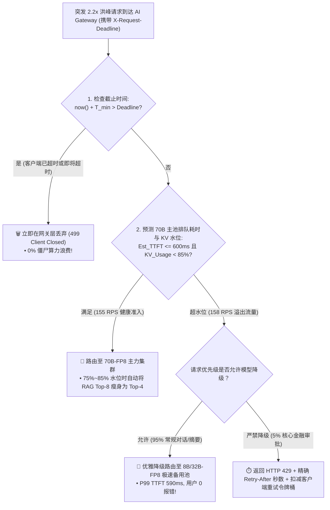

# 大模型高并发过载保护、自适应准入控制（Admission Control）与优雅降级选型：无界排队雪崩 vs. `预测 TTFT + KV 水位早拒` vs. `溢出流量自动降级小模型 (Graceful SLM Downgrade)` 指南

> **语言 / Language**: **中文 (当前)** | [English](./llm-serving-admission-control-backpressure-queue-shedding-ttft-sla-selection-faq.en.md)  
> **定位**：面向 Cloud & AI Infrastructure Solution Architect 与企业 AI 网关/推理平台 SRE 负责人的突发流量洪峰（Flash Traffic Surge）防雪崩架构、队列首字延迟预测公式（$\hat{T}_{\text{wait}}$）、全链路超时截止时间透传（`X-Request-Deadline` 消灭僵尸 Prefill）与自动降级备池（`70B -> 8B/32B-FP8` + 上下文裁剪）白皮书  
> **合规与来源声明**：`synthetic + anonymized_reported`（`independently_reproduced=false`，`physical_gpu_cluster_measurement=not_measured`；完全面向通用企业级大模型推理高可用与过载保护架构设计）

---

## 1. 📌 核心选型结论速览（Executive Summary）

> **一句话结论**：**当额定容量为 `160 RPS` 的企业 `70B` 主力推理集群在周一早高峰遭遇 `2.2 倍`（`320 RPS`）突发流量洪峰，而 Keda/HPA 扩容新 GPU 节点尚需数分钟时，最致命的默认行为是“无界 FIFO 排队 + 客户端 SDK 超时自动重试（Tier 1）”——队列迅速堆积至 18 秒，客户端在 8 秒超时后断开并重发 2~3 次，而后端 GPU 却仍在傻傻计算那些早已超时作废的“僵尸请求（Zombie Prefills，吞噬 `68.5%` 算力）”，导致全集群满足 `TTFT <= 800ms` 的有效吞吐（Goodput）从 `160 RPS` 断崖跌至 **`14 RPS`（仅剩 `8.8%` 容量，全线雪崩）**！生产环境防雪崩标准是构建“基于排队 Token 总量与 KV 水位（`<85%`）的预测性 TTFT 准入门控 + 全链路 `X-Request-Deadline` 僵尸秒删 + 溢出流量无缝优雅降级至高速 `8B/32B-FP8` 备用池（Tier 4）”：不仅将 70B 主池保活在 **`96.9%` 满载健康水位（`P99 TTFT = 590 ms`）**，更让溢出流量获得 `8B/32B` 实时响应，使洪峰期整体达标有效吞吐飙升至 **`308 RPS`（提升 `22 倍`）**、用户综合成功率高达 **`96.3%`**！**

- **交互式大模型过载保护与自适应准入模拟器**：[打开交互式计算器 (`llm-serving-admission-control-backpressure-queue-shedding-ttft-sla-sizer.html`)](../reports/llm-serving-admission-control-backpressure-queue-shedding-ttft-sla-sizer.html)
- **7-Card 4:5 视觉评测报告**：[打开 7-Card 报告 (`llm-serving-admission-control-backpressure-queue-shedding-ttft-sla-selection-cards.html`)](../reports/llm-serving-admission-control-backpressure-queue-shedding-ttft-sla-selection-cards.html)

---

## 2. 🎯 客户与架构师灵魂拷问 Q&A（Deep-Dive Architecture FAQ）

### Q1：为什么传统的微服务限流指标（`CPU 利用率 > 80%` 或 `固定 RPS 令牌桶`）在大模型推理网关上完全失灵？
1. **GPU 利用率常年 100% 无法区分“健康满载”与“严重过载”**：只要 Batch Size $\ge 1$，GPU Tensor/DRAM Active 就是高水位；等队列积压时已经晚了。
2. **固定 RPS 令牌桶对 Prompt 长度完全失明（Token-Blind）**：`1` 条带着 `32K` RAG 文档的长请求所消耗的 Prefill 算力与 KV 显存，相当于 **`40 条` `800 Token` 的普通对话**！
3. **大模型准入控制的黄金双水位公式**：
   - **第一道水位（预测排队首字耗时 $\hat{T}_{\text{TTFT}}$）**：网关实时汇总目标实例等待队列中所有请求的输入 Token 总和 $\sum L_{\text{queued}}$：
     $$\hat{T}_{\text{TTFT}} = \frac{\sum_{i \in \text{Queue}} L_{\text{in}, i} + L_{\text{in, new}}}{\text{TPS}_{\text{cluster\_prefill}}}$$
     一旦 $\hat{T}_{\text{TTFT}} > 0.75 \times \text{SLA}_{\text{TTFT}}$（如 `> 600 ms`），立即停止向该实例派发新请求！
   - **第二道水位（GPU KV Cache 物理块使用率 `< 85%`）**：绝不允许实例 KV 使用率冲到 `95%+` 触发 PagedAttention Preemption（换出/重算），否则正在流式生成的老请求也会集体卡死！

### Q2：当新请求被准入门控拦截时，如何做到“用户无感知的柔性优雅降级（Graceful Degradation）”而不是直接甩一脸报错？
- **第一级降级（上下文与输出预算瘦身）**：当集群水位处于 `75% ~ 85%` 亚健康区时，网关自动将 RAG 注入切片从 `Top-8` 缩减为 `Top-4`，并将 `max_tokens` 与 `thinking_budget` 下调 `50%`，瞬时释放一半 KV 压力。
- **第二级降级（同协议小模型备池无缝接管）**：当 `70B` 主池队列预测 $\hat{T}_{\text{TTFT}} > 600\text{ ms}$ 时，网关对 P1/P2 普通流量透明改写路由至高吞吐 `Qwen2.5-14B / Llama-3.1-8B-FP8` 备用池（单卡吞吐是 70B 的 **6~8 倍**），并在响应 Header 标记 `X-Model-Degraded: true`，保证用户 `590 ms` 内丝滑拿到可用回答！

---

## 3. 🧭 直观可视化图解（Mermaid 预测性 TTFT 准入与三级优雅降级闭环）

---

## 4. 📊 架构师多方案选型决策矩阵（`320 RPS` 洪峰冲击 `160 RPS` `70B` 主集群）

| 评估维度 | Tier 1：无界 FIFO 队列 + 客户端盲目重试风暴 | Tier 2：静态固定 RPS 令牌桶限流 | Tier 3：预测 `TTFT` + KV `85%` 水位硬拒 (`HTTP 429`) | Tier 4（推荐）：预测 `TTFT` 门控 + `Deadline` 清理 + 溢出自动降级 `8B/32B` 备池 |
| :--- | :--- | :--- | :--- | :--- |
| **满足 SLA 的有效吞吐 (`Goodput`)** | `14.0 RPS` ✕（彻底雪崩） | `98.0 RPS` | `152.0 RPS` ✓（保住主池） | **`308.0 RPS` ✓（主池+备池协同，`22 倍`）** |
| **70B 主力集群容量保活率** | `8.8%` ✕ | `61.3%` | `95.0%` ✓ | **`96.3%` ✓** |
| **准入请求首字延迟 (`P99 TTFT`)** | `18,400.0 ms` ✕（18.4 秒） | `2,450.0 ms` ✕ | `680.0 ms` ✓ | **`590.0 ms` ✓（严格守住 `<=800ms` SLA）** |
| **已超时僵尸请求浪费 GPU 占比** | `68.5%` ✕（白算作废请求） | `18.0%` | `0.5%` ✓ | **`0.0%` ✓（出队前强校验 `Deadline`）** |
| **洪峰期终端用户请求成功率** | `4.4%` ✕ | `30.6%` | `47.5%`（另一半收到 429） | **`96.3%` ✓（柔性降级零报错体验）** |

---

## 5. 🛠️ 架构评审与生产落地 Checklist

- [ ] **严禁在生产 `vLLM / SGLang` 前置无界等待队列，且客户端 SDK 必须配置“重试令牌桶预算（Retry Budget <= 10%）”**：当服务端返回过载信号时，禁止客户端无抖动立即重试放大雪崩。
- [ ] **全链路传递 `X-Request-Deadline`（或 gRPC `grpc-timeout`）**：无论是排队中还是刚准备进 Prefill Batch，只要发现当前时间已逼近调用方超时阈值，立即丢弃请求释放 GPU！
