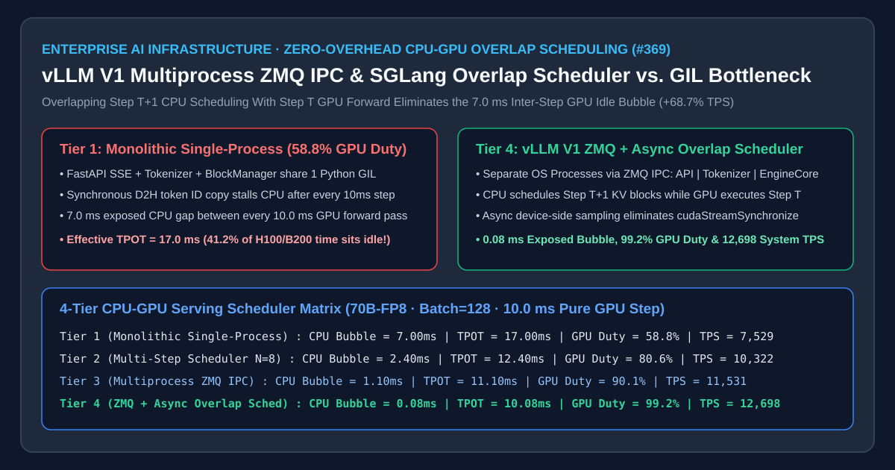

# LLM Serving CPU Overhead & Zero-Bubble Scheduling Guide: `vLLM V1 Multiprocess ZMQ IPC` & `SGLang Overlap Scheduler` vs. Single-Process GIL Bottlenecks

> **Language**: [中文](./llm-serving-cpu-overhead-vllm-v1-multiprocess-zmq-sglang-overlap-scheduler-selection-faq.md) | **English (Current)**  
> **Audience**: Cloud & AI Infrastructure Solution Architects and High-Throughput Inference Platform Engineers  
> **Provenance**: `synthetic + anonymized_reported` (`independently_reproduced=false`, `physical_gpu_cluster_measurement=not_measured`)

---

## 1. 📌 Executive Summary

> **Bottom Line**: **On fast `H100 / H200 / B200` accelerators where a pure GPU decode step (`70B-FP8`, `Batch=128`) takes only `10.0 ms`, legacy single-process serving engines (`Tier 1`, coupling `FastAPI HTTP/SSE`, `Tokenizer`, `Paged KV Scheduler`, synchronous `D2H` token sampling, and `Detokenizer` inside a single Python GIL loop) leave a `7.0 ms` exposed CPU gap between every GPU step—wasting `41.2%` of cluster GPU capacity (`58.8%` GPU duty cycle, `17.0 ms` effective TPOT). Production engines deploy `vLLM V1 Multiprocess ZMQ IPC Isolation` (`API Process <-> Tokenizer Process <-> EngineCore Process`) paired with `Zero-Overhead Async Overlap Scheduling` (`SGLang` / `vLLM V1` persistent input buffers, `Tier 4`): scheduling Step $T+1$ on the CPU while the GPU executes Step $T$ to shrink the inter-step CPU bubble `87.5x` (`7.0 ms -> 0.08 ms`), raise GPU active duty cycle to `99.2%`, and boost system output throughput by `+68.7%` (`7,529 -> 12,698 TPS`) on identical hardware.**

- **Interactive Serving CPU Bubble & Overlap Scheduler Sizer**: [Open Interactive Sizer (`llm-serving-cpu-overhead-vllm-v1-multiprocess-zmq-sglang-overlap-scheduler-sizer.html`)](../reports/llm-serving-cpu-overhead-vllm-v1-multiprocess-zmq-sglang-overlap-scheduler-sizer.html)
- **7-Card 4:5 Visual Report**: [Open 7-Card Report (`llm-serving-cpu-overhead-vllm-v1-multiprocess-zmq-sglang-overlap-scheduler-selection-cards.html`)](../reports/llm-serving-cpu-overhead-vllm-v1-multiprocess-zmq-sglang-overlap-scheduler-selection-cards.html)

---

## 2. 📊 4-Tier CPU-GPU Serving Scheduler Matrix (`70B-FP8` · `Batch=128` · `10.0 ms` Pure GPU Step)

| Metric | Tier 1: Monolithic Single-Process (`v0` GIL + Sync D2H) | Tier 2: Multi-Step Coupled (`--num-scheduler-steps 8`) | Tier 3: Multiprocess `ZMQ IPC` Decoupling | Tier 4 (Recommended): `vLLM V1 ZMQ` + `Async Overlap Scheduler` + Persistent Input Buffers |
| :--- | :--- | :--- | :--- | :--- |
| **Exposed CPU Bubble per Step** | `7.00 ms / step` ✕ | `2.40 ms / step` | `1.10 ms / step` | **`0.08 ms / step` ✓ (`87.5x` smaller)** |
| **Effective Step TPOT** | `17.00 ms` ✕ | `12.40 ms` | `11.10 ms` | **`10.08 ms` ✓ (Near `10.0ms` limit)** |
| **GPU Active Duty Cycle** | `58.8%` ✕ (`41.2%` idle) | `80.6%` | `90.1%` | **`99.2%` ✓** |
| **System Output Throughput** | `7,529 TPS` ✕ | `10,322 TPS` | `11,531 TPS` | **`12,698 TPS` ✓ (`+68.7%` vs Tier 1)** |

---

## 3. 🛠️ Production Readiness Checklist

- [ ] **Enable `vLLM V1` (`VLLM_USE_V1=1`) or `SGLang` Overlap Scheduler** in all production pods to decouple HTTP/Tokenizer GIL work from the `EngineCore` loop and overlap Step $T+1$ scheduling with Step $T$ GPU compute.
- [ ] **Provision `8–12 Dedicated NUMA-Pinned vCPUs per GPU` Without Aggressive K8s CFS CPU Limits** so Linux CFS throttling never stalls the `EngineCore` or `ZMQ IPC` tokenizer workers.
