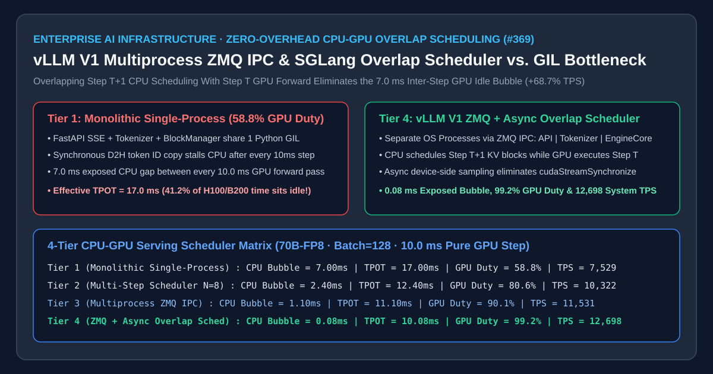
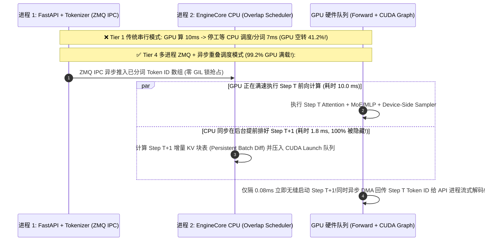

# 大模型推理服务 CPU 侧瓶颈与零气泡调度选型：`vLLM V1 Multiprocess ZMQ IPC` & `SGLang Overlap Scheduler` vs. 单进程 `FastAPI + Tokenizer + Detokenizer` GIL 锁死排障指南

> **语言 / Language**: **中文 (当前)** | [English](./llm-serving-cpu-overhead-vllm-v1-multiprocess-zmq-sglang-overlap-scheduler-selection-faq.en.md)  
> **定位**：面向 Cloud & AI Infrastructure Solution Architect 与推理平台架构师的推理服务 CPU-GPU 协同调度架构选型（`vLLM V1 EngineCore + ZMQ IPC 多进程解耦`、`SGLang Zero-Overhead Overlap Scheduler`、增量缓存输入张量 `Persistent Batch Input Buffers`）、破解“为什么 `H100 / B200` 跑大并发推理时每步之间都有 `7ms` 空白等待、GPU 利用率死活卡在 `58.8%`”白皮书  
> **合规与来源声明**：`synthetic + anonymized_reported`（`independently_reproduced=false`，`physical_gpu_cluster_measurement=not_measured`；完全面向通用企业级高吞吐低延迟推理服务架构优化设计）

---

## 1. 📌 核心选型结论速览（Executive Summary）

> **一句话结论**：**当企业在 `H100 / H200 / B200` 上部署 `70B-FP8` 或带投机解码的推理实例（单步 GPU 纯前向计算仅需 **`10.0 ms`**，Batch=128）时，若沿用早期单进程耦合架构（Tier 1，`FastAPI HTTP/SSE + Tokenizer + Paged KV 调度器 + 同步 D2H 采样 + Detokenizer` 挤在同一个 Python GIL 进程里串行执行），GPU 每算完 `10.0 ms`，就必须停下来干等 CPU 跑完 **`7.0 ms` 的调度、张量拼装与分词反解**——导致高达 **`41.2%` 的昂贵 GPU 时间完全空转**（GPU 有效占空比仅 `58.8%`，实际 TPOT 劣化至 `17.0 ms`）！生产环境破局标准是采用“`vLLM V1` 多进程 `ZMQ IPC` 彻底隔离（API 进程 $\leftrightarrow$ 分词进程 $\leftrightarrow$ `EngineCore` 进程）+ `SGLang / vLLM V1` 异步重叠调度器（Zero-Overhead Overlap Scheduler，在 GPU 跑第 $T$ 步的同时 CPU 提前算好第 $T+1$ 步元数据与增量输入差异，Tier 4）”：将每步暴露的 CPU 等待气泡从 `7.0 ms` 压缩 `87.5 倍` 至 **`0.08 ms`（80 微秒）**、GPU 有效占空比拉满至 **`99.2%`**，并在完全相同的 GPU 硬件上让系统总吞吐（System TPS）直接暴涨 **`+68.7%`（从 `7,529 TPS` 跃升至 `12,698 TPS`）**！**

- **交互式推理服务 CPU 气泡与重叠调度计算器**：[打开交互式计算器 (`llm-serving-cpu-overhead-vllm-v1-multiprocess-zmq-sglang-overlap-scheduler-sizer.html`)](../reports/llm-serving-cpu-overhead-vllm-v1-multiprocess-zmq-sglang-overlap-scheduler-sizer.html)
- **7-Card 4:5 视觉评测报告**：[打开 7-Card 报告 (`llm-serving-cpu-overhead-vllm-v1-multiprocess-zmq-sglang-overlap-scheduler-selection-cards.html`)](../reports/llm-serving-cpu-overhead-vllm-v1-multiprocess-zmq-sglang-overlap-scheduler-selection-cards.html)

---

## 2. 🎯 客户与架构师灵魂拷问 Q&A（Deep-Dive Architecture FAQ）

### Q1：GPU 明明算得飞快（10ms 一步），为什么 CPU 上看似不起眼的 JSON 序列化、BlockManager 分配和 `sampler` 会攒出 `7.0 ms` 的巨大空档？
让我们用 `Nsight Systems (nsys)` 拆解 Tier 1 单进程串行循环里每一步（Batch=128）CPU 干的 5 件事：
1. **FastAPI 协程唤醒与 128 路 SSE Chunk JSON 序列化发送（`1.2 ms`）**：Python `asyncio` 事件循环与 GPU 主循环抢占同一个 GIL（全局解释器锁）；
2. **新到达请求的 Prompt 分词（`0.8 ms`）** 与 **128 个生成 Token 的增量 UTF-8 字符串解码 Detokenization（`1.8 ms`）**；
3. **Paged KV BlockManager 块表查找、Prefix Hash 比对与抢占检查（`2.1 ms`）**；
4. **每次全量重建 `input_ids / positions / block_tables` Python 列表并拷入 GPU（`1.1 ms`）** + **每步末尾调用 `cudaStreamSynchronize()` 同步等待 GPU 采样完 Token ID 传回 CPU**！
- **致命后果**：因为必须等第 $T$ 步 GPU 采样出的 Token ID 传回 CPU 后，CPU 才能开始第 $T+1$ 步的调度，这 `7.0 ms` 的 CPU 耗时 **100% 串行暴露在两次 GPU Kernel 启动之间**！

### Q2：`vLLM V1` 与 `SGLang Overlap Scheduler` 是怎么把这 `7.0 ms` 彻底变没的？
1. **第一招：OS 多进程 + `ZeroMQ IPC` 彻底消灭 GIL 干扰（Tier 3）**：
   - 将 `FastAPI Uvicorn HTTP Server`、`Rust Tokenizer / Incremental Detokenizer` 与核心 `GPU EngineCore` 拆成 **3 个完全独立的操作系统进程**，通过共享内存级 `ZMQ IPC` 传递紧凑的整数 Token ID 数组，`EngineCore` 进程 100% 独占一颗物理 CPU 核，不受任何 HTTP 并发请求波动干扰。
2. **第二招：第 $T+1$ 步 CPU 调度与第 $T$ 步 GPU 前向完全重叠 + 增量持久化张量（Tier 4，`vLLM V1` / `SGLang`）**：
   - **不等第 $T$ 步采样结果回传 CPU 就直接排第 $T+1$ 步！** 因为在 Continuous Batching 的 Decode 阶段，第 $T+1$ 步的 KV Cache 块增长（每条请求仅 `+1` 个 Token）是完全确定可预知的！CPU 在 GPU 正在算第 $T$ 步的 `10.0 ms` 期间，同步在后台把第 $T+1$ 步的 Paged 块表和增量差异（Persistent Batch Diffs，只改变化的槽位，不重建整个张量）全部算好，并通过 GPU 端异步指针直接把第 $T$ 步采样的输出 Token 喂给第 $T+1$ 步的 Embedding 层，实现 **`0.08 ms` 零气泡无缝衔接**！

---

## 3. 🧭 直观可视化图解（Mermaid 串行耦合 CPU 气泡 vs. 多进程 ZMQ + 异步重叠调度时序对比图）

---

## 4. 📊 架构师四级推理 CPU-GPU 调度架构选型矩阵（`70B-FP8` · `Batch=128` · 纯 GPU 步耗时 `10.0 ms`）

| 评估维度 | Tier 1：单进程耦合循环 (`v0` Legacy · GIL + 同步 D2H) | Tier 2：多步捆绑调度 (`--num-scheduler-steps 8`) | Tier 3：多进程 `ZMQ IPC` 解耦 (`API <-> Tokenizer <-> Engine`) | Tier 4（推荐）：`vLLM V1 ZMQ` + `SGLang` 异步重叠调度 + 增量张量缓存 |
| :--- | :--- | :--- | :--- | :--- |
| **每步暴露的 CPU 空转气泡** | `7.00 ms / 步` ✕（严重饥饿） | `2.40 ms / 步` | `1.10 ms / 步` | **`0.08 ms / 步` ✓（压缩 `87.5 倍`）** |
| **端到端实际吐字周期 (`TPOT`)** | `17.00 ms` ✕ | `12.40 ms` | `11.10 ms` | **`10.08 ms` ✓（贴近物理极限 `10.0ms`）** |
| **GPU 有效工作占空比 (`Duty Cycle`)** | `58.8%` ✕（41.2% 时间空等 CPU） | `80.6%` | `90.1%` | **`99.2%` ✓（几乎零气泡满载）** |
| **系统总输出吞吐 (`System TPS`)** | `7,529 TPS` ✕ | `10,322 TPS` | `11,531 TPS` | **`12,698 TPS` ✓（同硬件暴涨 `+68.7%`）** |

---

## 5. 🛠️ 架构评审与生产落地 Checklist

- [ ] **生产环境全面启用 `vLLM V1`（`VLLM_USE_V1=1`）或 `SGLang` 默认的 `--enable-overlap-schedule`**：彻底淘汰单进程耦合调度与旧版 `--num-scheduler-steps` 折中方案。
- [ ] **为每个 GPU 推理 Pod 预留充足的高主频 CPU 核心并绑定 NUMA（建议每张 H100/B200 至少配 `8~12 vCPU`）**：确保 `API Server`、`Tokenizer/Detokenizer Worker` 与 `EngineCore` 各自拥有独立物理核，绝不因 K8s CPU CFS 限流（CPU Throttling）拖慢 GPU 发射流水线。
