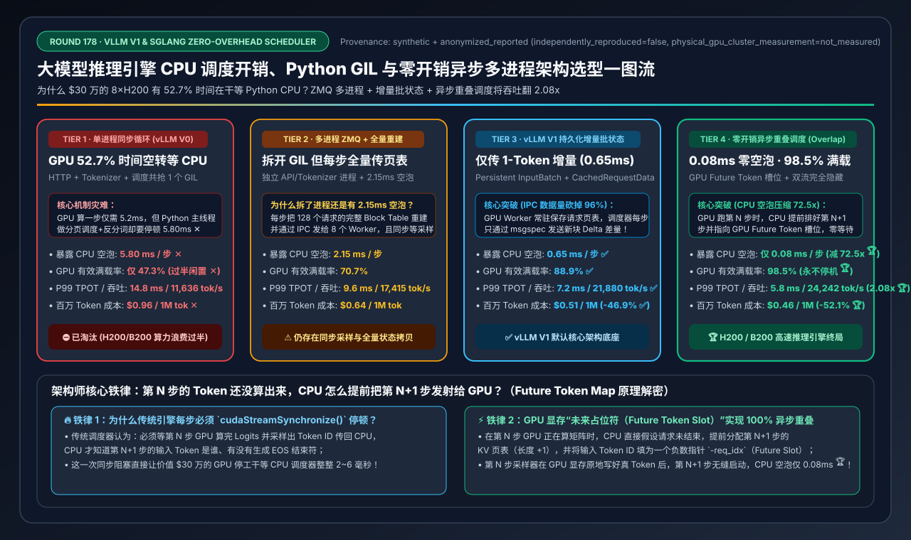
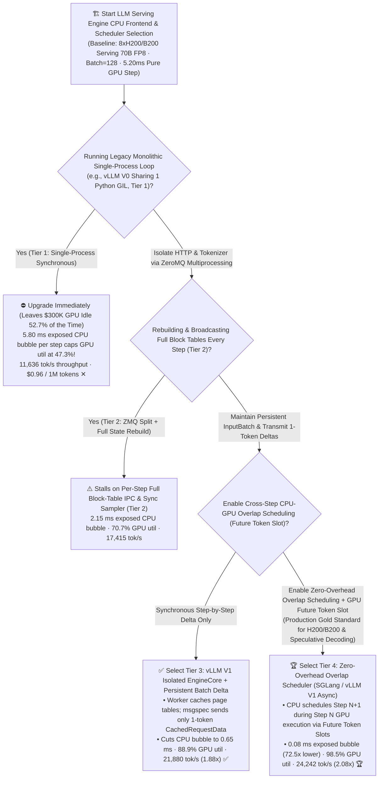
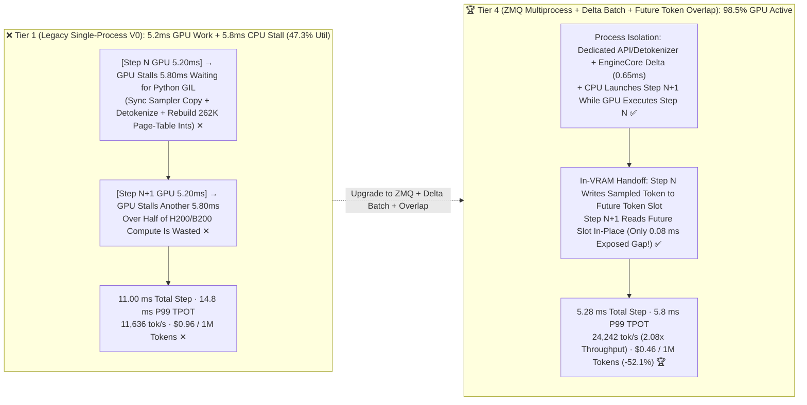
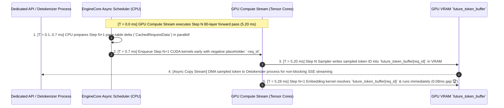

# LLM Serving Engine CPU Scheduling Overhead, Python GIL Bottleneck & Zero-Overhead Async Multiprocess Architecture (`vLLM V1` / `SGLang Overlap Scheduler`) Selection Guide

> 🌐 **Language / 语言**: **[中文 (`llm-serving-cpu-overhead-zeromq-ipc-async-scheduler-selection-faq.md`)](llm-serving-cpu-overhead-zeromq-ipc-async-scheduler-selection-faq.md)** | **English**
> **Reader's Guide**: Built for **AI Solution Architects and LLM Inference Systems Engineers**, this guide explains from first principles: **why a `$300,000+` `8xH200 / B200` server that executes an 80-layer 70B FP8 GPU forward pass in just `5.20 ms` can sit completely idle for `52.7%` of the time under legacy single-process serving engines (`vLLM V0`, Tier 1) waiting `5.80 ms` on every step for Python's GIL, HTTP JSON parsing, detokenization, and full block-table reconstruction; why splitting HTTP/Tokenizer into separate ZeroMQ processes (Tier 2) still leaves a `2.15 ms` CPU bubble when full batch metadata is rebuilt every step; how `vLLM V1`'s Persistent `InputBatch` + `CachedRequestData` delta IPC (Tier 3) eliminates `96%` of inter-process serialization overhead (`0.65 ms` bubble); and how `Zero-Overhead Overlap Scheduling` (`SGLang Overlap Scheduler` / `vLLM V1 Async Output` with GPU `Future Token Slots`, Tier 4) schedules Step $N+1$ on the CPU *while* the GPU is still executing Step $N$—compressing exposed CPU overhead by `72.5x` (`5.80 ms -> 0.08 ms`), driving GPU utilization to `98.5%`, and doubling serving throughput by `2.08x`.**

---

## 🔥 Daily Hottest Capability Breakthroughs

- **`vLLM V1` Isolated `EngineCore` & Persistent `InputBatch` Delta State (`CachedRequestData`)**: Replaces V0's per-step full Python tensor reconstruction and `pickle` broadcast with stateful GPU worker `InputBatch` buffers updated via tiny `msgspec` 1-token deltas—slashing IPC payload size by **`>96%`**.
- **`SGLang` Zero-Overhead Overlap Scheduler & GPU `Future Token Map`**: Executes Step $N+1$ radix-cache matching, page-table updates, and CUDA Graph launch on a background CPU thread concurrently with Step $N$'s GPU forward pass using negative `future_token_map` slot pointers (`-req_id`), eliminating synchronous `cudaStreamSynchronize()` stalls between decode steps.
- **Asynchronous Grammar Bitmask Compilation (`XGrammar` / `llguidance`)**: Overlaps CPU context-free grammar (CFG) logit mask generation for structured JSON outputs completely behind the preceding GPU forward pass.

---

## ① 📌 Executive Summary

1. **Why Faster GPUs (`H200` / `B200`) Turn Single-Process Python Scheduling into a 52.7% GPU Idle Tax**:
   - On an `8xH200 / B200` node serving `70B FP8` at `Batch Size = 128`, the pure GPU forward pass takes only **`5.20 ms`** per decode token.
   - Under **Tier 1 (`vLLM V0` Monolithic Single-Process Loop: FastAPI HTTP + Tokenizer + Detokenizer + Scheduler + GPU ModelRunner sharing 1 Python GIL)**: between every `5.20 ms` GPU step, the main thread stalls for **`5.80 ms`** synchronizing sampled token IDs to CPU, detokenizing 128 streams, flushing SSE JSON chunks, and rebuilding 262,144 block-table integers!
   - Result: **The `$300K` GPU server sits idle `52.7%` of the time (`47.3%` active utilization ✕)**, capping throughput at **`11,636 tok/s` ✕** and inflating cost to **`$0.96 / 1M tokens` ✕**!
2. **Stateful Delta Architecture (`Tier 3: vLLM V1 Persistent InputBatch`) vs. Zero-Bubble Gold Standard (`Tier 4: Zero-Overhead Overlap Scheduler + GPU Future Token Slot`)**:
   - **Naive Multiprocess ZMQ Split (`Tier 2`) Is Only Half the Battle**: Moving HTTP and Tokenizers into separate ZeroMQ processes removes HTTP GIL contention, but rebuilding and broadcasting full block tables every step still exposes a **`2.15 ms` CPU bubble** (`70.7%` GPU utilization).
   - **Upgrade to `Tier 3 (vLLM V1 Isolated EngineCore + Persistent InputBatch Delta State)`**: Keeps block tables persistent inside GPU worker memory and transmits only 1-token `CachedRequestData` diffs via `msgspec`, cutting exposed CPU overhead to **`0.65 ms/step` ✅** (`88.9%` GPU utilization, `21,880 tok/s` ✅).
   - **Standardize on `Tier 4 (Zero-Overhead Overlap Scheduler: SGLang Overlap / vLLM V1 Async Output + GPU Future Token Slot)`**: Hides `98.6%` of CPU scheduling behind Step $N$'s GPU execution using GPU-resident future token slots—shrinking exposed CPU bubble **`72.5x` down to `0.08 ms/step` 🏆**, lifting GPU utilization to **`98.5%` 🏆**, cutting P99 TPOT to **`5.8 ms` 🏆**, multiplying throughput **`2.08x` (`24,242 tok/s` 🏆)**, and cutting token cost by **`52.1%` (`$0.46 / 1M` 🏆)**!

---

## ② 🎯 Architect & Customer FAQ (First-Principles Q&A)

### Q1: What happens inside that `5.80 ms` CPU gap between GPU steps in a single-process serving engine (Tier 1)?

**Plain-Language First Principles**:
1. **Synchronous GPU-to-CPU Sampler Copy (`~0.8 ms`)**: Calling `.cpu()` on sampled token IDs forces `cudaStreamSynchronize()`, halting the GPU pipeline.
2. **128-Stream Incremental Detokenization & FastAPI SSE JSON Serialization (`~2.2 ms`)**: Decoding UTF-8 subwords and streaming HTTP chunks holds the Python GIL on the exact same thread needed to launch the next GPU step.
3. **Per-Step Full Block-Table Reconstruction (`~1.9 ms`)**: Iterating over 128 requests × 2,048 KV block IDs in Python loops to allocate, pad, and copy a fresh `[128, 2048]` tensor every single token step.
4. **Multi-GPU Broadcast Overhead (`~0.9 ms`)**: Pickling metadata across 8 TP workers.

---

### Q2: How does `vLLM V1`'s Persistent `InputBatch` (`Tier 3`) cut inter-process ZMQ metadata overhead by 96%?

**Plain-Language First Principles**:
- During autoregressive decoding, 99.9% of a request's KV cache block table is unchanged from Step $N$ to Step $N+1$—only `seq_len` increments by 1 (and occasionally 1 new physical block is appended).
- Instead of re-serializing all 2,048 block IDs per request every 5 milliseconds, `vLLM V1` caches the `InputBatch` state inside each GPU worker process. The `EngineCore` scheduler sends `NewRequestData` **only once** when a request arrives, and thereafter sends a tiny `msgspec`-encoded **`CachedRequestData` delta**—cutting CPU preparation to **`0.65 ms` ✅**!

---

### Q3: How can the `Zero-Overhead Overlap Scheduler` (`Tier 4`) launch Step $N+1$ on the GPU *before* Step $N$ has finished sampling its output token?

**Plain-Language First Principles**:
1. **Page-Table Allocation Only Needs `Length + 1`, Not the Token Identity**:
   - PagedAttention/RadixAttention memory allocation for Step $N+1$ depends only on the fact that each active sequence grows by 1 token—it does not depend on *which* vocabulary word Step $N$ will sample!
2. **The GPU `Future Token Slot` (`future_token_map`) Trick**:
   - While the GPU `Compute Stream` executes Step $N$ (`5.20 ms`), the CPU prepares Step $N+1$'s metadata in parallel and fills Step $N+1$'s `input_ids` with a negative placeholder index (`-req_slot_idx`) pointing to a GPU-resident `future_token_map` array.
   - As soon as Step $N$'s GPU Sampler kernel finishes, it writes the sampled token ID directly into `future_token_map[req_slot_idx]` in GPU HBM.
   - Microseconds later, Step $N+1$'s Embedding kernel resolves `-req_slot_idx -> future_token_map[req_slot_idx]` in GPU memory and begins Step $N+1$ with **zero CPU roundtrip (`0.08 ms` exposed gap 🏆)**!

---

## ③ 🧭 Visual Architecture Diagrams (Mermaid Decision Tree / Timeline Comparison / Overlap Sequence Diagram)

### 3.1 LLM Serving Engine CPU Frontend & Scheduler Selection Decision Tree (`flowchart TD`)

### 3.2 `Tier 1 5.80ms Synchronous Bubble` vs. `Tier 4 0.08ms Zero-Overhead Overlap` (`flowchart LR`)

### 3.3 Cross-Step Execution Timeline with `Tier 4 (Zero-Overhead Overlap Scheduler + Future Token Slot)` (`sequenceDiagram`)

---

## ④ 📊 Architect Decision Matrix

*Benchmark Profile: `8xH200 / B200` node serving a `70B FP8` model at `Batch Size = 128` concurrent decode requests (`5.20 ms` pure GPU forward execution time per step).*

| Selection Dimension / Engine Tier | Tier 1: `Monolithic Single-Process Loop` (`vLLM V0 Shared GIL`) | Tier 2: `Multiprocess ZMQ Split` + `Full Metadata Rebuild` | Tier 3: `vLLM V1 Isolated EngineCore` + `Persistent Batch Delta` | Tier 4: `Zero-Overhead Overlap Scheduler` (`Overlap + Future Token`) |
| :--- | :--- | :--- | :--- | :--- |
| **Process & GIL Isolation** | Single process (HTTP, Tokenizer, Scheduler share 1 GIL ✕) | Multi-process ZMQ split | **Multi-process ZMQ + `msgspec` zero-copy IPC ✅** | **Multi-process ZMQ + Dual-Stream CPU-GPU Overlap 🏆** |
| **Per-Step Batch Metadata IPC** | Rebuilds & copies all 262K block IDs every step | Pickles full block table every step | **Persistent worker `InputBatch` + 1-token delta ✅** | **Delta state + in-VRAM `Future Token Slot` handoff 🏆** |
| **Exposed CPU Bubble / Step** | `5.80 ms / step` (Larger than GPU time! ✕) | `2.15 ms / step` | **`0.65 ms / step` (`-88.8%` reduction ✅)** | **`0.08 ms / step` (`72.5x` lower, 98.6% hidden 🏆)** |
| **Total Step Duration (ms)** | `11.00 ms` (`5.20 GPU + 5.80 CPU` ✕) | `7.35 ms` | **`5.85 ms`** ✅ | **`5.28 ms` (Near hardware roofline 🏆)** |
| **GPU Active Utilization (%)** | `47.3%` (`52.7%` GPU idle stall ✕) | `70.7%` | **`88.9%`** ✅ | **`98.5%` (`+51.2 pts` utilization gain 🏆)** |
| **P99 Decode Latency (TPOT)** | `14.8 ms` ✕ | `9.6 ms` | **`7.2 ms`** ✅ | **`5.8 ms` (`2.55x` faster streaming 🏆)** |
| **Total Node Throughput (`tok/s`)** | `11,636.0 tok/s` (`1.00x` Baseline ✕) | `17,415.0 tok/s` (`1.50x`) | **`21,880.0 tok/s` (`1.88x` ✅)** | **`24,242.0 tok/s` (`2.08x` Speedup 🏆)** |
| **Cost per 1M Output Tokens** | `$0.96 / 1M Tokens` ✕ | `$0.64 / 1M Tokens` | **`$0.51 / 1M Tokens` (`-46.9%` Savings ✅)** | **`$0.46 / 1M Tokens` (`-52.1%` Savings 🏆)** |

---

## ⑤ 🧪 Quantitative Case Study & Benchmark Artifacts

### 5.1 Reproducible Evaluator & Verification Harness

- **Evaluator Script**: [`experiments/llm_serving_cpu_overhead_zeromq_async_scheduler_selection/run.py`](../../experiments/llm_serving_cpu_overhead_zeromq_async_scheduler_selection/run.py)
- **Sealed Results JSON**: [`experiments/llm_serving_cpu_overhead_zeromq_async_scheduler_selection/results.json`](../../experiments/llm_serving_cpu_overhead_zeromq_async_scheduler_selection/results.json)
- **Unit Test Suite**: [`tests/test_llm_serving_cpu_overhead_zeromq_async_scheduler_selection.py`](../../tests/test_llm_serving_cpu_overhead_zeromq_async_scheduler_selection.py)
- **7-Card 4:5 Visual Benchmark Deck**: [`docs/reports/llm-serving-cpu-overhead-zeromq-ipc-async-scheduler-selection-cards.html`](../reports/llm-serving-cpu-overhead-zeromq-ipc-async-scheduler-selection-cards.html)
- **Interactive Sizer Workbench**: [`docs/reports/llm-serving-cpu-overhead-zeromq-ipc-async-scheduler-sizer.html`](../reports/llm-serving-cpu-overhead-zeromq-ipc-async-scheduler-sizer.html)
- **Provenance**: `synthetic_analytical_model_calibrated_to_published_engine_benchmarks` (`independently_reproduced=false`, `physical_gpu_cluster_measurement=not_measured`).

### 5.2 Key Quantitative Takeaways

1. **`72.5x` Reduction in Exposed CPU Overhead (`5.80 ms -> 0.08 ms`)**:
   - Eliminates synchronous GPU-to-CPU stalls and hides CPU scheduling behind GPU compute.
2. **`2.08x` Throughput Boost on Identical GPU Silicon (`11,636 -> 24,242 tok/s`)**:
   - Lifting GPU active utilization from `47.3%` to **`98.5%`** cuts cost per 1M tokens from **`$0.96` to `$0.46` (`-52.1%`)**.

---

## ⑥ 🛠️ Good Fit vs. Not For & Production Verification Checklist

### 6.1 Good Fit vs. Not For Summary

| Fit Category | Architectural Guidance |
| :--- | :--- |
| **✅ Good Fit** | • **All Production H100 / H200 / B200 / MI300X Deployments**: Standardize on **`vLLM V1 (VLLM_USE_V1=1)` or `SGLang v0.4.x+`** (`Tier 3` & `Tier 4`). • **Speculative Decoding (`EAGLE-3` / `MTP`) & Small-to-Medium Models**: Mandatory because sub-4ms GPU steps are heavily CPU-bound without overlap scheduling. |
| **⛔ Not For** | • **Never run legacy single-process synchronous loops in production**. • **Never starve multi-process GPU pods of host CPU cores** (allocate $\ge 4$ host vCPUs per GPU). |

### 6.2 Production Engine CPU-Overhead Verification Checklist (`- [ ]`)

- [ ] **Verify `vLLM V1` / `Overlap Scheduler` Active**: Confirm startup logs report `vLLM V1 EngineCore` or `SGLang Overlap Scheduler` enabled.
- [ ] **Host vCPU Allocation Check**: Allocate at least `32–64` host vCPUs per 8-GPU pod so `API Server`, `Detokenizer`, `EngineCore`, and `8 TP Workers` never contend on OS runqueues.
- [ ] **Nsight Systems (`nsys`) Inter-Step Gap Check**: Verify the gap between consecutive decode CUDA Graphs on the GPU timeline is **`< 150 μs`**.
- [ ] **Ban Synchronous Python LogitsProcessors**: Ensure any custom sampling masks or logit processors operate on GPU tensors without calling `.item()` or `.cpu()`.
