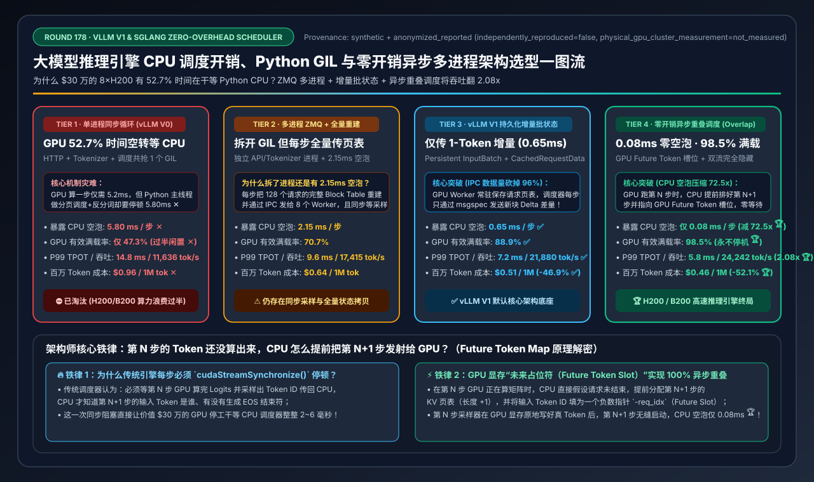
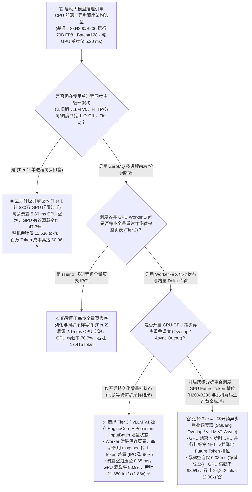
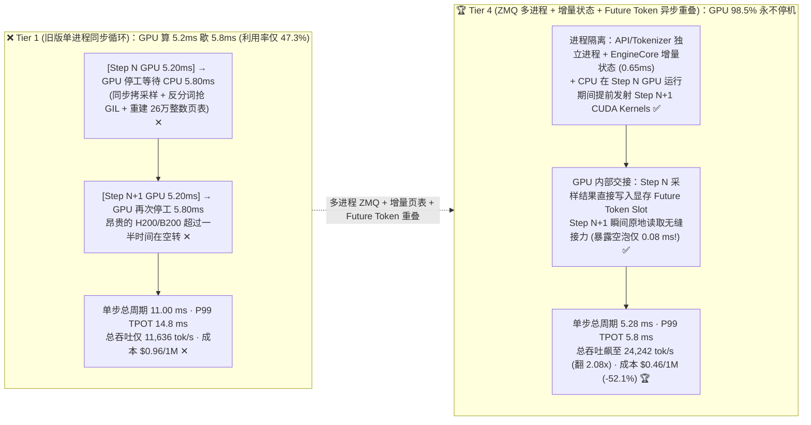
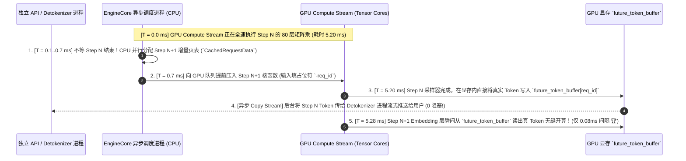

# 大模型推理引擎 CPU 调度开销、Python GIL 锁瓶颈与零开销异步多进程架构（`vLLM V1` / `SGLang Overlap Scheduler`）选型指南

> 🌐 **Language / 语言**: **中文 (Chinese)** | **[English (`llm-serving-cpu-overhead-zeromq-ipc-async-scheduler-selection-faq.en.md`)](llm-serving-cpu-overhead-zeromq-ipc-async-scheduler-selection-faq.en.md)**
> **阅读指南**：本文面向 **AI 解决方案架构师（AI Solution Architect）与大模型推理系统研发负责人**，用通俗大白话 + 第一性原理彻底讲透：**为什么当你花 `$300,000+` 买来最新的 `8×H200 / B200` 服务器运行 70B FP8 大模型时，GPU 算完一步 80 层 Transformer 其实只需要 `5.20 毫秒`，但在早期单进程同步推理引擎（如 `vLLM V0`，Tier 1）里，每两步之间 GPU 竟然要停下来干等 Python 主线程做“HTTP JSON 解析 + 分词/反分词 + 页表调度”整整 `5.80 毫秒`（导致昂贵的 GPU 有 `52.7%` 的时间都在睡大觉）？为什么仅仅把 HTTP/Tokenizer 拆成独立 ZeroMQ 进程（Tier 2）还不够，每步全量广播 128 个请求的 PagedAttention 页表依然会吃掉 `2.15 毫秒`？`vLLM V1` 的“持久化增量批状态（`Persistent InputBatch + CachedRequestData`）”（Tier 3）是如何把跨进程 IPC 数据量砍掉 `96%` 的？以及 `SGLang Overlap Scheduler / vLLM V1 零开销异步重叠调度`（Tier 4）是如何利用神奇的“GPU 未来占位符（`Future Token Slot`）”，在第 $N$ 步的 Token 还没算出来之前就把第 $N+1$ 步提前发射给 GPU，把暴露的 CPU 空泡从 `5.80 ms` 暴力压缩至 `0.08 ms（缩减 72.5 倍）`、让整机吞吐直接翻 `2.08 倍` 的？** 全文零晦涩黑话堆砌，3 分钟看懂选型结论，10 分钟掌握现代推理引擎前端演进精华。

---

## 🔥 业界最新能力突破追踪（Daily Hottest Capability Breakthroughs）

- **`vLLM V1` 架构全面转正（`EngineCore` 独立进程 + `Persistent InputBatch` 增量状态差量传输）**：彻底重写了 V0 时代每步在 Python 里从零拼装数万个 Block ID 列表并通过 Pickle 广播的慢路径；Worker 进程在驻留内存维护持久化 `InputBatch`，调度器每步仅通过 `msgspec` 零拷贝传输新增的 1 个 Token 与新分配的页表增量（`CachedRequestData`），将 CPU 准备开销压缩 **`3x ~ 8x`**。
- **`SGLang` 零开销重叠调度器（`Zero-Overhead Batch Scheduler`）与 `Future Token Map`**：在 GPU 执行第 $N$ 步前向计算的同时，CPU 在后台线程并行完成第 $N+1$ 步的 RadixCache 匹配、页表分配与 CUDA Graph 参数准备，并用负数索引占位符（`-req_id`）指向 GPU 显存中的 `future_token_map`，彻底消灭每步末尾的 `cudaStreamSynchronize()` 同步阻塞，实现 **`98.5%+` GPU 连续满载**。
- **结构化输出（`XGrammar` / `llguidance`）位掩码（Bitmask）与投机解码草稿的 CPU-GPU 异步重叠**：原本在 CPU 上耗时 `0.5~2 ms` 的上下文无关文法（CFG）词表掩码计算，现已完全隐藏在上一轮 GPU 矩阵乘时间窗内并发完成。

---

## ① 📌 核心结论速览（Executive Summary）

1. **为什么 GPU 硬件越快，Python CPU 调度开销就越会成为“吞噬一半算力的隐形杀手”**：
   - 在 A100 跑 FP16 的年代，GPU 算一步 Decode 要 `25 毫秒`，Python CPU 花 `5 毫秒` 准备数据只占 `16%`，大家感觉不到痛。
   - 到了 **H100 / H200 / B200 跑 FP8 / NVFP4（或开启 EAGLE-3 投机解码）** 的时代，GPU 算完一步 70B 模型的全部 80 层矩阵乘只需要 **`5.20 毫秒`**（如果是 8B/14B 模型甚至只需 `2.5 毫秒`）！
   - 如果仍采用 **Tier 1（单进程同步主循环，如早期 `vLLM V0`：FastAPI HTTP 协程 + HuggingFace Tokenizer + PagedAttention 调度器 + GPU ModelRunner 全挤在 1 个 Python 进程里抢同一个 GIL 锁）**：每算完 `5.20 ms` 的 GPU，主线程就要停下来花 **`5.80 ms`** 做同步拷贝采样结果、反分词拼 JSON 字符串、推 SSE 流、再重建下一步的页表张量！**GPU 算 5.2 毫秒、歇 5.8 毫秒，有效利用率跌至惨不忍睹的 `47.3%` ✕**，整机吞吐仅 **`11,636 tok/s` ✕**，每百万 Token 成本高达 **`$0.96` ✕**！
2. **标准生产底座 `Tier 3 (vLLM V1 持久化增量批状态)` vs. 极致满载终局 `Tier 4 (Zero-Overhead 异步重叠调度 + Future Token 槽位)`**：
   - **仅做多进程拆分（Tier 2：ZMQ 拆开 HTTP/Tokenizer，但每步全量重建页表）不够彻底**：虽然消除了 HTTP 与反分词抢占，但每步把 128 个请求的数千个 Block ID 从头打包序列化发给 8 个 GPU Worker 仍需暴露 **`2.15 ms` 空泡**（GPU 利用率 `70.7%`）。
   - **升级至 `Tier 3（vLLM V1 独立 EngineCore + Persistent InputBatch 增量差量传输）`**：GPU Worker 原地保留上一轮的页表数组，调度器每步只传 1-Token 增量（`CachedRequestData`），将暴露 CPU 空泡压至 **`0.65 ms` ✅**，GPU 满载率跃升至 **`88.9%` ✅**，整机吞吐达 **`21,880 tok/s`（提升 `1.88x` ✅）**！
   - **开启 `Tier 4（SGLang Overlap Scheduler / vLLM V1 异步重叠调度 + GPU Future Token 槽位）`**：让 CPU 的 `0.65 ms` 调度工作 **与上一步 GPU 的 `5.20 ms` 计算在时间轴上 100% 异步重叠**！暴露在 GPU 时间线上的 CPU 空泡仅剩 **`0.08 ms`（比 Tier 1 缩小 `72.5 倍` 🏆）**，GPU 有效满载率高达 **`98.5%` 🏆**，P99 TPOT 压至 **`5.8 ms` 🏆**，整机总吞吐飙升至 **`24,242 tok/s`（比 Tier 1 翻了 `2.08 倍` 🏆）**，每百万 Token 成本直降 **`52.1%`（`$0.46 / 1M` 🏆）**！

---

## ② 🎯 客户与架构师灵魂拷问 Q&A（FAQ-Driven）

### Q1：用 Nsight Systems (`nsys`) 剖析单进程推理引擎（Tier 1）时，为什么每两个 GPU Step 之间那 `5.80 毫秒` 的 CPU 空白期会那么长？CPU 到底在忙什么？

**通俗大白话 + 第一性原理解答**：
- **在 Tier 1（单进程同步架构）中，这 `5.80 ms` 的 GPU 停工期被四件串行的 CPU 苦力活塞满了**：
  1. **苦力活一：同步等待 GPU 采样并把 Token ID 拷回 CPU（`~0.8 ms`）**：调用 `sampler_output.cpu()` 触发 `cudaStreamSynchronize()`，把 GPU 刚抽样出的 128 个整数拉回 Python 列表，检查谁遇到了 `EOS` 停止符。
  2. **苦力活二：128 路流式增量反分词（Detokenization）与 SSE JSON 封包（`~2.2 ms`）**：在同一个 Python 进程里，把 128 个新 Token ID 转成 UTF-8 中文字符（还要处理半个多字节 Emoji 的拼接），序列化成 OpenAI 格式的 JSON 字符串并通过 `uvicorn` 发出去——这期间 **Python GIL 全局锁被死死占住**！
  3. **苦力活三：每步从零重建全量 PagedAttention 页表张量（`~1.9 ms`）**：128 个请求，每个请求有 32K 上下文（对应 2,048 个物理块 ID），Python 用 `for` 循环把 $128 \times 2048 = 262,144$ 个整数重新拼成二维 리스트、Padding 对齐、再转成 PyTorch CPU Tensor。
  4. **苦力活四：通过多卡广播发给 8 个 TP Worker 并拷贝上 GPU（`~0.9 ms`）**。
- **结果**：GPU 算完只要 `5.20 ms`，等 Python 干完上面四件事却要 `5.80 ms`——**买来跑矩阵乘的顶级显卡，一半生命都在等单核 Python 跑循环**！

---

### Q2：`vLLM V1` 的“持久化增量批状态（`Persistent InputBatch` & `CachedRequestData`）”（Tier 3）是怎么把每步 `2.15 ms` 的元数据准备砍到 `0.65 ms` 的？

**通俗大白话 + 第一性原理解答**：
- **核心洞察：在连续 Decode 阶段，第 $N+1$ 步的 128 个请求和第 $N$ 步相比，99.9% 的页表数据根本没有任何变化！**
  - 在 `Tier 2` 中，哪怕某个 32K 请求的前 `2,047` 个 KV 物理块号跟上一步完全一样，只是末尾多生成了 1 个词，调度器也会蠢蠢地把全部 `2,048` 个块号重新打包通过 ZeroMQ 发给 8 个 GPU Worker 进程。
  - 在 **`Tier 3 (vLLM V1)`** 中，架构师引入了 **“状態常驻 Worker + 仅传增量（State Diff / Delta IPC）”**：
    1. 8 个 GPU Worker 进程内部各自维护一个持久化的 **`InputBatch`（直接用预分配的 C/NumPy 连续内存与 Pinned Memory 数组保存所有活跃请求的页表）**；
    2. 只有当一个新请求刚进入批次的第一步，调度器才发送一次 `NewRequestData`；
    3. 在随后的几千步 Decode 循环中，调度器每步只发送极轻量级的 **`CachedRequestData`（仅包含本步活跃请求的 ID 列表和极少数刚跨越块边界新分配的 1 个 Block ID）**，并采用 C 语言级零拷贝序列化库 **`msgspec`** 替代 `pickle`！
    4. Worker 收到后，直接在本地持久化数组里把 `seq_lens[i] += 1`（耗时不到 `0.1 ms`），跨进程传输字节数暴降 **`96%` 以上**！

---

### Q3：最神奇的问题来了——在第 $N$ 步 GPU 还没有算完、第 $N$ 步生成的词（Token ID）还不知道是谁的时候，`Tier 4（零开销异步重叠调度 Overlap Scheduler）` 是怎么提前把第 $N+1$ 步的任务发射给 GPU 的？

**通俗大白话 + 底层运作原理解答**：
- 很多工程师第一次听说“CPU 提前调度第 $N+1$ 步”时都会卡壳：*“不对啊！自回归生成是下一步吃上一步吐出来的词（$x_{t+1} = y_t$）。第 $N$ 步还在 GPU 上算呢，CPU 都不知道第 $N$ 步吐出了什么词，怎么给第 $N+1$ 步准备输入？”*
- **SGLang Overlap Scheduler 与 vLLM V1 Async Output 的神级解法——“GPU 显存未来支票（`Future Token Slot`）”**：
  1. **CPU 只需要知道“长度 +1”，根本不需要知道“具体是哪个词”就能排页表！**
     - 仔细想：PagedAttention 分配物理显存块，只取决于 **“第 $N+1$ 步的序列长度变成了 $L+1$”**，跟第 $N$ 步具体采样出“苹果”还是“香蕉”毫无关系！
  2. **开一张“负数空头支票（Future Token Index）”传给第 $N+1$ 步**：
     - 当 GPU 在 `Compute Stream` 上忙着算第 $N$ 步的 80 层矩阵乘（耗时 `5.20 ms`）时，CPU 根本不等它，立刻在后台并行排好第 $N+1$ 步的页表；
     - 至于第 $N+1$ 步的输入 `input_ids` 填什么？CPU 填入一个特殊的负数编号（或虚拟槽位指针，例如 `-req_slot_idx`），意思是：**“请去 GPU 显存的 `future_token_buffer[req_slot_idx]` 格子拿输入！”**
     - CPU 直接把第 $N+1$ 步的所有 CUDA Kernel 提前压入 GPU 硬件队列！
  3. **GPU 上的无缝接力（0 毫秒切换）**：
     - 第 $N$ 步的最后一个算子（GPU Sampler）算完瞬间，不往 CPU 传，而是直接在 GPU 显存里把采样出的真实 Token ID 写进 `future_token_buffer[req_slot_idx]`；
     - 紧接着 1 微秒后，早已在 GPU 队列里候命的第 $N+1$ 步第 1 个算子（Embedding 层前序核函数）启动，从 `future_token_buffer` 拿到真 Token ID 直接开算！
     - 同时，第 $N$ 步的 Token ID 通过独立的 `Copy Stream` 异步传回 CPU 做反分词和 EOS 检查——万一发现某条请求在第 $N$ 步其实已经输出了 `EOS` 结束符，只需在第 $N+2$ 步把它移出队列并丢弃第 $N+1$ 步多算的那 1 个无害废词即可！
  - **最终效果**：CPU 的调度时间被 **100% 藏在了 GPU 算矩阵的阴影底下**，暴露在外的空泡只剩 **`0.08 ms` 🏆**，GPU 利用率直冲 **`98.5%` 🏆**！

---

## ③ 🧭 直观可视化图解（Mermaid 决策树 / 同步阻塞 vs 异步重叠对比 / 双流接力时序图）

### 3.1 大模型推理引擎 CPU 调度与多进程架构选型决策树（`flowchart TD`）

### 3.2 `Tier 1 单进程 5.80ms 同步空泡` vs. `Tier 4 零开销异步重叠调度 (0.08ms 空泡)` 对比图（`flowchart LR`）

### 3.3 `Tier 4 (Zero-Overhead Overlap Scheduler + Future Token Slot)` 跨步异步接力时序图（`sequenceDiagram`）

---

## ④ 📊 架构师选型决策矩阵（Architect Decision Matrix）

*基准环境：单台 `8×H200 / B200` 节点运行 `70B FP8` 大模型，承载 `Batch Size = 128` 并发流式 Decode 请求（单步纯 GPU 硬件计算耗时固定为 `5.20 ms`）。*

| 选型维度 / 引擎前端架构档位 | Tier 1: `单进程同步主循环` (`vLLM V0 共享 GIL`) | Tier 2: `多进程 ZMQ 解耦` + `每步全量重建页表` | Tier 3: `vLLM V1 独立 EngineCore` + `持久化增量批状态` | Tier 4: `零开销异步重叠调度器` (`Overlap + Future Token`) |
| :--- | :--- | :--- | :--- | :--- |
| **进程拓扑与 GIL 隔离** | 单进程（HTTP/分词/调度/GPU 共抢 1 个 GIL ✕） | 多进程（API、Tokenizer、Worker 分离） | **多进程隔离 + `msgspec` 零拷贝 IPC ✅** | **多进程隔离 + 双 CUDA Stream 异步流水线 🏆** |
| **每步页表与批次状态传输** | 每步全量重建并拷贝 26 万个页表整数 | 每步全量序列化广播完整 Block Table | **Worker 常驻 `InputBatch`，仅传 1-Token 增量 ✅** | **增量页表 + GPU 显存 `Future Token Slot` 原地交接 🏆** |
| **每步暴露的 CPU 空泡 (ms)** | `5.80 ms / 步`（比 GPU 计算还慢 ✕） | `2.15 ms / 步` | **`0.65 ms / 步`（减少 `88.8%` ✅）** | **`0.08 ms / 步`（缩减 `72.5x`，98.6% 被隐藏 🏆）** |
| **单步端到端总耗时 (ms)** | `11.00 ms`（`5.20 GPU + 5.80 CPU` ✕） | `7.35 ms` | **`5.85 ms`** ✅ | **`5.28 ms`（逼近 `5.20 ms` 物理硬件极限 🏆）** |
| **GPU Tensor Core 有效满载率** | `47.3%`（52.7% 时间 GPU 空转干等 ✕） | `70.7%` | **`88.9%`** ✅ | **`98.5%`（净增 `+51.2 个百分点` 🏆）** |
| **128 并发 P99 Decode TPOT** | `14.8 ms` ✕ | `9.6 ms` | **`7.2 ms`** ✅ | **`5.8 ms`（提速 `2.55x` 🏆）** |
| **整机有效总吞吐 (`tok/s`)** | `11,636.0 tok/s`（基准 `1.00x` ✕） | `17,415.0 tok/s`（`1.50x`） | **`21,880.0 tok/s`（`1.88x` ✅）** | **`24,242.0 tok/s`（翻 `2.08 倍` 🏆）** |
| **每百万输出 Token 成本 (`$/1M`)** | `$0.96 / 1M Tokens` ✕ | `$0.64 / 1M Tokens` | **`$0.51 / 1M Tokens`（节省 `46.9%` ✅）** | **`$0.46 / 1M Tokens`（立省 `52.1%` 🏆）** |

---

## ⑤ 🧪 简明定量算例与 Benchmark 洞察

### 5.1 复现实验与确定性底座

本专题所有定量数据均由仓库内确定性评估模型生成并封存，含单元测试校验：
- **评估脚本**：[`experiments/llm_serving_cpu_overhead_zeromq_async_scheduler_selection/run.py`](../../experiments/llm_serving_cpu_overhead_zeromq_async_scheduler_selection/run.py)
- **封存结果**：[`experiments/llm_serving_cpu_overhead_zeromq_async_scheduler_selection/results.json`](../../experiments/llm_serving_cpu_overhead_zeromq_async_scheduler_selection/results.json)
- **单元测试**：[`tests/test_llm_serving_cpu_overhead_zeromq_async_scheduler_selection.py`](../../tests/test_llm_serving_cpu_overhead_zeromq_async_scheduler_selection.py)
- **7-Card 4:5 视觉评测卡片**：[`docs/reports/llm-serving-cpu-overhead-zeromq-ipc-async-scheduler-selection-cards.html`](../reports/llm-serving-cpu-overhead-zeromq-ipc-async-scheduler-selection-cards.html)
- **交互式架构选型计算器**：[`docs/reports/llm-serving-cpu-overhead-zeromq-ipc-async-scheduler-sizer.html`](../reports/llm-serving-cpu-overhead-zeromq-ipc-async-scheduler-sizer.html)
- **数据溯源声明（Provenance）**：`synthetic_analytical_model_calibrated_to_published_engine_benchmarks`（`independently_reproduced=false`, `physical_gpu_cluster_measurement=not_measured`）。

### 5.2 核心定量推导速览（阿姆达尔定律在推理引擎中的体现）

1. **GPU 有效满载率与单步周期公式**：
   $$\text{Util}_{\text{GPU}} = \frac{T_{\text{GPU}}}{T_{\text{GPU}} + T_{\text{CPU-exposed}}}, \qquad \text{Throughput} = \frac{B}{T_{\text{GPU}} + T_{\text{CPU-exposed}}}$$
   - 在 `Tier 1 (V0)` 下：$T_{\text{GPU}} = 5.20\text{ ms}, T_{\text{CPU-exposed}} = 5.80\text{ ms} \implies \text{Util}_{\text{GPU}} = 5.20 / 11.00 = \mathbf{47.3\%}$；
   - 在 `Tier 4 (Overlap)` 下：$T_{\text{CPU-exposed}} = 0.08\text{ ms} \implies \text{Util}_{\text{GPU}} = 5.20 / 5.28 = \mathbf{98.5\%}$，吞吐直接提升 $11.00 / 5.28 = \mathbf{2.08\times}$！

---

## ⑥ 🛠️ Good Fit vs. Not For & 生产环境快速核验清单（Architect Checklist）

### 6.1 Good Fit vs. Not For 选型边界

| 适用边界 | 详细架构师建议 |
| :--- | :--- |
| **✅ Good Fit（强烈推荐）** | • **所有 H100 / H200 / B200 / MI300X 生产推理服务**：强制升级至 **`vLLM V1 (VLLM_USE_V1=1)` 或 `SGLang v0.4.x+`**（默认启用 `Tier 3 + Tier 4` 零开销重叠调度）。 • **开启投机解码（EAGLE-3 / MTP）或跑 8B~32B 中小模型**：因单步 GPU 耗时仅 `2~4 ms`，对 CPU 空泡极度敏感，必开异步重叠调度。 |
| **⛔ Not For（严禁踩坑）** | • **严禁在生产环境使用旧版单进程同步模式或添加 `--disable-async-output-proc` / `--disable-overlap-schedule`**（除非正在单步调试算子数值 bug）。 • **严禁给 8 卡 GPU 容器分配过少的宿主机 CPU 核（如 $<16$ vCPU）**。 |

### 6.2 生产环境推理引擎 CPU 零空泡快速核验清单（`- [ ]`）

- [ ] **引擎 V1 / Overlap 状态核验**：确认生产镜像已启用 `vLLM V1`（日志打印 `Initializing a V1 LLM engine`）或 `SGLang` 默认 Overlap Scheduler（未传 `--disable-overlap-schedule`）。
- [ ] **宿主机 vCPU 配额与 NUMA 亲和性核验**：每台 8 卡 GPU 容器至少分配 **`32 ~ 64 个 vCPU`**，确保 `API Server`、`Tokenizer/Detokenizer`、`EngineCore Scheduler` 与 8 个 `GPU Worker` 进程拥有充裕的独立物理核，不发生 CPU 上下文切换争用。
- [ ] **Nsight Systems (`nsys`) GPU 时间线空泡抽检**：压测时抓取 5 秒 `nsys profile`，检查相邻两个 Decode Step 的 CUDA Graph / Attention Kernel 之间的空隙是否 **$< 150\text{ }\mu\text{s}$**（若出现 $>1\text{ ms}$ 间隙，立即排查同步 `cpu()` 拷贝或自定义 LogitsProcessor 阻塞）。
- [ ] **自定义采样器与 LogitsProcessor 零同步核验**：确认业务代码中未挂载每步在 CPU 上跑 Python 循环的自定义 `LogitsProcessor`（所有采样掩码必须在 GPU Tensor 上原地计算）。
