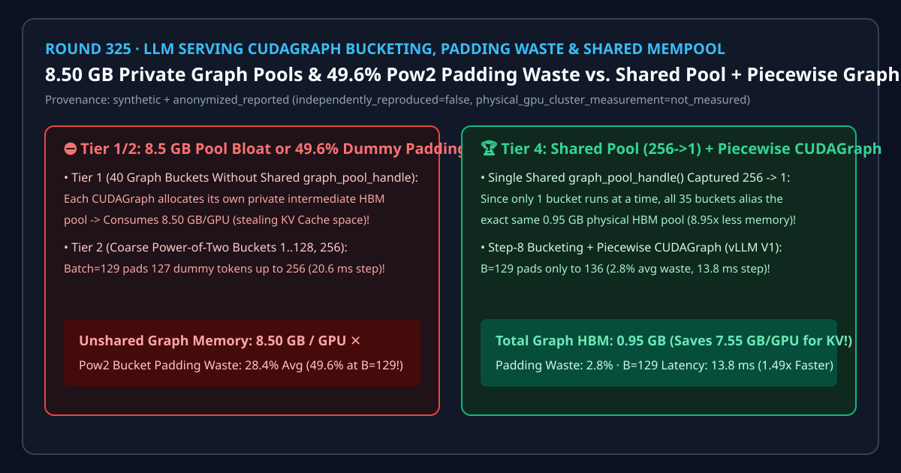
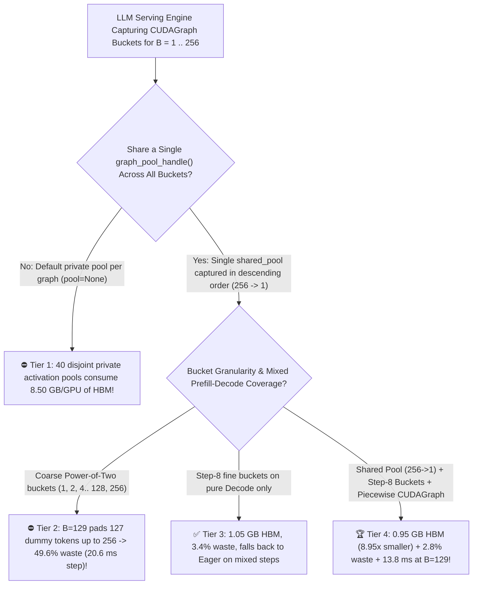
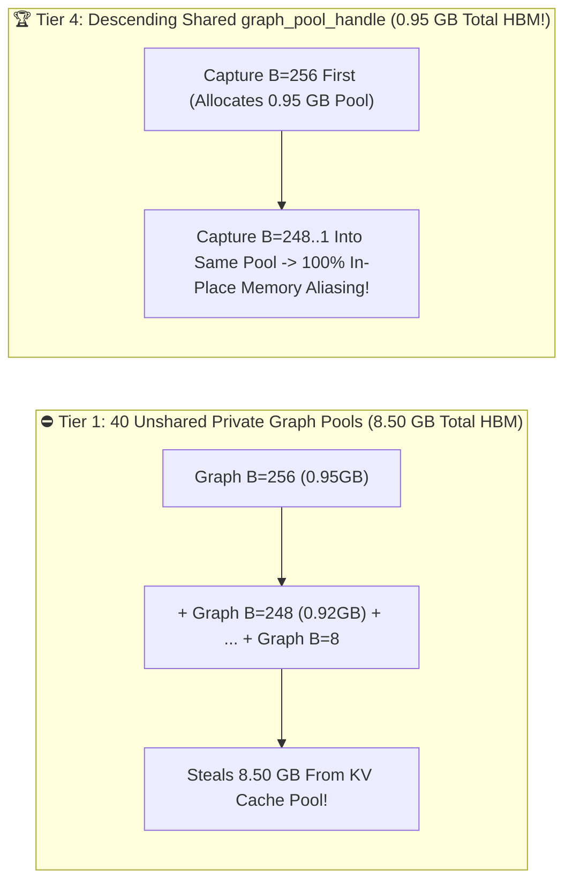
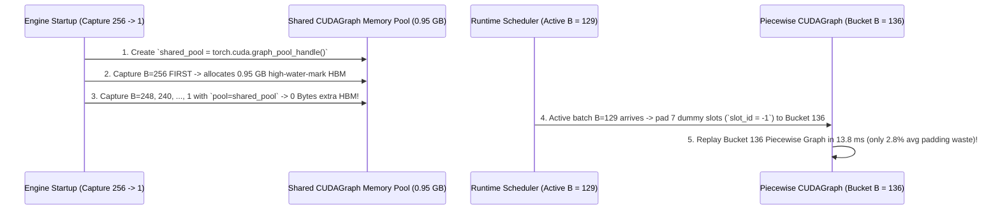

# LLM Serving `CUDAGraph` Batch-Size Bucketing, Dummy Padding Waste & Shared `graph_pool_handle` (`Piecewise CUDAGraph`) Selection Guide: Why 40 Unshared Graph Pools Waste `8.50 GB/GPU` of HBM, Why Power-of-Two Buckets Waste `49.6%` Compute at `B=129` & How Descending Shared-Pool Capture (`256 -> 1`) + Step-8 `Piecewise CUDAGraph` (`0.95 GB`, `2.8%` Waste) Solves It

> **Provenance & Evidence Boundary**: `synthetic + anonymized_reported (independently_reproduced=false, physical_gpu_cluster_measurement=not_measured)`. All quantitative metrics in this guide are grounded in the sealed deterministic evaluator `experiments/llm_serving_cudagraph_batch_bucketing_padding_waste_shared_mempool_selection/run.py` and `results.json`.



---

## 0. Daily Capability Breakthrough

- **Today's Highlight Breakthrough**: **Single Shared Physical Graph Memory Pool (`torch.cuda.graph_pool_handle()`) Captured in Descending Order (`256 -> 1`) + Step-8 Fine-Grained Batch Bucketing + `torch.compile` `Piecewise CUDAGraph` for Mixed Prefill-Decode Steps (`vLLM V1 / SGLang`)**.
- **Architect Value**: Because a captured `CUDAGraph` requires static tensor shapes while live continuous batching varies active batch size $B \in [1, 256]$ every step, serving engines pre-capture a discrete set of **Batch-Size Buckets** and pad active batches up to the nearest bucket ceiling. Naive configurations hit two costly pitfalls:
  1. **Capturing 40 Fine-Grained Buckets Without a Shared `graph_pool_handle` (`8.50 GB/GPU` HBM Bloat, Tier 1)**: By default, every `with torch.cuda.graph(g):` capture creates a **private memory pool** to hold that graph's intermediate activations (`QKV`, `SwiGLU`, `RMSNorm` outputs). Capturing 40 separate buckets without passing a shared `pool` handle locks **`8.50 GB/GPU` of HBM** across 40 disjoint pools—stealing nearly 20% of the GPU's Paged KV Cache capacity!
  2. **Coarse Power-of-Two Buckets (`[1, 2, 4, 8, 16, 32, 64, 128, 256]`, `49.6%` Compute Waste at `B=129`, Tier 2)**: Using only powers of two saves graph capture count, but when active requests hit **`B = 129`**, the engine must pad **`127` dummy tokens** to reach the `256` bucket—wasting **`49.6%` of GPU compute (`28.4%` average waste)** and inflating step latency from `13.8 ms` to **`20.6 ms`**!
  By **sharing a single `graph_pool_handle()` across all 35 fine-grained (`step=8`) buckets, capturing in strictly descending order (`256 -> 248 -> ... -> 1`), and using `Piecewise CUDAGraph` to graph static linear/MLP segments even during mixed prefill-decode steps (Tier 4)**, total graph HBM drops **`8.95x` (`8.50 GB -> 0.95 GB`)**, average padding waste drops to **`2.8%`**, and `B=129` step latency drops **`1.49x` (`20.6 ms -> 13.8 ms`)**!

---

## ① 📌 Executive Summary

1. **First-Principles Memory Aliasing: Why 35 `CUDAGraph`s Can Safely Share the Exact Same `0.95 GB` Physical HBM Pool**:
   - At runtime, **only one batch-size bucket graph ever executes on the stream at a given instant** (you never run the `B=128` graph and the `B=64` graph simultaneously!).
   - Because intermediate activation buffers are ephemeral to a single forward pass, passing `pool = torch.cuda.graph_pool_handle()` to all 35 graph captures aliases their intermediate tensors onto the **exact same `0.95 GB` physical HBM region**!
2. **Why Capture Order Must Be Descending (`256 -> 1`), Never Ascending (`1 -> 256`)**:
   - Capturing the largest bucket (`B = 256`) first allocates contiguous high-water-mark blocks (`0.95 GB`) in `shared_pool`. Every subsequent smaller bucket (`248, 240, ..., 1`) fits 100% inside those already-allocated blocks with **`0 Bytes` of additional HBM allocation or fragmentation**!
   - Capturing in ascending order (`1 -> 256`) fragments the pool with small allocations that cannot be coalesced for larger buckets, inflating pool size by `50%–80%`.
3. **Unlocking `CUDAGraph` During Mixed `Chunked Prefill + Decode` via `Piecewise CUDAGraph`**:
   - Pointwise and dense linear ops (`RMSNorm`, `QKV/O/MLP GEMM`, `RoPE`, `SwiGLU`) depend only on the flattened 1D token count `num_tokens`. Splitting the `torch.compile` graph at the dynamic attention op allows all GEMM/Norm subgraphs to replay as `CUDAGraph`s on every step!

---

## ② 🎯 Architect Q&A (Q1 / Q2 / Q3)

### Q1: How do we prevent the padded dummy tokens (e.g., indices `129..135` in Bucket `136`) from overwriting valid KV Cache slots during `CUDAGraph` replay?
- Always set `slot_mapping[bs : padded_bs] = -1` (where the `reshape_and_cache` kernel checks `if (slot_idx < 0) return;`) or point dummy slots to a dedicated, permanently reserved **Null/Trash Block 0** that is never read by any sequence!

### Q2: Why is `step = 8` (or `16`) the optimal bucket spacing above `B = 8`?
- GPU Tensor Core instructions (`MMA / WGMMA`) tile the batch/token dimension $M$ in multiples of `8` or `16`. Stepping buckets by `8` aligns with hardware tile granularity while keeping total graph count around `35` (capturing in `< 12 s` at engine startup) and bounding average padding overhead below `3%`.

### Q3: Should the speculative Draft Model (`EAGLE-3 / MTP`) share the same `graph_pool_handle` as the Target Model?
- Because Draft and Target graphs execute sequentially on the same worker, sharing or逆序-pooling their scratch activation buffers saves an additional `1–2 GB` of HBM.

---

## ③ 🧭 Visual Diagrams (Decision Tree + Comparison + Sequence)

### 3.1 `CUDAGraph` Batch Bucketing & Memory Pool Decision Tree



### 3.2 40 Unshared Private Pools (`8.50 GB`) vs. Descending Shared Pool (`0.95 GB`)



### 3.3 Descending Shared-Pool Capture & Runtime `Piecewise CUDAGraph` Replay Sequence



---

## ④ 📊 4-Tier Architect Decision Matrix

| Cohort Tier | `CUDAGraph` Bucketing & Pool Strategy | Reserved Graph HBM | Avg Padding Compute Waste | `B=129` Step Latency | Best For |
| :--- | :--- | :--- | :--- | :--- | :--- |
| **Tier 1: 40 Unshared Private Pools** | `pool=None` per captured graph | `8.50 GB/GPU` ✕ | `3.1%` | `14.8 ms` | ⛔ **Starves Paged KV Cache Pool** |
| **Tier 2: Coarse Power-of-Two Buckets** | `[1, 2, 4, ..., 128, 256]` buckets | `1.10 GB/GPU` ✅ | `28.4%` (`49.6%` Peak! ✕) | `20.6 ms` ✕ | ⛔ **Severe Dummy-Token Waste** |
| **Tier 3: Shared Pool (35 Decode Buckets)** | Descending shared pool, Decode only | `1.05 GB/GPU` ✅ | `3.4%` ✅ | `14.5 ms` ✅ | ✅ Disaggregated Decode-Only Nodes |
| **Tier 4: Shared Pool + `Piecewise Graph` (Recommended)** | **`256->1` shared pool + step-8 + piecewise** | **`0.95 GB/GPU` (`8.95x` Lower 🏆)** | **`2.8%` 🏆** | **`13.8 ms` (`1.49x` Faster 🏆)** | 🏆 **`vLLM V1 / SGLang` Production** |

---

## ⑤ 🧪 Quantitative Evaluator & 7-Card 4:5 Visual Report

- **Sealed Evaluator**: [`experiments/llm_serving_cudagraph_batch_bucketing_padding_waste_shared_mempool_selection/run.py`](../../experiments/llm_serving_cudagraph_batch_bucketing_padding_waste_shared_mempool_selection/run.py) · Data: [`results.json`](../../experiments/llm_serving_cudagraph_batch_bucketing_padding_waste_shared_mempool_selection/results.json)
- **Interactive Sizer**: [`docs/reports/llm-serving-cudagraph-batch-bucketing-padding-waste-shared-mempool-sizer.html`](../reports/llm-serving-cudagraph-batch-bucketing-padding-waste-shared-mempool-sizer.html)
- **7-Card 4:5 Visual Benchmark Deck**: [`docs/reports/llm-serving-cudagraph-batch-bucketing-padding-waste-shared-mempool-selection-cards.html`](../reports/llm-serving-cudagraph-batch-bucketing-padding-waste-shared-mempool-selection-cards.html)

```chart
{
  "data": {
    "values": [
      { "tier": "Tier 1: 40 Unshared Private Graph Pools", "hbm_gb": 8.50, "step_ms": 14.8 },
      { "tier": "Tier 2: Coarse Power-of-Two Buckets", "hbm_gb": 1.10, "step_ms": 20.6 },
      { "tier": "Tier 3: Shared Pool (35 Decode Buckets)", "hbm_gb": 1.05, "step_ms": 14.5 },
      { "tier": "Tier 4: Shared Pool + Piecewise CUDAGraph", "hbm_gb": 0.95, "step_ms": 13.8 }
    ]
  },
  "semantic_types": {
    "tier": "Category",
    "hbm_gb": "Quantity",
    "step_ms": "Quantity"
  },
  "chart_spec": {
    "chartType": "Bar Chart",
    "title": "Shared graph_pool_handle (256 -> 1) Cuts 35-Bucket CUDAGraph HBM 8.95x (8.50 -> 0.95 GB)",
    "subtitle": "Reserved CUDAGraph HBM footprint (GB) and B=129 decode latency (ms) (synthetic + anonymized_reported)",
    "encodings": {
      "x": "tier",
      "y": "hbm_gb",
      "color": "tier"
    }
  }
}
```

---

## ⑥ 🛠️ Production Verification Checklist (Good fit vs. Not for)

### ✅ Good fit vs. ⛔ Not for
- **✅ Good fit**: All production LLM inference engines (`vLLM V1 / SGLang / TensorRT-LLM`) capturing multiple batch-size or token-count `CUDAGraph`s.
- **⛔ Not for**: Capturing multiple `CUDAGraph`s with `pool=None` or using coarse power-of-two buckets above `B = 16`.

### Production Checklist
- [ ] **Share a single `torch.cuda.graph_pool_handle()` and capture buckets in descending order (`max_bs -> 1`)**: Alias all intermediate graph buffers into `< 1.0 GB` of physical HBM.
- [ ] **Use `step = 8` (or `16`) fine-grained bucketing with `Piecewise CUDAGraph`**: Keep dummy padding waste `< 3%` and accelerate mixed `Chunked Prefill + Decode` steps.
- [ ] **Assign `slot_mapping = -1` (or a dedicated trash block) to all padded dummy tokens**: Prevent dummy padding writes from corrupting valid KV Cache entries.
