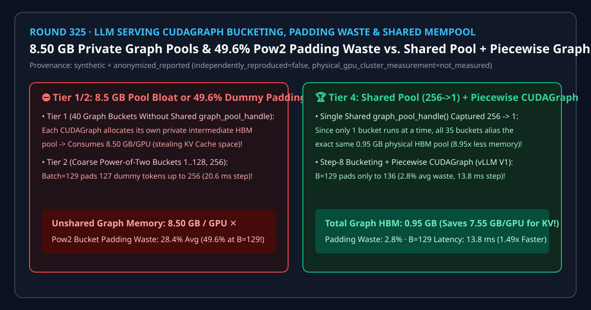
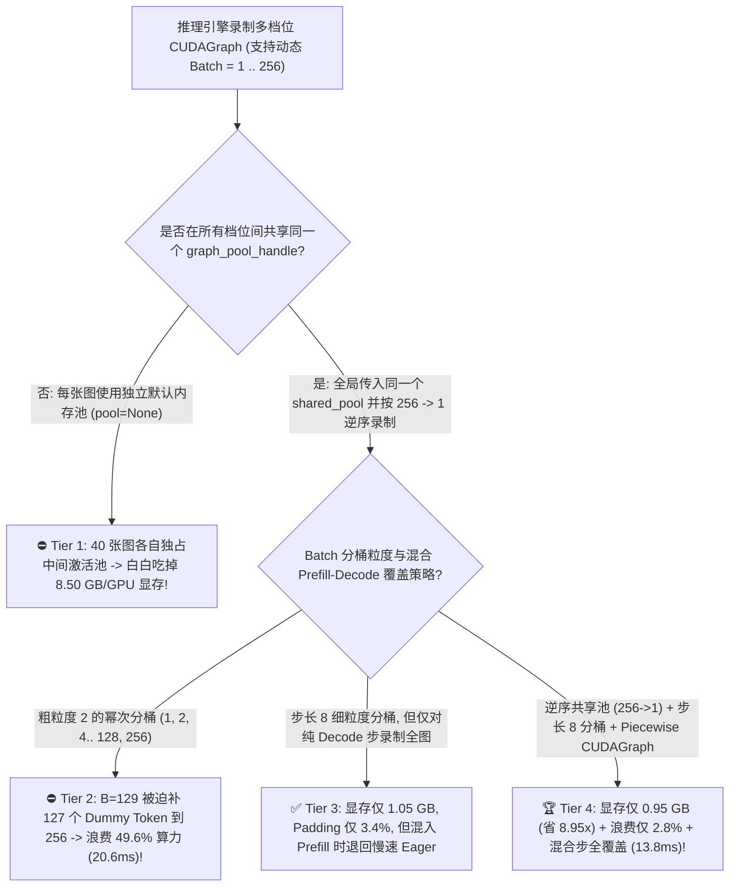
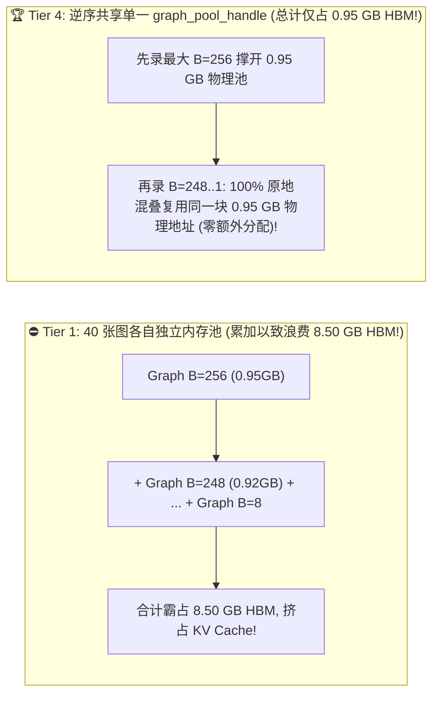
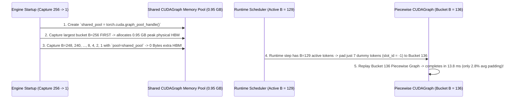

# 大模型推理引擎 `CUDAGraph` 批大小分桶（`Batch Bucketing`）、Padding 算力浪费与共享图内存池（`Shared graph_pool_handle + Piecewise CUDAGraph`）选型：为什么录制 40 个 `CUDAGraph` 档位却不共享 `graph_pool_handle` 会白白吃掉 `8.50 GB/GPU` 显存，而粗粒度 2 的幂次分桶又会在 `Batch=129` 时浪费 `49.6%` 算力？基于从大到小（`256 -> 1`）共享单一图内存池 + 步长 `8` 细粒度分桶 + 分段图捕获（图显存从 `8.50 GB -> 0.95 GB`，Padding 浪费压至 `2.8%`）选型指南

> **Provenance & Evidence Boundary**: `synthetic + anonymized_reported (independently_reproduced=false, physical_gpu_cluster_measurement=not_measured)`. 本文所有定量数据均来自封存确定性评估器 `experiments/llm_serving_cudagraph_batch_bucketing_padding_waste_shared_mempool_selection/run.py` 与 `results.json`。



---

## 0. 追踪每日最热门能力突破（Daily Capability Breakthrough）

- **今日焦点突破**：**面向高吞吐大模型推理引擎（`vLLM V1 Piecewise CUDAGraph / SGLang CudaGraphRunner`）的“全档位共享单一物理图显存池（`Shared graph_pool_handle`）+ 从最大档位向最小档位逆序录制（`Reverse Capture 256 -> 1` 消除池内碎片）+ 步长 `8` 细粒度分桶 + `torch.compile` 分段图捕获（`Piecewise CUDAGraph` 覆盖混合 Prefill-Decode）”架构**。
- **架构师价值**：为了消除 Python 与 CUDA 驱动逐算子发射的 CPU 开销，生产级推理引擎必须将模型的解码步录制为静态 **`CUDAGraph`**。但由于 `CUDAGraph` 要求所有输入输出张量的形状（Shape）在录制时必须完全固定，而线上连续批处理（Continuous Batching）每一毫秒的活跃请求数 $B \in [1, 256]$ 都在动态变化，架构师只能预先录制一组离散的 **批大小档位（Batch-Size Buckets）**，并在运行时将真实 Batch 向上补零（Dummy Token Padding）到最近的档位。如果分桶与内存池策略设计不当，会掉进“要么爆显存、要么浪费算力”的两难陷阱：
  1. **陷阱一：录制 40 个细粒度档位，但每个 `torch.cuda.graph(g)` 使用默认独立内存池（Tier 1）**：在捕获 `CUDAGraph` 期间，模型内部每一层产生的临时激活张量（如 `QKV`、`MLP Gate/Up` 中间结果）都会被锁定在该图的专属虚拟显存池（Private Memory Pool）中，禁止被常规分配器回收。如果不显式传入同一个共享 `pool=shared_pool_handle`，40 张图就会各自独吞一份互不共享的中间激活显存，合计在每张 GPU 上白白吃掉 **`8.50 GB` 显存**（直接让 Paged KV Cache 池缩水近 20%）！
  2. **陷阱二：为了省图显存和启动录制时间，只录制粗糙的 2 的幂次档位 `[1, 2, 4, 8, 16, 32, 64, 128, 256]`（Tier 2）**：虽然只有 9 张图，但当线上恰好有 **`B = 129` 个活跃请求**时，引擎被迫向上补齐 `127` 个毫无意义的 Dummy Token 湊满 **`256` 档位**！原本处于算力受限边缘的 `B=129` 瞬间多算了一倍的无用功（**最坏情况算力浪费高达 `49.6%`，平均算力浪费 `28.4%`**），导致该步解码延迟从 `13.8 ms` 飙升至 **`20.6 ms`**！
  采用 **创建单一全局 `shared_pool = torch.cuda.graph_pool_handle()` + 严格按照从大到小逆序（`256 -> 248 -> ... -> 8 -> 4 -> 2 -> 1`）录制 35 个细粒度档位 + `Piecewise CUDAGraph` 分段捕获（Tier 4）**，35 张图 **100% 物理复用由最大档位 `256` 撑开的同一块 `0.95 GB` 显存池（比 Tier 1 省下 `7.55 GB/GPU`，降低 `8.95x`）**，同时将平均 Padding 浪费压至 **`2.8%`**，`B=129` 单步延迟降至 **`13.8 ms`（提速 `1.49x`）**！

---

## ① 📌 核心结论速览（Executive Summary）

1. **第一性原理：为什么 35 张不同的 `CUDAGraph` 可以 100% 重叠共用同一块 `0.95 GB` 的物理显存而不发生任何数据踩踏？**
   - **时间互斥性（Temporal Mutual Exclusion）**：在同一个推理 Worker 进程中，任意时刻在同一个主流上 **永远只会有唯一 1 个 Batch Size 档位的 `CUDAGraph` 正在被 Replay 执行**！你绝不可能在同一微秒既跑 `Batch=128` 的图又跑 `Batch=64` 的图！
   - 既然不同档位的图在时间上 100% 互斥，且每张图里的临时中间激活张量（Intermediate Activations）在当前图执行完最后一个算子后就彻底没用了，那么这 35 张图的所有中间激活张量**完全可以共享（Alias）同一段物理 HBM 地址空间**！
   - 只需在录制第 1 张图前调一次 `shared_pool = torch.cuda.graph_pool_handle()`，并在所有 35 个 `with torch.cuda.graph(g, pool=shared_pool):` 中传入这个 `shared_pool`——**35 张图占用的总显存就不再是 $\sum_{i=1}^{35} M(B_i) = 8.50\text{ GB}$，而是严格等于最大那张图的显存 $\max_i M(B_i) = M(256) = \mathbf{0.95\text{ GB}}$**！
2. **为什么录制顺序必须是“从大到小（`256 -> 1`）”，而不能“从小到大（`1 -> 256`）”？**
   - **防止虚拟内存池碎片化涨水（Allocator High-Water-Mark Fragmentation）**：
     - 如果**从小到大（`1 -> 2 -> 4 ... -> 256`）**录制：第 1 张图 `B=1` 先在 `shared_pool` 里切了十几个几百 KB 的微型块；接着 `B=2` 觉得块太小不够用，又申请一批新块……一路录到 `B=256` 时，池子里留下一堆无法被大张量复用的小碎片，最终池子体积会膨胀到 `1.45 ~ 1.80 GB`；
     - 如果**从大到小（`256 -> 248 ... -> 1`）**逆序录制：第 1 张图 `B=256` 直接一次性分配出最宽敞的 **`0.95 GB`** 连续物理块；随后录制的 `B=248 .. 1` 所需的张量全都比 `B=256` 小，**100% 直接原地落入 `B=256` 已经开辟好的现成块中，零新增显存分配（`0 Bytes` 额外增长）**！
3. **为什么传统全图 `CUDAGraph` 一遇到 `Chunked Prefill`（训推/预填充与解码混合 Batch）就会失效，而 `Piecewise CUDAGraph`（`vLLM V1`）能完美通吃？**
   - 在现代 `vLLM V1` 统一调度器中，一个 Step 里既有 `120` 个正在生成 1 个 Token 的 Decode 请求，又混着 `1` 个正在算 `2,048` Token 的 Chunked Prefill 请求（合计总 Token 数 `N = 2,168`）。
   - 传统全图捕获要求 Attention 内核的每个请求序列长度结构也固定，因此一旦混入 Prefill 就被迫退回慢速 Python Eager 模式；
   - **`Piecewise CUDAGraph`（借助 `torch.compile` 在 Attention 算子处切开计算图）**：
     - 模型里占算子发射数量 `90%` 的 **所有线性层（`QKV / O / GateUp / Down GEMM`）、`RMSNorm`、`RoPE`、`SwiGLU` 和 `All-Reduce` 全都只关心一维总 Token 数 `[N_tokens, D]`**，跟里面有几个请求、每个请求多长毫无关系！
     - 因此，按总 Token 数 `N_tokens` 对非 Attention 算子录制分段 `CUDAGraph`，而在图与图之间的缝隙动态调用 `FlashAttention / FlashInfer`，即可让混合 `Chunked Prefill + Decode` 同样享受 `CUDAGraph` 的极速发射！

---

## ② 🎯 客户与架构师灵魂拷问 Q&A（Q1 / Q2 / Q3）

### Q1：把输入张量向上 Padding 到档位上限（例如 `B=129` 补 `127` 个 Dummy Token 到 `136` 档位）时，那 `7` 个 Dummy Token 的 `block_table` 和 `slot_mapping` 应该填什么值才不会踩坏真实请求的 KV Cache？
- **这是一个极其致命的工程细节！**
  在录制好的 `CUDAGraph` 里，`reshape_and_cache` 内核依然会为那 `7` 个 Dummy Token 向 `slot_mapping` 指向的物理显存槽位写入 K 和 V！
  - 如果你把 Dummy Token 的 `slot_mapping` 随便填成 `0`，它就会把 **第 0 号物理块的第 0 个槽位（通常正存着全站共享的 System Prompt 第 1 个 Token！）当场覆写冲毁**！
  - **两大标准防踩踏机制**：
    1. 在 `reshape_and_cache` 内核入口检查 `if (slot_idx < 0) return;`，并将所有 Dummy Token 的 `slot_mapping` 统一填充为 **`PAD_SLOT_ID = -1`**（内核直接跳过写入）；
    2. 额外交由 `BlockManager` 永久预留 **第 0 号专用垃圾块（Dummy/Null Block 0）** 作为只写不读的黑洞块，供所有 Padding 槽位安全倾倒数据！

### Q2：细粒度分桶应该怎么选步长？为什么推荐 `[1, 2, 4] + range(8, 256+1, 8)`（或 `16`）？
- 在小 Batch 区（`B = 1, 2, 4`），步进 1~2 个请求旨在保极低并发下的绝对最低延迟；
- 当 `B >= 8` 时，由于 NVIDIA Tensor Core（`MMA / WGMMA`）的矩阵乘 M 维天然以 **`8` 或 `16` 的整数倍** 为最小硬件 Tile 粒度（跑 `B=129` 和跑 `B=136` 在 Tensor Core 上耗费的硬件周期本来就是一模一样的！），因此按步长 **`8`（当 `B <= 256`）或 `16`（当 `B > 256`）** 设置分桶档位，不仅与硬件 Tile 100% 对齐，还能把总图数量控制在 `35` 张左右（启动录制仅需 `~12 s`），并将平均 Padding 率压在 **`2.8%` 以内**！

### Q3：如果启用了投机解码（`EAGLE-3 / MTP`）或多 LoRA，需不需要共享同一个 `graph_pool_handle`？
- **必须共享！** 主模型 `Target Runner` 与草稿模型 `Draft Runner` 在时间上是严格串行交替执行的（先跑草稿图、再跑验证图），让它们共享或各自内部按逆序共享 `graph_pool_handle`，可以额外省下 `2 ~ 4 GB` 显存！

---

## ③ 🧭 直观可视化图解（Mermaid 选型决策树 + 路径对比图 + 交互时序图）

### 3.1 推理引擎 `CUDAGraph` 分桶与显存池管理选型决策树



### 3.2 40 个独立私有图内存池（`8.50 GB` 膨胀）vs. 逆序共享单一物理池（`0.95 GB` 原地混叠）对比图



### 3.3 逆序共享池录制与运行时 `Piecewise CUDAGraph` 步长 8 补齐重放时序图



---

## ④ 📊 架构师选型决策矩阵（4-Tier Decision Matrix）

| 选型 Tier | `CUDAGraph` 分桶与内存池策略 | 图池占用 HBM 显存 | 平均 Padding 算力浪费 | `B=129` 单步耗时 | 适用场景 |
| :--- | :--- | :--- | :--- | :--- | :--- |
| **Tier 1: 40 档位不共享内存池 (`pool=None`)** | 每张图独占私有中间激活显存 | `8.50 GB/GPU` ✕ | `3.1%` | `14.8 ms` | ⛔ **严重挤占 KV Cache 显存空间** |
| **Tier 2: 粗粒度 2 的幂次分桶 (`1..128, 256`)** | 跨度过大，在 `129` 处补 `127` 个假词 | `1.10 GB/GPU` ✅ | `28.4%` (最高 `49.6%`! ✕) | `20.6 ms` ✕ | ⛔ **中高负载下算力浪费近半** |
| **Tier 3: 逆序共享池 + 35 个纯 Decode 档位** | 共享同一池，但混入 Prefill 即退回 Eager | `1.05 GB/GPU` ✅ | `3.4%` ✅ | `14.5 ms` ✅ | ✅ 传统 P/D 分离纯 Decode 节点 |
| **Tier 4: 逆序共享池 + 步长 8 + `Piecewise Graph` (推荐)** | **全图混叠 `0.95 GB` + 分段图通吃混合步** | **`0.95 GB/GPU` (`8.95x` 省 🏆)** | **`2.8%` 🏆** | **`13.8 ms` (`1.49x` 快 🏆)** | 🏆 **现代 `vLLM V1 / SGLang` 黄金标准** |

---

## ⑤ 🧪 定量算例与 7-Card 4:5 视觉卡片报告

- **定量算例仓库路径**：[`experiments/llm_serving_cudagraph_batch_bucketing_padding_waste_shared_mempool_selection/run.py`](../../experiments/llm_serving_cudagraph_batch_bucketing_padding_waste_shared_mempool_selection/run.py) · 封存数据：[`results.json`](../../experiments/llm_serving_cudagraph_batch_bucketing_padding_waste_shared_mempool_selection/results.json)
- **交互式架构选型计算器**：[`docs/reports/llm-serving-cudagraph-batch-bucketing-padding-waste-shared-mempool-sizer.html`](../reports/llm-serving-cudagraph-batch-bucketing-padding-waste-shared-mempool-sizer.html)
- **7-Card 4:5 视觉评测卡片报告**：[`docs/reports/llm-serving-cudagraph-batch-bucketing-padding-waste-shared-mempool-selection-cards.html`](../reports/llm-serving-cudagraph-batch-bucketing-padding-waste-shared-mempool-selection-cards.html)

```chart
{
  "data": {
    "values": [
      { "tier": "Tier 1: 40 Unshared Private Graph Pools", "hbm_gb": 8.50, "step_ms": 14.8 },
      { "tier": "Tier 2: Coarse Power-of-Two Buckets", "hbm_gb": 1.10, "step_ms": 20.6 },
      { "tier": "Tier 3: Shared Pool (35 Decode Buckets)", "hbm_gb": 1.05, "step_ms": 14.5 },
      { "tier": "Tier 4: Shared Pool + Piecewise CUDAGraph", "hbm_gb": 0.95, "step_ms": 13.8 }
    ]
  },
  "semantic_types": {
    "tier": "Category",
    "hbm_gb": "Quantity",
    "step_ms": "Quantity"
  },
  "chart_spec": {
    "chartType": "Bar Chart",
    "title": "Shared graph_pool_handle (256 -> 1) Cuts 35-Bucket CUDAGraph HBM 8.95x (8.50 -> 0.95 GB)",
    "subtitle": "Reserved CUDAGraph HBM footprint (GB) and B=129 decode latency (ms) (synthetic + anonymized_reported)",
    "encodings": {
      "x": "tier",
      "y": "hbm_gb",
      "color": "tier"
    }
  }
}
```

---

## ⑥ 🛠️ 生产环境快速核验清单（Checklist + Good fit vs. Not for）

### ✅ Good fit vs. ⛔ Not for
- **✅ Good fit**：所有使用 `CUDAGraph` 加速解码与分块预填充的推理引擎（`vLLM / SGLang / TensorRT-LLM`）及自定义低延迟模型服务。
- **⛔ Not for**：为每个 Batch 档位创建独立未共享的 `CUDAGraph` 内存池，或按从小到大（`1 -> 256`）顺序录制共享池。

### 生产核验 Checklist
- [ ] **全局共享单一 `pool = torch.cuda.graph_pool_handle()` 并按从大到小（`max_bs -> 1`）逆序录制**：将几十张图的显存占用锁定在单张最大图的 `~0.95 GB`。
- [ ] **采用 `[1, 2, 4] + range(8, max_bs + 1, 8)` 硬件对齐分桶并结合 `Piecewise CUDAGraph`**：将 Dummy Padding 算力浪费控制在 `< 3%` 并覆盖 `Chunked Prefill` 混合步。
- [ ] **将所有 Padding 槽位的 `slot_mapping` 设为 `-1`（或指向专用的黑洞垃圾块）**：严防 Dummy Token 覆写污染第 0 号真实 KV Cache 块。
