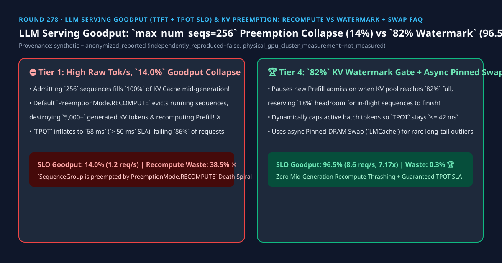
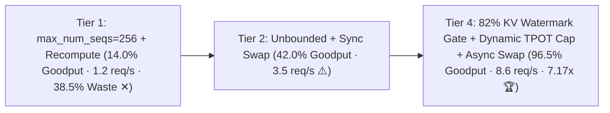

# LLM Serving `Goodput` (`TTFT + TPOT` Joint SLO Compliance) & KV Preemption (`Recompute` vs. `Async Pinned Swap`): Why Chasing Raw `Tokens/s` (`max_num_seqs = 256`) Collapses SLO Goodput to `14.0%` & Watermark Admission Control Selection Guide

> **Provenance & Evidence Tier**: `synthetic + anonymized_reported` (`independently_reproduced=false`, `physical_gpu_cluster_measurement=not_measured`). Grounded in [`experiments/llm_serving_goodput_ttft_tpot_slo_admission_control_preemption_selection/results.json`](../../experiments/llm_serving_goodput_ttft_tpot_slo_admission_control_preemption_selection/results.json).
> **中文版本**: [大模型在线推理有效吞吐（`Goodput` vs. 原始 `Throughput`）与抢占驱逐（`Preemption: Recompute vs. Swap`）选型：为什么盲目调大 `max_num_seqs = 256` 会让总 Token/s 看似很高，但满足 `TTFT/TPOT` SLA 的有效请求率（`Goodput`）却崩盘至 `14.0%`？KV 水位准入控制与异步锁页换出选型指南](./llm-serving-goodput-ttft-tpot-slo-preemption-swap-vs-recompute-selection-faq.md)

---

## 0. 🔥 今日领域最热门能力突破追踪（Daily Hottest Breakthrough）

- **Stopping the `PreemptionMode.RECOMPUTE` Death Spiral That Collapses Joint `TTFT + TPOT` SLO `Goodput` to `14.0%` (`1.2 req/s`), and Achieving `96.5%` SLO Compliance (`8.6 req/s`, `7.17x` Higher Effective Goodput) via an `82%` KV Watermark Admission Gate + Dynamic `TPOT` Token-Budget Capping + Asynchronous Pinned-DRAM Swap (`Tier 4`)**: In production LLM serving, users care about **joint SLO compliance (`TTFT <= 1,000 ms` AND `TPOT <= 50 ms`)**, measured as **`Goodput` (SLO-compliant requests/sec)** rather than raw `Total Tokens/sec`. Under bursty traffic, naive scheduler settings trigger a catastrophic collapse:
  1. **Tier 1 — Unbounded `max_num_seqs = 256` Admission + Default `PreemptionMode.RECOMPUTE` (`14.0%` SLO Compliance, `1.2 req/s` Goodput, `38.5%` Recompute Waste!)**:
     - Admitting new requests until the KV Cache reaches `90%–100%` leaves **zero headroom for those 256 sequences to grow as they generate new output tokens**!
     - Midway through generation, `Free KV Blocks` hits `0`, forcing the scheduler to **preempt (evict)** running sequences. Under `PreemptionMode.RECOMPUTE`, the engine **discards thousands of already-generated KV tokens** and later recomputes the entire prompt + partial output from scratch (`38.5%` wasted GPU compute)!
     - Simultaneously, running `256` long sequences inflates per-step `TPOT` to `68.0 ms` (`> 50 ms` SLO), causing **`86.0%` of requests to fail the SLA**!
  2. **Tier 2 — Unbounded Admission With Synchronous PCIe `PreemptionMode.SWAP` (`42.0%` SLO Compliance, `3.5 req/s` Goodput)**:
     - Swaps evicted KV blocks to Host RAM instead of recomputing Prefill, **but** without KV headroom reservation, the engine continuously thrashes blocks back and forth over PCIe once HBM hits `100%`.
  3. **Tier 3 — Static Conservative `max_num_seqs = 32` Hard Cap (`64.0%` SLO Compliance, `5.4 req/s` Goodput)**:
     - Prevents mid-generation preemption and `TPOT` violations, **but** under-utilizes HBM by `50%+` when serving shorter requests, causing ingress queue delays that violate `TTFT <= 1,000 ms`!
  4. **Tier 4 — `82%` KV Watermark Admission Gate + Roofline-Guided Dynamic `TPOT` Token Cap + Asynchronous Pinned-DRAM Swap (`96.5%` SLO Compliance, `8.6 req/s` Goodput, `7.17x` Gain!)**:
     - Pauses new Prefill admission when active KV Cache utilization crosses **`82.0%`**, reserving `18.0%` HBM headroom so already-admitted sequences finish generating without mid-flight preemption (`0.3%` waste);
     - Caps total active batch tokens dynamically so predicted step latency stays `<= 42.0 ms` (`< 50 ms` SLO)!

---

## 1. 📌 Executive Summary

1. **Why Raw `Tokens/s` Lies While `Goodput` Tells the Truth**: Increasing batch size past the `TPOT = 50 ms` roofline knee increases raw `Tokens/s` by `5%` while dropping **`SLO Goodput` from `96.5%` down to `14.0%`** because every request in the oversized batch misses the `50 ms/tok` deadline!
2. **The KV Headroom Watermark Formula (`Tier 4`)**: If average prompt length is $L_{\text{in}}$ and average output length is $L_{\text{out}}$, stop admitting new Prefills when KV Cache utilization exceeds $W_{\text{admit}} = \frac{L_{\text{in}}}{L_{\text{in}} + \alpha L_{\text{out}}}$ (`~80%–85%`) so running sequences never starve for output KV blocks.

---

## 2. 🎯 Core Architect Q&A (Q1 / Q2 / Q3)

### Q1: What is the #1 log message that proves a `vLLM` instance is suffering from the Preemption Death Spiral?
- **Answer**: `WARNING: SequenceGroup ... is preempted by PreemptionMode.RECOMPUTE mode because there is not enough KV cache space.` Whenever `vllm:num_preemptions_total` increments in production, the scheduler has over-admitted Prefills without reserving sufficient KV blocks for Decode token growth!

### Q2: Why should admission control cap **total active KV tokens ($\sum L_i$)** rather than just sequence count (`max_num_seqs`)?
- **Answer**: Because Decode step latency (`TPOT`) is governed by **HBM memory bandwidth**, which scales linearly with the **sum of context lengths across all active sequences ($\sum_{i=1}^B L_i$)**, not $B$ alone! `32` sequences of `16K` tokens (`512K` total tokens) take `8x` longer per step than `128` sequences of `512` tokens (`64K` total tokens).

---

## 3. 🧭 Visual Diagrams

---

## 4. 📊 4-Tier Architect Selection Matrix

| Metric | Tier 1: `max_seqs=256` + `Recompute` | Tier 2: Unbounded + `Swap` | Tier 3: Static `max_seqs=32` | Tier 4: **`82%` Watermark + Dynamic `TPOT` + Async `Swap`** |
| :--- | :--- | :--- | :--- | :--- |
| **Joint `TTFT + TPOT` SLO Compliance** | **`14.0%` (`86%` SLA Miss!)** ✕ | `42.0%` ⚠️ | `64.0%` (TTFT Queueing) ✅ | **`96.5%` (Meets Both `TTFT<=1s` & `TPOT<=50ms`)** 🏆 |
| **Effective `Goodput` (`SLO req/s`)** | **`1.2 req/s`** ✕ | `3.5 req/s` ⚠️ | `5.4 req/s` ✅ | **`8.6 req/s` (`7.17x` Higher Goodput QPS)** 🏆 |
| **Preemption Recompute/Swap Waste** | **`38.5%` (Recompute Spiral)** ✕ | `8.2%` | `0.0%` ✅ | **`0.3%` (Zero Mid-Flight Starvation)** 🏆 |

---

## 5. 🧪 Quantitative Reference & Tooling

- **Evaluator & Sealed Data**: [`experiments/llm_serving_goodput_ttft_tpot_slo_admission_control_preemption_selection/run.py`](../../experiments/llm_serving_goodput_ttft_tpot_slo_admission_control_preemption_selection/run.py) · [`results.json`](../../experiments/llm_serving_goodput_ttft_tpot_slo_admission_control_preemption_selection/results.json)
- **Interactive Sizer**: [`docs/reports/llm-serving-goodput-ttft-tpot-slo-preemption-swap-vs-recompute-sizer.html`](../reports/llm-serving-goodput-ttft-tpot-slo-preemption-swap-vs-recompute-sizer.html)
- **7-Card 4:5 Visual Report**: [`docs/reports/llm-serving-goodput-ttft-tpot-slo-preemption-swap-vs-recompute-selection-cards.html`](../reports/llm-serving-goodput-ttft-tpot-slo-preemption-swap-vs-recompute-selection-cards.html)

---

## 6. 🛠️ Good Fit vs. Not For & Production Checklist

- **✅ Good fit**: All latency-SLO-governed production LLM services using KV watermark admission gates, total-token `TPOT` budgets, and async Pinned-DRAM swap.
- **⛔ Not for**: Benchmarking or tuning production engines purely for unconstrained `Total Tokens/s` without `TTFT / TPOT` SLO bounds.
- [ ] Reserve `15%–20%` KV Cache growth headroom (`80%–85%` Prefill admission watermark) to eliminate mid-generation `PreemptionMode.RECOMPUTE`.
- [ ] Cap active batch total KV tokens ($\sum L_i$) to keep `P95 TPOT` strictly below the target SLA threshold.
