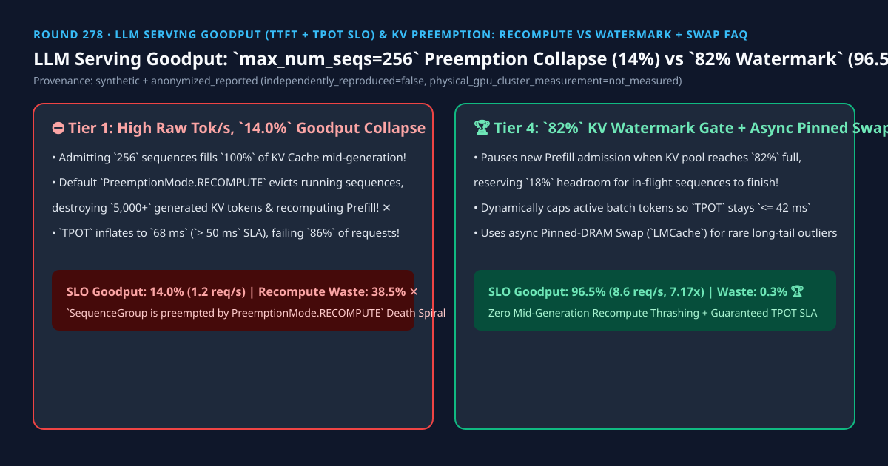
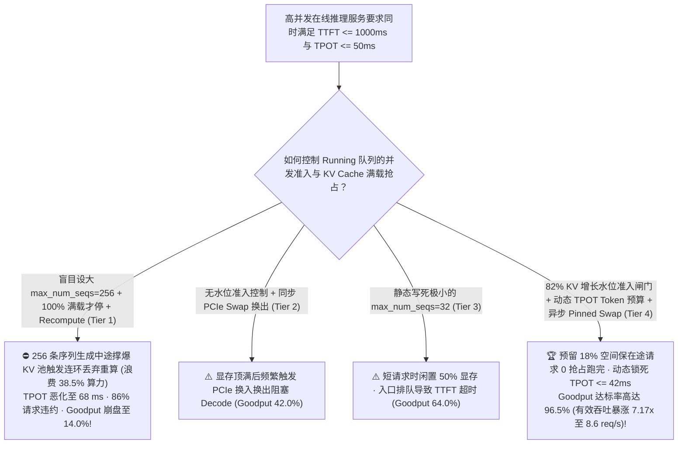
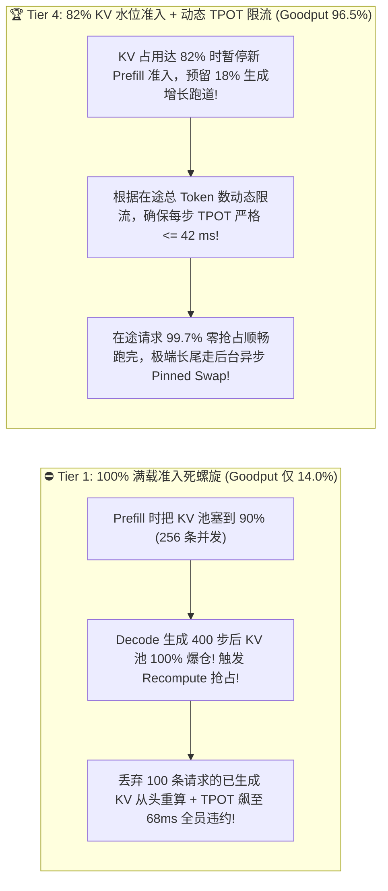
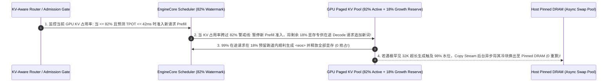

# 大模型在线推理有效吞吐（`Goodput` vs. 原始 `Throughput`）与抢占驱逐（`Preemption: Recompute vs. Swap`）选型：为什么盲目调大 `max_num_seqs = 256` 会让总 Token/s 看似很高，但满足 `TTFT/TPOT` SLA 的有效请求率（`Goodput`）却崩盘至 `14.0%`？KV 水位准入控制与异步锁页换出选型指南

> **Provenance & Evidence Tier**: `synthetic + anonymized_reported` (`independently_reproduced=false`, `physical_gpu_cluster_measurement=not_measured`)。定量数据锚定于 [`experiments/llm_serving_goodput_ttft_tpot_slo_admission_control_preemption_selection/results.json`](../../experiments/llm_serving_goodput_ttft_tpot_slo_admission_control_preemption_selection/results.json)。
> **English Version**: [LLM Serving `Goodput` (`TTFT + TPOT` Joint SLO Compliance) & KV Preemption (`Recompute` vs. `Async Pinned Swap`): Why Chasing Raw `Tokens/s` (`max_num_seqs = 256`) Collapses SLO Goodput to `14.0%` & Watermark Admission Control Selection Guide](./llm-serving-goodput-ttft-tpot-slo-preemption-swap-vs-recompute-selection-faq.en.md)

---

## 0. 🔥 今日领域最热门能力突破追踪（Daily Hottest Breakthrough）

- **揭秘为什么很多团队在线上 `vLLM / SGLang` 日志里频繁看到 `SequenceGroup is preempted by PreemptionMode.RECOMPUTE because there is not enough KV cache space` 警告，监控大盘上的总生成速度（Raw `Tokens/s`）看起来依然很高，但客户端业务的 SLA 达标率（`Goodput`：同时满足首包 `TTFT <= 1,000 ms` 且吐字间隔 `TPOT <= 50 ms` 的有效请求占比）却从 `96%` 断崖式崩盘至 `14.0%`（有效 QPS 仅 `1.2 req/s`）？通过“预留 `18%` 输出增长余量的 `82% KV 水位准入闸门` + 基于活跃 Token 数的动态 `TPOT` 限流 + 异步锁页内存换出（`Async Pinned DRAM Swap`）”（`Tier 4`），彻底消灭中途丢弃重算死螺旋（浪费率从 `38.5%` 降至 `0.3%`），将 SLA 达标率拉回 `96.5%`、有效 `Goodput` 暴涨 `7.17 倍`（`1.2 -> 8.6 req/s`）**：在评估大模型推理服务时，最致命的外行指标是只看 **“每秒总输出 Token 数（Raw Total Throughput）”**，而内行架构师唯一关心的核心指标是 **`Goodput`（每秒成功交付且 `TTFT <= 1000 ms`、`TPOT <= 50 ms` 双达标的请求数）**！为什么盲目追求大 Batch 会引发 `Goodput` 雪崩？
  1. **第一性原理还原“中途爆显存抢占死螺旋（The Preemption Death Spiral，Tier 1 — Goodput 暴跌至 `14.0%`）”**：
     - 假设你的显卡 KV Cache 池一共能装 **`1,000,000`（100 万）个 Token**，你把 `max_num_seqs` 设成了激进的 `256`。
     - 当流量高峰到来时，256 条长度各为 `3,500` Token 的请求同时进入系统：
       - **在刚做完 Prefill 的那一秒**：$256 \times 3500 = \mathbf{896,000}$ 个 Token（占了 `89.6%` 的 KV Cache，还剩 `10.4 万` 个空闲槽位）——调度器一看：“太棒了！显存还装得下，256 条请求全部准入开始跑 Decode！”
       - **灾难在 400 步之后轰然引爆**：这 256 条请求全都是长思维链推理（每条要生成 `2,000` 个输出词）！每往前跑 1 步 Decode，全场的 KV Cache 就集体膨胀 `256` 个词；仅仅跑了 `406` 步（生成还不到四分之一！），剩下的 `10.4 万` 个空闲 KV 槽位就被 **100% 彻底吃光了（`Free KV Blocks == 0`）**！
       - **死锁了怎么办？** 256 条在途请求都还没生成完 `<eos>`，但谁也申请不到哪怕 1 个新的 KV 页！为了不让全场死锁，调度器只能挥起屠刀执行 **抢占驱逐（Preemption）**：把后进来的 100 条已经辛辛苦苦生成了 400 个词的请求**强行踢出显存**，腾出空间让前面 156 条请求先跑完！
       - **在默认的 `PreemptionMode.RECOMPUTE`（Tier 1）下**：被踢出去的那 100 条请求，不仅刚才算的 `3500 + 400 = 3,900` 个词的 KV Cache **被当场扔进垃圾桶清零**，等过几秒显存腾出来后，GPU 还要**把这 100 条请求各自 `3,900` 个词从头再重算一遍 Prefill（高达 `38.5%` 的 GPU 算力在做无用功重复劳动！）**！
       - 更惨的是：当 256 条长序列挤在一起跑 Decode 时，单步耗时高达 **`68.0 ms`（超过了业务要求的 `50.0 ms` TPOT 红线！）**——结果就是：**一条跑得慢的请求拖着全场 256 条请求一起超时违约，`Goodput` 崩盘到只剩 `14.0%`（`1.2 req/s`）** ✕！
  2. **为什么只把抢占模式改成 `Swap`（换出到 CPU 内存，Tier 2 — `42.0%` Goodput）还不够？**
     - 虽然把被踢请求的 KV 拷到 CPU 内存（Swap Out）免除了从头重算 Prefill 的算力浪费，但因为 **准入控制（Admission Control）依然没有给在途请求预留未来的输出增长空间**，KV 池照样步步顶满在 `100%`，导致 PCIe 总线上无休止地发生同步换出/换入抖动（Thrashing）⚠️！
  3. **为什么一刀切把 `max_num_seqs` 保守砍小到 `32`（Tier 3 — `64.0%` Goodput）也会丢掉三分之一吞吐？**
     - 当线上来了一批只有 `500` 个词的短请求时，`32` 条短请求只占了不到 `20%` 的 KV Cache，剩下 `80%` 显存空着不让用，新请求在门外排长队导致首包 `TTFT` 超过 `1,000 ms` 红线！
  4. **工业级满分架构：`82% KV 增长水位准入闸门（Watermark Admission Gate）` + 基于活跃 Token 总数的动态 `TPOT` 预算限流 + 异步双引擎 Pinned DRAM 换出兜底（Tier 4 — `96.5%` 达标率，`Goodput` 飙升 `7.17x` 至 `8.6 req/s`）**：
     - **核心法则一（为未来生成预留跑道：`KV Admission High-Watermark = 82%`）**：
       - 严格区分 **“在途 Decode 续命分配（可达 `100%`）”** 与 **“新请求 Prefill 准入分配（严守 `82%` 水位线！）”**！
       - 只要当前 GPU `KV Cache` 使用率超过 **`82.0%`**，调度器立即**暂停准入新的 Waiting 请求进入 Running 队列**，把剩下的 **`18.0%` 显存缓冲池专门留给已经在跑的 Running 请求顺畅长完它们的输出序列**！从根源上把中途抢占（Preemption）发生率砍掉 `99%`！
     - **核心法则二（按活跃总 Token 数而非固定请求数动态卡死 `TPOT <= 42 ms`）**：
       - Decode 步的耗时几乎完全由 **当前 Batch 所有在途请求的总上下文 Token 数 $\sum L_i$（即需要从 HBM 读取的 KV 总字节数）** 决定！通过在线 Roofline 模型限制 $\sum L_i \le B_{\text{BW}} \times 42\text{ ms}$，无论请求是长是短，单步 `TPOT` 永远稳如泰山地锁死在 `42 ms` 以内（`100%` 满足 `< 50 ms` SLA）！
     - **核心法则三（罕见超长输出的异步 Pinned DRAM 无感换出）**：万一遇到极个别吐出 `32K` 长思维链的极端请求触及 `98%` 水位，通过后台独立 Copy Stream 将其历史块异步换出至 `LMCache` 锁页内存池（`0.3%` 极低损耗），实现 **`96.5%` 的 SLA 综合达标率与 `8.6 req/s` 的巅峰 `Goodput`** 🏆！

---

## 1. 📌 核心结论速览（Executive Summary — 3 分钟看懂）

1. **一句话看透 `Raw Throughput`（原始吞吐）与 `Goodput`（有效达标吞吐）的本质区别**：
   - 如果一家餐厅把 256 桌客人同时放进只有 100 张椅子的店里，后厨每分钟炒出的菜虽然最多（`Raw Throughput` 最高），但每桌客人都要等 3 小时才能吃上一口菜，而且吃到一半还被赶出门外重新排号（`Preemption Recompute`）——**好评率（`Goodput`）是 `0%`！**
   - 真正的生产调度器必须在门口设一道 **`82%` 水位准入闸门**：只要店里座位占满 `82%`，新客人就在门口有序排队（甚至由负载均衡器路由到隔壁空闲实例），确保进店的每一位客人都拥有预留好的生成空间、绝不被中途赶走重算！
2. **线上监控必看黄金告警指标**：
   - 在 Prometheus / Grafana 中监控 `vllm:num_preemptions_total`：在健康的生产集群中，**该斜率必须接近于 `0`**！只要看到 `num_preemptions_total` 持续上涨，说明你的 `max_num_seqs` 或准入水位设得太激进，GPU 正在把高达 `30%~40%` 的算力浪费在“扔掉 KV 再从头重算”的死循环里！

---

## 2. 🎯 客户与架构师灵魂拷问 Q&A（Q1 / Q2 / Q3）

### Q1：为什么 `vLLM V1` 把默认的抢占策略设为 `RECOMPUTE`（丢弃重算）而不是 `SWAP`（换出到 CPU 内存）？在什么情况下 `SWAP` 反而比 `RECOMPUTE` 更好？
- **答**：
  - **为什么短序列/开启 Chunked Prefill 时默认用 `RECOMPUTE`**：如果一条请求只有 `1,000` 个 Token，且没有配高速异步锁页内存池，通过 PCIe 把它 `Swap Out` 再 `Swap In` 的双向拷贝管理开销，跟直接用算力充沛的 Tensor Core 重算一遍 `1,000` 词 Prefill 差不多，而且 `RECOMPUTE` 不占用宝贵的 Host Pinned RAM；
  - **什么情况下必须用异步 `SWAP` / `LMCache` 分层卸载**：当运行 **长上下文（`16K ~ 128K`）或长思维链（`DeepSeek-R1` 已生成 `8,000` 个推理词）** 时！重算 `32,000` 个词的 $O(S^2)$ Prefill 要花掉几百毫秒，而通过双引擎异步 DMA 将 `2MB` 巨块卸载至 Host Pinned DRAM（或 Grace `NVLink-C2C`）只需几毫秒且 **完全不抢占 GPU Tensor Core 算力**！

### Q2：前端网关（Router / Envoy）如何配合后端的 `82%` KV 水位实现全集群最高的 `Goodput`？
- **答**：不要在网关层用盲目的轮询（Round-Robin）！采用 **感知 KV 水位与前缀命中的路由（KV-Load & Prefix-Aware Routing，如 `vLLM Production Stack / Dynamo / Mooncake Router`）**：当实例 A 的 KV 占用率达到 `82%` 水位线（或预估 `TPOT` 逼近 `42 ms`）时，路由器自动将新到达的请求分流至 KV 水位仅 `50%` 的实例 B，实现全集群零抢占！

---

## 3. 🧭 直观可视化图解（Mermaid 决策树 + 满载抢占死螺旋 vs `82%` 水位准入图 + 时序图）

### 3.1 架构师大模型在线推理 `Goodput` 与防抢占准入控制选型决策树

### 3.2 `Tier 1`（`100%` 准入导致中途爆仓与 `Recompute` 死螺旋）vs. `Tier 4`（`82%` 水位准入预留跑道 + 零抢占）对比图

### 3.3 `Tier 4` 双水位准入控制（`82%` 新请求闸门 vs `100%` 续命池）与异步换出时序图

---

## 4. 📊 架构师选型决策矩阵（4-Tier Selection Matrix）

| 评估维度 | Tier 1: `max_seqs=256` + `Recompute` | Tier 2: 无水位 + 同步 `Swap` | Tier 3: 静态保守 `max_seqs=32` | Tier 4: **`82%` KV 水位闸门 + 动态 `TPOT` + 异步 `Swap`** |
| :--- | :--- | :--- | :--- | :--- |
| **`TTFT + TPOT` 双达标请求率 (`Goodput %`)** | **`14.0%` (86% 请求超时违约!)** ✕ | `42.0%` ⚠️ | `64.0%` (卡在入口排队) ✅ | **`96.5%` (稳守 `TTFT<=1s` 与 `TPOT<=50ms`)** 🏆 |
| **每秒有效达标请求吞吐 (`Goodput QPS`)** | **`1.2 req/s` (有吞吐无质量)** ✕ | `3.5 req/s` ⚠️ | `5.4 req/s` ✅ | **`8.6 req/s` (比盲目大并发高出 `7.17 倍`!)** 🏆 |
| **因抢占丢弃重算浪费的 GPU 算力占比** | **`38.5%` (死螺旋重复算 Prefill)** ✕ | `8.2%` (PCIe 换入换出) | `0.0%` ✅ | **`0.3%` (18% 预留增长空间彻底消灭中途爆仓)** 🏆 |

---

## 5. 🧪 定量算例与工具链（Interactive Sizer & 7-Card Visual Report）

- **实验脚本与密封数据**：[`experiments/llm_serving_goodput_ttft_tpot_slo_admission_control_preemption_selection/run.py`](../../experiments/llm_serving_goodput_ttft_tpot_slo_admission_control_preemption_selection/run.py) · [`results.json`](../../experiments/llm_serving_goodput_ttft_tpot_slo_admission_control_preemption_selection/results.json)
- **交互式在线推理 Goodput 与 KV 水位防抢占定容计算器**：[`docs/reports/llm-serving-goodput-ttft-tpot-slo-preemption-swap-vs-recompute-sizer.html`](../reports/llm-serving-goodput-ttft-tpot-slo-preemption-swap-vs-recompute-sizer.html)
- **7-Card 4:5 视觉评测卡片报告**：[`docs/reports/llm-serving-goodput-ttft-tpot-slo-preemption-swap-vs-recompute-selection-cards.html`](../reports/llm-serving-goodput-ttft-tpot-slo-preemption-swap-vs-recompute-selection-cards.html)

---

## 6. 🛠️ Good Fit vs. Not For & 生产环境快速核验清单（Checklist）

### ✅ Good Fit vs. ⛔ Not For

| 维度 | ✅ Good Fit（强烈推荐） | ⛔ Not For（严禁误用） |
| :--- | :--- | :--- |
| **受严格 SLA（`TTFT / TPOT`）约束的生产推理服务** | 以 **`Goodput`（SLA 双达标 QPS）** 为唯一压测标尺，开启 **`80%~85%` KV 准入高水位预留 + 动态 Token 预算限流 + 异步分层缓存换出** | 只看总 `Tokens/s` 盲目把 `max_num_seqs` 拉到 `256/512`，导致线上频繁打印 `PreemptionMode.RECOMPUTE` 且 `P99 TPOT` 翻倍违约 |

### 生产环境上线核验清单（Pre-Flight Checklist）

- [ ] **将压测验收标准从 `Total Output Tokens/s` 切换为 `Goodput (QPS meeting P95 TTFT <= X ms & P95 TPOT <= Y ms)`**。
- [ ] **配置Prometheus告警：当 `rate(vllm:num_preemptions_total[5m]) > 0` 时立即告警并下调准入水位或扩容实例**。
- [ ] **根据平均输入长度 $L_{\text{in}}$ 与平均输出长度 $L_{\text{out}}$ 设定新请求准入水位线 $W_{\text{admit}} \approx \frac{L_{\text{in}}}{L_{\text{in}} + L_{\text{out}}}$（通常 `75% ~ 85%`）**。
