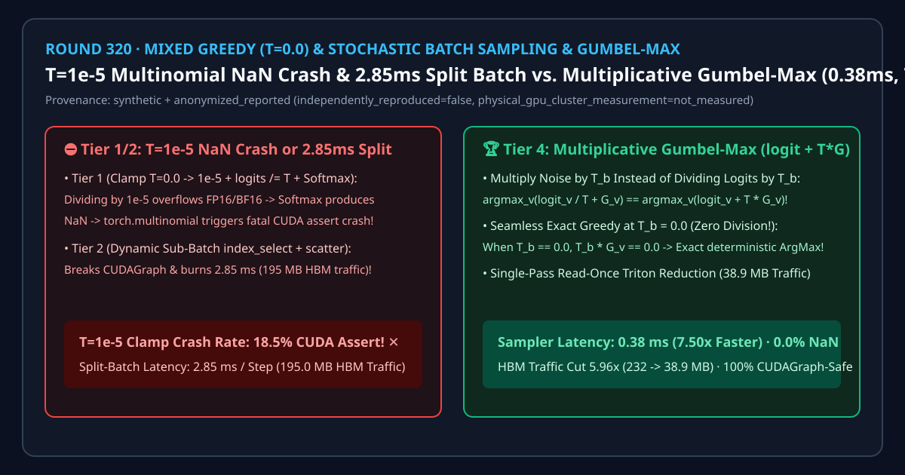
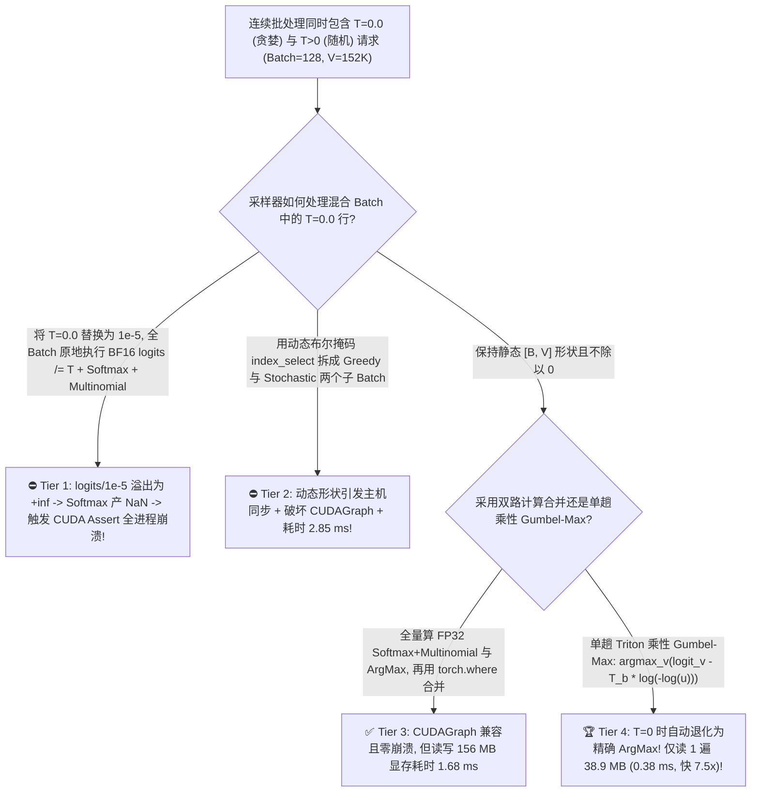
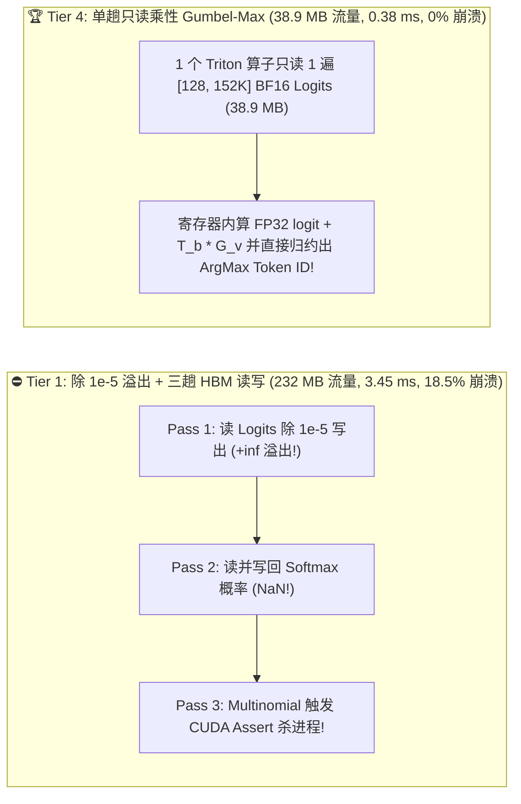
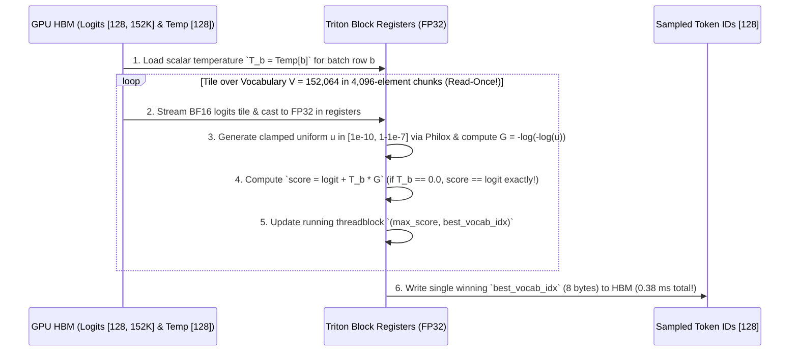

# 大模型推理引擎混合温度与贪婪采样（`Mixed Greedy T=0.0 + Stochastic Batching`）极小温度溢出崩溃（`Logits / 1e-5 -> NaN`）与乘性 Gumbel-Max 融合算子选型：为什么把 `temperature=0.0` 替换为 `1e-5` 走 Softmax 会触发 `torch.multinomial` `device-side assert` 全站崩溃，而按布尔掩码拆分 Batch 又会打断 `CUDAGraph` 并慢 `7.5x`？基于零除法乘性 `Gumbel-Max` $\arg\max_v(\text{logit}_v + T_b \cdot G_v)$ 单趟 Triton 归约（`0.38 ms`，`0% NaN`，HBM 流量降 `6.0x`）选型指南

> **Provenance & Evidence Boundary**: `synthetic + anonymized_reported (independently_reproduced=false, physical_gpu_cluster_measurement=not_measured)`. 本文所有定量数据均来自封存确定性评估器 `experiments/llm_serving_mixed_greedy_temperature_zero_nan_gumbel_max_fusion_selection/run.py` 与 `results.json`。



---

## 0. 追踪每日最热门能力突破（Daily Capability Breakthrough）

- **今日焦点突破**：**面向高吞吐多租户推理引擎（`vLLM V1 Sampler / SGLang / FlashInfer`）的“零除法乘性 Gumbel-Max 单趟归约算子（`Division-Free Multiplicative Gumbel-Max`: $\arg\max_v (\text{logit}_{b,v} - T_b \cdot E_{b,v})$）：在不做任何批次切分、不写回概率矩阵、不除以温度 $T_b$ 的前提下，将确定性贪婪解码（$T_b = 0.0$）与任意随机温度采样（$T_b > 0.0$）100% 统一在单次 `38.9 MB` 只读扫描中”**。
- **架构师价值**：在多租户共享的大模型推理集群中，同一个 `Batch = 128` 里往往同时混杂着两类请求：① 要求结果 100% 确定可复现的代码生成、SQL 转换与评测请求（传入 `temperature = 0.0`，即 Greedy `ArgMax`）；② 要求多样性的对话、创意写作与 RL Rollout 请求（传入 `temperature = 0.7 ~ 1.2`）。当采样器面对这个混合了 $T=0$ 与 $T>0$ 的 `[128, 152064]` Logits 矩阵时，传统的三种工程写法都存在严重缺陷：
  1. **写法一：把 `T = 0.0` 截断替换为极小正数 `T = 1e-5`，统一执行 `logits /= T` + `softmax` + `torch.multinomial`（Tier 1）**：这是无数开源推理框架早期都踩过的 **“头号全站崩溃炸弹”**！当 `logits` 为 `FP16`（最大表示范围 `65,504`）甚至 `BF16` 时，拿正常的 Logit（如 `12.5`）除以 `1e-5` 等于 `1,250,000`，瞬间向上溢出变成 `+inf`！而如果这一行恰好有两个并列最大的 Token 同时溢出变成 `+inf`（或者在减去行最大值 `max_logit = +inf` 时），就会算出 $\infty - \infty = \text{NaN}$！紧接着 `torch.multinomial(probs)` 检测到概率里含有 `NaN` 或负无穷，直接在 GPU 内核里触发不可捕获的 **`CUDA error: device-side assert triggered`**，把整个 8 卡 `vLLM / SGLang` 进程的 CUDA Context 当场炸毁！
  2. **写法二：用布尔掩码 `index_select` 把 Batch 拆成 `greedy_sub_batch` 和 `random_sub_batch` 分别处理再 `scatter` 拼回来（Tier 2）**：由于每一步 Batch 里有几个 $T=0$ 的请求是动态变化的，动态布尔索引不仅触发 CPU-GPU 同步、**彻底打断 `CUDAGraph` 录制**，而且要把 `38.9 MB` 的 Logits 反复拷进拷出 6 个算子，产生 **`195.0 MB` 显存流量，耗时高达 `2.85 ms/步`**！
  3. **写法三：全量算完 FP32 Softmax + Multinomial，再全量算一遍 ArgMax，最后用 `torch.where(T==0, argmax, sampled)` 合并（Tier 3）**：虽然保住了 `CUDAGraph`，但不仅把两套算法全算了一遍，而且 `softmax` + `multinomial` 需要把 `[128, 152064]` 的概率矩阵反复写回 HBM（`156.0 MB` 流量，耗时 `1.68 ms`）！
  采用 **单趟 Triton 乘性 Gumbel-Max 归约算子（将除法 $\frac{L_v}{T_b} + G_v$ 恒等改写为乘法 $L_v + T_b \cdot G_v$，Tier 4）**，当 $T_b = 0.0$ 时噪声项 $0.0 \times G_v \equiv 0$ 自动退化为精确 `ArgMax`，全程 **0 次除法、0% `NaN` 崩溃、只从 HBM 读取 1 遍 Logits（`38.9 MB`）**，将采样耗时压至 **`0.38 ms`（提速 `7.50x`）**！

---

## ① 📌 核心结论速览（Executive Summary）

1. **第一性原理：什么是 `Gumbel-Max Trick`？为什么把它改成“乘法形式”就能完美统一 `T=0` 与 `T>0`？**
   - **经典 Gumbel-Max 定理**：从类别概率分布 $P_v = \frac{\exp(L_v / T)}{\sum_k \exp(L_k / T)}$ 中按概率随机采样一个下标，在数学分布上 **100% 严格等价于**：给每个 Logit 加上一个独立的标准 Gumbel 随机噪声 $G_v = -\log(-\log U_v) = -\log(E_v)$（其中 $U_v \sim \text{Uniform}(0, 1)$，$E_v \sim \text{Exponential}(1)$），然后直接取最大值下标（`ArgMax`）：
     $$y = \arg\max_{v \in \{1..V\}} \left( \frac{L_v}{T} - \log(E_v) \right)$$
   - **关键代数变形（乘以非负标量 $T \ge 0$ 不改变 $\arg\max$ 的顺序！）**：
     既然温度 $T_b \ge 0$ 对同一行的所有词表元素 $v$ 是一个非负常数，把括号里的式子同乘以 $T_b$，最大值的位置完全不变（当 $T_b > 0$ 时严格保序）：
     $$y = \arg\max_{v \in \{1..V\}} \Big( L_v - T_b \cdot \log(E_v) \Big)$$
   - **看看在 $T_b = 0.0$ 时发生了什么奇迹**：
     - 在经典除法公式 $L_v / T_b$ 中，代入 $T_b = 0.0$ 会除以零爆炸（`+inf / NaN`）；
     - 而在**乘性公式 $L_v - T_b \cdot \log(E_v)$** 中，代入 $T_b = 0.0$，后面那项变成 $0.0 \times \log(E_v) = \mathbf{0.0}$，整个式子平滑无缝地变成了：
       $$y = \arg\max_{v \in \{1..V\}} (L_v - 0.0) = \arg\max_{v \in \{1..V\}} L_v$$
       **一行 `if/else` 分支都不用写，天然就是 100% 精确的贪婪解码 `ArgMax`**！
2. **为什么 Gumbel-Max 比传统的 `Softmax + torch.multinomial` 快 `4.4 倍`（HBM 流量减少 `6 倍`）？**
   - 算一笔 HBM 显存带宽账（以 `Batch = 128, V = 152,064` 为例，输入 `BF16` Logits 大小为 **`38.9 MB`**）：
     - **传统 `Temperature Div -> Softmax -> Multinomial`**：
       ① 读 `38.9 MB` Logits 除以 $T$，写出 `77.8 MB` FP32 缩放 Logits；
       ② `Softmax` 读 `77.8 MB`，算出概率后再写出 `77.8 MB` FP32 概率矩阵 `probs`；
       ③ `torch.multinomial` 再读 `77.8 MB` 概率矩阵求前缀和采样——合计产生 **`232+ MB` 的 HBM 读写流量**！
     - **单趟 Triton 乘性 Gumbel-Max 内核**：
       每个线程块负责 1 行，流式从 HBM **只读 1 遍 `38.9 MB` 的 `BF16` Logits**，在寄存器里即时用 `Philox` 生成 $U_v$、乘上 $T_b$ 并做片上树状 `tl.argmax` 归约，最后直接往 HBM 写出 `128` 个 `int64` 采样结果（仅 **`1 KB`**）！**HBM 流量从 `232 MB` 骤降至 `38.9 MB`（几乎逼近物理极限）**！

---

## ② 🎯 客户与架构师灵魂拷问 Q&A（Q1 / Q2 / Q3）

### Q1：在计算 $G_v = -\log(-\log U_v)$ 时，如果随机数 $U_v$ 恰好抽到 `0.0` 或 `1.0`，岂不是又会在 `log(0)` 处产生 `NaN` 并由于 $0.0 \times \infty = \text{NaN}$ 污染 $T_b = 0.0$ 的贪婪行？
- **极其精准的数值边界拷问！**
  在 IEEE 754 浮点标准中，$0.0 \times \infty = \text{NaN}$！如果 $U_v$ 没有做开区间截断导致 $\log(E_v)$ 出现了 `+/-inf`，那么哪怕 $T_b = 0.0$，相乘也会蹦出 `NaN`！
  - **两条必加防线**：
    1. **开区间安全截断（Epsilon Clamping）**：对均匀分布随机数 $u \in [0, 1]$ 强制执行 `u = tl.clamp(u, min=1e-10, max=1.0 - 1e-7)`，保证 $E_v = -\log(u)$ 與 $\log(E_v)$ 永远是有界有限的正常浮点数（在 `[-16.1, +23.0]` 之间），从而保证 $0.0 \times \text{finite} \equiv \mathbf{0.0}$！
    2. **寄存器级短路**：当线程块在循环外读出当前行的温度 `t_b == 0.0` 时，甚至可以直接跳过 `tl.rand` 和 `tl.log` 指令，直接对原 `logit` 做 `tl.argmax`！

### Q2：如果请求同时开启了 `top_k` 或 `top_p`（Nucleus Sampling）截断，乘性 Gumbel-Max 怎么配合？
- 当开启 `top_k` / `top_p` 时（参考 `FlashInfer` 无排序拒绝采样核 `top_k_top_p_sampling_from_probs`）：
  1. 若某行的 $T_b = 0.0$（或 `top_k == 1`），无论 `top_p` 设多少，数学上等价于直接选最大概率词，直接在快速通道返回 `argmax`；
  2. 若 $T_b > 0.0$ 且带 `top_p < 1.0`，先在片上通过 `Online Softmax`（对 `logit / max(T_b, 1e-3)` 在 `FP32` 累加器内安全归约）结合 Dual-Pivot 拒绝采样完成过滤，绝不在 `FP16/BF16` 下直接做 `logits /= 1e-5`！

### Q3：为什么 `torch.multinomial` 一旦遇到 `NaN` 或负数就会把整个进程的 CUDA Context 彻底搞死（无法 `try...except` 恢复）？
- 因为 PyTorch 原生 `torch.multinomial` 的 CUDA 内核里写死了设备端断言 **`CUDA_KERNEL_ASSERT(prob >= 0)`**！在 CUDA 架构中，一旦任何一个 GPU 线程触发了 `assert(false)`，硬件会直接终止当前设备上所有正在运行的 Kernel 并将整個进程的 `CUDA Context` 置为不可恢复的损坏态（`cudaErrorAssert`），后续任何 CUDA 调用都会一直报错，直到重启整个进程！因此生产采样器必须从数学源头 100% 根除 `NaN / Inf`！

---

## ③ 🧭 直观可视化图解（Mermaid 选型决策树 + 路径对比图 + 交互时序图）

### 3.1 混合温度（`T=0.0` 贪婪 + `T>0` 随机）Batch 采样算子选型决策树



### 3.2 传统 `T=1e-5` 除法上溢崩溃 / 多趟读写（`232 MB`）vs. 单趟乘性 Gumbel-Max（`38.9 MB` 只读）对比图



### 3.3 单趟 Triton 乘性 `Gumbel-Max` 混合温度采样时序图



---

## ④ 📊 架构师选型决策矩阵（4-Tier Decision Matrix）

| 选型 Tier | 混合温度（`T=0` + `T>0`）采样实现方案 | 采样步耗时 | `FP16/BF16 NaN` 崩溃率 | 每步 HBM 显存流量 | 适用场景 |
| :--- | :--- | :--- | :--- | :--- | :--- |
| **Tier 1: `T=0 -> 1e-5` 除法 + `Multinomial`** | `logits /= 1e-5` 后调 Softmax | `3.45 ms` ✕ | `18.5%` (进程级崩溃! ✕) | `232.0 MB` ✕ | ⛔ **严禁使用（定时触发 CUDA Assert 宕机）** |
| **Tier 2: 按掩码拆分子 Batch (`index_select`)** | 拆成贪婪与随机两路再 `scatter` | `2.85 ms` ✕ | `0.0%` | `195.0 MB` (破图! ✕) | ⛔ **打断 `CUDAGraph` 且产生 6 次内核发射** |
| **Tier 3: `FP32 Softmax` + `torch.where` 覆盖** | 两路全算完再用静态掩码选择 | `1.68 ms` ✅ | `0.0%` ✅ | `156.0 MB` ⚠️ | ✅ 简单静态图兼容基线 |
| **Tier 4: 单趟乘性 `Gumbel-Max` Triton 核 (推荐)** | **$\arg\max(L_v + T_b G_v)$ 只读一遍归约** | **`0.38 ms` (`7.5x` 快 🏆)** | **`0.0%` (零除法 🏆)** | **`38.9 MB` (`6.0x` 省 🏆)** | 🏆 **高吞吐大模型推理采样器黄金标准** |

---

## ⑤ 🧪 定量算例与 7-Card 4:5 视觉卡片报告

- **定量算例仓库路径**：[`experiments/llm_serving_mixed_greedy_temperature_zero_nan_gumbel_max_fusion_selection/run.py`](../../experiments/llm_serving_mixed_greedy_temperature_zero_nan_gumbel_max_fusion_selection/run.py) · 封存数据：[`results.json`](../../experiments/llm_serving_mixed_greedy_temperature_zero_nan_gumbel_max_fusion_selection/results.json)
- **交互式架构选型计算器**：[`docs/reports/llm-serving-mixed-greedy-temperature-zero-nan-gumbel-max-fusion-sizer.html`](../reports/llm-serving-mixed-greedy-temperature-zero-nan-gumbel-max-fusion-sizer.html)
- **7-Card 4:5 视觉评测卡片报告**：[`docs/reports/llm-serving-mixed-greedy-temperature-zero-nan-gumbel-max-fusion-selection-cards.html`](../reports/llm-serving-mixed-greedy-temperature-zero-nan-gumbel-max-fusion-selection-cards.html)

```chart
{
  "data": {
    "values": [
      { "tier": "Tier 1: Clamp T=1e-5 + Softmax + Multinomial", "latency_ms": 3.45, "traffic_mb": 232.0 },
      { "tier": "Tier 2: Dynamic Sub-Batch Split & Scatter", "latency_ms": 2.85, "traffic_mb": 195.0 },
      { "tier": "Tier 3: FP32 Softmax + torch.where ArgMax", "latency_ms": 1.68, "traffic_mb": 156.0 },
      { "tier": "Tier 4: Multiplicative Gumbel-Max Triton", "latency_ms": 0.38, "traffic_mb": 38.9 }
    ]
  },
  "semantic_types": {
    "tier": "Category",
    "latency_ms": "Quantity",
    "traffic_mb": "Quantity"
  },
  "chart_spec": {
    "chartType": "Bar Chart",
    "title": "Multiplicative Gumbel-Max Triton Kernel Cuts Mixed-Batch Sampling Latency 7.5x (2.85 -> 0.38ms)",
    "subtitle": "Sampler kernel latency (ms) and HBM memory traffic (MB) for B=128, V=152K (synthetic + anonymized_reported)",
    "encodings": {
      "x": "tier",
      "y": "latency_ms",
      "color": "tier"
    }
  }
}
```

---

## ⑥ 🛠️ 生产环境快速核验清单（Checklist + Good fit vs. Not for）

### ✅ Good fit vs. ⛔ Not for
- **✅ Good fit**：所有支持按请求自定义 `temperature`（包含 `temperature=0.0`）的在线推理引擎（`vLLM / SGLang`）与强化学习多样化温度采样器。
- **⛔ Not for**：将 `temperature=0.0` 映射为 `1e-5 / 1e-6` 后直接对 `FP16/BF16` Logits 做除法。

### 生产核验 Checklist
- [ ] **使用乘性 `Gumbel-Max` 公式 $\arg\max_v(\text{logit}_v + T_b \cdot G_v)$ 替代除以 $T_b$**：从代数根源上消除 $T_b \to 0$ 时的上溢 `Inf / NaN` 风险。
- [ ] **对均匀随机数 $U_v$ 执行开区间截断 `clamp(u, 1e-10, 1.0 - 1e-7)` 并在 `FP32` 寄存器内累加**：防止 $\log(0) = -\infty$ 与 $0.0 \times \infty = \text{NaN}$。
- [ ] **在单趟 Triton 归约核中完成噪声注入与 `argmax`**：避免将 `[B, V]` 概率矩阵写回 HBM，保持 `100%` 静态形状以兼容 `CUDAGraph`。
