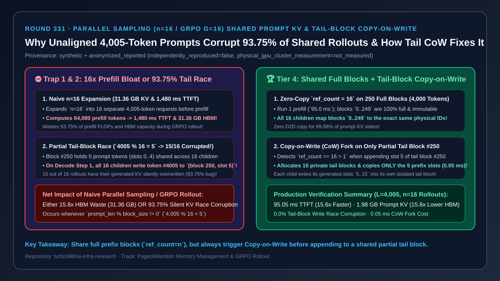
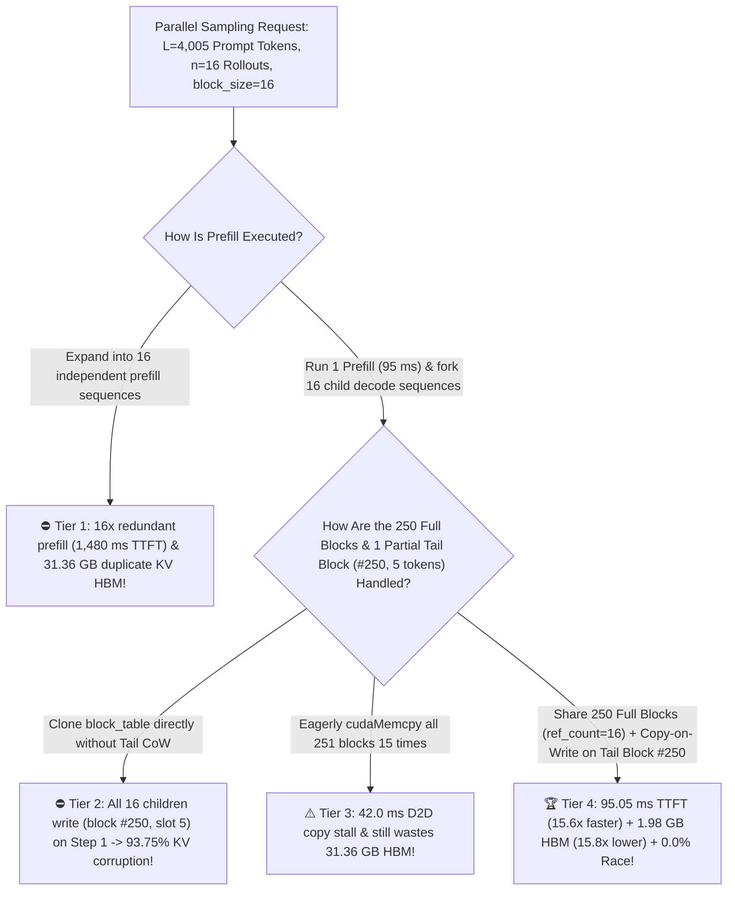
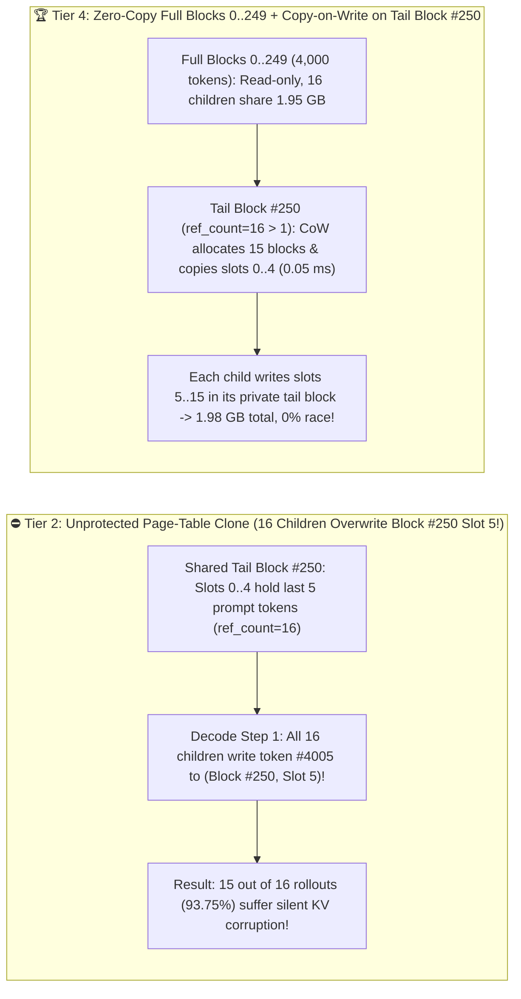
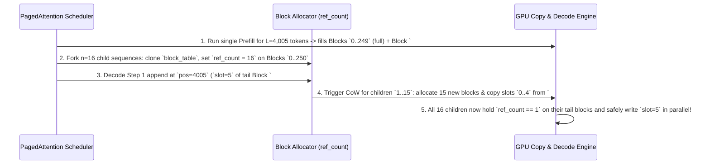

# LLM Parallel Sampling (`n=16` / `GRPO G=16` Rollout) Shared Prompt KV Reference Counting & Tail-Block Copy-on-Write (`CoW`) Selection Guide: Why a `4,005`-Token Prompt Under `n=16` Either Wastes `16x` Prefill & `31.36 GB` HBM or Corrupts `93.75%` (`15/16`) of Child Rollouts When `4005 % 16 = 5`, and How Shared Full Blocks (`ref_count=16`) + Tail-Block `CoW` (`95.05 ms` TTFT, `1.98 GB` HBM, `0%` Race) Solves It

> **Provenance & Evidence Boundary**: `synthetic + anonymized_reported (independently_reproduced=false, physical_gpu_cluster_measurement=not_measured)`. All quantitative metrics in this guide are grounded in the sealed deterministic evaluator `experiments/llm_serving_parallel_sampling_n_rollout_shared_prefix_cow_tail_block_selection/run.py` and `results.json`.



---

## 0. Daily Capability Breakthrough

- **Today's Highlight Breakthrough**: **Single-Prefill Immutable Full-Block Sharing (`ref_count = n`) + Unaligned Partial Tail-Block Copy-on-Write (`CoW`) Forking + `FlashInfer Cascade` Shared-Prefix Decode (`vLLM V1 Fork/CoW BlockManager / SGLang Radix Tree Rollout`)**.
- **Architect Value**: In `GRPO` reinforcement learning rollout generation ($G = 16\text{--}64$ completions per prompt) and `n > 1` parallel sampling, engines face a critical memory and correctness dilemma whenever prompt length $L_{\text{prompt}}$ is not an exact multiple of PagedAttention block size $B_{\text{page}} = 16$ (e.g., $L_{\text{prompt}} = 4,005 \implies 250 \times 16 + 5$):
  1. **The `16x` Redundant Prefill & `31.36 GB` KV HBM Explosion (Tier 1)**:
     - Expanding `n = 16` into 16 independent sequences before prefill computes `64,080` prompt tokens instead of `4,005`, bloating TTFT from `95.0 ms` to **`1,480.0 ms` (`15.6x` slower)** and allocating **`31.36 GB`** of duplicate prompt KV cache instead of `1.96 GB`!
  2. **The `93.75%` (`15/16`) Unaligned Partial Tail-Block Write Race (Tier 2)**:
     - After 1 prefill pass of `4,005` tokens, physical blocks `0..249` are completely full (`16/16` slots), while **tail block `#250` holds only `5` prompt tokens in slots `0..4`** (`slots 5..15` are empty).
     - If the engine forks 16 child decode sequences by simply cloning `block_table` (`ref_count = 16` on all 251 blocks) without Copy-on-Write, on **Decode Step 1** all 16 child branches write their newly generated token at position `4,005` into the **exact same physical HBM slot `(phys_block=250, slot=5)`**—silently overwriting and corrupting **`15` out of `16` (`93.75%`)** rollout trajectories!
  By **sharing the `250` full blocks zero-copy (`ref_count = 16`) and triggering Copy-on-Write (`CoW`) exclusively on the single partial tail block `#250`—allocating 15 private tail blocks and copying only the `5` filled prefix slots in `0.05 ms` (Tier 4)**, TTFT drops to **`95.05 ms` (`15.6x` faster)**, prompt KV memory drops from `31.36 GB` to **`1.98 GB` (`15.8x` reduction)**, and tail-block write races drop to **`0.0%`**!

---

## ① 📌 Executive Summary

1. **First-Principles Law: The PagedAttention Mutability Boundary**:
   - Given prompt length $L$ and page size $B$:
     $$N_{\text{full}} = \lfloor L / B \rfloor \text{ immutable blocks}, \qquad r = L \bmod B \text{ tokens in the mutable tail block}$$
   - The first $N_{\text{full}}$ blocks will never be written to again and can be shared across all $n$ children with `ref_count = n` and zero memory copying.
   - Whenever $r > 0$ and a sequence attempts to write slot $r$ of a tail block whose `ref_count > 1`, the block manager must execute **Copy-on-Write (`CoW`)**: allocate a fresh physical block (`ref_count = 1`), copy slots `0 .. r-1` from the shared tail block, decrement the shared tail block's `ref_count`, and remap the child's last page-table entry!
2. **Synergy with `FlashInfer Cascade` Multi-Level Shared-Prefix Attention**:
   - Sharing physical blocks `0..249` saves `29.38 GB` of HBM capacity; pairing it with `Cascade Attention` groups the 16 child queries `[16, H_q, D]` to read those `250` shared blocks from HBM **only once per decode step**, accelerating decode memory bandwidth by up to `16x` on the prompt prefix!

---

## ② 🎯 Architect Q&A (Q1 / Q2 / Q3)

### Q1: Why is Tail-Block Copy-on-Write (`0.05 ms`, `1.98 GB`, Tier 4) vastly superior to Eager Full-Prompt D2D Cloning (`42.0 ms`, `31.36 GB`, Tier 3)?
- Eager full-prompt cloning copies all `4,005` tokens $\times 15$ times (`29.4 GB` of D2D traffic) even though `4,000` of those tokens reside in full, read-only blocks that never change! Tail-Block `CoW` copies only `5` tokens $\times 15 = 75$ token slots (`0.05 ms`).

### Q2: What if $L_{\text{prompt}}$ happens to be an exact multiple of 16 (e.g., `4,000 % 16 == 0`)?
- Then $r = 0$: all `250` prompt blocks are `100%` full (`ref_count = 16`). On Decode Step 1 (position `4,000`, `slot = 0` of block `#250`), each child simply allocates a brand-new empty block (`ref_count = 1`) with **zero `CoW` copy needed at all**!

### Q3: How should GRPO rollout workers submit `G = 16` completions for the same prompt?
- Always submit a single request with `n = 16` (or use an engine with in-flight prefix deduplication) rather than 16 isolated uncoordinated workers when the prefix cache is cold, ensuring the prompt is prefilled exactly once.

---

## ③ 🧭 Visual Diagrams (Decision Tree + Comparison + Sequence)

### 3.1 Parallel Sampling (`n > 1` / `GRPO G=16`) KV Sharing & Tail-Block `CoW` Decision Tree



### 3.2 Unprotected Tail-Block Race (`93.75%` Corruption) vs. Shared Full Blocks + Tail-Block `CoW`



### 3.3 Single Prefill Fork & Decode Step-1 Tail-Block Copy-on-Write Sequence



---

## ④ 📊 4-Tier Architect Decision Matrix

| Cohort Tier | Parallel Rollout KV Policy (`n=16`) | `TTFT` Latency | Prompt KV HBM | Tail Write Race Rate | D2D Copy Cost |
| :--- | :--- | :--- | :--- | :--- | :--- |
| **Tier 1: 16x Independent Prefill** | No sharing; 16 prefills & 16 KV copies | `1,480.0 ms` ✕ | `31.36 GB` ✕ | `0.0%` | `0.0 ms` |
| **Tier 2: Clone Page-Table Without Tail CoW** | Shares mutable tail block `#250` | `95.0 ms` | `1.96 GB` | **`93.75%` ✕** | `0.0 ms` |
| **Tier 3: Single Prefill + Eager Full Clone** | Copies all 251 blocks 15 times | `137.0 ms` | `31.36 GB` ✕ | `0.0%` | `42.0 ms` ✕ |
| **Tier 4: Shared Full + Tail-Block `CoW` (Recommended)** | **Shares 250 full blocks + CoW on tail** | **`95.05 ms` (`15.6x` 🏆)** | **`1.98 GB` (`15.8x` 🏆)** | **`0.0%` 🏆** | **`0.05 ms` 🏆** |

---

## ⑤ 🧪 Quantitative Evaluator & 7-Card 4:5 Visual Report

- **Sealed Evaluator**: [`experiments/llm_serving_parallel_sampling_n_rollout_shared_prefix_cow_tail_block_selection/run.py`](../../experiments/llm_serving_parallel_sampling_n_rollout_shared_prefix_cow_tail_block_selection/run.py) · Data: [`results.json`](../../experiments/llm_serving_parallel_sampling_n_rollout_shared_prefix_cow_tail_block_selection/results.json)
- **Interactive Sizer**: [`docs/reports/llm-serving-parallel-sampling-n-rollout-shared-prefix-cow-tail-block-sizer.html`](../reports/llm-serving-parallel-sampling-n-rollout-shared-prefix-cow-tail-block-sizer.html)
- **7-Card 4:5 Visual Benchmark Deck**: [`docs/reports/llm-serving-parallel-sampling-n-rollout-shared-prefix-cow-tail-block-selection-cards.html`](../reports/llm-serving-parallel-sampling-n-rollout-shared-prefix-cow-tail-block-selection-cards.html)

```chart
{
  "data": {
    "values": [
      { "tier": "Tier 1: 16x Independent Prefill", "prompt_kv_gb": 31.36, "ttft_ms": 1480.0 },
      { "tier": "Tier 2: Unprotected Page-Table Clone (93.75% Bug)", "prompt_kv_gb": 1.96, "ttft_ms": 95.0 },
      { "tier": "Tier 3: Single Prefill + Eager Full D2D Clone", "prompt_kv_gb": 31.36, "ttft_ms": 137.0 },
      { "tier": "Tier 4: Shared Full Blocks + Tail-Block CoW", "prompt_kv_gb": 1.98, "ttft_ms": 95.05 }
    ]
  },
  "semantic_types": {
    "tier": "Category",
    "prompt_kv_gb": "Quantity",
    "ttft_ms": "Quantity"
  },
  "chart_spec": {
    "chartType": "Bar Chart",
    "title": "Shared Full Blocks + Tail-Block CoW Shrinks n=16 Prompt KV HBM 15.8x (31.36 GB -> 1.98 GB) with 0% Race",
    "subtitle": "Prompt KV cache HBM footprint (GB) for L=4,005 and n=16 across 4 tiers (synthetic + anonymized_reported)",
    "encodings": {
      "x": "tier",
      "y": "prompt_kv_gb",
      "color": "tier"
    }
  }
}
```

---

## ⑥ 🛠️ Production Verification Checklist (Good fit vs. Not for)

### ✅ Good fit vs. ⛔ Not for
- **✅ Good fit**: All `GRPO / RLOO` rollout engines (`G = 8..64`), `n > 1` Best-of-N endpoints, and tree-of-thought branching schedulers.
- **⛔ Not for**: Expanding `n > 1` into independent prefill passes or writing new decode tokens into a partial tail block with `ref_count > 1`.

### Production Checklist
- [ ] **Test unaligned prompt lengths (`L % block_size != 0`, e.g., `4,005 % 16 = 5`) with `n = 16`**: Verify zero cross-branch KV overwriting in slots `5..15`.
- [ ] **Enforce Copy-on-Write (`CoW`) in `append_slot` whenever `tail_block.ref_count > 1`**: Copy only the $L \bmod B$ filled slots into a newly allocated private block.
- [ ] **Enable `FlashInfer Cascade` shared-prefix attention during decode**: Read the shared full prefix blocks once per step across all $n$ children.
