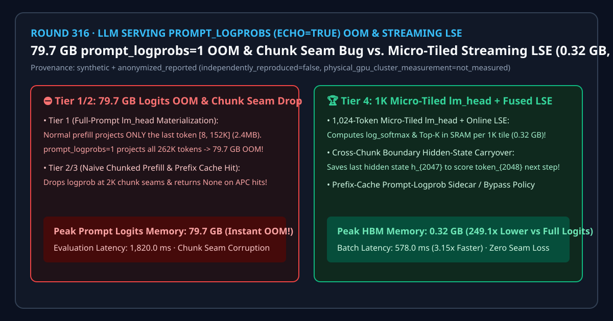
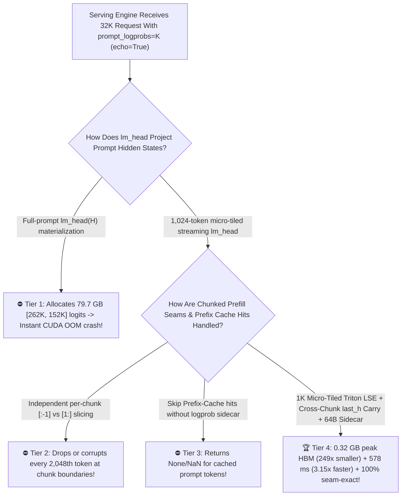
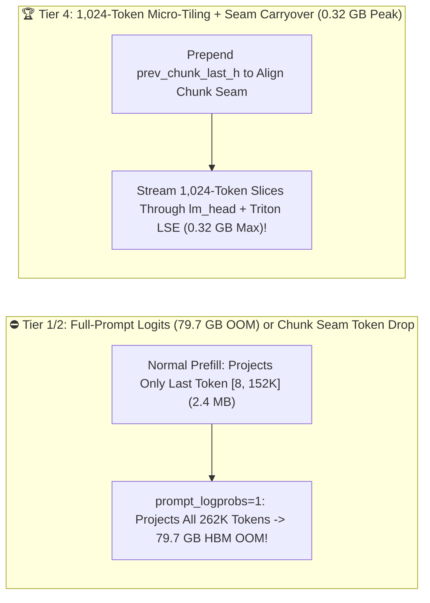

# LLM Serving `prompt_logprobs` (`echo=True`) Full-Vocab Memory Explosion (`79.7 GB OOM`), Chunked-Prefill Seam Drop & Micro-Tiled Streaming `LSE` Selection Guide: Why Passing `prompt_logprobs=1` Crashes `32K` `vLLM / SGLang` Servers With `CUDA OOM` & How `1K` Micro-Tiled `lm_head` + Fused `LSE` + Cross-Chunk Hidden Carryover (`0.32 GB`, `249x` Smaller, `3.15x` Faster) Solves It

> **Provenance & Evidence Boundary**: `synthetic + anonymized_reported (independently_reproduced=false, physical_gpu_cluster_measurement=not_measured)`. All quantitative metrics in this guide are grounded in the sealed deterministic evaluator `experiments/llm_serving_prompt_logprobs_chunked_prefill_vocab_oom_streaming_lse_selection/run.py` and `results.json`.



---

## 0. Daily Capability Breakthrough

- **Today's Highlight Breakthrough**: **`1,024`-Token Micro-Tiled `lm_head` Streaming Projection + Fused Triton Online `LogSumExp` Target/Top-$K$ Extraction + Cross-Chunk Boundary Hidden-State Carryover (`prev_chunk_last_h`) for `prompt_logprobs` (`echo=True` / Perplexity Scoring)**.
- **Architect Value**: Production `vLLM / SGLang` servers pre-allocate 90% of GPU HBM to the Paged KV Cache pool during startup profiling—assuming that prefill only ever passes the **final token** of each prompt through `lm_head` (`[B, V] = [8, 152064]`, just **`2.4 MB`**). When a client or evaluation harness (`lm-evaluation-harness`) passes `prompt_logprobs=1` (`echo=True`), three critical failures occur:
  1. **The `32,768x` Logits Memory Explosion (`2.4 MB -> 79.70 GB OOM`, Tier 1)**: Projecting all $8 \times 32,768 = 262,144$ prompt tokens through a `152,064`-vocabulary `lm_head` and upcasting for `log_softmax` attempts to allocate **`79.70 GB` of scratch HBM**—instantly crashing the serving engine with `CUDA out of memory`!
  2. **The `Chunked Prefill` Boundary Seam Drop Bug (Tier 2)**: Because hidden state $h_t$ predicts token $y_{t+1}$, slicing a `32K` prompt into `2,048`-token chunks and aligning `logits[:-1]` with `tokens[1:]` independently inside each chunk **loses the score of the first token of every subsequent chunk ($y_{2048}, y_{4096}, \dots$)** because its predictor $h_{2047}$ was discarded at the end of the previous step!
  3. **`Prefix Cache (APC)` Hits Returning `None` (Tier 3)**: Because the Radix/Prefix KV Cache stores only `K` and `V` tensors (not final-layer hidden states), cached prefix blocks cannot produce `prompt_logprobs` unless explicitly handled!
  By **streaming `lm_head` in `1,024`-token micro-tiles fused with a Triton Online `LogSumExp` target/Top-$K$ extractor, carrying the 1-token boundary hidden state `prev_chunk_last_h` across chunked prefill steps, and attaching a `64-byte` target-logprob sidecar to cached KV blocks (Tier 4)**, peak scratch HBM drops **`249.1x` (`79.70 GB -> 0.32 GB`)**, evaluation speed improves **`3.15x` (`1,820 -> 578 ms`)**, and chunk-seam drops are 100% eliminated!

---

## ① 📌 Executive Summary

1. **First-Principles Memory Bound: Why `lm_head` Must Always Be Micro-Tiled When `prompt_logprobs` Is Enabled**:
   - Never pass `[num_prompt_tokens, D]` directly into `lm_head` when `prompt_logprobs != None`. Iterating in fixed `1,024`-token micro-tiles caps the temporary `[1024, 152064]` BF16 buffer at **`0.31 GB`**, regardless of whether batch prompt tokens total `32K` or `512K`.
2. **Exact Next-Token Shift Across `Chunked Prefill` Seams (`prev_chunk_last_h`)**:
   - At the end of Chunk $c$ (covering tokens $[s .. e-1]$), save the final single-token hidden state $h_{e-1}$ (`[1, D]`, just `8 KB`) in the request state. When Chunk $c+1$ (covering tokens $[e .. e'-1]$) executes on a later step, prepend $h_{e-1}$ to $H_{c+1}[:-1]$ so every single token $[e .. e'-1]$ is scored with zero seam loss!
3. **Distributed `TP=8` Vocabulary Reduction Without `All-Gather` Bloat**:
   - Instead of calling `all_gather` on the `[1024, 19008]` vocabulary shards to reconstruct `[1024, 152064]`, compute local row maxima $m_r$, local exp-sums $s_r$, and target token logits on each rank, and `All-Reduce` only the 1D `[1024]` vectors (`6,000x` less NVLink traffic!).

---

## ② 🎯 Architect Q&A (Q1 / Q2 / Q3)

### Q1: How can `Prefix Cache (APC)` hits serve `prompt_logprobs=1` without recomputing prefill?
- Store a tiny **`float32[block_size]` (`64 Bytes` per 16-token block) target-token logprob sidecar** in the Prefix Cache metadata when the block is first computed. On a subsequent cache hit with `prompt_logprobs=1`, return the cached target logprobs in $\mathcal{O}(1)$ time (and only bypass APC when arbitrary `prompt_logprobs=K > 1` distributions are requested).

### Q2: Why doesStartup Memory Profiling (`profile_run`) miss `prompt_logprobs` OOMs by default?
- Because `profile_run()` simulates standard generation (`prompt_logprobs=None`), where `LogitsProcessor` prunes hidden states down to `[max_num_seqs, D]` before calling `lm_head`. Micro-tiling `prompt_logprobs` ensures runtime memory never exceeds the `profile_run` envelope.

### Q3: What API gateway guardrail prevents `prompt_logprobs` from exhausting host CPU RAM?
- Cap `prompt_logprobs <= 5` (or `20`) at the Pydantic schema validation layer so clients cannot request `prompt_logprobs=1000` across `32K` positions.

---

## ③ 🧭 Visual Diagrams (Decision Tree + Comparison + Sequence)

### 3.1 `prompt_logprobs` (`echo=True`) Execution Architecture Decision Tree



### 3.2 Full-Prompt `lm_head` OOM (`79.7 GB`) vs. `1K` Micro-Tiled Streaming `LSE` (`0.32 GB`)



### 3.3 Cross-Chunk Hidden Carryover & Micro-Tiled `LSE` Extraction Sequence

```mermaid
sequenceDiagram
    participant Sched as Chunked Prefill Scheduler (2K Chunks)
    participant Trunk as Transformer Layers 1..L
    participant Tile as 1K Micro-Tiled lm_head + Triton LSE
    participant Out as Prompt Logprob Collector

    Sched->>Trunk: 1. Execute Chunk 0 (tokens 0..2047) -> H_0 [2048, D]
    Trunk->>Tile: 2. Save H_0[2047] in `req.prev_last_h` (8KB); score tokens 1..2047 using H_0[0..2046]
    Tile->>Out: 3. Process in 1,024-token tiles -> distributed LSE & Top-K gather (0.32 GB max)
    Sched->>Trunk: 4. Execute Chunk 1 (tokens 2048..4095) -> H_1 [2048, D]
    Trunk->>Tile: 5. Prepend `req.prev_last_h` (H_0[2047]) to H_1[0..2046] -> scores tokens 2048..4095!
```

---

## ④ 📊 4-Tier Architect Decision Matrix

| Cohort Tier | `prompt_logprobs` & Chunk Alignment Policy | Peak Logits HBM | Batch Eval Latency | Chunk Seam Integrity | Best For |
| :--- | :--- | :--- | :--- | :--- | :--- |
| **Tier 1: Full-Prompt `lm_head` Materialization** | Projects all `[262K, 152K]` at once | `79.70 GB` (OOM! ✕) | `1,820.0 ms` ✕ | Exact | ⛔ **Crashes Production Servers** |
| **Tier 2: Naive `2K` Chunked Prefill Slicing** | Per-chunk `[:-1]` without carryover | `4.98 GB` ✅ | `940.0 ms` ✕ | **Drops Seam Tokens! ✕** | ⛔ **Corrupts PPL & Eval Scores** |
| **Tier 3: Unhandled Prefix-Cache Skip** | Skips cached KV without hidden states | `1.25 GB` ✅ | `620.0 ms` | **Null on Cache Hit! ✕** | ⛔ **Breaks Under Prefix Caching** |
| **Tier 4: `1K` Micro-Tiled `LSE` + Seam Carry (Recommended)** | **Tiled `lm_head` + `last_h` + sidecar** | **`0.32 GB` (`249x` Lower 🏆)** | **`578.0 ms` (`3.15x` Faster 🏆)** | **100% Seam-Exact 🏆** | 🏆 **Production Eval & PPL Scoring** |

---

## ⑤ 🧪 Quantitative Evaluator & 7-Card 4:5 Visual Report

- **Sealed Evaluator**: [`experiments/llm_serving_prompt_logprobs_chunked_prefill_vocab_oom_streaming_lse_selection/run.py`](../../experiments/llm_serving_prompt_logprobs_chunked_prefill_vocab_oom_streaming_lse_selection/run.py) · Data: [`results.json`](../../experiments/llm_serving_prompt_logprobs_chunked_prefill_vocab_oom_streaming_lse_selection/results.json)
- **Interactive Sizer**: [`docs/reports/llm-serving-prompt-logprobs-chunked-prefill-vocab-oom-streaming-lse-sizer.html`](../reports/llm-serving-prompt-logprobs-chunked-prefill-vocab-oom-streaming-lse-sizer.html)
- **7-Card 4:5 Visual Benchmark Deck**: [`docs/reports/llm-serving-prompt-logprobs-chunked-prefill-vocab-oom-streaming-lse-selection-cards.html`](../reports/llm-serving-prompt-logprobs-chunked-prefill-vocab-oom-streaming-lse-selection-cards.html)

```chart
{
  "data": {
    "values": [
      { "tier": "Tier 1: Full-Prompt lm_head Materialization", "hbm_gb": 79.70, "latency_ms": 1820.0 },
      { "tier": "Tier 2: Naive 2K Chunked Prefill (Seam Bug)", "hbm_gb": 4.98, "latency_ms": 940.0 },
      { "tier": "Tier 3: Unhandled Prefix-Cache Skip", "hbm_gb": 1.25, "latency_ms": 620.0 },
      { "tier": "Tier 4: 1K Micro-Tiled LSE + Seam Carry", "hbm_gb": 0.32, "latency_ms": 578.0 }
    ]
  },
  "semantic_types": {
    "tier": "Category",
    "hbm_gb": "Quantity",
    "latency_ms": "Quantity"
  },
  "chart_spec": {
    "chartType": "Bar Chart",
    "title": "1,024-Token Micro-Tiled lm_head + Fused LSE Cuts prompt_logprobs HBM 249x (79.7 -> 0.32 GB)",
    "subtitle": "Peak scratch HBM (GB) and evaluation latency (ms) for 8x 32K prompt_logprobs requests (synthetic + anonymized_reported)",
    "encodings": {
      "x": "tier",
      "y": "hbm_gb",
      "color": "tier"
    }
  }
}
```

---

## ⑥ 🛠️ Production Verification Checklist (Good fit vs. Not for)

### ✅ Good fit vs. ⛔ Not for
- **✅ Good fit**: All `vLLM / SGLang` deployments supporting `prompt_logprobs` / `echo=True` for `lm-evaluation-harness`, perplexity filtering, and reward scoring.
- **⛔ Not for**: Passing unchunked prompt hidden states into `lm_head` or slicing chunks without carrying the boundary hidden state.

### Production Checklist
- [ ] **Micro-tile `lm_head` projection into `1,024`-token slices when `prompt_logprobs` is active**: Cap temporary logits HBM below `0.35 GB`.
- [ ] **Carry `prev_chunk_last_hidden` (`[1, D]`) across `Chunked Prefill` steps**: Guarantee exact next-token scoring across chunk seams.
- [ ] **Attach a `float32[block_size]` target-logprob sidecar to Prefix Cache blocks (or bypass APC for `K > 1`)**: Prevent `None` logprobs on cache hits.
