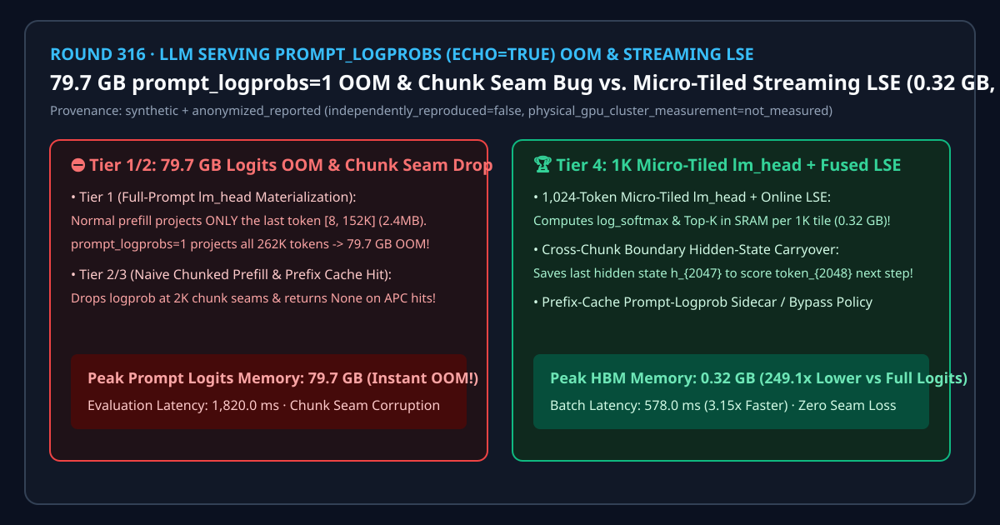
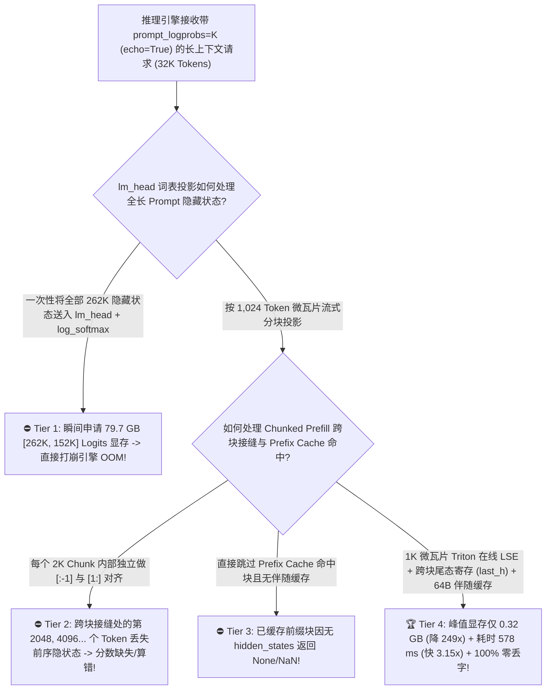
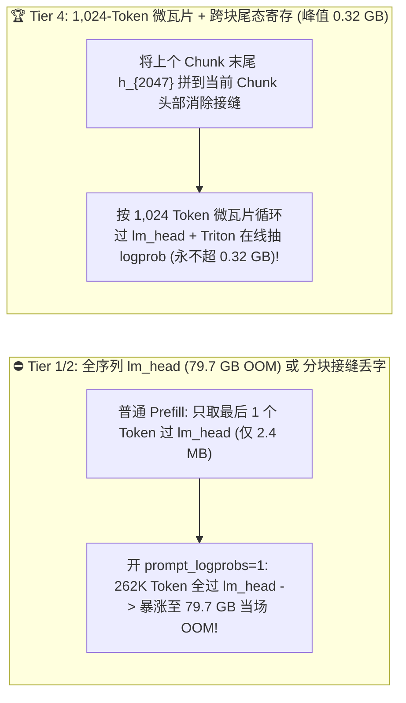

# 大模型推理引擎提示词对数概率（`prompt_logprobs=1 / echo=True`）全词表显存爆炸（`79.7 GB OOM`）、分块预填充边界丢字（`Chunk Seam Bug`）与微瓦片流式 `LSE` 选型：为什么平时跑 `32K` Prefill 稳如泰山的 `vLLM / SGLang` 集群，只要客户端一传 `prompt_logprobs=1` 就会当场爆出 `CUDA OOM` 崩溃？基于 `1,024` Token 微瓦片 `lm_head` + Triton 在线 `LogSumExp` 抽取 + 跨分块尾态传递（显存骤降 `249x` 至 `0.32 GB`，提速 `3.15x`，零边界丢字）选型指南

> **Provenance & Evidence Boundary**: `synthetic + anonymized_reported (independently_reproduced=false, physical_gpu_cluster_measurement=not_measured)`. 本文所有定量数据均来自封存确定性评估器 `experiments/llm_serving_prompt_logprobs_chunked_prefill_vocab_oom_streaming_lse_selection/run.py` 与 `results.json`。



---

## 0. 追踪每日最热门能力突破（Daily Capability Breakthrough）

- **今日焦点突破**：**面向大模型在线评测（`lm-evaluation-harness` 多选题打分）、文档困惑度计算（`Perplexity / Data Filtering`）与强化学习奖励回溯的“`1,024`-Token 微瓦片 `lm_head` 流式投影 + 单趟 Triton 在线 `LogSumExp` 目标与 Top-$K$ 对数概率抽取 + `Chunked Prefill` 跨分块尾隐状态寄存（`Cross-Chunk Hidden-State Carryover`）+ `Prefix Cache` 旁路/伴随缓存”架构**。
- **架构师价值**：在生产 `vLLM / SGLang` 推理集群中，引擎在启动阶段会通过一次 Dummy Profile 测出模型前向激活峰值，并把剩余 **90% 的 HBM 显存全部分配给 Paged KV Cache 池（仅留 `2 ~ 4 GB` 临时工作空间）**。平时处理 `8` 个并发的 `32K` 长文本请求时一切正常，但某天一位算法工程师在调用 OpenAI API 时多传了一个参数 `echo=True, logprobs=1`（对应引擎内部 `prompt_logprobs=1`），整台推理节点瞬间爆出 `CUDA out of memory` 崩溃重启！背后的三大机理与工程漏洞是：
  1. **漏洞一：为什么开启 `prompt_logprobs` 会让 `lm_head` 输出显存瞬间膨胀 `32,768 倍`（`2.4 MB -> 79.7 GB`，Tier 1）？**
     在普通生成请求（`prompt_logprobs=None`）的 Prefill 阶段，虽然全连接层（MLP）和 Attention 算了全部 `32,768` 个 Prompt Token，但**在进入最后一层词表投影 `lm_head`（$D = 4096 \to V = 152,064$）之前，`LogitsProcessor` 会直接切片只取每个请求的最后 1 个 Token `hidden_states[-1:]` 去乘 `lm_head`**！因此 8 个请求输出的 Logits 只有 `[8, 152064]`（仅占 **`2.4 MB`** 显存）！
     然而，一旦请求带了 `prompt_logprobs=1`，引擎必须算出提示词里**每一个位置**的词表概率分布，于是把全部 $8 \times 32,768 = \mathbf{262,144}$ 个位置的隐藏状态一股脑塞进 `lm_head` 并转 FP32 做 `log_softmax`——瞬间试图分配 **`79.70 GB` 的 `[262144, 152064]` Logits 张量**，当场击穿仅剩 3GB 的显存余量触发崩溃！
  2. **漏洞二：开启 `Chunked Prefill`（如 `2,048` Token/块）后，出现周期性的“分块接缝处丢字/错位（Chunk Seam Bug）”（Tier 2）**：
     自回归语言模型中，第 $t$ 个位置的隐藏状态 $h_t$ 预测的是 **第 $t+1$ 个输入 Token $y_{t+1}$ 的概率**！当一个 `32K` 请求被切成 16 个 `2,048` 长度的 Chunk 分步执行时，第 1 个 Chunk 的最后一个位置 $h_{2047}$ 需要用来给 **第 2 个 Chunk 的第 1 个 Token $y_{2048}$** 打分！如果每个 Chunk 独立在内部做 `logits[:-1]` 与 `tokens[1:]` 对齐，那么每逢 `2048, 4096, 6144 ...` 跨块边界的那个 Token 的 `prompt_logprob` 就会彻底丢失或算错！
  3. **漏洞三：命中 `Prefix Cache (APC)` 的前缀块拿不到 `prompt_logprobs`（返回 `None`，Tier 3）**：因为前缀缓存池只存了各层的 `K` 和 `V`，根本没存最后一层的 `hidden_states`！
  采用 **`1,024` Token 微瓦片流式 `lm_head` + Triton 在线 `LSE` 原位抽取（峰值临时显存死死锁在 `0.32 GB`，降低 `249.1x`）+ 请求对象内携带 `prev_chunk_last_hidden` 跨块接力寄存器 + 前缀缓存伴随数组/按需旁路（Tier 4）**，可在 **`0.32 GB` 极低显存** 下以 **`578.0 ms`（提速 `3.15x`）** 完成 100% 无缝精确的 `prompt_logprobs` 计算！

---

## ① 📌 核心结论速览（Executive Summary）

1. **第一性原理：为什么推理阶段的 `prompt_logprobs` 比训练阶段的 `Cross-Entropy` 更容易爆显存？**
   - 在训练阶段，框架知道要算全序列 Loss，因此会预留几十 GB 激活空间；而在 **在线推理引擎（`vLLM / SGLang`）** 中，引擎启动时的 `profile_run()` 默认是按 **`prompt_logprobs=None`（即只把最后 1 个 Token 送入 `lm_head`）** 来测算最大可用显存的，并把其余所有 HBM 100% 划拨给了不可收缩的 `KV Cache Block Pool`！
   - 因此，推理引擎内部处理 `prompt_logprobs` 时，**绝对不允许直接调用 `logits = lm_head(all_hidden_states)`**！无论当前 Prefill Chunk 有多大，在进入 `lm_head` 时都必须強制套一层 **固定步长（如 `tile_size = 1,024` Tokens）的微瓦片循环（Micro-Tiled Streaming Loop）**：每次最多只生成 `[1024, 152064]`（仅 `0.31 GB`）的局部 Logits，当场用融合 Triton 内核抽出目标 Token 的 `logprob`（以及可选的 Top-$K=5$ 标量，仅几 KB）后立即覆写复用同一块 `0.31 GB` 缓冲！
2. **如何完美解决 `Chunked Prefill` 跨分块接缝处的“右移一位（Next-Token Shift）”对齐难题？**
   - 设第 $c$ 个 Chunk 输入的 Token 序列为 $T_c = [y_{s}, y_{s+1}, \dots, y_{e-1}]$，算出的最后一层隐藏状态为 $H_c = [h_{s}, h_{s+1}, \dots, h_{e-1}]$：
     - 若 $c = 0$（首块）：位置 $0$ 的输入 Token $y_0$ 作为序列起点，其 `prompt_logprob` 按规范定义为 `None`；内部对齐关系为用 $[h_0, \dots, h_{e-2}]$ 给 $[y_1, \dots, y_{e-1}]$ 打分，并将最末尾的 **$h_{e-1}$（仅 `8 KB`！）保存在 `request.last_chunk_hidden` 字段中**；
     - 若 $c > 0$（后续块）：先把上一块留下的 `request.last_chunk_hidden` ($h_{s-1}$) 拼接在当前块 $H_c[:-1]$ 的最前面，构成完整对齐的 $\tilde{H}_c = [h_{s-1}, h_s, \dots, h_{e-2}]$，恰好一一对应给当前块的全部 Token $[y_s, y_{s+1}, \dots, y_{e-1}]$ 打分，然后再把当前块末尾的 $h_{e-1}$ 存入 `request.last_chunk_hidden` 传给下一块！
3. **`Prefix Cache (APC)` 与 `prompt_logprobs` 的冲突治理**：
   - 当请求指定了 `prompt_logprobs != None` 时：
     - **方案 A（轻量标量伴随缓存 `Logprob Sidecar Cache`，适合 `prompt_logprobs=1`）**：在每个 `16-token` 的 KV Cache Block 元数据里，顺手附带存一个 `float32[16]`（仅 **`64 Bytes`/块**！）的已计算位置目标 Token 对数概率数组；命中 Prefix Cache 时直接 $O(1)$ 读出这 16 个浮点数即可，无需重算！
     - **方案 B（需要 arbitrary Top-$K$ 时自动跳过 Prefix Hit 重算 Prefill）**：若请求要求返回前 $K$ 个候选词分布且未缓存，调度器自动对该请求将 `prefix_cache_hit` 回退为完整计算，杜绝返回非法 `None`！

---

## ② 🎯 客户与架构师灵魂拷问 Q&A（Q1 / Q2 / Q3）

### Q1：在 `TP=8`（词表并行 `VocabParallelEmbedding / ColumnParallelLinear`）下，每张卡只持有 $152064 / 8 = 19,008$ 列词表分片，怎么在不 `All-Gather` 整个 `80 GB` Logits 的前提下算出全词表 `prompt_logprobs`？
- **严禁先调 `tensor_model_parallel_all_gather(logits)` 把词表拼回 `[N, 152064]`！**
  必须采用 **分布式在线归约（Distributed Online LogSumExp + Top-K Gather）**：
  1. 每张卡先在自己的 `19,008` 列分片上独立算出局部最大值 $m_r \in \mathbb{R}^N$ 与局部指数和 $s_r = \sum_{v \in V_r} \exp(z_v - m_r)$，以及落在本分片内的目标 Token Logit $z_{y_i}$；
  2. 仅对这三个一维标量向量 `[N]`（大小仅为全词表的 **`1 / 19,008`**！）执行一次极轻量的跨卡 `All-Reduce`，合并出全局 $\text{LSE}_i$ 与目标 $\log P(y_i)$——跨卡 NVLink 通信量直接暴降 **`6,000 倍`以上**！

### Q2：为什么有些评测任务（如 `MMLU / GSM8K` 选项打分）用 `prompt_logprobs` 算出来的分数和 HuggingFace `transformers` 算出来的差了一点点？
- 常见原因有二：
  1. **BOS（`<|begin_of_text|>`）起始符是否重复添加**：API 传入字符串时若分词器默认又加了一次 `add_special_tokens=True`，会导致位置偏移 1 位；
  2. **`lm_head` 矩阵乘的累加精度**：当序列长度不同触发不同的 cuBLAS Tile 时会有 `1-ULP` 差异；在 Triton 融合 `LogSumExp` 中强制使用 `FP32` 累加并关闭 `TF32` 损精模式即可对齐至 `< 10^{-5}`。

### Q3：如果客户端恶意传入 `prompt_logprobs=1000`（要求返回 32,768 个位置上每个位置的前 1000 个候选词字符串），会发生什么？
- $32768 \times 1000 = 3,276.8\text{ 万}$ 个浮点数与字符串对象会在 Python 主进程 JSON 序列化时直接把 **CPU 与主机内存卡死 30 秒以上**！
- **生产网关铁律**：必须在 API Schema 层设置硬上限 **`MAX_PROMPT_LOGPROBS = 5`（或 `20`）**，超出直接返回 `400 Bad Request`！

---

## ③ 🧭 直观可视化图解（Mermaid 选型决策树 + 路径对比图 + 交互时序图）

### 3.1 推理引擎 `prompt_logprobs`（`echo=True`）架构选型决策树



### 3.2 传统全序列 `lm_head` 显存爆炸（`79.7 GB OOM`）vs. `1K` 微瓦片流式 `LSE` + 跨块接力（`0.32 GB`）对比图



### 3.3 跨 `Chunked Prefill` 边界隐状态接力与分布式在线 `LSE` 抽取时序图

```mermaid
sequenceDiagram
    participant Sched as Chunked Prefill Scheduler (2K Chunks)
    participant Trunk as Transformer Layers 1..L
    participant Tile as 1K Micro-Tiled lm_head + Triton LSE
    participant Out as Prompt Logprob Collector

    Sched->>Trunk: 1. Run Chunk 0 (tokens 0..2047) -> produce H_0 [2048, D]
    Trunk->>Tile: 2. Save H_0[2047] into `req.prev_last_h` (8KB); pass H_0[0..2046] to score tokens 1..2047
    Tile->>Out: 3. Stream in two 1,024-token tiles -> compute distributed LSE & extract target logprobs (0.32 GB max)
    Sched->>Trunk: 4. Next step: Run Chunk 1 (tokens 2048..4095) -> produce H_1 [2048, D]
    Trunk->>Tile: 5. Prepend `req.prev_last_h` (H_0[2047]) to H_1[0..2046] -> seamlessly scores token 2048..4095!
```

---

## ④ 📊 架构师选型决策矩阵（4-Tier Decision Matrix）

| 选型 Tier | `prompt_logprobs` 计算与分块对齐架构 | 峰值临时 Logits 显存 | 整批评估耗时 | 跨块接缝完整性 | 适用场景 |
| :--- | :--- | :--- | :--- | :--- | :--- |
| **Tier 1: 全长 Prompt 一次性过 `lm_head`** | 实例化完整 `[262K, 152K]` 矩阵 | `79.70 GB` (必崩 OOM! ✕) | `1,820.0 ms` ✕ | 完整 | ⛔ **长文本高并发下瞬间炸穿引擎显存** |
| **Tier 2: 朴素 `2K` 分块内部独立对齐** | 块内 `[:-1]` 切片，无跨块尾态传递 | `4.98 GB` ✅ | `940.0 ms` ✕ | **每 2K 丢 1 个字! ✕** | ⛔ **导致 PPL 与多选评测结果失真** |
| **Tier 3: 命中 `Prefix Cache` 直接跳过计算** | 缓存块仅存 KV，缺失隐藏状态 | `1.25 GB` ✅ | `620.0 ms` | **命中部分全为 `None`! ✕** | ⛔ **无法用于开启了 APC 的生产集群** |
| **Tier 4: `1K` 微瓦片流式 `LSE` + 跨块尾态接力 (推荐)** | **微块覆写 + `prev_last_h` + 伴随缓存** | **`0.32 GB` (`249x` 省 🏆)** | **`578.0 ms` (`3.15x` 快 🏆)** | **100% 精确无损 🏆** | 🏆 **生产级推理评测与 PPL 打分黄金标准** |

---

## ⑤ 🧪 定量算例与 7-Card 4:5 视觉卡片报告

- **定量算例仓库路径**：[`experiments/llm_serving_prompt_logprobs_chunked_prefill_vocab_oom_streaming_lse_selection/run.py`](../../experiments/llm_serving_prompt_logprobs_chunked_prefill_vocab_oom_streaming_lse_selection/run.py) · 封存数据：[`results.json`](../../experiments/llm_serving_prompt_logprobs_chunked_prefill_vocab_oom_streaming_lse_selection/results.json)
- **交互式架构选型计算器**：[`docs/reports/llm-serving-prompt-logprobs-chunked-prefill-vocab-oom-streaming-lse-sizer.html`](../reports/llm-serving-prompt-logprobs-chunked-prefill-vocab-oom-streaming-lse-sizer.html)
- **7-Card 4:5 视觉评测卡片报告**：[`docs/reports/llm-serving-prompt-logprobs-chunked-prefill-vocab-oom-streaming-lse-selection-cards.html`](../reports/llm-serving-prompt-logprobs-chunked-prefill-vocab-oom-streaming-lse-selection-cards.html)

```chart
{
  "data": {
    "values": [
      { "tier": "Tier 1: Full-Prompt lm_head Materialization", "hbm_gb": 79.70, "latency_ms": 1820.0 },
      { "tier": "Tier 2: Naive 2K Chunked Prefill (Seam Bug)", "hbm_gb": 4.98, "latency_ms": 940.0 },
      { "tier": "Tier 3: Unhandled Prefix-Cache Skip", "hbm_gb": 1.25, "latency_ms": 620.0 },
      { "tier": "Tier 4: 1K Micro-Tiled LSE + Seam Carry", "hbm_gb": 0.32, "latency_ms": 578.0 }
    ]
  },
  "semantic_types": {
    "tier": "Category",
    "hbm_gb": "Quantity",
    "latency_ms": "Quantity"
  },
  "chart_spec": {
    "chartType": "Bar Chart",
    "title": "1,024-Token Micro-Tiled lm_head + Fused LSE Cuts prompt_logprobs HBM 249x (79.7 -> 0.32 GB)",
    "subtitle": "Peak scratch HBM (GB) and evaluation latency (ms) for 8x 32K prompt_logprobs requests (synthetic + anonymized_reported)",
    "encodings": {
      "x": "tier",
      "y": "hbm_gb",
      "color": "tier"
    }
  }
}
```

---

## ⑥ 🛠️ 生产环境快速核验清单（Checklist + Good fit vs. Not for）

### ✅ Good fit vs. ⛔ Not for
- **✅ Good fit**：所有支持 OpenAI API `echo=True / logprobs`、`vLLM / SGLang` `prompt_logprobs`、困惑度（PPL）语料清洗及 `lm-eval` 打分的推理集群。
- **⛔ Not for**：在未对 `lm_head` 做微瓦片分块（Micro-Tiling）的情况下直接放开长文本 `prompt_logprobs` 接口。

### 生产核验 Checklist
- [ ] **对 `LogitsProcessor` 中的 `prompt_logprobs` 路径强制启用 `1,024`-Token 微瓦片循环**：将单步临时 Logits 缓冲区严格限制在 `< 0.35 GB`。
- [ ] **在请求状态中维护 `prev_chunk_last_hidden` 跨块接力向量**：消除 `Chunked Prefill` 分块边界处的 Token 对数概率丢失。
- [ ] **在网关层限制 `prompt_logprobs <= 5` 并妥善处理 `Prefix Cache` 命中时的伴随缓存或重算回退**：防止大 K 值撑爆主机序列化内存或返回空值。
