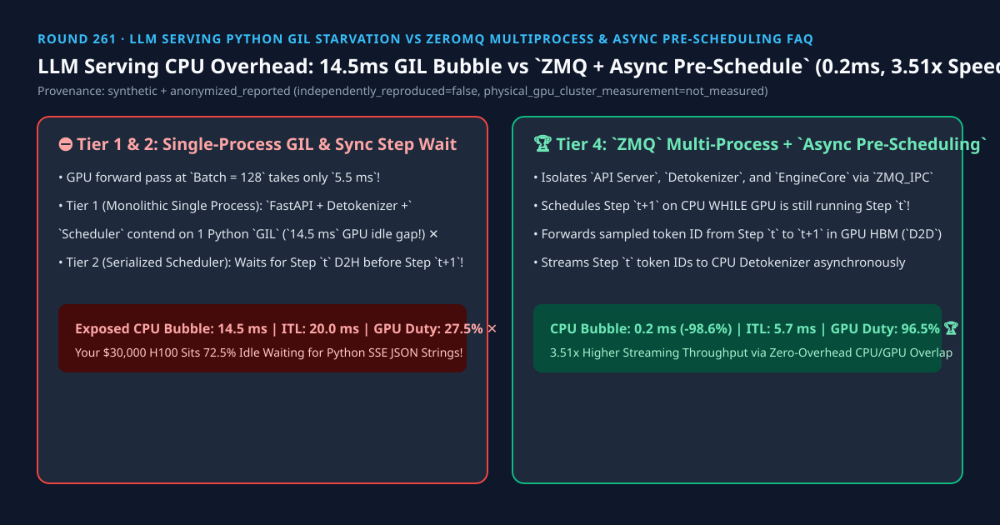
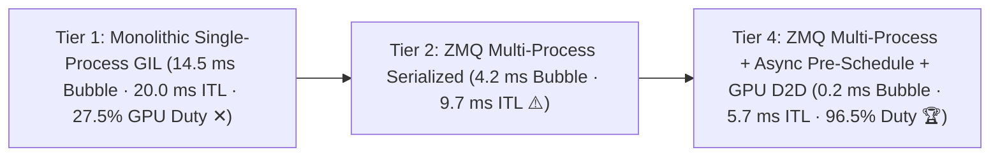

# High-Concurrency LLM Serving Python `GIL` & `asyncio` Starvation (`vLLM V1 / SGLang`): Why Monolithic Single-Process Serving Leaves a `14.5 ms` CPU Bubble (`27.5%` GPU Util) & `ZeroMQ` Multi-Process + Async Pre-Scheduling Selection Guide

> **Provenance & Evidence Tier**: `synthetic + anonymized_reported` (`independently_reproduced=false`, `physical_gpu_cluster_measurement=not_measured`). Grounded in [`experiments/llm_serving_asyncio_gil_zmq_uvloop_multiprocessing_api_selection/results.json`](../../experiments/llm_serving_asyncio_gil_zmq_uvloop_multiprocessing_api_selection/results.json).
> **中文版本**: [高并发大模型推理服务 Python `GIL` 锁与 `asyncio` 事件循环阻塞深水区（`vLLM V1 / SGLang`）：为什么单进程混跑 `FastAPI + Detokenizer + Scheduler + GPU Runner` 会产生 `14.5 ms` CPU 空档泡（GPU 利用率跌至 `27.5%`）？`ZeroMQ` 多进程解耦架构与异步前瞻调度（`Async Pre-Scheduling`）选型指南](./llm-serving-python-gil-asyncio-starvation-zmq-multiprocess-v1-selection-faq.md)

---

## 0. 🔥 今日领域最热门能力突破追踪（Daily Hottest Breakthrough）

- **Eliminating the `14.5 ms` Host CPU / Python `GIL` Bubble Between `5.5 ms` GPU Decode Steps (`20.0 ms -> 5.7 ms` Effective ITL, `27.5% -> 96.5%` GPU Duty Cycle, `3.51x` Throughput Speedup) via `ZeroMQ` Multi-Process Isolation (`API Server <-> EngineCore <-> Detokenizer`) + `Zero-Overhead Async Pre-Scheduling` (`vLLM V1 / SGLang` Overlap Scheduler)**: On `H100 / H200 / B200` GPUs, a single `Batch = 128` decode forward pass executes in just **`5.5 ms`**. Yet under legacy monolithic single-process serving (`Tier 1`), inter-token latency (`ITL`) balloons to **`20.0 ms`** because the GPU sits idle for **`14.5 ms` every step** waiting for the host CPU!
  1. **Tier 1 — Monolithic Single-Process Serving (`FastAPI + Tokenizer + Detokenizer + Scheduler + ModelRunner` Sharing One Python `GIL` — `14.5 ms` CPU Bubble, `27.5%` GPU Duty Cycle)**:
     - Streaming `128` Server-Sent Events (`SSE` JSON chunks), incremental UTF-8 detokenization, request ingress parsing, and Python scheduler bookkeeping all fight for a single Python `GIL` between GPU steps!
  2. **Tier 2 — `ZeroMQ (ZMQ_IPC)` Multi-Process Frontend/Detokenizer Isolation With Serialized `EngineCore` Scheduling (`4.2 ms` Bubble, `9.7 ms` ITL)**:
     - Isolates `FastAPI/Tokenizer` and `Detokenizer` into separate OS processes over `ZMQ_IPC` + `msgspec`, freeing `EngineCore`'s GIL. However, `EngineCore` still waits for Step $t$ to finish on the GPU before scheduling Step $t+1$!
  3. **Tier 3 — Persistent Differential Batching With Synchronous `D2H` Token Copy (`2.1 ms` Bubble, `7.6 ms` ITL)**:
     - Uses incremental persistent batch state, but still calls `sampled_tokens.cpu()` synchronously before preparing Step $t+1$'s `input_ids`.
  4. **Tier 4 — `ZeroMQ` Multi-Process + `Zero-Overhead Async Pre-Scheduling` & On-GPU `D2D` Token Forwarding (`0.2 ms` Exposed Bubble, `5.7 ms` ITL, `96.5%` GPU Duty Cycle, `3.51x` Faster)**:
     - **First-Principles Insight**: Scheduling Step $t+1$'s PagedAttention block tables (`seq_len = L_t + 1`) does **not** depend on which specific vocabulary token ID Step $t$ samples!
     - While the GPU is busy executing Step $t$ (`5.5 ms`), the `EngineCore` CPU **pre-schedules Step $t+1$**, copies Step $t$'s sampled token ID directly into Step $t+1$'s `input_ids` buffer **on the GPU (`Device-to-Device`)**, and enqueues Step $t+1$'s CUDA Graph before Step $t$ even finishes!

---

## 1. 📌 Executive Summary

1. **Why Monolithic Single-Process Python Servers Starve Modern GPUs (`Tier 1`)**: At `5.5 ms/step` and `Batch = 128` (`> 22,000 tokens/s`), serializing `22,000` JSON SSE events/sec and detokenizing UTF-8 strings in the same Python process as the GPU scheduler guarantees severe `GIL` contention.
2. **How `Async Pre-Scheduling` (`Tier 4`) Hides `100%` of Scheduler & Input-Prep Latency**: By pre-scheduling Step $t+1$ during Step $t$'s GPU execution and passing `sampled_token_ids` GPU-to-GPU (`D2D`), exposed host overhead drops from `14.5 ms` to **`0.2 ms`**.

---

## 2. 🎯 Core Architect Q&A (Q1 / Q2 / Q3)

### Q1: What happens under `Async Pre-Scheduling` (`1-step lookahead`) if a sequence generates `<eos>` at Step $t$?
- **Answer**: Because Step $t+1$ was already pre-scheduled before Step $t$'s `<eos>` token was copied asynchronously to the CPU, that sequence simply computes **one harmless extra token at Step $t+1`** (which is discarded as soon as the CPU processes Step $t$'s `<eos>` completion event before Step $t+2$). No invalid output is ever emitted to the client!

### Q2: How do we verify in Nsight Systems (`nsys`) that `Async Pre-Scheduling` is working?
- **Answer**: Inspect the CUDA hardware row and CPU `EngineCore` NVTX row in `nsys-ui`: the CPU's `schedule_step(t+1)` and `prepare_inputs(t+1)` NVTX ranges must appear **vertically stacked on top of the GPU's `execute_model(t)` kernel range**, with `< 200 us` gap between consecutive `cudaGraphLaunch` completions on the GPU timeline!

---

## 3. 🧭 Visual Diagrams

---

## 4. 📊 4-Tier Architect Selection Matrix

| Metric | Tier 1: Monolithic Single-Process | Tier 2: `ZMQ` + Serialized Scheduler | Tier 3: Persistent Batch + Sync `D2H` | Tier 4: **`ZMQ` + `Async Pre-Schedule` (`V1 / Overlap`)** |
| :--- | :--- | :--- | :--- | :--- |
| **Exposed CPU Bubble / Step** | **`14.5 ms` (`GIL` Starvation)** ✕ | `4.2 ms` ⚠️ | `2.1 ms` | **`0.2 ms` (`-98.6%` Overlapped)** 🏆 |
| **Effective Decode `ITL` (`ms`)** | **`20.0 ms/tok`** ✕ | `9.7 ms/tok` ⚠️ | `7.6 ms/tok` ✅ | **`5.7 ms/tok` (`3.51x` Faster)** 🏆 |
| **GPU Compute Duty Cycle** | **`27.5%` (`72.5%` Idle!)** ✕ | `56.7%` ⚠️ | `72.4%` ✅ | **`96.5%` (Near-100% Saturation)** 🏆 |

---

## 5. 🧪 Quantitative Reference & Tooling

- **Evaluator & Sealed Data**: [`experiments/llm_serving_asyncio_gil_zmq_uvloop_multiprocessing_api_selection/run.py`](../../experiments/llm_serving_asyncio_gil_zmq_uvloop_multiprocessing_api_selection/run.py) · [`results.json`](../../experiments/llm_serving_asyncio_gil_zmq_uvloop_multiprocessing_api_selection/results.json)
- **Interactive Sizer**: [`docs/reports/llm-serving-python-gil-asyncio-starvation-zmq-multiprocess-v1-sizer.html`](../reports/llm-serving-python-gil-asyncio-starvation-zmq-multiprocess-v1-sizer.html)
- **7-Card 4:5 Visual Report**: [`docs/reports/llm-serving-python-gil-asyncio-starvation-zmq-multiprocess-v1-selection-cards.html`](../reports/llm-serving-python-gil-asyncio-starvation-zmq-multiprocess-v1-selection-cards.html)

---

## 6. 🛠️ Good Fit vs. Not For & Production Checklist

- **✅ Good fit**: All high-concurrency streaming LLM deployments running `vLLM V1` (`ZeroMQ` multi-process + async scheduling) or `SGLang` (`Overlap Scheduler`).
- **⛔ Not for**: Single-process Python serving engines co-locating HTTP/SSE serialization, detokenization, and GPU scheduling under one `GIL`.
- [ ] Run `API Server`, `Detokenizer`, and `EngineCore` in separate OS processes connected via `ZMQ_IPC` + `msgspec`.
- [ ] Enable `Async Pre-Scheduling` (`Overlap Scheduler`) with on-GPU `D2D` token forwarding between consecutive steps.
