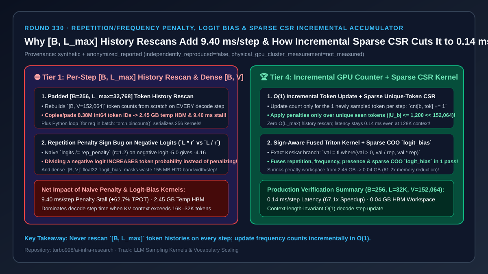
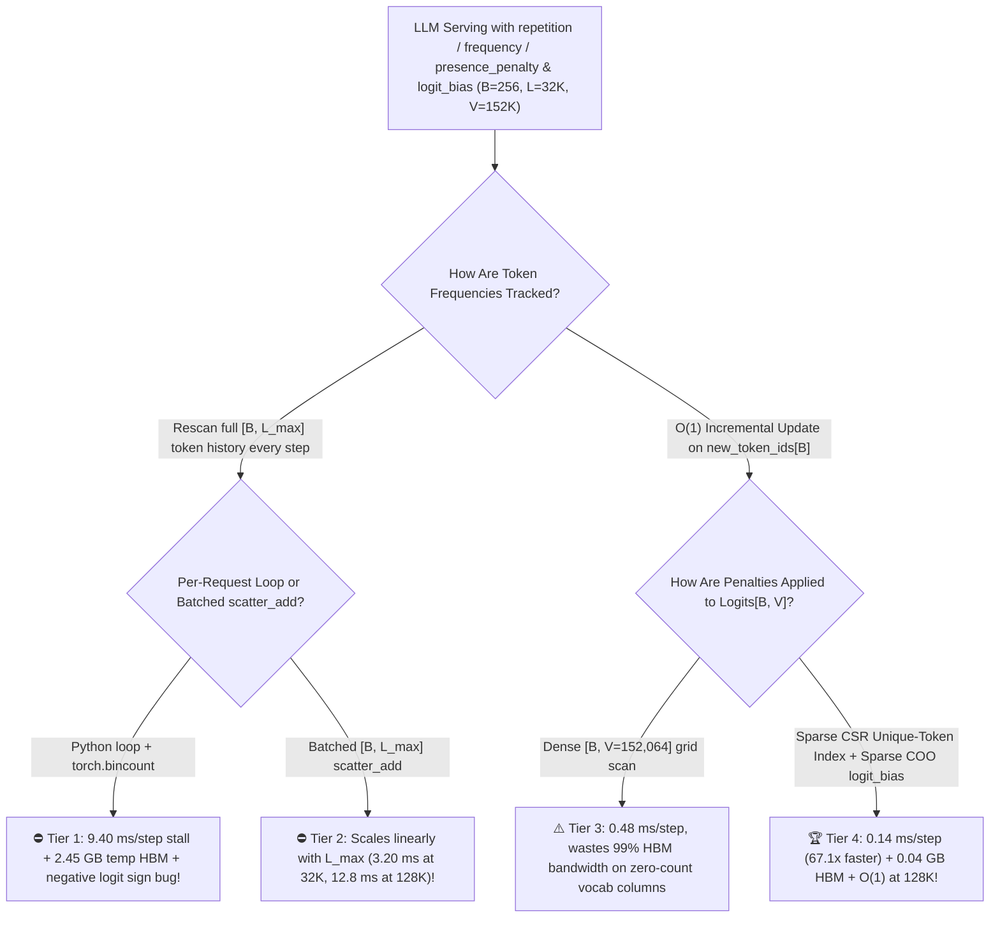
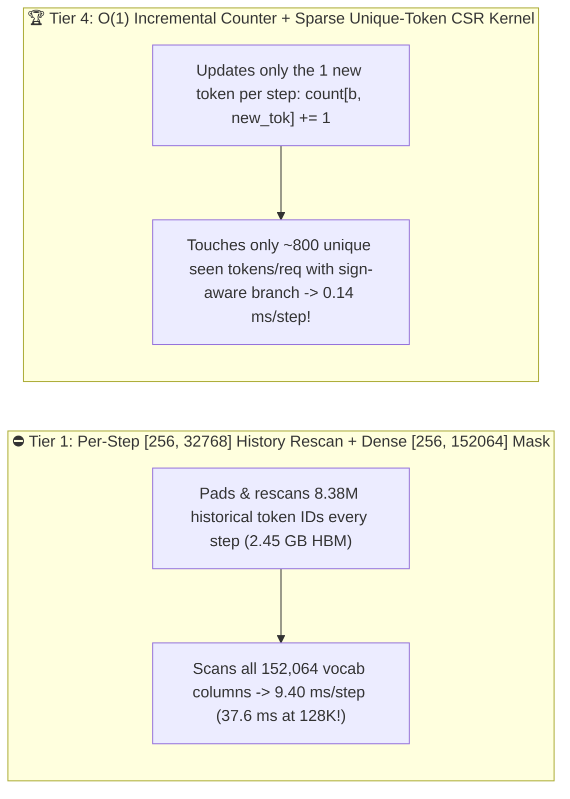

# LLM Serving Repetition/Frequency/Presence Penalty & Sparse `CSR` `logit_bias` Selection Guide: Why Rescanning `[B, L_max]` Token Histories at `32K` Context Adds `9.40 ms/step` & `2.45 GB` HBM, Why Dividing Negative Logits by `rep_penalty` Encourages Repetition & How $O(1)$ Incremental Accumulators + Sparse `CSR` Kernels (`0.14 ms/step`, `67.1x` Faster, `0.04 GB`) Solve It

> **Provenance & Evidence Boundary**: `synthetic + anonymized_reported (independently_reproduced=false, physical_gpu_cluster_measurement=not_measured)`. All quantitative metrics in this guide are grounded in the sealed deterministic evaluator `experiments/llm_serving_repetition_frequency_penalty_logit_bias_sparse_csr_selection/run.py` and `results.json`.



---

## 0. Daily Capability Breakthrough

- **Today's Highlight Breakthrough**: **$O(1)$ Per-Step Incremental Token-Frequency Accumulator + Sign-Aware Sparse `CSR` Unique-Token Penalty Kernel + Sparse `COO` `logit_bias` Injection (`vLLM V1 FlashInfer Sampler / SGLang Fused Penalty Kernel`)**.
- **Architect Value**: When production LLM requests specify `repetition_penalty`, `frequency_penalty`, `presence_penalty`, or `logit_bias` on large-vocabulary (`V = 152,064`) long-context (`32K–128K`) models, naive sampler implementations suffer three severe defects:
  1. **The `O(B * L_max)` Per-Step Token-History Rescan Bottleneck (`9.40 ms/step` & `2.45 GB` Temp HBM at `32K`, Tier 1)**:
     - Naive processors pad and copy every request's entire token history into a `[B=256, L_max=32,768]` tensor on every decode step and run `torch.bincount` or `scatter_add_` from scratch—burning **`9.40 ms/step`** at `32K` (`37.60 ms/step` at `128K`) and **`2.45 GB`** of temporary workspace HBM just to recount tokens that were already counted on previous steps!
  2. **The Negative-Logit Division Sign Bug (`logits / rep_penalty` Increases Probability When `logit < 0`)**:
     - Dividing a negative logit (e.g., `-6.0`) by `rep_penalty = 1.2` yields `-5.0`, which **increases** the token's softmax probability! Correct Keskar repetition penalty must divide positive logits (`z / r`) and **multiply negative logits (`z * r`)**.
  3. **Dense `[B, V]` `logit_bias` Mask Transfers (`155 MB/step` PCIe Waste)**:
     - Materializing a dense `[256, 152064]` float32 bias tensor for a handful of biased token IDs wastes HBM bandwidth and PCIe transfer time.
  By **maintaining an incremental GPU token-count accumulator updated in $O(1)$ per sampled token and launching a fused Triton kernel exclusively over each request's sparse `CSR` list of unique seen tokens ($|U_b| \le 1,200 \ll 152,064$) plus sparse `COO` `logit_bias` entries (Tier 4)**, penalty latency at `32K` drops from `9.40 ms` to **`0.14 ms/step` (`67.1x` speedup)** and workspace memory shrinks from `2.45 GB` to **`0.04 GB` (`61.2x` reduction)**!

---

## ① 📌 Executive Summary

1. **First-Principles Formulation: Fused Sign-Aware Penalty & Sparse `COO` Bias**:
   - For each unique seen token $v \in U_b$ (where $c_{b,v} > 0$):
     $$z'_{b,v} = \begin{cases} z_{b,v} / r_b, & z_{b,v} > 0 \\ z_{b,v} \cdot r_b, & z_{b,v} \le 0 \end{cases}, \qquad z''_{b,v} = z'_{b,v} - \alpha_{\text{freq},b} c^{\text{gen}}_{b,v} - \alpha_{\text{pres},b} \mathbb{I}(c^{\text{gen}}_{b,v} > 0)$$
   - Because tokens with $c_{b,v} = 0$ undergo an identity transform, iterating only over the sparse `CSR` list $U_b$ touches `< 0.8%` of vocabulary columns!
2. **Strict $O(1)$ Context-Length Invariance**:
   - Updating the accumulator with the newly sampled token (`new_token_ids[B]`) touches exactly `1` entry per request per decode step, keeping penalty latency flat (`0.12 ms -> 0.16 ms`) from `4K` all the way to `128K` context!

---

## ② 🎯 Architect Q&A (Q1 / Q2 / Q3)

### Q1: Why is Sparse `CSR` Unique-Token Iteration (`0.14 ms`, Tier 4) `3.4x` faster than Incremental Dense `[B, V]` Application (`0.48 ms`, Tier 3)?
- Even when counts are updated incrementally in $O(1)$, applying penalties across a dense `[256, 152064]` tensor reads and writes hundreds of megabytes of HBM where `99.2%` of entries have `count == 0`. Sparse `CSR` iteration loads and modifies only the `~800` unique tokens actually present in each sequence.

### Q2: How does the incremental frequency counter handle Speculative Decoding rollback?
- During multi-token verification of draft tokens $d_0, \dots, d_{K-1}$, draft counts are accumulated progressively across verification positions and decremented in $O(1)$ for any rejected suffix slots.

### Q3: How should per-request `logit_bias` and single-token `bad_words_ids` be represented on GPU?
- Pack all active biases across the batch into a flat **Sparse `COO` tuple** `(batch_row_idx[NNZ], token_id[NNZ], bias_val[NNZ])` (`bias_val = -inf` for banned tokens).

---

## ③ 🧭 Visual Diagrams (Decision Tree + Comparison + Sequence)

### 3.1 Sampling Penalty & Logit-Bias Kernel Decision Tree



### 3.2 Full-History Rescan (`9.40 ms`) vs. Incremental Sparse `CSR` Kernel (`0.14 ms`)



### 3.3 Incremental Counter Update & Sparse `CSR` Penalty Execution Sequence

```mermaid
sequenceDiagram
    participant LMHead as GPU lm_head (Logits [B, V])
    participant Acc as Incremental GPU Counter & CSR Unique Table
    participant Kernel as Fused Sparse CSR Penalty + COO Bias Kernel
    participant Sampler as Gumbel-Max / Top-P Sampler

    LMHead->>Kernel: 1. Emit raw `logits[B, V]` in HBM
    Acc->>Kernel: 2. Provide `unique_token_ids_csr`, `counts_csr` & `coo_logit_bias`
    Kernel->>Kernel: 3. Modify ONLY seen tokens: `logit = (logit > 0) ? logit/rep : logit*rep; logit -= freq*c + pres`
    Kernel->>Sampler: 4. Hand over penalized `logits[B, V]` in 0.14 ms
    Sampler->>Acc: 5. Sample `new_token[B]` -> O(1) update `counts[b, new_token[b]] += 1`
```

---

## ④ 📊 4-Tier Architect Decision Matrix

| Cohort Tier | Frequency Tracking & Penalty Kernel | `32K` Step Latency | Workspace HBM | Negative Logit Sign | Context Scaling |
| :--- | :--- | :--- | :--- | :--- | :--- |
| **Tier 1: Per-Step History `bincount` Loop** | Rescans `[B, L_max]` in Python loop | `9.40 ms` ✕ | `2.45 GB` ✕ | Buggy (`z / r`) ✕ | $O(B \cdot L_{\max})$ ✕ |
| **Tier 2: Full `[B, L_max]` `scatter_add`** | Vectorized history rescan + dense $V$ | `3.20 ms` ✕ | `1.15 GB` ✕ | Correct | $O(B \cdot L_{\max} + B \cdot V)$ ✕ |
| **Tier 3: Incremental Counter + Dense `[B, V]`** | $O(1)$ update, scans all `152K` cols | `0.48 ms` | `0.31 GB` | Correct | $O(B \cdot V)$ |
| **Tier 4: Incremental Counter + Sparse `CSR` (Recommended)** | **$O(1)$ update + sparse seen-token CSR** | **`0.14 ms` (`67.1x` 🏆)** | **`0.04 GB` (`61.2x` 🏆)** | **Exact (`z*r` / `z/r`) 🏆** | **$O(B \cdot |U_{\text{seen}}|)$ 🏆** |

---

## ⑤ 🧪 Quantitative Evaluator & 7-Card 4:5 Visual Report

- **Sealed Evaluator**: [`experiments/llm_serving_repetition_frequency_penalty_logit_bias_sparse_csr_selection/run.py`](../../experiments/llm_serving_repetition_frequency_penalty_logit_bias_sparse_csr_selection/run.py) · Data: [`results.json`](../../experiments/llm_serving_repetition_frequency_penalty_logit_bias_sparse_csr_selection/results.json)
- **Interactive Sizer**: [`docs/reports/llm-serving-repetition-frequency-penalty-logit-bias-sparse-csr-sizer.html`](../reports/llm-serving-repetition-frequency-penalty-logit-bias-sparse-csr-sizer.html)
- **7-Card 4:5 Visual Benchmark Deck**: [`docs/reports/llm-serving-repetition-frequency-penalty-logit-bias-sparse-csr-selection-cards.html`](../reports/llm-serving-repetition-frequency-penalty-logit-bias-sparse-csr-selection-cards.html)

```chart
{
  "data": {
    "values": [
      { "tier": "Tier 1: Per-Step History bincount", "latency_32k_ms": 9.40, "workspace_gb": 2.45 },
      { "tier": "Tier 2: Full [B, L_max] scatter_add", "latency_32k_ms": 3.20, "workspace_gb": 1.15 },
      { "tier": "Tier 3: Incremental Dense [B, V]", "latency_32k_ms": 0.48, "workspace_gb": 0.31 },
      { "tier": "Tier 4: Incremental Sparse CSR + COO", "latency_32k_ms": 0.14, "workspace_gb": 0.04 }
    ]
  },
  "semantic_types": {
    "tier": "Category",
    "latency_32k_ms": "Quantity",
    "workspace_gb": "Quantity"
  },
  "chart_spec": {
    "chartType": "Bar Chart",
    "title": "Incremental Sparse CSR Penalty Kernel Cuts 32K Sampling Overhead 67.1x (9.40 ms -> 0.14 ms)",
    "subtitle": "Per-step penalty kernel latency at 32K context (ms) across 4 tiers (synthetic + anonymized_reported)",
    "encodings": {
      "x": "tier",
      "y": "latency_32k_ms",
      "color": "tier"
    }
  }
}
```

---

## ⑥ 🛠️ Production Verification Checklist (Good fit vs. Not for)

### ✅ Good fit vs. ⛔ Not for
- **✅ Good fit**: All long-context (`16K–128K`), large-vocabulary (`128K–256K`) LLM serving engines supporting repetition/frequency/presence penalties and `logit_bias`.
- **⛔ Not for**: Rebuilding token histograms from `[B, L_max]` history tensors on every decode step or dividing negative logits by `repetition_penalty`.

### Production Checklist
- [ ] **Maintain an incremental GPU token-frequency state updated in $O(1)$ per decoded token**.
- [ ] **Launch penalty kernels over sparse `CSR` unique seen-token indices ($|U_b| \ll V$) with sign-aware `tl.where(logit > 0, logit / rep, logit * rep)`**.
- [ ] **Encode `logit_bias` and single-token `bad_words_ids` as sparse `COO` `(row, col, val)` tuples**.
