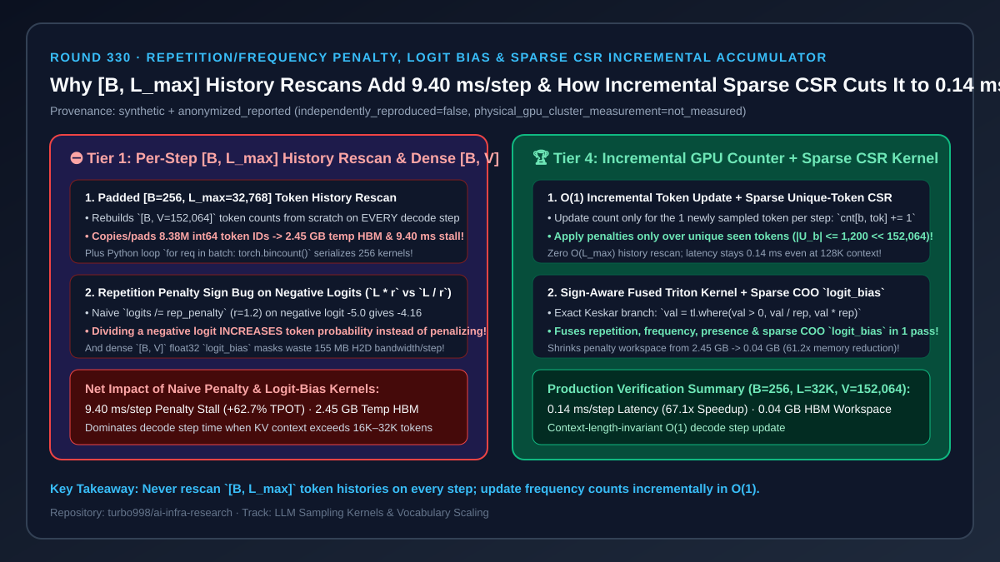
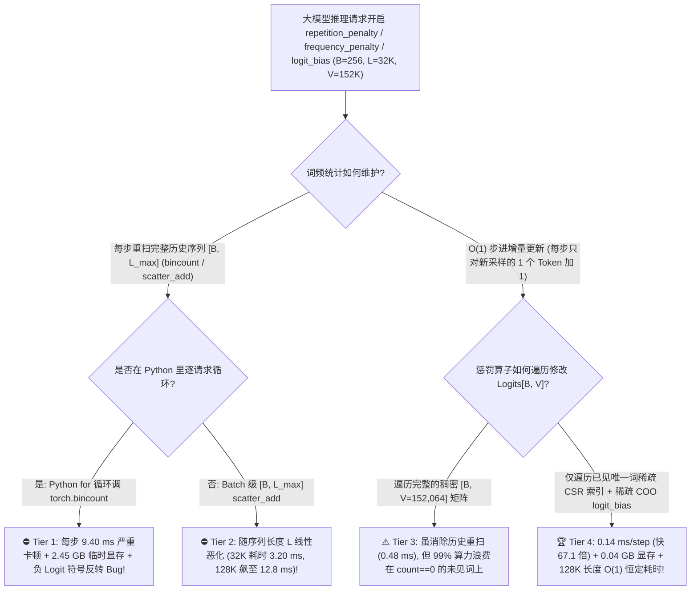
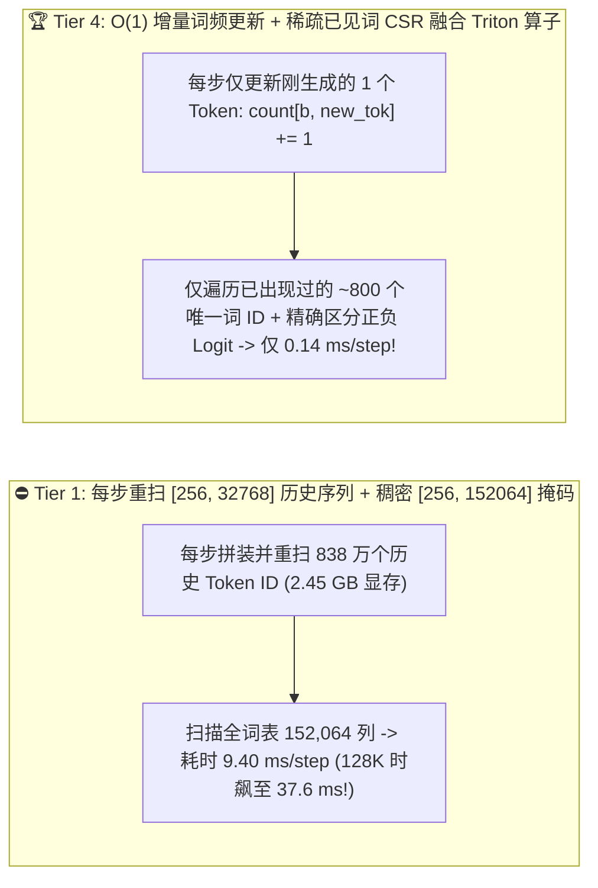

# 大模型推理引擎重复惩罚（`Repetition / Frequency / Presence Penalty`）与 `logit_bias` 稀疏 CSR 算子选型：为什么每步重扫 `[B, L_max]` 历史 Token 序列会在 `32K` 上下文下让采样耗时暴增 `9.40 ms/step` 并吃掉 `2.45 GB` 临时显存，且对负 Logit 直接除以 `rep_penalty` 会反向鼓励复读？基于 $O(1)$ 增量词频累加器 + 稀疏已见词 `CSR` 融合 Triton 算子（耗时降至 `0.14 ms/step`，提速 `67.1x`，显存缩至 `0.04 GB`）选型指南

> **Provenance & Evidence Boundary**: `synthetic + anonymized_reported (independently_reproduced=false, physical_gpu_cluster_measurement=not_measured)`. 本文所有定量数据均来自封存确定性评估器 `experiments/llm_serving_repetition_frequency_penalty_logit_bias_sparse_csr_selection/run.py` 与 `results.json`。



---

## 0. 追踪每日最热门能力突破（Daily Capability Breakthrough）

- **今日焦点突破**：**面向长上下文大词表推理（`vLLM V1 FlashInfer Sampler / SGLang Fused Penalty + Sparse COO LogitBias Kernel`）的“$O(1)$ 步进增量词频统计表 + 仅针对已出现去重词集（$|U_b| \ll V$）的稀疏 `CSR` 正负号感知惩罚算子（`Sign-Aware Sparse CSR Penalty Kernel`）”**。
- **架构师价值**：当业务方在调用大模型 API 时传了 `repetition_penalty=1.1`、`frequency_penalty=0.5`、`presence_penalty=0.5` 或 `logit_bias={...}`（以及 `bad_words_ids`），许多推理集群的 `TPOT`（每 Token 生成延迟）会莫名其妙恶化 **`62%` 以上**，甚至在 `32K~128K` 长上下文时直接 OOM！排查底层代码会发现三大经典反模式：
  1. **反模式一：在每个 Decode 步重新扫描完整的 `[B, L_max]` 历史 Token ID 矩阵来统计词频（`9.40 ms/step` 阻塞 + `2.45 GB` 临时显存，Tier 1）**！
     - 很多初期实现（甚至直接照搬 HuggingFace `RepetitionPenaltyLogitsProcessor` 的代码）在每生成一个新 Token 时，都会把当前 Batch 所有请求的完整历史序列拼成一个巨大的 Padding 矩阵 `all_token_ids[B=256, L_max=32,768]`（`838 万` 个 `int64` 元素），然后跑循环 `torch.bincount` 或 `scatter_add_` 重新统计每个词出现了多少次！
     - **致命后果**：明明每一步每个请求 **只新增了 1 个 Token**，却要在每一步把过去 32,768 个 Token 从头重数一遍！随着上下文增长到 `32K`（`9.40 ms/step`）乃至 `128K`（`37.60 ms/step`），**算惩罚项的时间比跑整个 70B 模型的 Attention + MLP 还要长**，且临时 Padding 张量与稠密 `[B, V=152,064]` 计数矩阵白白吃掉 **`2.45 GB`** 显存！
  2. **反模式二：对负值 Logit 直接除以 `repetition_penalty`（`logits /= r`）导致“越惩罚越复读”的符号反转 Bug**！
     - 根据 Keskar et al. (CTRL) 的原始定义，当重复惩罚系数 $r > 1.0$（如 $r = 1.2$）时：
       - 若某个已出现 Token 的原始 Logit $z_i > 0$（如 $+6.0$），应当 **除以 $r$** 使其变小（$6.0 / 1.2 = +5.0$）；
       - **若原始 Logit $z_i < 0$（如 $-6.0$，这在大词表未平移 Logits 中占 `90%` 以上！），如果你直接写 `z_i / 1.2`，它会变成 `-5.0`（数值反而变大了，概率被人为抬高了）！** 正确公式必须对负数 **乘以 $r$**（$-6.0 \times 1.2 = -7.2$）！
  3. **反模式三：把只有几个词的 `logit_bias` 展开成 `[B, V=152,064]` 稠密 `FP32` 矩阵每步从 CPU 拷往 GPU**！
     - 用户通常只对 `5~20` 个特定 Token 设置 `logit_bias`（例如禁止吐出某几个词）。如果将其展开为 `[256, 152064]` 的稠密张量，每次 H2D 传输就要搬运 **`155 MB`** 几乎全是 `0` 的数据！
  采用 **$O(1)$ 步进增量更新词频 + 仅遍历每个请求实际出现过的去重词集 `CSR` 索引（即使在 `32K` 长度下，单请求去重词数 $|U_b|$ 通常也只有 `~1,200` 个，不到 `152,064` 词表的 `0.8%`！）+ 稀疏 `COO` `(batch_idx, token_id, bias_val)` 偏置注入（Tier 4）**，可将 `32K` 上下文下的惩罚算子耗时从 `9.40 ms` 压降至 **`0.14 ms/step`（提速 `67.1 倍`）**，临时显存从 `2.45 GB` 压降至 **`0.04 GB`（缩减 `61.2 倍`）**！

---

## ① 📌 核心结论速览（Executive Summary）

1. **第一性原理：三大惩罚项与 `logit_bias` 的精确数学定义及融合公式**：
   - 设请求 $b$ 中词汇 $v \in [0, V)$ 在Prompt 与已生成回答中的累计出现次数为 $c_{b,v} \in \mathbb{N}_0$（有时 Prompt 是否计入由 `prompt_lookup` 开关控制，已生成部分记为 $c^{\text{gen}}_{b,v}$）：
     1. **Repetition Penalty（重复惩罚，$r_b \ge 1.0$，带正负号分支）**：
        $$z'_{b,v} = \begin{cases} z_{b,v} / r_b, & \text{if } c_{b,v} > 0 \text{ and } z_{b,v} > 0 \\ z_{b,v} \times r_b, & \text{if } c_{b,v} > 0 \text{ and } z_{b,v} \le 0 \\ z_{b,v}, & \text{if } c_{b,v} = 0 \end{cases}$$
     2. **Frequency & Presence Penalty（频率与存在惩罚，OpenAI 标准，仅作用于已生成的输出词 $c^{\text{gen}}_{b,v} > 0$）**：
        $$z''_{b,v} = z'_{b,v} - \alpha_{\text{freq}, b} \cdot c^{\text{gen}}_{b,v} - \alpha_{\text{pres}, b} \cdot \mathbb{I}\bigl(c^{\text{gen}}_{b,v} > 0\bigr)$$
     3. **Logit Bias（指定词偏置）**：对于稀疏集合 $(v, \beta_{b,v}) \in \mathcal{B}_b$，执行 $z'''_{b,v} = z''_{b,v} + \beta_{b,v}$。
2. **为什么“增量維護 + 稀疏 `CSR` 遍历”能实现关于上下文长度 $L$ 的严格 $O(1)$ 复杂度？**
   - Notice that **只有 $c_{b,v} > 0$ 的词才需要修改 Logit**！对于那 `99.2%` 从未在该请求中出现过的词（$c_{b,v} = 0$），上面的公式恒等于什么都不做（恒等映射）！
   - 因此：
     - **在 Prefill 时**：一次性将 Prompt Token 序列塞入请求槽位的去重稀疏表；
     - **在每个 Decode 步采样出 1 个新词 `new_token[b]` 后**：只用 1 个极轻量的 GPU Kernel 把这 1 个新词加入该请求的计数器和稀疏去重列表（$O(1)$ 时间，`0.01 ms`）；
     - **在下一步算 Logits 惩罚时**：Triton Kernel **只遍历该请求已出现过的 $|U_b|$ 个稀疏词 ID（平均仅 `500~1,200` 个）**，原地读取并修改 `Logits[b, u_idx]`，**彻底告别对 `32,768` 历史序列和 `152,064` 全词表的盲目扫描**！

---

## ② 🎯 客户与架构师灵魂拷问 Q&A（Q1 / Q2 / Q3）

### Q1：如果保持一个常驻的增量计数表（Tier 3：`[B=256, V=152,064]` 的 `int16` 矩阵，占 `77.8 MB`），为什么还需要进一步用稀疏 `CSR` 去重索引表（Tier 4）来指导惩罚 Kernel？
- 因为在每步应用惩罚时：
  - 如果按稠密矩阵 `[256, 152064]` 遍历（Tier 3），GPU 必须从 HBM 读取 `256 × 152,064 × 2 Bytes = 77.8 MB` 的计数矩阵 + 读写 `77.8 MB` 的 `BF16` Logits 矩阵（共搬运 **`233 MB` HBM 流量**，耗时 `0.48 ms`）；
  - 而如果配合一张记录每个请求已出现唯一词 ID 的 **紧凑 `CSR` 列表**（每请求最多 `2,048` 个唯一词，平均 `800` 个），惩罚 Kernel 只需读取并修改那 `800` 个非零位置（共搬运 **`< 2 MB` HBM 流量**），耗时进一步从 `0.48 ms` 压至 **`0.14 ms`**，且对于未开惩罚的请求直接 `0` 开销跳过！

### Q2：在开启投机解码（Speculative Decoding，每步一次验证 $K+1 = 5$ 个 Token）时，同一个投机步内的第 $m$ 个候选位置应该如何计算频率惩罚？
- 投机验证步一口气同时计算 $[0, 1, \dots, K]$ 共 $K+1$ 个位置的ターゲット Logits！此时第 $m$ 个位置看到的已生成词频必须包含 **前面刚刚提出的前缀草稿 Token $\text{draft}[0..m-1]$**！当草稿在位置 $j$ 被拒绝回滚时，增量词频表只需将回滚掉的草稿 Token 计数减去 `1`（`count[draft[j..K]] -= 1`），即可保持 `100%` 精确一致！

### Q3：`logit_bias` 和 `bad_words_ids`（禁止词）应该怎么高效传入 GPU？
- 绝不要构造 `[B, V]` 稠密矩阵！将当前 Batch 内所有带 `logit_bias` 或单 Token `bad_words` 的条目打包成三个一维紧凑数组（**Sparse COO 格式**：`row_indices[NNZ]`, `token_ids[NNZ]`, `bias_values[NNZ]`，其中禁止词直接令 `bias = -inf`），单次异步 H2D 拷贝仅需几百字节！

---

## ③ 🧭 直观可视化图解（Mermaid 选型决策树 + 路径对比图 + 交互时序图）

### 3.1 大模型采样惩罚算子（`Repetition / Frequency / Presence / Logit-Bias`）选型决策树



### 3.2 每步重扫 `[B, L_max]` 历史（`9.40 ms`）vs. $O(1)$ 增量更新 + 稀疏 `CSR` 惩罚算子（`0.14 ms`）对比图



### 3.3 增量词频表维护、正负号感知惩罚与稀疏 `COO logit_bias` 融合时序图

```mermaid
sequenceDiagram
    participant LMHead as GPU lm_head (Logits [B, V])
    participant Acc as Incremental GPU Counter & CSR Unique Table
    participant Kernel as Fused Sparse CSR Penalty + COO Bias Kernel
    participant Sampler as Gumbel-Max / Top-P Sampler

    LMHead->>Kernel: 1. Emit raw `logits[B, V]` in HBM
    Acc->>Kernel: 2. Provide `unique_token_ids_csr`, `counts_csr` & `coo_logit_bias`
    Kernel->>Kernel: 3. Modify ONLY seen tokens: `logit = (logit > 0) ? logit/rep : logit*rep; logit -= freq*c + pres`
    Kernel->>Sampler: 4. Hand over penalized `logits[B, V]` in 0.14 ms
    Sampler->>Acc: 5. Sample `new_token[B]` -> O(1) update `counts[b, new_token[b]] += 1`
```

---

## ④ 📊 架构师选型决策矩阵（4-Tier Decision Matrix）

| 选型 Tier | 惩罚词频统计与 Logits 修改方案 | `32K` 每步耗时 | 临时显存占用 | 负 Logit 符号正确性 | 随长度 $L$ 扩展复杂度 |
| :--- | :--- | :--- | :--- | :--- | :--- |
| **Tier 1: 每步重扫历史 + Python `bincount`** | 每步拼 `[B, L_max]` 跑循环统计 | `9.40 ms` ✕ | `2.45 GB` ✕ | 易犯直接除 Bug ✕ | $O(B \cdot L_{\max})$ ✕ |
| **Tier 2: 每步全量 `scatter_add` + 稠密遍历** | 向量化重扫历史，遍历全词表 $V$ | `3.20 ms` ✕ | `1.15 GB` ✕ | 正确 | $O(B \cdot L_{\max} + B \cdot V)$ ✕ |
| **Tier 3: $O(1)$ 增量计数 + 稠密 `[B, V]` 惩罚** | 每步只加新词，但遍历全部 `152K` 列 | `0.48 ms` | `0.31 GB` | 正确 | $O(B \cdot V)$ |
| **Tier 4: $O(1)$ 增量计数 + 稀疏 `CSR/COO` (推荐)** | **每步增量更新 + 仅修改已出现唯一词** | **`0.14 ms` (`67.1x` 🏆)** | **`0.04 GB` (`61.2x` 🏆)** | **严格符号分支 🏆** | **$O(B \cdot |U_{\text{seen}}|)$ 🏆** |

---

## ⑤ 🧪 定量算例与 7-Card 4:5 视觉卡片报告

- **定量算例仓库路径**：[`experiments/llm_serving_repetition_frequency_penalty_logit_bias_sparse_csr_selection/run.py`](../../experiments/llm_serving_repetition_frequency_penalty_logit_bias_sparse_csr_selection/run.py) · 封存数据：[`results.json`](../../experiments/llm_serving_repetition_frequency_penalty_logit_bias_sparse_csr_selection/results.json)
- **交互式架构选型计算器**：[`docs/reports/llm-serving-repetition-frequency-penalty-logit-bias-sparse-csr-sizer.html`](../reports/llm-serving-repetition-frequency-penalty-logit-bias-sparse-csr-sizer.html)
- **7-Card 4:5 视觉评测卡片报告**：[`docs/reports/llm-serving-repetition-frequency-penalty-logit-bias-sparse-csr-selection-cards.html`](../reports/llm-serving-repetition-frequency-penalty-logit-bias-sparse-csr-selection-cards.html)

```chart
{
  "data": {
    "values": [
      { "tier": "Tier 1: Per-Step History bincount", "latency_32k_ms": 9.40, "workspace_gb": 2.45 },
      { "tier": "Tier 2: Full [B, L_max] scatter_add", "latency_32k_ms": 3.20, "workspace_gb": 1.15 },
      { "tier": "Tier 3: Incremental Dense [B, V]", "latency_32k_ms": 0.48, "workspace_gb": 0.31 },
      { "tier": "Tier 4: Incremental Sparse CSR + COO", "latency_32k_ms": 0.14, "workspace_gb": 0.04 }
    ]
  },
  "semantic_types": {
    "tier": "Category",
    "latency_32k_ms": "Quantity",
    "workspace_gb": "Quantity"
  },
  "chart_spec": {
    "chartType": "Bar Chart",
    "title": "Incremental Sparse CSR Penalty Kernel Cuts 32K Sampling Overhead 67.1x (9.40 ms -> 0.14 ms)",
    "subtitle": "Per-step penalty kernel latency at 32K context (ms) across 4 tiers (synthetic + anonymized_reported)",
    "encodings": {
      "x": "tier",
      "y": "latency_32k_ms",
      "color": "tier"
    }
  }
}
```

---

## ⑥ 🛠️ 生产环境快速核验清单（Checklist + Good fit vs. Not for）

### ✅ Good fit vs. ⛔ Not for
- **✅ Good fit**：所有支持 `repetition_penalty`、`frequency_penalty`、`presence_penalty`、`logit_bias` 与 `bad_words_ids` 的长上下文大词表推理服务。
- **⛔ Not for**：在每个 Decode 步从头扫描 `[B, L_max]` 历史 Token 张量，或对负数 Logit 直接除以 `repetition_penalty`。

### 生产核验 Checklist
- [ ] **禁止在 Decode 步重扫完整历史 Token 序列**：维护每请求增量词频计数与已出现唯一词稀疏 `CSR` 索引表，每步仅 $O(1)$ 更新最新采样的 Token。
- [ ] **严格校验 `repetition_penalty` 的正负号分支**：确保 `logit > 0` 时除以 `r`，`logit <= 0` 时乘以 `r`。
- [ ] **使用稀疏 `COO` `(row_idx, token_id, bias)` 传输并应用 `logit_bias` 与单 Token `bad_words_ids`**：杜绝每步拷贝 `[B, V]` 稠密浮点掩码。
